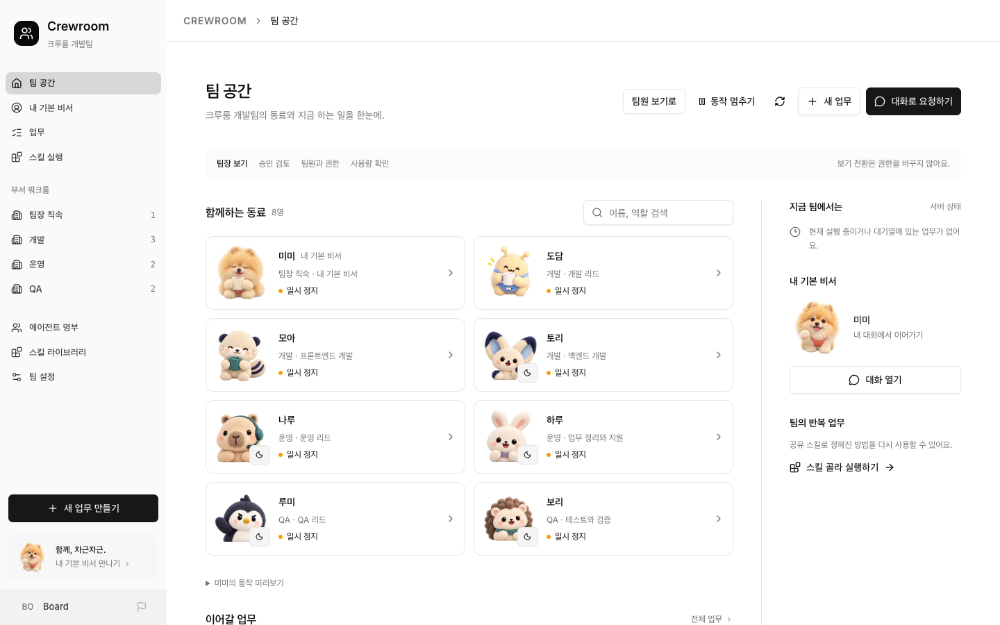
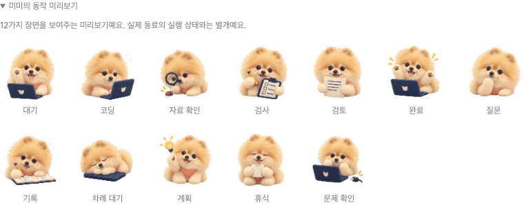
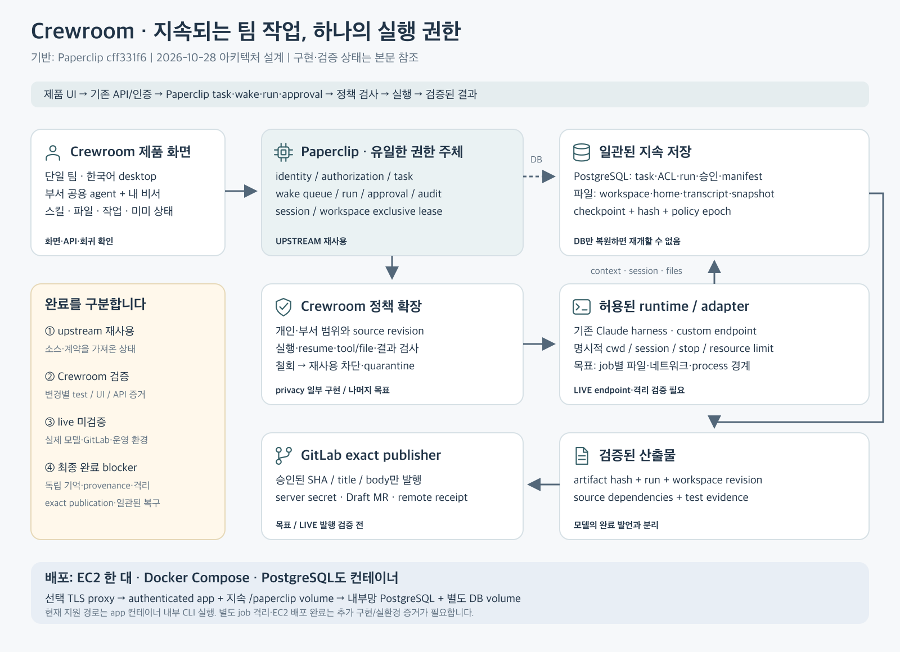

# Crewroom

Crewroom은 [Paperclip](https://github.com/paperclipai/paperclip) 전체 소스를 기반으로 만든 한국어 팀 에이전트 작업 공간입니다. 팀 명부, 개인 대화, 업무, 실행 기록, 승인, 파일과 스킬은 하나의 Paperclip 실행 체계를 사용합니다.



격리된 로컬 API를 읽은 실제 화면입니다. 초기 동료는 연결 준비를 위해 일시 정지한 상태이며 실제 모델 실행 결과가 아닙니다. [작업방](doc/crewroom/media/workroom.png) · [개인 대화](doc/crewroom/media/private-chat.png) · [내 기본 비서](doc/crewroom/media/personal.png) · [스킬](doc/crewroom/media/skills.png) · [화면·샘플 구분과 캡처 기록](doc/crewroom/MEDIA.ko.md)

[아키텍처와 구현 경계](doc/crewroom/ARCHITECTURE.ko.md) · [리뷰 및 검증 기록](doc/crewroom/REVIEW.ko.md) · [EC2 배포 안내](doc/crewroom/DEPLOYMENT.ko.md)

## 제품에서 할 수 있는 일

- 직속·개발·운영·QA 명부에서 담당자를 찾고, 실제 업무와 실행 상태를 확인합니다.
- 팀장 보기와 팀원 보기, 사용자별 기본 비서를 선택합니다. 이 선택은 화면과 개인 선호이며 권한을 부여하지 않습니다.
- 같은 에이전트와 대화를 이어갑니다. 대화 지침은 명확한 실행 요청에 일반 업무를 생성·배정하고, 질문과 아이디어는 대화로 다루도록 구성합니다. 실제 모델의 의도 해석·실행 품질은 연결 후 별도로 검증해야 합니다.
- 업무별 댓글과 작업방에서 결과 확인·피드백·수정 요청을 이어갑니다. 완료한 업무는 의견만 저장하거나 같은 업무에 수정을 요청하는 흐름으로 구분합니다.
- 업무·파일·팀 스킬을 기존 API로 조회하고, 권한이 허용된 담당자에게 업무를 생성·배정합니다. 스킬 요청은 일반 업무와 버전 참조를 남깁니다.
- 12종 캐릭터와 상태별 작업 모션, 동작 감소 설정을 제공합니다. 실행 애니메이션은 관측된 실제 실행 상태를 따릅니다.

개인 대화는 인증 사용자에게 귀속된 private issue로 생성합니다. 공개된 과거 대화는 명시적으로 비공개 전환하기 전 개인 대화로 계속 사용할 수 없습니다. 부서 명칭과 기본 비서 설정은 ACL이나 독립된 개인 메모리 경계가 아닙니다. 원본 관리 화면과 실행·승인·감사 기능도 유지합니다. 전체 upstream 화면을 한국어로 번역한 제품은 아닙니다.

명시적인 미미 동작 샘플입니다. 실제 동료의 업무 실행을 나타내지 않습니다.



## 아키텍처



에이전트의 이름·역할·설정과 업무 이력은 서버에 유지됩니다. 실행 요청이 승인되면 기존 Paperclip 실행 체계가 해당 업무의 작업공간과 세션을 준비하고 구성된 adapter를 실행합니다. 기본 구성은 Claude CLI harness이며 파일·코드·명령 실행을 지원합니다. 에이전트마다 Docker를 계속 띄우는 방식은 아니며, 기본 배포는 앱과 PostgreSQL 컨테이너로 구성합니다.

업무 메타데이터·권한·댓글·실행 상태는 PostgreSQL, 실제 파일·에이전트 home·세션 자료는 앱의 지속 볼륨에 저장합니다. 대화, 공용 에이전트의 home, 업무 작업공간, 모델 세션은 각각 수명과 접근 범위가 다릅니다. [구현된 경계와 목표 설계](doc/crewroom/ARCHITECTURE.ko.md)를 함께 확인하세요.

## 격리된 로컬 실행

Node.js 24.11+, pnpm 9+, Git이 필요합니다. 전체 빌드에는 `packages/paperclip-runner/rust-toolchain.toml`에 고정한 Rust toolchain도 사용합니다.

```sh
pnpm install --frozen-lockfile
node scripts/crewroom-dev.mjs
```

`http://127.0.0.1:3117`에서 엽니다. wrapper는 checkout 안의 무시된 `.paperclip/crewroom-home`에 설정과 embedded PostgreSQL을 만들고 전용 DB 포트 `55447`을 사용합니다. 이전 앱의 데이터·환경·secret을 복사하지 않으며 외부 DB 환경 상속과 telemetry, announcement fetching을 끕니다. `node scripts/crewroom-dev.mjs --prepare`는 설정만 준비합니다. foreground 프로세스의 Ctrl+C로 종료합니다.

서버가 준비되면 별도 터미널에서 로컬용 초기 명부를 만들 수 있습니다.

```sh
node scripts/crewroom-bootstrap.mjs
```

미미를 포함한 8명, 부서와 회의 정리 스킬을 준비하고 팀 화면 URL을 출력합니다. 재실행해도 같은 초기 동료를 유지합니다. 모델 자격증명은 넣지 않으며 동료는 연결 준비 상태로 남습니다. 이 도구는 loopback 개발 인스턴스에서만 동작합니다.

로컬 trusted 모드는 한 명의 운영자를 위한 개발 구성입니다. 여러 사용자는 authenticated 배포와 서버의 membership·grant 정책을 사용해야 합니다. 모델 자격증명을 넣지 않은 설치에서는 대화 화면이 열려도 모델 응답이나 실제 업무 실행이 검증된 상태가 아닙니다.

## EC2 한 대와 Docker PostgreSQL

```sh
python3 deploy/crewroom/setup.py
docker compose --env-file deploy/crewroom/.env -f deploy/crewroom/compose.yaml config --quiet
docker compose --env-file deploy/crewroom/.env -f deploy/crewroom/compose.yaml build --build-arg BUILD_NODE_HEAP_MB=4096 app
docker compose --env-file deploy/crewroom/.env -f deploy/crewroom/compose.yaml up -d --wait app
```

기본 프로젝트는 `crewroom-next`, 앱은 loopback `3118`입니다. PostgreSQL에는 host port가 없습니다. 앱 데이터와 DB는 각각 지속 볼륨에 저장하고, 선택적 Caddy profile이 HTTPS를 제공합니다. 생성된 `.env`는 owner-only이며 Docker build context와 Git에서 제외됩니다. 최초 관리자 설정, 초대, 도메인, 정상 종료, DB+파일의 일관된 snapshot 및 새 프로젝트 복원은 [배포 안내](doc/crewroom/DEPLOYMENT.ko.md)를 따릅니다.

현재 local CLI adapter는 앱 컨테이너 안에서 실행합니다. 사용자별 또는 작업별 sandbox, 독립 비서 메모리, 실제 GitLab 발행, EC2·도메인 실배포는 별도의 구현·운영 검증이 필요합니다. upstream 이미지의 이동하는 CLI 패키지와 OS 의존성이 있으므로 동일 소스만으로 bit-for-bit 재현 가능하다고 주장하지 않습니다. 운영자는 빌드한 이미지 digest와 CLI 버전을 함께 보존해야 합니다.

## 개발과 검증

```sh
# 바뀐 대화·권한 경계: disposable PostgreSQL 사용
pnpm --dir server exec vitest run src/__tests__/agent-conversations.test.ts src/__tests__/crewroom-capabilities.test.ts

# 전체 저장소의 PR 준비 검사
pnpm -r typecheck
pnpm test:run
pnpm build
```

최신 통과 수·실패 이력·미검증 범위는 [리뷰 기록](doc/crewroom/REVIEW.ko.md)과 [foundation receipt](doc/plans/2026-10-28-crewroom-paperclip-foundation.md)에 구분해 남깁니다. fixture와 로컬 DB 검사는 실제 Claude custom endpoint의 추론·도구·중단·재개 품질 증거가 아닙니다. [Claude endpoint 안내](crewroom/CLAUDE-ENDPOINT.md)를 따라 실제 연결을 별도로 확인합니다.

2026-10-29 기준, 제품 소스 [`5d2b242`](https://github.com/benny1020/crewroom-platform/commit/5d2b242658efe63c10c495bf526b329db2f2f064)의 검증 결과입니다. 이후 문서·검증 helper만 바뀐 commit과 제품 revision은 구분합니다.

| 검사 | 결과와 근거 |
| --- | --- |
| 기본 CI | [3개 작업 통과: 구조·집중 회귀·전체 타입 검사와 빌드](https://github.com/benny1020/crewroom-platform/actions/runs/40744488533) |
| 전체 회귀 | [21개 작업·43개 Vitest 호출 완료, 실제 테스트 45,761개 통과·실패 0·재시도 0](https://github.com/benny1020/crewroom-platform/actions/runs/40744488638). 조건부 skip 100개는 별도입니다. [집계 증거](doc/crewroom/regression-receipt-5d2b242.json) |
| production Docker 이미지 | [인증·초대·개인 대화/파일 권한·재시작·일관된 snapshot·새 프로젝트 복원 통과](https://github.com/benny1020/crewroom-platform/actions/runs/40744488774). [이미지 식별자·CLI 버전·검증 증거](doc/crewroom/image-receipt-5d2b242.json) |
| 추가 실행 복구 검사 | 실제 프로세스 8개 통과. 원격 연속성 5개는 완료 사례 보고서가 없어 미완료로 판정했습니다. [기록 도구를 보강한 재검증](https://github.com/benny1020/crewroom-platform/actions/runs/40752013695)과 [검증 범위](doc/crewroom/RUNTIME-QUALIFICATION.ko.md)를 구분합니다. 고정 테스트 provider를 사용합니다. |
| 실제 외부 연결 | Claude custom endpoint 추론, GitLab 발행, EC2와 실제 도메인/TLS는 미검증입니다. |

이전 제품 `13e79d1`의 45,760개 통과 기록은 [별도 영수증](doc/crewroom/regression-receipt.json)에 보존합니다. 다른 소스의 통과 수를 최신 제품에 합산하지 않습니다.

보안 의존성 패치와 기존 계정·세션을 보존하는 인증 마이그레이션을 포함합니다. 업데이트 전에는 [계정 이전과 snapshot 절차](doc/crewroom/DEPLOYMENT.ko.md)를 확인합니다. 감사 수치, 실제 설치·회귀 증거와 MSAL·Zod v3의 남은 경계는 [의존성 보안 기록](doc/crewroom/DEPENDENCY-SECURITY.ko.md)에 설명합니다. 별도의 [Linux 프로세스·원격 연속성 검증](doc/crewroom/RUNTIME-QUALIFICATION.ko.md)은 실제 모델 대신 고정된 테스트 provider를 사용합니다.

[AGENTS.md](AGENTS.md), upstream `rules/`, [제품 경계](PRODUCT.md)를 먼저 읽습니다. [고정 Impeccable 설치](crewroom/IMPECCABLE.md)는 checksum 검증 후 스킬만 설치하며 자동 hook trust를 설정하지 않습니다. [upstream source receipt](crewroom/UPSTREAM.json)는 revision `cff331f6ca0a652b5e41641c68dfa5fa584c22ae`를 고정합니다. [원본 README](crewroom/UPSTREAM-README.md)와 [보존된 비활성 workflow](crewroom/upstream-workflows/README.md)도 제공합니다. 원본 Crewroom 구현은 Git history에 보존하며 두 번째 실행 체계로 사용하지 않습니다.

## 라이선스

Paperclip 파생 소스는 저작권 고지와 root [MIT license](LICENSE)를 유지합니다. 새로 작성한 Crewroom 코드·문서·자산은 [명시된 파일 범위](crewroom/LICENSE-SCOPE.md)에 한해 [0BSD license](crewroom/LICENSE)를 적용합니다. 기존 원본 자산은 자체 [0BSD 고지](crewroom/legacy-assets/LICENSE)를 유지합니다. Impeccable은 Apache-2.0이며 각 외부 의존성은 자체 라이선스를 유지합니다. [제3자 고지](THIRD_PARTY_NOTICES.md)를 확인하세요.
