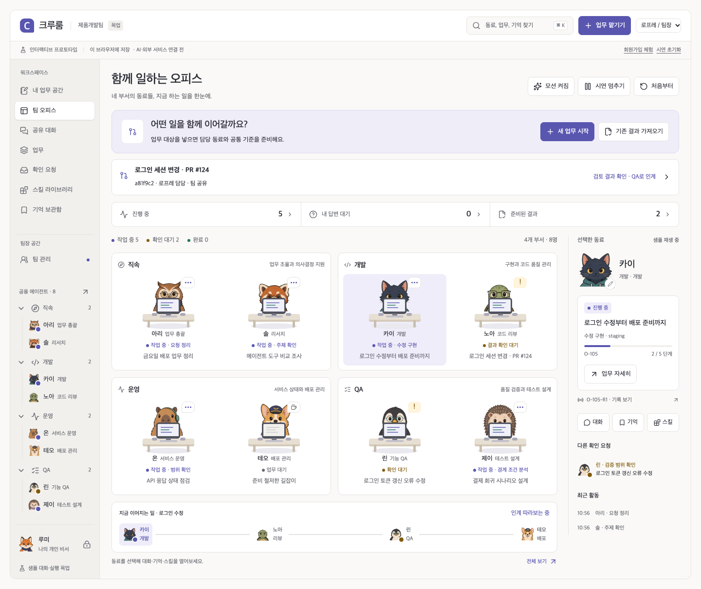

<div align="center">

# 크루룸 · Crewroom

**원하는 모델과 저장소를 연결하는, 셀프 호스팅 팀 AI 에이전트 플랫폼.**

[화면 데모](https://benny1020.github.io/crewroom-platform/) · [서버 실행](#서버-실행) · [구조](#구현-구조) · [운영 안내](docs/SERVER_OPERATIONS.md) · [연결 설정](docs/CONFIGURATION.md) · [검증·리뷰](docs/SERVER_VERIFICATION.md)

[](https://github.com/benny1020/crewroom-platform/actions/workflows/verify-and-deploy.yml)
[](LICENSE)

</div>

**0.8.1은 Astra의 독립 조사·리뷰를 반영해 승인된 기억의 출처 추적, 적용 기간, 역할 경계와 동시 실행을 보강했습니다.** [발견·수정·검증 기록](docs/ASTRA_MEMORY_REVIEW.md). GitHub Pages는 API 없는 0.4 화면 데모입니다. 실제 공동 사용은 아래 서버를 실행해야 합니다. 모델 키는 포함하지 않습니다. 외부 모델 추론과 실제 팀의 업무 절감 효과는 아직 검증하지 않았습니다. [배포별 시범 운영 가이드](docs/PILOT_GUIDE.md)를 별도로 관리합니다.

OpenAI 호환 또는 Claude Messages API의 **URL·모델 ID·인증 방식**을 직접 지정합니다. 제공자 API, 게이트웨이, 자체 호스팅 endpoint를 같은 설정 방식으로 연결하고, GitLab URL과 사용할 프로젝트도 선택합니다. [커스텀 연결 설정](docs/CONFIGURATION.md)

## 구현 구조

[](docs/diagrams/platform-architecture.svg)

그림을 누르면 확대할 수 있습니다. [아키텍처 그림 모음](docs/diagrams/README.md)에서 실행 흐름·DB 관계·개발/QA 격리 구조를 함께 볼 수 있습니다. [조사 근거와 도식 디자인 규칙](docs/diagrams/DESIGN_NOTES.md)도 정리했습니다.

| 구성   | 실제 구현                                                                                                                              |
| ------ | -------------------------------------------------------------------------------------------------------------------------------------- |
| 웹     | Vite + Vanilla JS + Lucide + CSS 캐릭터 모션. 서버 모드와 정적 데모 진입점 분리                                                        |
| App    | Fastify 5, Zod 입력 검사, 로그인·CSRF·범위 검사·업무/스킬/기억 API·SSE                                                                 |
| DB     | PostgreSQL 18, SQL migration 7개, 단일 Task/Run 큐, 영속 이벤트·메시지·버전별 결과                                                     |
| Worker | 별도 Node 프로세스. 전체 2개·같은 에이전트 1개 동시 실행, 임대와 generation으로 오래된 결과 차단                                       |
| Runner | 별도 HTTP broker. Docker socket 전담, 고정 이미지·등록 검사·Run별 개발/QA Job 생성과 종료 검증                                         |
| 모델   | Claude Messages / OpenAI 호환 HTTP adapter. 커스텀 URL·인증 설정, endpoint/model profile 고정, 제한된 JSON 행동 루프, 구조화 결과 검사 |
| 파일   | Docker named volume에 Run별 `input.json`. 본문·결과·스킬·기억의 기준 저장소는 DB                                                       |
| 배포   | Node 24 이미지 + App / Worker / Runner / PostgreSQL, 운영 시 Caddy HTTPS. 비밀 파일 별도 마운트                                        |
| 복구   | 자동 재발송 없이 종료 확인. 암호화 백업·빈 DB 복원·세션 폐기·미완료 Run 격리                                                           |

**에이전트는 DB에 상주하고, 코드 실행 업무마다 Docker Job을 띄웁니다.** 에이전트는 DB의 고유 ID·설정·장착 스킬·범위별 기억입니다. 상주 Worker가 요청마다 이 문맥을 고정해서 모델 API를 호출합니다. App과 Worker는 웹 접속 여부와 무관하게 실행됩니다. 읽기 전용 분석은 API 호출만 사용합니다. 코드 수정과 등록 검사는 별도 Runner의 격리 환경에서 수행하며 최종 patch를 다운로드합니다. 자동 GitLab push/MR/배포는 제공하지 않습니다.

LangChain/LangGraph는 사용하지 않습니다. Paperclip 내부 큐를 별도 SDK처럼 재사용하면 인증·서비스 의존성과 기존 Hermes adapter의 실행 권한이 함께 따라오는 문제가 있어 이번 구현에서는 채택을 유보했습니다. Crewroom DB가 업무와 실행의 유일한 소유자입니다. [코드 근거와 결정](docs/ADR_001_RUNTIME.md)

## 만드는 이유

팀원들이 각자 스킬과 세션을 띄우면 작업을 이어받기 어렵고 결과 형식도 달라집니다. 크루룸에서는 같은 공용 동료에게 요청하고, 같은 업무방에서 대화·책임·결과를 이어갑니다. 개인 비서는 보조 기능이며 소유자만 접근합니다.

**설치마다 독립 워크스페이스 하나**를 제공합니다. 개인 서버·공유 서버·클라우드의 Docker 환경에 배포하고, 모델 endpoint와 GitLab 저장소는 운영자가 선택합니다. 팀 생성·조직 전환·결제·모바일은 범위에 포함하지 않습니다. 데스크톱 1440 / 1280 / 1024 화면을 검증합니다.

[](docs/diagrams/team-agents.svg)

역할·캐릭터로 동료를 찾고, 대화창에서 적용한 스킬을 선택해 실행합니다. 개발 업무는 **고정 GitLab 커밋의 코드 수정 → 실제 검사 → 같은 patch의 독립 QA → 사람의 수용**을 지원합니다. [실행 구조·한도·프로젝트 이미지 설정](docs/CODE_EXECUTION.md)

## 함께 일하는 흐름

1. 대상·버전·원하는 결과와 공개 범위를 입력합니다.
2. 책임자가 실행을 시작하면 지침·스킬 버전·기억·대화·입력 결과를 고정합니다.
3. Worker가 분석 또는 실제 실행 결과·patch·검사 로그를 저장합니다. 팀원은 같은 업무방에 조건을 남기고 책임을 인계합니다.
4. 결과 버전을 고정해 QA 계획 또는 독립 실제 검사로 넘깁니다. 사람이 결과를 수용해야 완료됩니다.
5. 수용한 결과에서 반복 업무 스킬 초안을 만들고 편집·게시·적용합니다. 이전 검증·승인은 복사하지 않습니다.

[](docs/diagrams/task-lifecycle.svg)

결과에는 요약·근거·미확인 사항·다음 행동과 출처를 남깁니다. `result_ready`와 `done`을 구분하고, 외부에서 가져온 결과·테스트 fixture·모델 응답을 표시합니다.

실제 백엔드와 Docker로 수행한 코드 수정·독립 QA 화면입니다. 모델 응답은 결정적 로컬 프로토콜 fixture이며 실제 모델 추론 검증과 구분합니다.


[Grok Bot·Meta Muse·논문·오픈소스별 조사와 채택 결정](docs/MEMORY_RESEARCH_DECISION.md)을 공개합니다. 공개 제품 계약과 실제 구현·미검증 범위를 구분합니다.

## 기억·스킬·권한

[](docs/diagrams/agent-context.svg)

- **나만 / 같은 부서 / 팀 공유**를 API·목록·상세·산출물·기억·SSE에서 검사합니다. 팀장도 다른 사람의 개인 비서 본문을 읽지 못합니다.
- 기억은 동료 전용과 프로젝트 공통으로 나누고 출처·정정 이력·결정의 적용 기간을 남깁니다. 삭제한 기억은 새 검색·발송에서 제외합니다. 이미 저장한 실행 이력·백업까지 지워지는 것은 아닙니다.
- 기억·과거 대화·자동 업무 요약을 관련성으로 검색합니다. **최근 기억 8개 제한을 제거**하고 16,000자 문맥 예산과 최대 4회 추가 조회를 사용합니다. 핵심 기억 고정, 출처 원문, 정정·삭제의 파생 요약 반영을 지원합니다. 별도 embedding URL을 설정하면 에이전트 실행에서 의미 검색을 결합합니다. 자동 요약은 원문 발췌이며 완벽한 무제한 회상을 보장하지 않습니다. [장기 기억 설계·조사·한도](docs/MEMORY_ARCHITECTURE.md)
- 에이전트는 원문을 인용해 기억을 제안합니다. 사람이 저장한 뒤에도 원문 버전·권한과 적용 기간을 이어받습니다. 근거가 변경되면 자동 사용을 중단하고 재검토 표시를 합니다. 종료된 결정은 현재 기억으로 승격하지 않습니다.
- 스킬의 **새 버전 게시**와 **에이전트에 적용**을 분리합니다. 진행 중 Run의 버전은 바뀌지 않습니다. 팀장은 스킬 관리 담당을 위임할 수 있습니다.
- 계정과 소속은 운영자가 사전 발급합니다. 이메일만 아는 사람이 가입해 동료를 사칭하지 못하도록 공개 회원가입은 막았습니다. 팀장 여부는 요청 후 기존 팀장이 승인합니다.

[](docs/diagrams/memory-learning.svg)


## 서버 실행

필수: Docker Compose, Node 24(비밀 파일 생성·운영 스크립트용). 기본 주소는 이 컴퓨터에서만 접근하는 `http://localhost:4180`입니다.

```bash
npm ci --ignore-scripts
cp .env.example .env
node scripts/init-secrets.mjs
docker compose --profile images build app runner job-image
docker compose up -d
```

첫 팀장 비밀번호를 `.local/secrets/lead_password`에 **12~128자**로 저장하고 파일 권한을 `600`으로 설정합니다. 비밀번호를 명령 인수·채팅·Git에 넣지 않습니다.

```bash
docker compose exec -T app node server/cli.js bootstrap lead@example.com 팀장 - < .local/secrets/lead_password
```

이메일과 이름은 실제 팀 정보로 바꾸세요. 팀원은 같은 방식으로 발급합니다. 부서 값은 `direct`, `development`, `operations`, `qa`입니다.

```bash
docker compose exec -T app node server/cli.js member member@example.com 민지 qa - < .local/secrets/member_password
```

모델을 연결하려면 `.env`의 `MODEL_PROVIDER`, `MODEL_ENDPOINT_URL`(또는 `MODEL_BASE_URL`), `MODEL_NAME`을 설정하고 `.local/secrets/model_api_key` 파일에 키를 저장한 뒤 `docker compose up -d`를 실행합니다. 모델 입력에는 허용된 업무·기억이 전송되므로 팀이 승인한 endpoint를 사용하세요. **키가 없으면 화면·협업은 사용 가능하지만 AI 실행은 설정 오류로 끝납니다. fixture를 실제 AI로 대체하지 않습니다.**

커스텀 모델·GitLab URL과 기존 HTTPS 프록시를 연결하려면 [연결 설정 안내](docs/CONFIGURATION.md)와 `deploy/custom.env.example`을 사용합니다. OpenAI 호환 Chat Completions와 Claude Messages 형식을 지원하며, 전체 endpoint·모델 ID·인증 헤더를 설정할 수 있습니다. GitLab MR 고정 diff와 코드 실행용 전체 SHA archive, 프로젝트별 공유 범위도 설정합니다.

다른 팀원이 접속하는 서버에서는 HTTPS 운영 override와 도메인을 사용합니다. [배포·계정·키·백업·복원·장애 대응 절차](docs/SERVER_OPERATIONS.md)

## 검증

```bash
npm run check
npm run test:e2e
# 운영 DB가 아닌, 테스트 전용 PostgreSQL을 지정합니다.
npm run test:runner
TEST_DATABASE_URL=postgresql://crewroom@127.0.0.1:5448/crewroom TEST_RUNNER_DOCKER=1 npm run test:server
TEST_DATABASE_URL=postgresql://crewroom@127.0.0.1:5448/crewroom npm run test:server:e2e
```

서버 테스트는 매번 고유 schema를 생성·삭제합니다. 브라우저 검증에는 명확히 표시된 deterministic fixture를 사용합니다. 로컬 HTTP 모델 계약 테스트와 실제 외부 모델 추론은 구분합니다. [테스트 수·독립 리뷰·Docker 복원 증거·미검증 범위](docs/SERVER_VERIFICATION.md)

## 동작 시연



아래 GIF는 API 없는 정적 목업입니다. 서버 화면 증거는 [검증 보고서](docs/SERVER_VERIFICATION.md)에 별도로 표시합니다.


## 문서

| 문서                                                                  | 내용                                                          |
| --------------------------------------------------------------------- | ------------------------------------------------------------- |
| [실제 코드 수정·독립 QA](docs/CODE_EXECUTION.md)                      | native 루프·Docker 격리·검사·이미지·복구 계약                 |
| [커스텀 모델·저장소 연결](docs/CONFIGURATION.md)                      | 모델·GitLab URL·인증·프록시·소스 패키지                       |
| [장기 기억 구조·조사·검증](docs/MEMORY_ARCHITECTURE.md)               | 핵심 기억·원문 검색·자동 업무 요약·추가 조회·선택적 의미 검색 |
| [아키텍처 그림·디자인 근거](docs/diagrams/DESIGN_NOTES.md)            | 아이콘·경계·흐름·읽는 순서와 조사 출처                        |
| [현재 서버 아키텍처](docs/SERVER_ARCHITECTURE.md)                     | 데이터 관계·API·실행·경쟁·권한·기억·실패 처리                 |
| [런타임 채택 결정](docs/ADR_001_RUNTIME.md)                           | Paperclip/Hermes 코드 검토와 독립 큐 선택 근거                |
| [운영 안내](docs/SERVER_OPERATIONS.md)                                | Compose·계정·모델 설정·백업·복원·종료 확인                    |
| [검증과 리뷰](docs/SERVER_VERIFICATION.md)                            | 실행한 검사·실제 증거·남은 범위                               |
| [개발 계획](docs/DEVELOPMENT_PLAN.md)                                 | 이번 릴리스의 완료 기준과 진행 결과                           |
| [0.4 기획·화면 설계 기록](docs/DESIGN_IMPLEMENTATION.md)              | 이전 설계·Astra 피드백. 서버 구현은 현재 문서 우선            |
| [오픈소스 코드 리서치](docs/research/2026-10-16-code-audit/README.md) | 고정 소스와 비교 근거                                         |
| [제품 효용 검증](docs/PRODUCT_REVIEW.md)                              | 실제 팀에서 측정할 사람 시간·품질·반복 사용                   |
| [서드파티 고지](THIRD_PARTY_NOTICES.md)                               | 참고 자료·라이선스                                            |
