<div align="center">

# 크루룸 · Crewroom

**원하는 모델과 저장소를 연결하는, 셀프 호스팅 팀 AI 에이전트 플랫폼.**

[화면 데모](https://benny1020.github.io/crewroom-platform/) · [서버 실행](#서버-실행) · [에이전트 동작 방식](#에이전트는-어떻게-실행되나요) · [구조](#구현-구조) · [연결 설정](docs/CONFIGURATION.md) · [검증·리뷰](docs/SERVER_VERIFICATION.md)

[](https://github.com/benny1020/crewroom-platform/actions/workflows/verify-and-deploy.yml)

</div>

**현재 버전: 0.15.4 · 2026-10-22.** 직속·개발·운영·QA의 공용 에이전트를 같은 서버에서 함께 사용합니다. 요청·대화·적용한 스킬·작업 문서·결과를 업무방에 모으고, 개인 비서는 소유자만 사용합니다.

| 현재 기능 | 동작 |
| --- | --- |
| 공용·개인 에이전트 | 부서별 역할·캐릭터·지침과 에이전트별 스킬 버전 관리 |
| 영속 작업공간 | 계획·진행 메모·Markdown 초안을 에이전트가 직접 저장·수정하고 다음 실행에서 조회 |
| 장기 기억 | 원문·결정·대화·과거 결과 검색, 출처·적용 시점·정정 추적, 선택적 embedding 연결 |
| AI 스킬 작성 | 짧은 설명 → 대화로 수정 → 예시 확인 → 버전 게시·에이전트 적용 |
| 코드 수정·QA | 고정 GitLab SHA에서 격리 실행, 등록 검사, 같은 patch의 독립 QA, 사람의 수용 |
| 공동 업무·운영 | 책임 인계·질문·재작업, 긴 대화 검색, 팀장 운영 현황, 암호화 백업·복원 |

0.15.0은 동료 초상 10종을 봉제 캐릭터로 바꾸고 **카이의 개발 일지 12장면**을 오피스·에이전트 홈·업무방에 연결했습니다. 코딩·문서 작성·검사·리뷰·대기·실패가 기록에 맞춰 바뀌며, 검사 통과와 사람의 결과 수용을 구분합니다. 모션 끄기와 동작 줄이기를 지원합니다. [캐릭터·상태 매핑·구현](docs/CHARACTERS.md).

0.15.1은 코딩·조사·검사·기록·휴식에 서로 다른 리듬을 넣었습니다. 완료는 짧게 한 번 축하하고 멈춥니다. 같은 업무의 화면 갱신에도 재생 위치를 유지하며, 모션 끄기·동작 줄이기·문서 숨김 정책을 적용합니다. [장면별 움직임 미리보기](docs/media/plush/developer-diary.gif).

0.15.2는 **르르르**를 열한 번째 선택 캐릭터로 추가합니다. 노란 봉제 초상과 전용 개발 일지 12장면·상황별 모션을 제공합니다. 데모에서 카이의 **캐릭터 바꾸기 → 르르르 → 캐릭터 적용**으로 선택하며, 기존 선택은 유지합니다. [새 친구의 움직임](docs/media/rururu/developer-diary.gif) · [이미지 생성 프롬프트](assets/rururu-generation.md). 서버의 캐릭터 선택 UI는 아직 제공하지 않습니다.

0.15.3은 사진의 얼굴·갈기를 참고한 **포메 친구**를 열두 번째 선택 캐릭터로 추가합니다. 황금빛 둥근 갈기·크림색 주둥이·산호색 하네스의 초상과 전용 12장면을 제공합니다. 데모에서 **캐릭터 바꾸기 → 포메 친구 → 캐릭터 적용**으로 선택합니다. [움직임 미리보기](docs/media/pom/developer-diary.gif) · [생성 프롬프트](assets/pom-generation.md). 참고 사진 원본은 공개 저장소에 포함하지 않습니다.

0.15.4는 강아지 캐릭터와 기본 개발 동료의 이름을 **미미**로 맞춥니다. 개발 부서·역할·고유 ID는 유지하며 새 데모에서는 미미가 기본으로 보입니다. 이전에 강아지를 선택한 기본 카이 프로필도 미미로 이어집니다. 직접 정한 다른 이름과 캐릭터는 유지합니다. [미미의 개발 일지](docs/media/pom/developer-diary.png).


0.14.1에서 현재 업무 문서 발견·담당자 인계의 새 권한·출처 검증과 여러 사람의 동시 조회·많은 문서 이력을 개선했습니다. 결과에는 실제 본문 조회·저장 횟수를 표시하며, 작업 중 실패해도 초안과 이전 버전은 남습니다. [개선·부하 검사](docs/TEAM_QUALITY.md) · [작업공간 기능·구조·한도](docs/AGENT_WORKSPACE.md).

[](docs/diagrams/agent-workspace.svg)

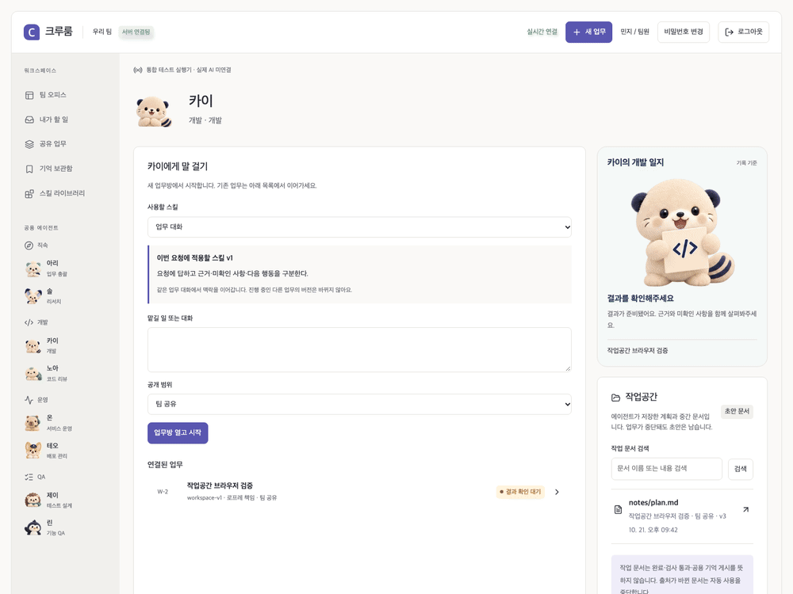

반복 업무는 Markdown을 처음부터 작성하지 않고 AI와 대화하며 스킬로 만들 수 있습니다. [스킬 만들기](docs/SKILL_STUDIO.md) · [직접 사용 시작](docs/READINESS.md) · [장기 운영](docs/LONG_TERM_OPERATIONS.md).

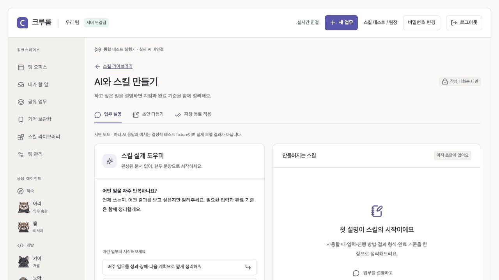

OpenAI 호환 또는 Claude Messages API의 **URL·모델 ID·인증 방식**을 직접 지정합니다. 제공자 API, 게이트웨이, 자체 호스팅 endpoint를 같은 설정 방식으로 연결하고, GitLab URL과 사용할 프로젝트도 선택합니다. [커스텀 연결 설정](docs/CONFIGURATION.md)

서버·도구 실행·저장·협업 흐름은 구현했고 **고유 자동 검사 295개와 암호화 복원 훈련**으로 검증합니다. 실제 모델의 업무 품질·비용·시간 절감은 endpoint를 연결한 뒤 평가해야 합니다. GitHub Pages는 API 없는 화면 데모이며, 실제 공동 사용과 AI 실행에는 아래 서버와 모델 설정이 필요합니다. 화면·GIF의 모델 응답은 격리된 fixture입니다. [검증 결과](docs/SERVER_VERIFICATION.md) · [시범 운영](docs/PILOT_GUIDE.md) · [마일스톤](docs/MILESTONES.md)

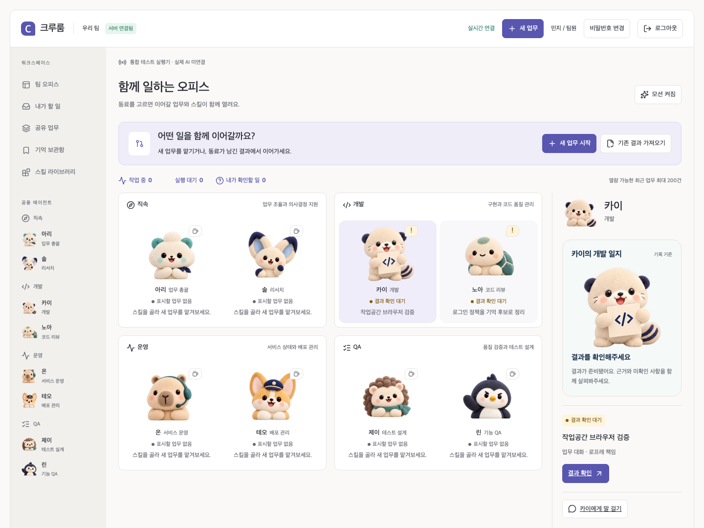

동료를 선택하면 현재 업무와 다음 행동, 적용한 스킬이 함께 열립니다. 스킬 요청 화면에는 실행에 고정할 버전과 완료 기준을 보여줍니다. 팀장은 열람 가능한 업무의 대기열·실패·처리 시간과 저장된 모델 사용 기록을 확인합니다. 아래 화면과 GIF는 격리된 PostgreSQL·App·Worker를 사용하며 모델 응답은 결정적 테스트 fixture입니다.


선택한 분석 스킬은 대상·버전·프로젝트 입력으로 이어지고, 코드 수정은 실제 개발·독립 QA 경로로 연결됩니다. 업무방은 현재 결과와 미확인 사항을 먼저 보여줍니다. 책임자가 질문할 사람을 지정하면 **내가 할 일**에서 답변하고, 새 답변과 재작업 이유는 다음 실행에 고정됩니다. 새 답변이 빠진 옛 결과는 수용할 수 없습니다. 모델의 자동 질문·자동 재개는 제공하지 않습니다. [질문·재작업의 상태와 한도](docs/WORKFLOW_IMPROVEMENTS.md)

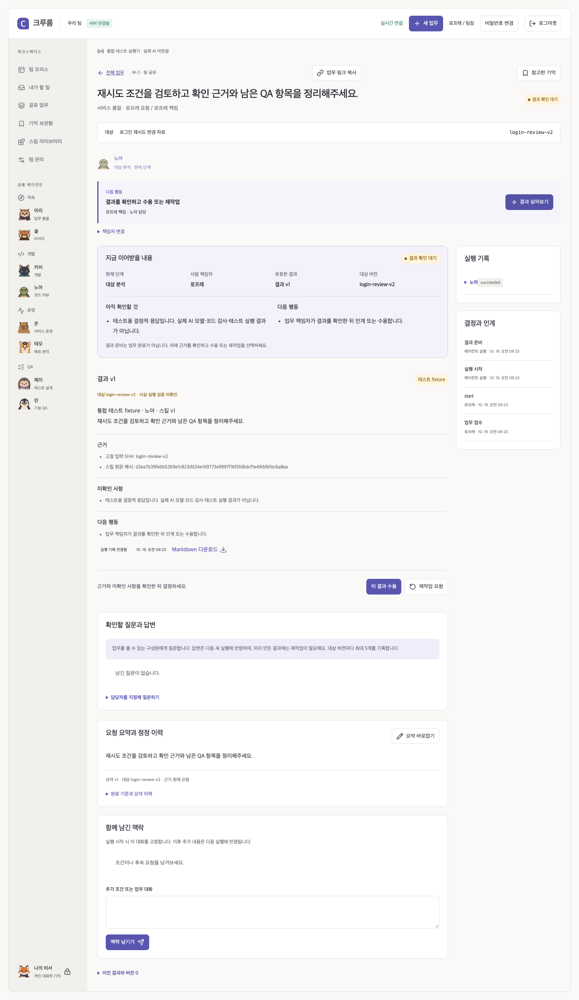

## 긴 대화와 장기 운영

한 방의 대화가 길어져도 최근 메시지 40개씩 읽고, 과거 페이지·검색으로 원문을 찾습니다. 현재 결과와 실행은 별도로 유지하고, 과거를 읽는 동안 실시간 변경이 화면과 초안을 덮지 않습니다. 검색 인덱스·Runner 종료 기록의 지연 로딩·로그 회전·DB 용량 진단을 추가했습니다. 원문과 복구 기록은 계속 보존하므로 디스크 증설과 백업 비용을 함께 관리해야 합니다. 대규모 의미 검색·PITR·고가용성은 아직 제공하지 않습니다. [운영 경계와 재현 검사](docs/LONG_TERM_OPERATIONS.md)


## 구현 구조

[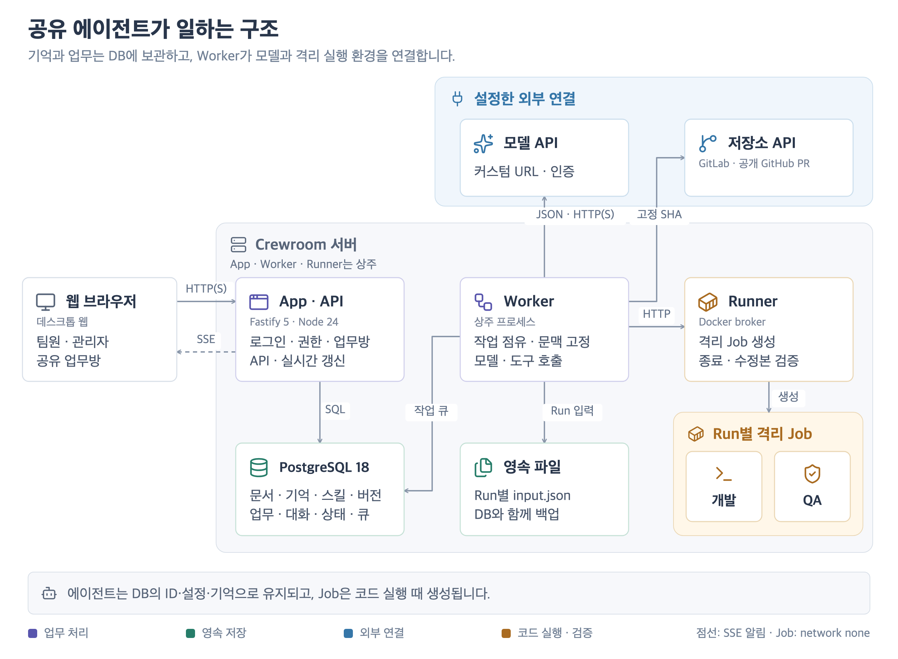](docs/diagrams/platform-architecture.svg)

그림을 누르면 확대할 수 있습니다. [아키텍처 그림 모음](docs/diagrams/README.md)에서 실행 흐름·DB 관계·개발/QA 격리 구조를 함께 볼 수 있습니다. [조사 근거와 도식 디자인 규칙](docs/diagrams/DESIGN_NOTES.md)도 정리했습니다.

| 구성   | 실제 구현                                                                                                                              |
| ------ | -------------------------------------------------------------------------------------------------------------------------------------- |
| 웹     | Vite + Vanilla JS + Lucide + CSS 캐릭터 모션. 서버 모드와 정적 데모 진입점 분리                                                        |
| App    | Fastify 5, Zod 입력 검사, 로그인·CSRF·범위 검사·업무/스킬/기억 API·SSE                                                                 |
| DB     | PostgreSQL 18, SQL migration 13개, 단일 Task/Run 큐, 이벤트·메시지·결과·문서 불변 버전                                                |
| Worker | 별도 Node 프로세스. 전체 2개·같은 에이전트 1개 동시 실행, 임대와 generation으로 오래된 결과 차단                                       |
| Runner | 별도 HTTP broker. Docker socket 전담, 고정 이미지·등록 검사·Run별 개발/QA Job 생성과 종료 검증                                         |
| 모델   | Claude Messages / OpenAI 호환 HTTP adapter. 커스텀 URL·인증 설정, endpoint/model profile 고정, 제한된 JSON 행동 루프, 구조화 결과 검사 |
| 저장   | PostgreSQL이 업무·결과·스킬·기억·작업 문서의 기준. runtime volume에 Run별 `input.json`, 코드 작업 파일은 Job tmpfs                    |
| 배포   | Node 24 이미지 + App / Worker / Runner / PostgreSQL, 운영 시 Caddy HTTPS. 비밀 파일 별도 마운트                                        |
| 복구   | 자동 재발송 없이 종료 확인. 암호화 백업·빈 DB 복원·세션 폐기·미완료 Run 격리                                                           |

App·Worker·Runner·PostgreSQL은 Docker Compose 서비스로 실행합니다. 에이전트마다 전용 상주 컨테이너를 만들지 않고, 아래의 DB 상태와 실행 루프로 동작합니다. LangChain/LangGraph·Hermes 런타임은 연결하지 않았으며 외부 에이전트 SDK도 사용하지 않습니다. [런타임 채택 결정](docs/ADR_001_RUNTIME.md)

## 에이전트는 어떻게 실행되나요

### 에이전트·업무·실행의 구분

**에이전트는 영속 설정과 기억을 가진 논리적 동료이고, 실제 행동은 상주 Worker가 처리합니다.** 같은 모델 endpoint를 쓰더라도 동료마다 지침·선택한 스킬·조회할 자료가 달라집니다. 현재 모델 URL·ID는 배포 전체 설정이며, 에이전트마다 서로 다른 모델을 고르는 기능은 없습니다.

| 단위 | 저장 내용과 역할 |
| --- | --- |
| Agent | `cr_agents`: 고유 ID·이름·부서·역할·캐릭터·지침·설정 버전. 공용은 소유자 없음, 개인 비서는 소유자 지정 |
| Skill | `cr_skill_versions`의 지침·완료 기준·hash와 `cr_skill_bindings`의 에이전트별 적용 버전. 요청에서 적용 스킬 하나 선택 |
| Task | `cr_tasks`: 같은 업무의 목표·프로젝트·대상 버전·공개 범위·책임자·대화·단계. 개발→QA 인계도 같은 업무 안에서 진행 |
| Run | `cr_runs`: 한 단계의 실행 시도. 실행 요청자·입력 snapshot·모델 설정·상태·generation·lease 기록 |
| Artifact | `cr_artifacts`: 실행이 만든 버전별 결과. 코드 업무에는 patch·실제 검사 근거도 포함 |
| Acceptance | `cr_acceptances`: 사람이 어떤 결과와 대상 버전을 수용했는지 기록. 답변 생성만으로 업무를 완료하지 않음 |

공용 동료를 여러 명이 사용해도 모든 대화를 하나의 전역 세션에 합치지 않습니다. 업무마다 Task와 실행 문맥을 구분하고, 허용된 기억·프로젝트 자료를 검색해 이어갑니다. 개인·부서·팀 공개 범위와 원문 권한은 조회·모델 발송·문서 저장·결과 게시 때 다시 검사합니다.

### 무엇이 계속 떠 있고, 무엇이 필요할 때 생성되나요

| 구성 | 수명 | 담당 |
| --- | --- | --- |
| App | 상주 | 로그인·권한·업무 API·문서 조회·SSE 갱신 |
| Worker | 상주 | DB 큐 점유·문맥 준비·모델 호출·기억/문서 도구 실행·결과 저장 |
| PostgreSQL | 상주 + 영속 volume | 에이전트 설정·큐·대화·기억·스킬·문서·결과·실행 기록 |
| Runner | 상주 | Docker socket을 가진 실행 broker. 코드 Job 생성·검사·종료·patch 검증 |
| 개발·QA Job | 코드 Run의 generation마다 생성·종료 | 고정 코드의 실제 파일 작업과 등록 검사. 개발과 QA는 별도 환경 |
| 모델 endpoint | 운영자가 지정한 서비스 | HTTP 요청의 문맥을 읽고 다음 행동 또는 최종 답변 생성 |

브라우저를 닫아도 서버에 접수한 실행과 저장된 자료는 유지됩니다. 일반 대화·분석은 모델 호출과 DB 도구를 사용하고 코드 Job은 생성하지 않습니다. 스케줄·이벤트를 보고 스스로 새 업무를 시작하는 기능은 현재 제공하지 않습니다.

### 요청 한 건의 실행 순서

아래는 일반 대화·분석·코드 업무 기준입니다. AI 스킬 작성은 같은 큐·Run·권한·발송 검사를 사용하되, `runSkillDesigner`가 요청마다 구조화된 스킬 초안·수정·예시를 생성합니다. 기억·작업 문서 행동 루프는 사용하지 않습니다.

1. 사용자가 동료·적용 스킬·목표·대상·공개 범위를 선택해 업무방을 만들고 실행을 시작합니다.
2. App이 역할·책임·미답변 질문·현재 revision을 검사하고, Agent 지침·선택한 스킬 버전·최근 대화·기억·대상·답변·인계 자료를 Run snapshot에 고정합니다.
3. Worker가 PostgreSQL 큐에서 실행을 점유합니다. 기본 전체 2개, 같은 에이전트 1개까지 실행하고 나머지는 대기합니다. 점유에는 60초 lease와 generation을 사용합니다.
4. Worker가 필요한 저장소 자료를 고정 SHA로 수집하고 입력 hash·`input.json`을 남깁니다. 선택적 의미 검색도 이 단계에서 준비하며, 외부 요청 전에는 발송 intent와 현재 권한을 확인합니다.
5. 모델이 다음 행동을 JSON으로 응답합니다. 서버는 스키마·실행 소유권·허용 범위·출처를 검사한 뒤 실제 도구를 실행합니다.
6. 실제 조회·저장·검사 결과를 모델에 돌려주고 다시 API를 호출합니다. 필요한 동안 **모델의 행동 선택 → 서버 도구 실행 → 실제 결과 반영**을 반복합니다.
7. 최종 결과 형식을 검사하고 현재 Run·generation·lease·자료 유효성을 확인한 뒤 Artifact와 `result_ready`를 저장합니다. SSE 알림을 받은 웹은 현재 상태를 다시 읽습니다. 필요한 QA 단계를 거치고 사람이 결과를 수용하면 `done`이 됩니다.

0.14.0의 문서 도구 흐름입니다. 그림은 미리 렌더링한 PNG이며 누르면 SVG로 확대합니다.

[](docs/diagrams/agent-workspace.svg)

### 에이전트가 직접 할 수 있는 행동

모델이 선택할 수 있는 동작은 서버에 등록된 JSON 프로토콜로 제한합니다. 제공자의 native function calling을 사용하지 않으며, 모델 응답의 `action`을 Crewroom이 검사·실행합니다. Claude Messages와 OpenAI 호환 API는 같은 앱 수준 행동 계약을 사용합니다.

| 행동 | 도구 | 실행 위치 |
| --- | --- | --- |
| 기억 검색·원문 조회 | `search_memory`, `read_memory` | Worker → PostgreSQL, 설정 시 별도 embedding endpoint |
| 기억 후보 제안 | `propose_memory` | 인용·출처를 검사해 DB 후보로 저장; 사람이 저장하기 전까지 검색 기억으로 사용하지 않음 |
| 작업 문서 찾기·읽기 | `list_workspace`, `read_workspace` | Worker → DB의 허용된 현재 문서 |
| 문서 생성·수정·이름 변경·보관 | `write_workspace`, `move_workspace`, `archive_workspace` | 현재 업무·작성 에이전트·revision·출처 확인 후 DB 저장 |
| 코드 파일 탐색·읽기·수정 | `list_files`, `read_file`, `write_file` | 코드 업무의 Runner Job; 독립 QA는 파일 수정 금지 |
| 실제 검사 | `run_check` | Runner에 등록된 check ID만 실행 |
| 완료 응답 | 일반 업무의 결과 JSON / 코드 업무의 `finish` | 서버가 결과 형식과 검사 근거를 확인한 뒤 저장 |

예를 들어 모델은 다음 행동을 선택할 수 있습니다. 이 JSON을 답변에 적는 것만으로 저장되는 것은 아니며, 서버가 도구로 처리해 실제 저장 receipt를 돌려줍니다.

```json
{
  "action": "write_workspace",
  "path": "notes/plan.md",
  "content": "# 작업 계획\n1. 현재 요구사항 확인\n2. 구현\n3. 실제 검사와 남은 일 기록",
  "expectedRevision": 0
}
```

새 문서는 `expectedRevision: 0`으로 요청하며 첫 저장 버전은 1입니다. 수정은 읽은 현재 revision을 사용합니다. 충돌 시 옛 내용으로 덮지 않고 오류를 반환합니다. 스킬을 추가해도 도구·네트워크·실행 권한은 늘어나지 않습니다. 임의 shell·임의 명령 인수·자유 브라우징은 제공하지 않습니다.

### 기억·작업공간·코드 파일은 어떻게 다른가요

| 종류 | 저장과 사용 | 유지 범위 |
| --- | --- | --- |
| 최근 대화 | 현재 업무의 메시지 중 최근 20개·12,000자까지 최초 입력 | 전체 원문은 DB에 보존, 화면은 40개씩 조회·과거 검색 |
| 장기 기억 | 핵심 기억·과거 대화·답변·자동 발췌 요약을 관련성으로 검색해 16,000자 예산에 구성 | 동료 전용/프로젝트 공통 + 개인/부서/팀 권한·출처·적용 시점 검사 |
| 작업 문서 | 계획·진행·Markdown 초안. 경로·본문·불변 버전·출처·저장 receipt를 DB에 보관 | 실패·취소·재시작 뒤에도 commit된 버전 유지 |
| 코드 파일 | 고정 저장소 archive를 펼친 Run별 Job tmpfs에서 실제 수정·검사 | 컨테이너 종료 시 임시 파일 제거, 확인한 patch checkpoint·최종 결과는 DB 보존 |
| 실행 입력 | Agent·스킬·모델 profile·목표·자료의 snapshot과 hash | DB snapshot + runtime volume의 Run별 `input.json` |

**작업공간의 소유자는 Task이고 작성 Agent를 함께 기록합니다.** 에이전트 홈은 사용자가 볼 수 있는 그 동료의 문서를 모아 보여줍니다. OS의 영구 홈 디렉터리를 에이전트마다 마운트하는 구조가 아닙니다. 같은 업무의 QA는 개발자가 남긴 허용된 문서를 읽을 수 있고, 다른 업무에서는 현재 동료·프로젝트·공개 범위에 맞는 문서를 찾습니다. 쓰기는 현재 업무와 작성 에이전트에 한정합니다.

문서 초안은 자동으로 공식 기억·스킬·완료 증거가 되지 않습니다. 문서는 전용 도구로 조회하며 자동 기억 검색·embedding corpus에는 넣지 않습니다. 기억 후보도 사람의 저장을 거칩니다. 원문이 바뀌거나 읽기 권한이 없어지면 해당 출처에 의존한 문서·기억·결과의 자동 재사용을 차단합니다. [기억 설계](docs/MEMORY_ARCHITECTURE.md) · [작업공간 계약](docs/AGENT_WORKSPACE.md)

### 이어가기·취소·장애 복구

- **문서가 있는 업무:** 다음 실행에서는 현재 문서를 도구로 다시 읽도록 안내합니다. 모델이 실제로 조회했는지는 실행 기록으로 확인하며, 조회를 강제하는 gate는 없습니다. 이전 답변은 웹 이력에 남고, 해당 작업 문서에 의존한 옛 답변을 자동 주입해 수정과 충돌시키지 않습니다. 코드 QA에는 정확한 patch를 계속 전달합니다.
- **문서 수정:** 현재 revision으로만 저장하며, 문서 간 출처 의존성이 깨지는 자기 수정은 transaction 전체를 rollback합니다. 현재 자료를 기준으로 새 경로의 후속 문서를 작성할 수 있습니다.
- **취소·일시정지:** generation을 바꾸고 모델 호출·코드 Job을 중지합니다. 취소 전 commit한 초안은 남고, 늦게 돌아온 응답은 저장할 수 없습니다.
- **코드 재개:** 마지막 확인 patch를 같은 SHA·실행 profile의 새 Job에 복원합니다. 이전 검사 통과 receipt는 복사하지 않고 다시 검사합니다.
- **불명확한 발송·종료:** 외부 호출과 DB commit의 exactly-once는 보장하지 않습니다. 발송 여부나 컨테이너 종료를 확인할 수 없으면 자동 재발송하지 않고 운영 확인을 기다립니다.
- **백업·복원:** DB의 문서·버전·출처와 runtime 입력을 암호화 백업합니다. 복원 후 옛 세션을 폐기하고 미완료 Run을 격리합니다.

현재 웹은 작업 문서 검색·열기·이전 버전 조회를 제공하며, 문서 수정·보관은 에이전트에게 대화로 요청합니다. 사람의 직접 문서 편집·보관 버튼, 예약 실행, 의존 문서의 자동 재작성은 제공하지 않습니다.

### 코드 수정과 독립 QA

[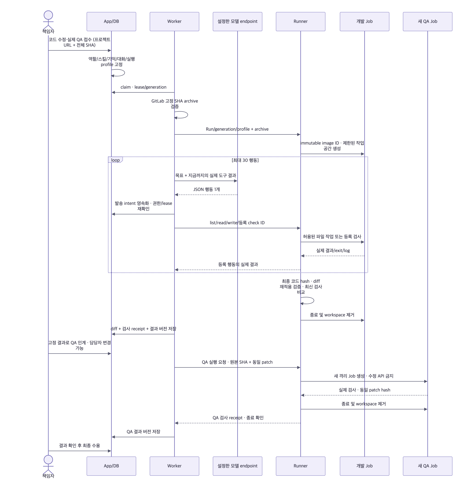](docs/diagrams/development-qa-sequence.svg)

개발 Job은 고정 GitLab SHA의 소스에서 파일을 수정하고 등록 검사를 수행합니다. Runner는 실제 파일 스냅샷으로 patch·tree hash·검사 receipt를 검증합니다. QA는 원본과 **동일 patch를 새 Job에 적용**해 다시 검사하며 파일을 고치지 않습니다. 코드가 바뀌면 이전 성공 검사는 무효입니다. 사람이 결과를 수용해야 업무가 완료되며 자동 GitLab push·MR 생성·배포는 제공하지 않습니다.

Job은 기본 network none·읽기 전용 root·비루트 사용자·CPU/메모리 제한으로 실행합니다. App·Worker에는 Docker socket이 없고, Job에는 모델·GitLab·DB 키를 주지 않습니다. 배포 하나에 실행 profile 하나를 사용하므로 프로젝트의 의존성과 등록 검사를 포함한 이미지를 미리 준비해야 합니다. [코드 실행·이미지 설정·한도](docs/CODE_EXECUTION.md)

### 현재 기본 한도와 코드 위치

| 항목 | 기본값 |
| --- | --- |
| 동시 실행 | 전체 2개 / 같은 에이전트 1개, 이미 시작한 paused·미해제 lease도 점유 |
| 일반 대화·분석 | 기억·문서 도구 합계 최대 20회 행동 후 최종 응답 |
| 코드·QA | 기억·문서·코드 행동과 `finish`를 합쳐 최대 30회 모델 응답 |
| 기억 도구 | 조회·제안 합계 최대 4회; 기억 후보 최대 2개 |
| 모델 요청 문맥 | 직렬화한 메시지 최대 200,000자; 초과 시 명시적으로 중단 |
| 문서 본문 | 32,768자 및 UTF-8 64KB 이하; 읽기는 6,000자씩 |
| 업무별 문서·이력 | 보관 포함 128문서 / 누적 4,096버전 / 버전 본문 합계 16MiB |
| 모델 요청 timeout | 기본 120초, 배포 설정으로 변경 |

자료를 오래 보존하는 것과 매번 모든 내용을 모델에 넣는 것은 구분합니다. 저장한 자료를 검색·부분 조회하는 방식이며 무제한 문맥·완전한 회상을 보장하지 않습니다. 선택적 의미 검색은 별도 embedding URL을 사용하고 현재 PostgreSQL JSONB 벡터 캐시의 exact 비교입니다. 대규모 ANN/HNSW·고가용성·PITR은 현재 제공하지 않습니다.

| 코드 | 확인할 내용 |
| --- | --- |
| [tasks.js](server/tasks.js) | 업무 명령·스킬 적용 버전·Run snapshot·질문/인계 입력 |
| [worker.js](server/worker.js) | 큐 점유·lease/generation·발송 원장·도구 fencing·결과 저장 |
| [provider.js](server/provider.js) | Claude/OpenAI 호환 HTTP·인증·JSON 응답/입력 크기 검사 |
| [memory-agent.js](server/memory-agent.js) | 일반 업무의 모델↔기억/문서 행동 루프 |
| [memory.js](server/memory.js) · [memory-embedding.js](server/memory-embedding.js) | 권한·출처·시점 검색, 문맥 예산, 선택적 의미 검색 |
| [agent-workspace.js](server/agent-workspace.js) · [migration 013](server/migrations/013_agent_workspace.sql) | 문서·CAS·불변 버전·조회 출처·멱등 receipt |
| [runner-client.js](server/runner-client.js) · [Runner](runner/server.mjs) | 코드 행동 루프·격리 실행·검사·patch·종료 |
| [compose.yaml](compose.yaml) | 상주 서비스·volume·비밀 파일·이미지·재시작 정책 |

## 만드는 이유

팀원들이 각자 스킬과 세션을 띄우면 작업을 이어받기 어렵고 결과 형식도 달라집니다. 크루룸에서는 같은 공용 동료에게 요청하고, 같은 업무방에서 대화·책임·결과를 이어갑니다. 개인 비서는 보조 기능이며 소유자만 접근합니다.

**설치마다 독립 워크스페이스 하나**를 제공합니다. 개인 서버·공유 서버·클라우드의 Docker 환경에 배포하고, 모델 endpoint와 GitLab 저장소는 운영자가 선택합니다. 팀 생성·조직 전환·결제·모바일은 범위에 포함하지 않습니다. 데스크톱 1440 / 1280 / 1024 화면을 검증합니다.

[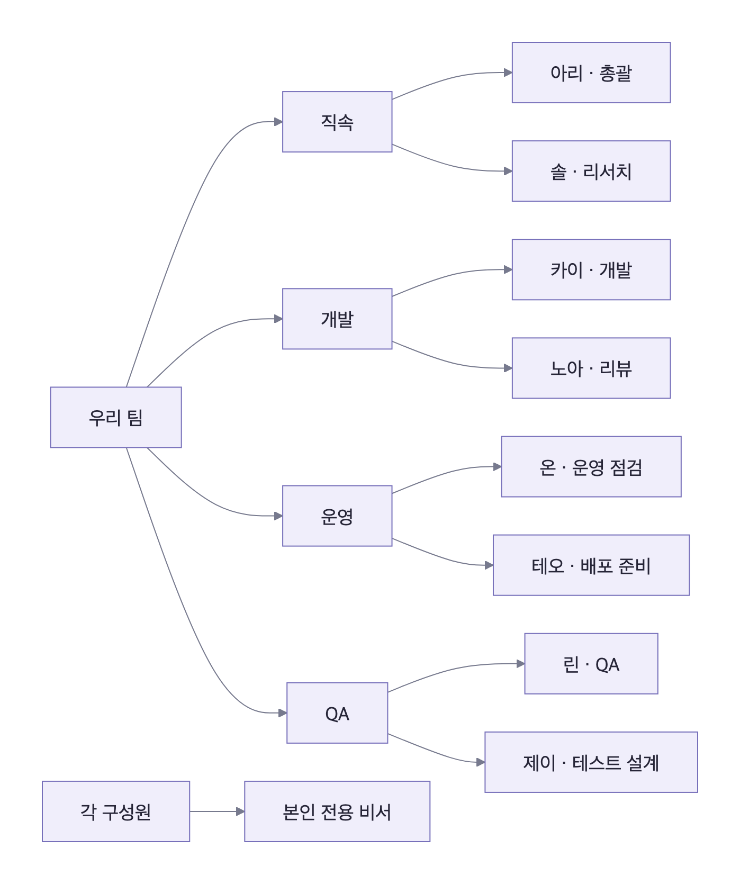](docs/diagrams/team-agents.svg)

역할·캐릭터로 동료를 찾고, 대화창에서 적용한 스킬을 선택해 실행합니다. 개발 업무는 **고정 GitLab 커밋의 코드 수정 → 실제 검사 → 같은 patch의 독립 QA → 사람의 수용**을 지원합니다. [실행 구조·한도·프로젝트 이미지 설정](docs/CODE_EXECUTION.md)

## 함께 일하는 흐름

1. 대상·버전·원하는 결과와 공개 범위를 입력합니다.
2. 책임자가 실행을 시작하면 지침·스킬 버전·기억·대화·입력 결과·재작업 지시·저장한 답변을 고정합니다.
3. Worker가 분석 또는 실제 실행 결과·patch·검사 로그를 저장합니다. 팀원은 같은 업무방에 조건을 남기고 책임을 인계합니다.
4. 필요한 질문에 담당자가 답하고, 새 답변이 있으면 재작업으로 반영합니다. 유효한 결과를 QA 계획 또는 독립 실제 검사로 넘기고 사람이 수용해야 완료됩니다.
5. 수용한 결과에서 반복 업무 스킬 초안을 만들고 편집·게시·적용합니다. 이전 검증·승인은 복사하지 않습니다.

[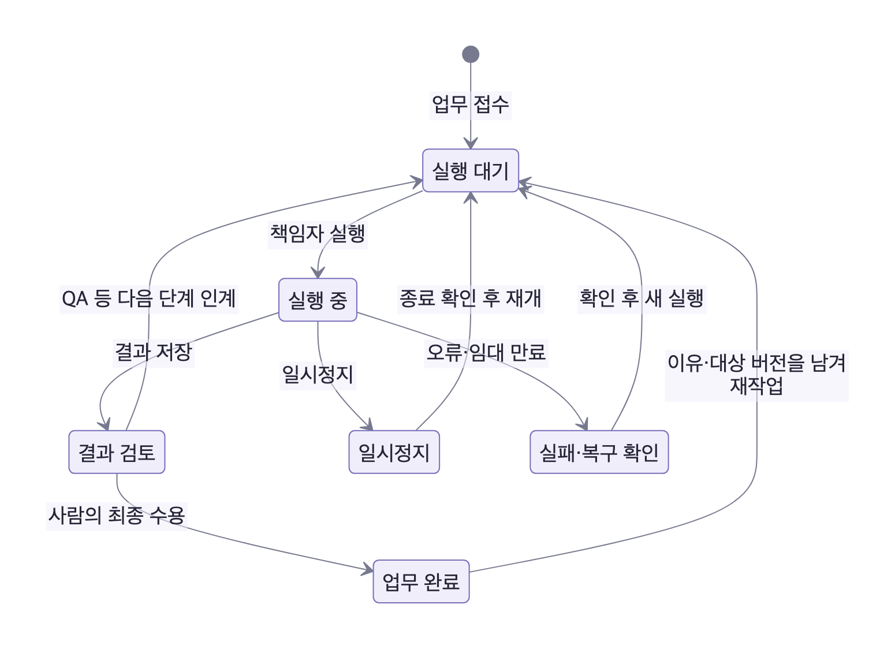](docs/diagrams/task-lifecycle.svg)

결과에는 요약·근거·미확인 사항·다음 행동과 출처를 남깁니다. `result_ready`와 `done`을 구분하고, 외부에서 가져온 결과·테스트 fixture·모델 응답을 표시합니다.

실제 백엔드와 Docker로 수행한 코드 수정·독립 QA 화면입니다. 모델 응답은 결정적 로컬 프로토콜 fixture이며 실제 모델 추론 검증과 구분합니다.

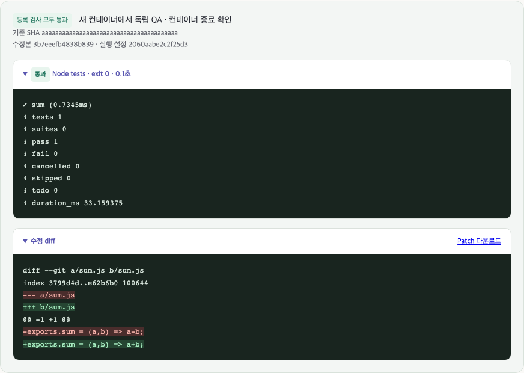


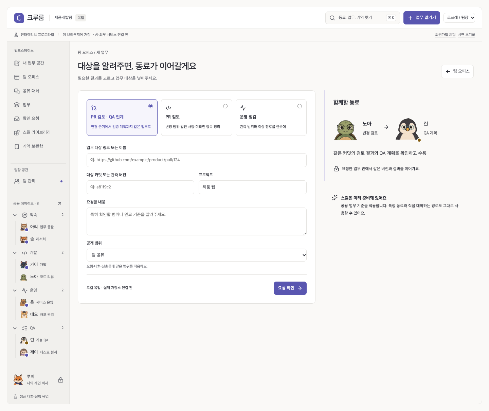
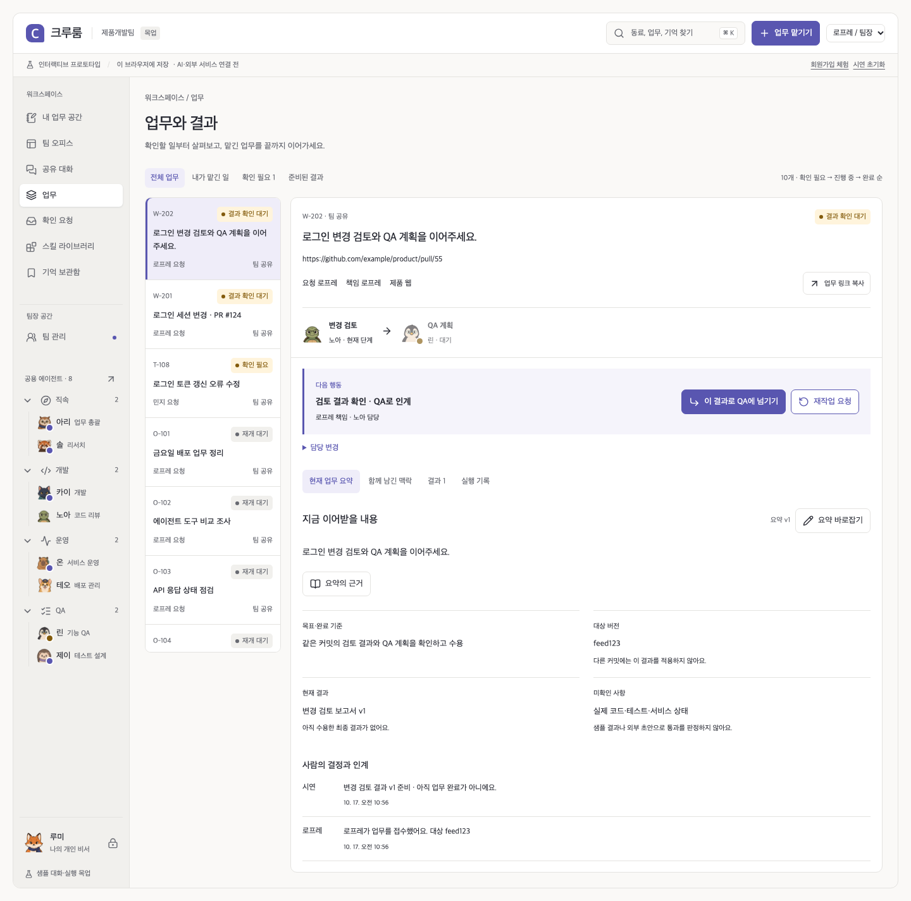

[Grok Bot·Meta Muse·논문·오픈소스별 조사와 채택 결정](docs/MEMORY_RESEARCH_DECISION.md)을 공개합니다. 공개 제품 계약과 실제 구현·미검증 범위를 구분합니다.

## 기억·스킬·권한

[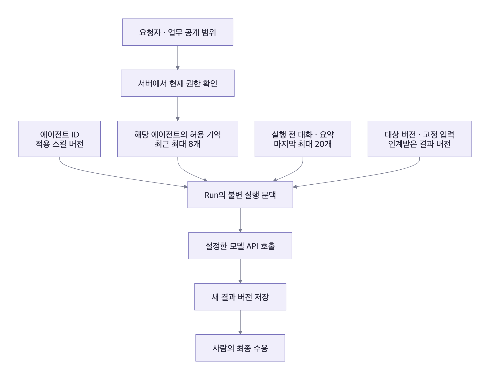](docs/diagrams/agent-context.svg)

- **나만 / 같은 부서 / 팀 공유**를 API·목록·상세·산출물·기억·SSE에서 검사합니다. 팀장도 다른 사람의 개인 비서 본문을 읽지 못합니다.
- 기억은 동료 전용과 프로젝트 공통으로 나누고 출처·정정 이력·결정의 적용 기간을 남깁니다. 삭제한 기억은 새 검색·발송에서 제외합니다. 이미 저장한 실행 이력·백업까지 지워지는 것은 아닙니다.
- 기억·과거 대화·자동 업무 요약을 관련성으로 검색합니다. **최근 기억 8개 제한을 제거**하고 16,000자 문맥 예산과 최대 4회 추가 조회를 사용합니다. 핵심 기억 고정, 출처 원문, 정정·삭제의 파생 요약 반영을 지원합니다. 별도 embedding URL을 설정하면 에이전트 실행에서 의미 검색을 결합합니다. 자동 요약은 원문 발췌이며 완벽한 무제한 회상을 보장하지 않습니다. [장기 기억 설계·조사·한도](docs/MEMORY_ARCHITECTURE.md)
- 에이전트는 원문을 인용해 기억을 제안합니다. 사람이 저장한 뒤에도 원문 버전·권한과 적용 기간을 이어받습니다. 근거가 변경되면 자동 사용을 중단하고 재검토 표시를 합니다. 종료된 결정은 현재 기억으로 승격하지 않습니다.
- 스킬의 **새 버전 게시**와 **에이전트에 적용**을 분리합니다. 진행 중 Run의 버전은 바뀌지 않습니다. 팀장은 스킬 관리 담당을 위임할 수 있습니다.
- 계정과 소속은 운영자가 사전 발급합니다. 이메일만 아는 사람이 가입해 동료를 사칭하지 못하도록 공개 회원가입은 막았습니다. 팀장 여부는 요청 후 기존 팀장이 승인합니다.

[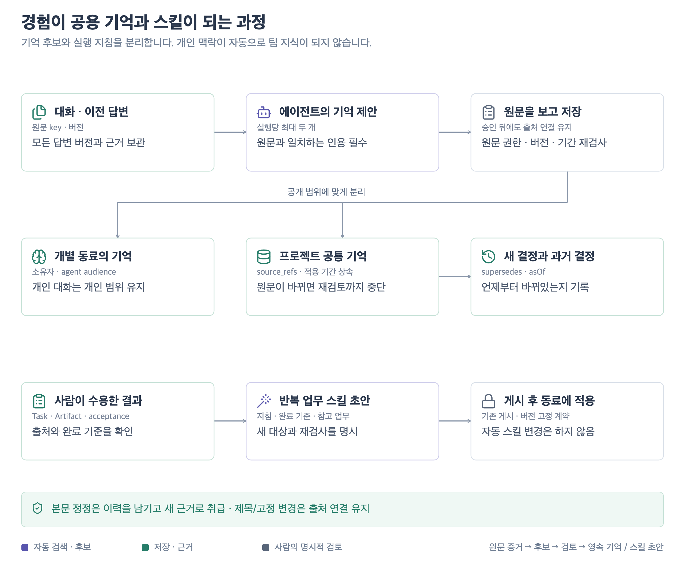](docs/diagrams/memory-learning.svg)

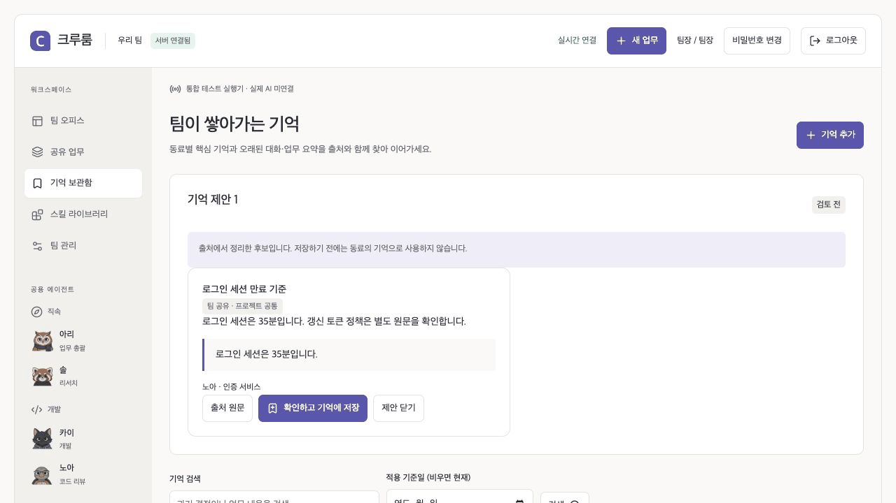

## 서버 실행

필수: Docker Compose, Node 24(비밀 파일 생성·운영 스크립트용). 기본 주소는 이 컴퓨터에서만 접근하는 `http://localhost:4180`입니다.

```bash
npm ci --ignore-scripts
cp .env.example .env
node scripts/init-secrets.mjs
docker compose --profile images build app runner job-image
docker compose up -d
```

첫 팀장 비밀번호를 `.local/secrets/lead_password`에 **12~128자**로 저장하고 파일 권한을 `600`으로 설정합니다. 비밀번호를 명령 인수·채팅·Git에 넣지 않습니다.

```bash
docker compose exec -T app node server/cli.js bootstrap lead@example.com 팀장 - < .local/secrets/lead_password
```

이메일과 이름은 실제 팀 정보로 바꾸세요. 팀원은 같은 방식으로 발급합니다. 부서 값은 `direct`, `development`, `operations`, `qa`입니다.

```bash
docker compose exec -T app node server/cli.js member member@example.com 민지 qa - < .local/secrets/member_password
```

모델을 연결하려면 `.env`의 `MODEL_PROVIDER`, `MODEL_ENDPOINT_URL`(또는 `MODEL_BASE_URL`), `MODEL_NAME`을 설정하고 `.local/secrets/model_api_key` 파일에 키를 저장한 뒤 `docker compose up -d`를 실행합니다. 모델 입력에는 허용된 업무·기억이 전송되므로 팀이 승인한 endpoint를 사용하세요. **모델 URL·모델 ID가 없으면 AI 실행은 설정 오류로 끝납니다. 인증이 필요한 endpoint는 키도 필요합니다. 인증 없는 커스텀 endpoint도 지원합니다.** 키 파일을 바꾼 뒤에는 아래처럼 비밀 볼륨을 다시 준비하고 App/Worker를 재생성합니다.

```bash
docker compose run --rm --no-deps init-secrets
docker compose up -d --force-recreate app worker
npm run doctor
# GitLab 코드 수정·검사를 사용할 때 추가 진단
npm run doctor -- --code
```

커스텀 모델·GitLab URL과 기존 HTTPS 프록시를 연결하려면 [연결 설정 안내](docs/CONFIGURATION.md)와 `deploy/custom.env.example`을 사용합니다. OpenAI 호환 Chat Completions와 Claude Messages 형식을 지원하며, 전체 endpoint·모델 ID·인증 헤더를 설정할 수 있습니다. GitLab MR 고정 diff와 코드 실행용 전체 SHA archive, 프로젝트별 공유 범위도 설정합니다.

다른 팀원이 접속하는 서버에서는 HTTPS 운영 override와 도메인을 사용합니다. [배포·계정·키·백업·복원·장애 대응 절차](docs/SERVER_OPERATIONS.md)

## 검증

0.14.1의 로컬 전체 검사는 아래와 같습니다. [검증 원자료](docs/evidence/0.14.1/verification.json)와 [Astra 동결 코드 리뷰](docs/reviews/ASTRA_TEAM_QUALITY.md)를 구분해 기록합니다. 리뷰어의 독립 테스트 실행은 0개입니다. 커밋별 CI는 [GitHub Actions](https://github.com/benny1020/crewroom-platform/actions/workflows/verify-and-deploy.yml)에서 확인할 수 있습니다. 이전 0.14.0의 269개 검사는 [과거 기록](docs/SERVER_VERIFICATION.md#0140-에이전트-영속-작업공간-검증)에 보존합니다.

| 검사 | 통과 |
| --- | ---: |
| 단위·HTTP adapter | 67 |
| PostgreSQL + 실제 Docker 개발·QA | 157 |
| Docker Runner | 6 |
| 정적 화면 브라우저 | 31 |
| 실제 서버 브라우저 | 24 |
| **고유 자동 검사 합계** | **285** |
| 별도 Linux 비밀 파일 소유권·암호화 백업 복원 | 통과 |

외부 모델 호출은 0회이며 모델 프로토콜에는 loopback 응답을 사용했습니다. 등록 검사의 성공을 실제 모델의 업무 품질·비용·실사용 성과로 해석하지 않습니다.

```bash
npm run check
npm run test:e2e
# 기본 동작은 계획만 출력하며 모델 호출 0회입니다.
npm run evaluate:answers
# 운영 DB가 아닌, 테스트 전용 PostgreSQL을 지정합니다.
npm run test:runner
TEST_DATABASE_URL=postgresql://crewroom@127.0.0.1:5448/crewroom TEST_RUNNER_DOCKER=1 npm run test:server
TEST_DATABASE_URL=postgresql://crewroom@127.0.0.1:5448/crewroom npm run test:server:e2e
```

서버 테스트는 매번 고유 schema를 생성·삭제합니다. 브라우저 검증에는 명확히 표시된 deterministic fixture를 사용합니다. 로컬 HTTP 모델 계약 테스트와 실제 외부 모델 추론은 구분합니다. [테스트 수·독립 리뷰·Docker 복원 증거·미검증 범위](docs/SERVER_VERIFICATION.md)

## 동작 시연

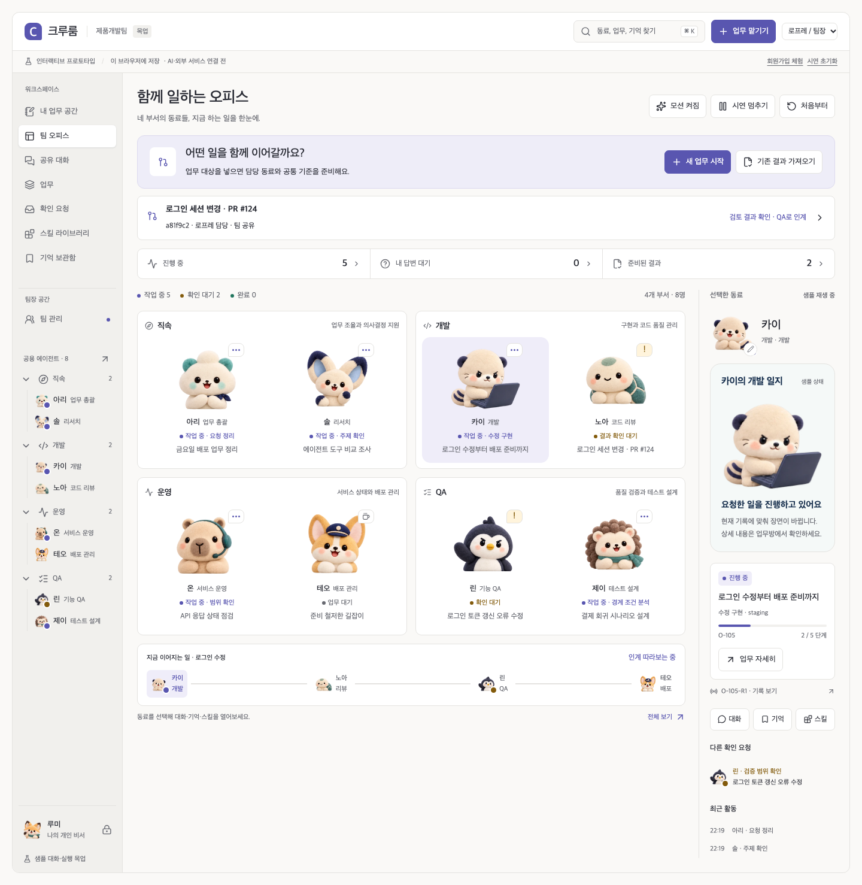

위 오피스는 API 없는 정적 목업입니다. 서버 화면 증거는 [검증 보고서](docs/SERVER_VERIFICATION.md)에 별도로 표시합니다.

<details>
<summary>카이의 개발 일지 12장면 보기</summary>

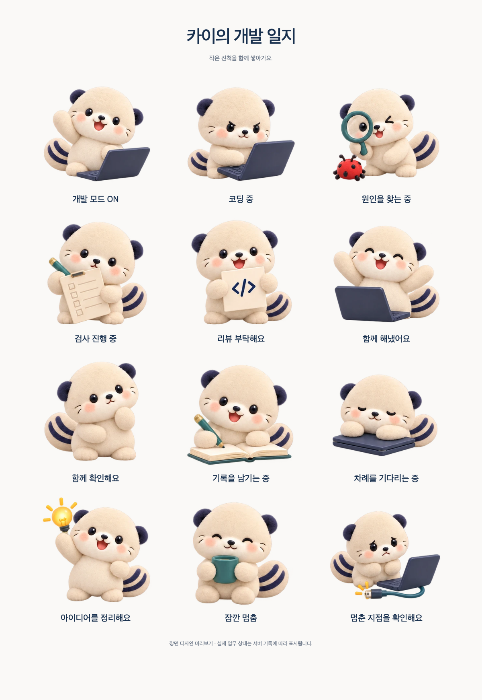

장면 디자인 예시입니다. 실제 업무에서는 현재 기록에 해당하는 한 장면을 보여줍니다.

</details>

## 문서

| 문서                                                                  | 내용                                                          |
| --------------------------------------------------------------------- | ------------------------------------------------------------- |
| [캐릭터와 개발 일지](docs/CHARACTERS.md) | 봉제 동료 12종·수달/르르르/포메 개발 일지·실제 상태 매핑·이미지 프롬프트 |
| [공동 사용 품질·장기 부하](docs/TEAM_QUALITY.md) | 인계·출처·실제 조회량·동시 사용·대량 문서 검증 |
| [직접 사용 시작](docs/READINESS.md)                                  | 설치·모델 연결·계정·진단·첫 업무와 실제 품질 검증             |
| [에이전트 영속 작업공간](docs/AGENT_WORKSPACE.md)                     | 문서 도구·불변 버전·출처·이어가기·용량·연구 근거              |
| [AI와 스킬 만들기](docs/SKILL_STUDIO.md)                              | 업무 설명·대화 수정·예시·게시·에이전트 적용                   |
| [장기 운영](docs/LONG_TERM_OPERATIONS.md)                             | 긴 대화·대기열·인덱스·용량·Worker 상태·백업 복구              |
| [요청·결과·질문·재작업](docs/WORKFLOW_IMPROVEMENTS.md)                | 0.10 화면, 수동 질문함, 답변·재작업 입력과 수용 계약          |
| [실제 코드 수정·독립 QA](docs/CODE_EXECUTION.md)                      | native 루프·Docker 격리·검사·이미지·복구 계약                 |
| [커스텀 모델·저장소 연결](docs/CONFIGURATION.md)                      | 모델·GitLab URL·인증·프록시·소스 패키지                       |
| [장기 기억 구조·조사·검증](docs/MEMORY_ARCHITECTURE.md)               | 핵심 기억·원문 검색·자동 업무 요약·추가 조회·선택적 의미 검색 |
| [아키텍처 그림·디자인 근거](docs/diagrams/DESIGN_NOTES.md)            | 아이콘·경계·흐름·읽는 순서와 조사 출처                        |
| [현재 서버 아키텍처](docs/SERVER_ARCHITECTURE.md)                     | 데이터 관계·API·실행·경쟁·권한·기억·실패 처리                 |
| [런타임 채택 결정](docs/ADR_001_RUNTIME.md)                           | Paperclip/Hermes 코드 검토와 독립 큐 선택 근거                |
| [운영 안내](docs/SERVER_OPERATIONS.md)                                | Compose·계정·모델 설정·백업·복원·종료 확인                    |
| [한국어 답변 평가](docs/ANSWER_EVALUATION.md)                         | 합성 20문항·명시적 호출 예산·동일 조건 비교·수동 판정         |
| [검증과 리뷰](docs/SERVER_VERIFICATION.md)                            | 실행한 검사·실제 증거·남은 범위                               |
| [개발 계획](docs/DEVELOPMENT_PLAN.md)                                 | 이번 릴리스의 완료 기준과 진행 결과                           |
| [0.4 기획·화면 설계 기록](docs/DESIGN_IMPLEMENTATION.md)              | 이전 설계·Astra 피드백. 서버 구현은 현재 문서 우선            |
| [오픈소스 코드 리서치](docs/research/2026-10-16-code-audit/README.md) | 고정 소스와 비교 근거                                         |
| [제품 효용 검증](docs/PRODUCT_REVIEW.md)                              | 실제 팀에서 측정할 사람 시간·품질·반복 사용                   |
| [서드파티 고지](THIRD_PARTY_NOTICES.md)                               | 참고 자료·라이선스                                            |
