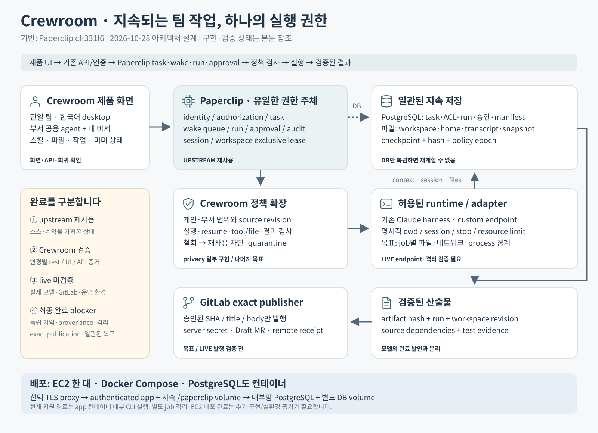

# Crewroom 아키텍처: 하나의 실행 권한, 지속되는 팀 작업

2026-10-28 · Astra 설계 및 리뷰 · GPT-6.1 Sol 제품 구현

Crewroom은 **Paperclip의 전체 소스를 기반으로 한 팀 에이전트 제품**이다. 한국어 작업 화면에서 공용 전문 에이전트와 개인비서를 사용하고, 대화가 문서·코드·테스트·검토 가능한 결과물로 이어지게 한다. Paperclip이 모든 작업과 실행의 유일한 권한 주체이며 Crewroom은 제품 경험과 필요한 정책을 같은 시스템 안에 확장한다.

**전체 소스를 가져왔다는 사실은 Crewroom의 모든 요구가 완료되었다는 뜻이 아니다.** 아래 그림과 계약에는 첫 구현 범위와 아직 구현·검증해야 할 목표가 함께 포함되어 있다. 최신 검증 상태는 [리뷰 기록](REVIEW.ko.md)을 따른다. 실제 Claude endpoint 추론과 GitLab 발행은 검증되지 않았다.



[큰 PNG 그림](./architecture.png) · [편집 가능한 SVG 그림](./architecture.svg) · [기반 소스 기록](../../crewroom/UPSTREAM.json)

## 1. 기반 소스와 책임

기준 소스는 [Paperclip cff331f6](https://github.com/paperclipai/paperclip/tree/cff331f6ca0a652b5e41641c68dfa5fa584c22ae)이다. import receipt에 전체 revision, upstream URL, MIT license hash, 이전 Crewroom revision을 보존한다. 원본 Paperclip은 MIT, Crewroom 독창 파일·자산은 각 파일/디렉터리에 명시된 0BSD 범위만 적용한다. 제3자 attribution을 제거하지 않는다.

| 소유 모듈 | 책임 | 금지하는 중복 |
|---|---|---|
| Paperclip core | identity, 회사/팀 접근, task, wake queue, run, lease, session, approval, audit | Crewroom 별도 task DB, scheduler, worker ledger |
| Crewroom UI | 단일 팀 홈, 부서 명부, 내 비서, 작업/파일/스킬, 팀장·팀원 보기, 캐릭터 | 화면 상태로 권한이나 완료를 결정 |
| Crewroom 정책 확장 | 개인/부서 범위, 과거 source revision과 철회, 실행/발행 admission | UI만의 ACL 또는 실행 뒤 사후 점검 |
| 실행 adapter | 허용된 harness 실행·stream·resume·cancel, 정규화된 결과 | 자체 task 재할당, 외부 publication 승인 |
| 지속 저장 | DB metadata와 파일/transcript/snapshot의 일관된 reference | DB session ID만으로 파일 복구 완료 주장 |
| GitLab publisher | 승인된 정확한 proposal만 발행하고 remote receipt 확정 | runtime에 장기 write token 제공, 무조건 retry |

현재 upstream adapter를 먼저 사용한다. `claude_local`의 ACP/CLI 경로와 official Claude harness 연결은 확인된 소스 기반이다. 이를 쓴다는 이유만으로 custom endpoint, sandbox, 취소 품질이 검증되는 것은 아니다.

## 2. 모듈 의존성과 확장 계약

제품 UI는 public API와 shared contract에 의존한다. API는 authenticated actor를 해석하고 기존 authorization/service로 위임한다. 정책 확장은 승인 여부와 이유를 반환하며 provider SDK와 무관하다. adapter는 정규화된 실행 요청을 받는다. provider payload가 UI나 policy의 계약으로 번지지 않게 한다.

```text
ui/crewroom → packages/shared + 기존 API clients
server/routes → 기존 authorization + application services
application services → 정책 확장 + 기존 durable task/run/approval services
execution services → adapter + workspace/session persistence
artifact services → 권한 검사 + content manifest
GitLab publisher → 승인/action service + GitLab transport
```

아래 이름은 **목표 인터페이스 설계**이며 현재 전부 구현된 API가 아니다. upstream에 같은 책임의 계약이 있으면 그 owner를 확장하고 별도의 facade state machine을 만들지 않는다.

| 제안 계약 | 입력·출력 | 반드시 실행되는 시점 |
|---|---|---|
| `admitWork` | 인증 actor, company/task, action, policy revision → allow/deny와 reason | 요청 수락 및 durable 재시도 직전 |
| `resolveExecutionContext` | task/session/workspace, 승인된 sources → snapshot + source manifest | 최초 실행·resume·handoff |
| `validateContextRevision` | 누적 source manifest와 현재 ACL/revision → valid 또는 quarantine | context/tool/file 접근, 이어 실행, 결과 확정 |
| `acquireExecutionCapability` | run ID, workspace binding revision, 허용 작업 → bounded capability | process 시작 전, 만료/철회 시 무효화 |
| `finalizeWorkProduct` | run, artifact hash, dependencies, workspace revision → 확정 artifact receipt | 성공 표시에 앞서 |
| `preparePublication` | repository, base/head SHA, artifact manifest, title/body → immutable proposal | 사람의 발행 승인 전 |
| `publishApprovedProposal` | proposal ID/hash, exact approval revision → remote receipt/uncertain | external write 직전 재검증 |
| `restoreConsistentCheckpoint` | backup manifest와 policy epoch → 복원 가능한 상태/차단 이유 | 재시작·재해복구 후 실행 재개 전 |

기존 issue checkout, single assignee, budget hard-stop, approval gate, activity logging, workspace exclusive lease의 소유권은 core에 남는다. 정책 확장 안에서 task queue나 poller를 새로 만들지 않는다. durable 재시도는 기존 work signal/scheduler에 등록한다. event는 다시 조회할 힌트이며 DB의 확정 상태가 진실이다.

## 3. 첫 구현 단면

단일 팀 홈은 현재 backend가 허용한 하나의 company를 제품의 ‘팀’으로 표현한다. company FK와 company 접근 검사는 유지한다. 잘못된/다중 팀 선택을 임의 첫 팀으로 숨기지 않는다.

부서 registry는 `direct`(직속), `development`(개발), `operations`(운영), `qa`(QA)이다. `agents.metadata.crewroom`은 `{schemaVersion:1, departmentId, characterId?, displayOrder?}` 형태의 **표시 데이터**다. 미분류 에이전트는 별도 표시한다. 부서명은 ACL이 아니며 이름·직무 문자열로 권한을 추측하지 않는다. 이 표시 계약은 새 DB migration을 요구하지 않는다.

팀장/팀원 보기는 현재 board access와 active company membership으로 결정한다. owner/admin은 관리 보기를 사용할 수 있고 operator는 팀원 보기, viewer는 읽기 전용이다. 버튼별 backend permission은 계속 별도로 적용된다. 보기 전환이나 localStorage는 권한을 바꾸지 않는다. 일반 팀원 홈이 관리자 전용 members API에 의존하지 않게 한다.

‘내 기본 비서’는 `user_company_preferences.primary_agent_id`를 사용한다. 주 에이전트 설정은 개인별 기본 선택이며 독립 agent ownership이 아니다. ‘대화하기’는 기존 AgentChat/TaskDetailSurface, issue comments, normal wake queue로 연결한다. BoardChat의 직접 Claude subprocess relay는 사용하지 않는다.

실시간 상태는 실제 agent lifecycle/run/interaction을 바탕으로 한다. live-runs의 `minCount:0`을 유지하고 이전 성공 run을 현재 실행으로 세지 않는다. 접근권한 부족/오류를 ‘0건’이나 ‘대기’로 위장하지 않는다. 미미의 대기·작업·확인 대기·오류·완료 동작도 이 관측에 따른다. 애니메이션이나 경과시간은 실행 증거가 아니다.

스킬과 작업공간은 upstream 버전/할당/권한과 canonical 경로로 연결한다. ‘스킬로 업무 만들기’가 단순 issue creation에 특정 skill/version 사용 요청을 담는 단계라면 그렇게 표시한다. 실제 immutable skill snapshot에 적용되는 계약이 없는 상태에서 ‘이 버전으로 실행됨’이라고 표시하지 않는다.

## 4. 개인 대화와 독립 개인비서의 차이

기준 upstream의 `/companies/:companyId/chats/:agentRef`는 사용자별 conversation identity를 쓰지만 생성 요청에 visibility를 지정하지 않는다. issue create의 기본값은 `open`이다. 사용자별 목록/쓰기 소유권만으로 읽기 비공개를 보장할 수 없으므로 Crewroom의 새 대화는 다음 의미를 기존 issue service에 전달한다.

- `visibility:'private'`
- `createdByUserId`와 `responsibleUserId`는 인증된 사용자
- `trustExplicitResponsibleUserId:true`는 서버가 구성하며 클라이언트 body를 신뢰하지 않음
- 기존 conversation identity, unique key, session generation 및 normal wake queue 유지

기존 `ensurePersonalPrivateProject`와 privacy root/access grants를 재사용한다. 기존 공개 conversation은 `409 chat_conversation_privacy_required`로 개인 대화 진입을 막고 ‘기존 공개 대화’임을 알린다. GET/POST와 동시 생성 중 service의 dedup 경로 모두 동일 계약이어야 한다. 공개 이력을 조용히 private로 바꾸거나 unique identity를 피해 중복 대화를 만들지 않는다. 명시적 privacy 전환은 personal project/root/grants와 audit를 검증한 뒤 재시도한다. 이미 공개됐던 내용의 과거 노출까지 취소됐다고 말하지 않는다.

목표의 독립 개인비서는 별도 요건이다. 한 사용자/팀에 한 agent identity를 연결하는 durable binding과, 그 agent의 home·memory·runtime configuration·source 접근을 같은 소유권 아래 보호해야 한다. 권장 binding은 `(company_id,user_id)` 및 `(company_id,agent_id)` unique이고 agent의 company 일치를 보장한다. 이를 추가하는 것만으로 enforcement가 완성되지는 않는다.

공용 specialist는 여러 사람의 일을 맡을 수 있으나 개인 history/file을 공용 agent home에 저장해 다음 사용자가 읽도록 해서는 안 된다. private conversation, agent identity/home, task workspace, provider session은 각각 다른 수명과 범위를 갖는다. 관리자 break-glass가 있는 upstream의 동작도 제품 정책에 드러내고 기록한다. ‘운영자도 절대 읽지 못함’은 별도의 암호학적 설계 없이는 약속하지 않는다.

## 5. 부서 접근과 memory/provenance 목표

부서 grouping에서 실제 부서 ACL로 확장할 때는 회사에 종속된 department registry/membership과 versioned policy가 필요하다. 사람/agent가 **시작, 읽기, 이어 실행, 인계, 승인, 발행**할 수 있는 범위를 구분한다. 부서 변경·퇴사·권한 철회는 신규 조회뿐 아니라 대기 task, resumed session, 이미 준비된 publication에도 적용한다.

memory는 저장 공간 자체가 아니라 source와 사용 이력을 가진 자원이다. 최소 계약은 source ID, revision/content hash, 원 소유자/범위, ACL revision, 생성/수정 시점, derived-from edges, revoke/quarantine 상태다. retrieval 결과뿐 아니라 과거 transcript, 파일, 요약, 생성 artifact에 도입된 dependency를 누적한다.

철회된 source가 포함된 history를 단순 prompt에서 빼는 것은 충분하지 않다. 모델 세션·파일이 이미 기억하고 있을 수 있기 때문이다. 재사용을 막고 관련 transcript와 outputs를 quarantine한 뒤, 허용된 sources와 검증된 파일 revision으로 새 세션을 준비한다. source record 삭제가 접근 허용으로 바뀌지 않게 missing reference는 fail closed다.

개인→공유 handoff는 사용자가 공개할 구체 내용/파일을 확인하는 기능이다. upstream의 privacyParentIssueId는 구조적 parent와 별개로 source privacy를 보존하므로 parentId를 제거해 공개하는 우회는 금지한다. 공유용 derived artifact는 승인한 부분만 담고 exact content와 source provenance를 기록한다.

## 6. 실행 격리·세션·중지

실행 단위는 작업에 바인딩된 workspace와 run이다. 같은 specialist agent가 여러 작업을 맡더라도 task mutable repository를 하나로 합치지 않는다. core가 exclusive lease와 binding revision을 소유하고 adapter는 전달받은 범위 안에서만 실행한다.

목표 실행 환경은 job별 filesystem/network/process 경계, 자원 제한, 명시적 cwd, 좁은 tool capability, 단기 인증, 만료/revocation을 제공한다. Claude harness의 기본 permission mode 또는 로컬 CLI라는 사실은 격리 증거가 아니다. 실제 custom endpoint는 auth, Messages/SSE, tool loop, model alias, resume, cancel, usage/error를 별도 시험한다.

Stop은 UI 상태 변경이 아니다. core가 새 쓰기를 fence하고 process tree 또는 remote operation의 종료 증거를 확인한 뒤 lease/workspace를 재사용할 수 있다. 부모 PID 종료만으로 후손 writer가 멎었다고 간주하지 않는다. retry와 resume는 같은 실행 권한을 중복 행사하지 않도록 run/session generation 및 workspace revision을 검사한다.

연결이 없는 첫 단면은 ‘실행 연결 필요’로 남는다. 기존 host credential을 조용히 가져다 사용하거나 fixture 결과를 live 추론으로 표시하지 않는다.

## 7. 산출물과 GitLab exact publication

문서·코드·테스트 결과는 실제 artifact/work product로 확인한다. 최소 manifest는 artifact ID/hash, 생성 run, workspace revision, source dependencies, access scope, 검증 evidence다. provider 응답 ‘완료’만으로 파일 저장/테스트/발행 성공을 확정하지 않는다.

GitLab publisher의 목표 상태는 다음과 같다.

```text
prepared → awaiting_approval → approved → publishing → published
                                      ↘ invalidated
                                           publishing → uncertain → reconciled / intervention
```

prepared proposal에는 repository identity, base/head SHA, exact tree/patch hash, title/body hash, 생성 source와 permissions revision이 들어간다. 승인은 이 immutable proposal에 묶인다. 내용이나 revision이 바뀌면 승인을 재사용하지 않는다. write 직전 현재 권한과 proposal을 다시 검증한다.

장기 GitLab write credential은 server-held secret이다. 일반 model shell에 넘기지 않고 publisher만 사용할 수 있다. push와 Draft MR에는 idempotency/remote identity receipt와 unknown-outcome reconciliation이 필요하다. 성공 응답이 유실되었다고 다시 발행하지 않는다. 기존 GitHub managed credential 경로 또는 GitLab catalog 카드의 존재는 이 흐름의 완료 증거가 아니다. merge는 별도 명시적 승인이다.

## 8. 지속 운영과 일관된 복구

백업 단위는 DB만이 아니다. task/ACL/action metadata, files, transcripts, workspace revisions/snapshots, source manifests, artifact hashes, 필요한 secret key reference의 일관성을 함께 보존한다. backup manifest는 checkpoint ID, content hashes, schema/version, policy epoch와 각 reference의 포함 여부를 기록한다.

복원은 자동으로 작업을 다시 실행하지 않는다. DB와 workspace/transcript가 같은 checkpoint인지 확인하고, 복원된 오래된 capability/승인을 현재 policy epoch와 대조해 무효화한다. 이미 external side effect가 일어난 publication은 remote reconciliation부터 수행한다. incomplete restore는 차단 상태로 남기고 무엇이 없어서 재개할 수 없는지 표시한다.

장기 운영에서 idle agent가 항상 OS process로 떠 있을 필요는 없다. identity와 work state가 지속되고, durable wake가 올 때 core가 실행한다. 새 background maintenance interval을 만들지 않고 기존 scheduler의 pending work/deadline/retry/shutdown 계약을 사용한다.

개발 검증은 별도 데이터 경로/포트/config를 사용한다. 현 source의 embedded PostgreSQL 동작을 확인하고 기존 사용자 DB를 reset하지 않는다. 독립 Crewroom dev config에서 `telemetry.enabled:false`를 선택하며 upstream telemetry event schema/generated contract를 바꾸지 않는다. observability endpoint와 local run log는 서로 다른 데이터 경로다.

## 9. 완료 판정: 네 종류의 증거

이 표는 기능 보유와 실제 검증을 분리한다. 구현 중인 항목은 검증 완료로 승격하지 않으며 실제 기록은 [foundation 작업 기록](../plans/2026-10-28-crewroom-paperclip-foundation.md)과 후속 review evidence에 남긴다.

| 범위 | upstream 재사용 | Crewroom 확인 증거 | live 미검증 | 최종 완료 blocker |
|---|---|---|---|---|
| core task/wake/session/workspace | pinned source와 관련 test 구조 확인 | 전체 source import, frozen install 기록 | 실운영 load/장기 recovery | 장애·stale writer·복원 검증 |
| 한국어 홈/부서/캐릭터 | UI/router/agents/live events | 구현 중; test/render evidence 필요 | 실제 팀 운영 | 정확한 상태·권한·접근 UX |
| 개인 대화 | conversation+issue privacy+개인 project | privacy 수정/통합 검증 진행 | 실제 다중 사용자 운영 | 두 사용자 직접 API·artifact/event 차단 |
| 독립 개인비서 memory/home | agent/file/session 기반 존재 | 목표 설계 | 격리·재개·철회 | binding과 전 경로 ownership enforcement |
| 부서 ACL/provenance | 회사/issue/project 권한 재사용 | grouping은 ACL 아님 | historical source revocation | department policy와 누적 dependency fencing |
| Claude custom endpoint | existing claude_local adapter | 설정 연결/fixture는 별도 기록 | 실제 endpoint inference/tool/resume/stop | credential과 실제 compatibility proof |
| 스킬 작업 | catalog/versions/assignments/snapshot | UI 요청과 실제 version 적용 구별 | 원하는 실제 업무 품질 | immutable 적용 증거와 tool 실행 |
| GitLab Draft MR | 일반 approval/action 기초 재사용 | 목표 설계 | push/MR/retry reconciliation | exact proposal publisher 구현·실계정 proof |
| backup/restore | snapshot/recovery 기반 존재 | 목표 일관성 계약 | 완전 복원/revocation/remote reconcile | 재해복구 시나리오 통과 |

단계는 (1) 실제 제품 진입과 비공개 대화, (2) 독립 identity·scope·provenance, (3) 격리 실행과 exact GitLab publication, (4) 일관된 복구·장기 운영 proof 순서다. 첫 단면 완료를 최종 전체 제품 완료로 발표하지 않는다.

## 10. 리뷰 기준

Astra는 제품 의미·권한·실행 소유권·코드 경계를 설계/리뷰하고 Sol은 소스를 구현한다. review는 변경 diff와 실제 검증 증거를 기준으로 한다. upstream 모든 파일을 가져온 상태에서 과거 Crewroom runtime이 다시 연결되지 않았는지, UI의 상태와 backend authority가 일치하는지 먼저 확인한다.

새로운 core 변경은 어떤 invariant owner가 왜 확장되어야 하는지 설명해야 한다. UI 때문에 heartbeat orchestration이나 authorization을 복제하면 차단한다. credential 미제공, fixture-only, 미실행 tests, 기존 baseline failures는 성공한 일부 검증 뒤에도 보고에 남긴다.

관련 기반 계약: [Agent Chat](https://github.com/paperclipai/paperclip/blob/cff331f6ca0a652b5e41641c68dfa5fa584c22ae/server/src/services/agent-conversations.ts), [Authorization](https://github.com/paperclipai/paperclip/blob/cff331f6ca0a652b5e41641c68dfa5fa584c22ae/server/src/services/authorization.ts), [Issue 생성/상태](https://github.com/paperclipai/paperclip/blob/cff331f6ca0a652b5e41641c68dfa5fa584c22ae/server/src/services/issues.ts), [Task sessions](https://github.com/paperclipai/paperclip/blob/cff331f6ca0a652b5e41641c68dfa5fa584c22ae/packages/db/src/schema/agent_task_sessions.ts), [Workspace leases](https://github.com/paperclipai/paperclip/blob/cff331f6ca0a652b5e41641c68dfa5fa584c22ae/packages/db/src/schema/execution_workspace_runtime_leases.ts), [Claude adapter](https://github.com/paperclipai/paperclip/tree/cff331f6ca0a652b5e41641c68dfa5fa584c22ae/packages/adapters/claude-local).

## 11. EC2 한 대 + Docker PostgreSQL 배포 계약

사용자 목표는 EC2 한 대에서 앱과 PostgreSQL을 모두 Docker로 운영하는 것이다. 기준 upstream의 [Dockerfile](../../Dockerfile), [Compose](../../docker/docker-compose.yml), [Docker 배포 설명](../../docs/deploy/docker.md), [deployment modes](../../docs/deploy/deployment-modes.md)를 확인했다. 현재 실제 지원 기반은 **app container 안에서 local adapter CLI를 실행하는 구조**다. 별도 runner container를 선언하는 것만으로 job 격리가 동작하지 않는다. `docker/agent-runtime/` 이미지들은 sandbox provider와 shim의 provisioning 계약을 위한 것으로, 이번 Compose의 자동 분리 worker가 아니다.

권장 배포 구성:

| 서비스/자원 | 계약 |
|---|---|
| `app` | upstream Dockerfile `target: production`을 명시. 마지막 `cloud` stage를 실수로 기본 선택하지 않음. authenticated mode, 내부 3100, `/paperclip` 지속 volume |
| `db` | 별도 PostgreSQL 17 container, 전용 password, healthcheck, PG data volume. host `ports` 없음. app만 붙는 internal network |
| `proxy` | 선택적 Caddy profile 또는 외부 TLS termination. domain이 있으면 80/443만 공개. proxy→app 네트워크 연결 |
| network | DB 전용 internal backend + app/proxy의 frontend/egress network. app의 custom Claude endpoint/GitLab 통신은 승인한 destination만 허용하는 운영 정책으로 관리 |
| host 접근 | proxy 미사용 상태는 app을 `127.0.0.1:3100`에만 publish하고 SSH/VPN 등의 사설 접근. public 인터넷에 raw 3100/5432 공개 금지 |
| 인증 | `PAPERCLIP_DEPLOYMENT_MODE=authenticated`. 인터넷 노출이면 `PAPERCLIP_DEPLOYMENT_EXPOSURE=public` + 명시적 HTTPS `PAPERCLIP_PUBLIC_URL`. VPN이면 private + 허용 host 정책 |
| process | image가 제공하는 tini 사용. 이중 init 불필요. app `pids_limit:2048`, `stop_grace_period:90s`, healthcheck와 `restart:unless-stopped` |
| secrets | 독립 DB password, `BETTER_AUTH_SECRET`, `PAPERCLIP_TOOL_ACTION_SIGNING_SECRET`. sample secret으로 기동되지 않게 함. provider/GitLab secret은 기존 server vault 경로 |
| volumes | PostgreSQL data와 app `/paperclip`을 분리. config/local secret key/agent homes/workspaces/transcripts/uploads를 재시작 후 보존. volume 삭제 명령을 일반 restart/update 절차에 넣지 않음 |
| backup | DB dump + 쓰기를 멈추거나 일관된 checkpoint에서 app volume manifest를 함께 보관. 같은 EC2 디스크의 backup만으로 EC2 손실을 복구할 수 있다고 주장하지 않음 |

상태 확인은 app process 존재가 아니라 DB 연결/마이그레이션 완료/API health, 로그인 및 팀 접근, 파일/대화의 재시작 후 보존을 포함한다. PostgreSQL health가 선행되어야 app을 시작한다. migration은 한 주체가 수행하며 업데이트 전 복구 가능한 backup을 남긴다. 실패 시 이전 image와 호환 schema/데이터 복원 전략을 분리한다. image digest와 full source revision을 배포 receipt에 기록한다.

**격리 한계:** local CLI는 app과 같은 컨테이너/사용자 및 일부 filesystem/process 환경을 공유할 수 있다. DB URL, config, secret storage와 같은 control-plane 자원에 접근 가능한 위험은 별도 app/DB 컨테이너만으로 해결되지 않는다. 이 프로필을 ‘사용자별 격리 실행 완료’로 표시하지 않는다. Docker socket mount, privileged mode, broad host mount를 추가해 임시로 해결하지 않는다. 완전한 job isolation은 실제 지원 sandbox provider의 admission, filesystem, egress, credential, stop/lease 계약까지 통과해야 한다.

Dockerfile은 기준 소스에서 CLI 일부를 `@latest`로 설치한다. source revision이 고정되어도 harness binary 전체가 reproducible하다는 뜻은 아니다. 첫 이미지에서 실제 설치 버전과 digest를 기록하고, 후속 운영 이미지에서 검증된 harness 버전을 pin하는 책임을 둔다.

EC2 계정/인스턴스가 제공되지 않은 상태에서는 **local Docker build/health/auth/database persistence smoke**만 검증할 수 있다. 그 결과를 EC2 배포, public TLS, 실제 사용자 로그인 운영, 실제 inference/GitLab 성공으로 바꾸어 보고하지 않는다.

## 12. 화면 capability의 좁은 서버 projection

역할은 기본 보기 선택에만 사용한다. 작업 생성·담당자 지정·agent 설정의 실제 가능 여부는 기존 backend authorization과 같은 판단을 재사용한다. 전역 `/cli-auth/me`에 모든 회사의 단순 write boolean을 덧붙이면 scope grant를 오판할 수 있으므로 company-scoped `/companies/:companyId/crewroom/capabilities` projection을 권장한다.

선택한 `assigneeAgentId`, `projectId`, 필요 시 `parentIssueId`/`assigneeUserId`를 검증한 concrete scope로 기존 `access.decide({action:'tasks:assign', ...})`를 호출한다. `canAssignTasks`, `canConfigureAgents`, `canCreateAgents`는 별개 결과다. 담당자 없는 task 생성은 해당 API의 company mutation eligibility를 별도로 반영한다. `tasks:create`라는 존재하지 않는 permission을 만들지 않는다. GET에 대한 `assertCompanyAccess`만으로 mutation eligibility를 계산하면 viewer가 통과할 수 있으므로 금지한다.

응답은 현재 선택에 대한 affordance이며 authorization token이 아니다. 실제 write API는 다시 검사한다. UI는 선택이 바뀌면 query scope를 바꾸고, 확인 전/실패 시 write를 비활성화한다. 임의 raw grant/actor 내부 구조는 노출하지 않는다.

현재 첫 projection의 입력은 선택 company와 `assigneeAgentId`이며 project/parent/user-assignee scope는 null이다. 이는 홈의 기본 업무 생성 진입을 위한 좁은 범위다. 이후 기존 새 업무 모달에서 project나 parent를 변경하면 실제 생성 API가 최종 concrete scope를 다시 검사한다. 이 첫 projection을 모든 project에 대한 일괄 assignment 권한으로 해석하지 않는다.

개인 대화 admission도 같은 정책을 재사용한다. 현재 board의 `agent:read`와 `agent:wake`는 company membership을 허용하므로 private agent의 assignment policy를 대신하지 못한다. 새 conversation 생성과 기존 대화의 새 실행 요청은 concrete 대상에 대한 `tasks:assign`을 별도로 확인한다. 철회 뒤에도 소유한 과거 대화 이력 읽기는 기존 issue ACL에 따른다. 수락 뒤 durable 실행·재시도에서 권한이 바뀌는 경우는 기존 책임 사용자 admission과 실제 철회 검증으로 다뤄야 하며 route 검사만으로 완전한 runtime fencing을 주장하지 않는다.

## 13. 대화를 주 진입으로 삼는 업무 계약

사용자는 먼저 원하는 결과를 말한다. 기본 진입은 기존 Agent Chat이고, 직접 업무를 작성하는 화면은 보조 진입으로 남긴다. 에이전트는 실행 의도가 분명한 요청만 필요한 최소 수의 업무로 나누어 담당자에게 배정한다. 모든 발언을 업무로 바꾸는 별도 intent 분류기, task 저장소, 실행 queue는 추가하지 않는다. 모델은 의도를 해석하지만 실행 권한과 중복 방지는 기존 서버가 결정한다.

| 사용자 입력과 현재 모드 | 동작 | 다시 물어야 하는 조건 |
|---|---|---|
| 질문, 비교, 아이디어 탐색 | 대화에서 답변·조사. 독립 실행 업무를 자동 생성하지 않음 | 답을 바꾸는 필수 정보가 없음 |
| 명확한 실행 요청 + standard | 기존 프로젝트와 담당자를 선택하고 `create_task`로 생성·실행 인계 | 결과·저장소가 중대하게 모호하거나 필수 접근이 없음 |
| 계획만 요청하거나 Plan 모드 | 계획을 작성·수정. 실행 전환은 기존 모드·승인 계약을 따름 | 사용자가 실행 전 검토를 요청했으면 revision에 묶인 승인 |
| Ask 모드 | 읽기와 답변만 수행 | 쓰기를 위해 명시적 모드 전환이 필요함 |
| 진행 중인 같은 업무의 수정 요청 | 기존 업무 상태와 결과를 읽고 가능한 기존 업무에 지시를 전달 | 새로운 범위 또는 별도 승인 대상이 추가됨 |
| 완료된 업무의 구체적인 수정 요청 | 기존 업무를 확인하고 허용된 comment/reopen 흐름으로 같은 업무와 산출물 revision을 이어감 | 대상 업무·산출물이 모호하거나 기존 권한으로 다시 열 수 없음 |
| 개인 자료를 팀에 공개하거나 외부에 발행 | 구체적인 내용과 대상에 대한 기존 승인·권한 확인 | 개인→공유 공개 및 별도 governed action의 승인 |

명확한 일반 실행 요청에는 관습적인 계획 승인 단계를 추가하지 않는다. 승인 카드가 이미 존재하면 채팅 답변을 그 카드의 정확한 revision과 연결해 기존 resolution API에 기록한 뒤 이어간다. 명시적인 계획 승인이 없는 요청에 승인 revision/interaction ID를 만들어 넣지 않는다. 실제 요청 comment, source conversation, 허용한 범위와 남은 실행 단계를 전달한다.

업무별 의견·수정 요청은 기존 task detail의 comment composer로도 바로 진입할 수 있어야 한다. 단순 감사나 평가를 재실행 요청으로 해석하지 않는다. 이미 실행 중인 업무는 기존 steering/queued-comment·interrupt 계약을 따르고, 일시 정지된 업무는 기존 resume gate를 존중한다. 완료된 업무 수정에는 기존 `reopen` 경로와 workspace 복구를 사용하며 새 task로 이력을 끊지 않는다. ‘그거 다시 고쳐줘’의 대상이 여러 개면 직전 대화와 task 링크를 먼저 확인하고 여전히 모호할 때만 후보를 묻는다. task 재사용은 권한을 우회하지 않으며 거절된 comment/reopen을 성공했다고 보고하지 않는다.

### 기존 소유자와 전달 순서

1. `AgentChat`의 인증된 사용자 comment가 기존 wake 경로를 사용한다. `AGENT_CHAT_DIRECTIVE`는 의도·모드·추가 승인 규칙을 안내한다.
2. 에이전트는 읽을 수 있는 project/repository와 적합한 담당자를 확인한다. 의미가 분명하면 이미 있는 프로젝트를 재사용한다. 비코드 업무에는 repository가 필요하지 않을 수 있다.
3. native `create_task` 또는 `project-tools` MCP의 같은 기능으로 ordinary task를 만든다. 대화를 structural parent로 넣지 않는다. `initialPlan`에 결과·수용 기준·필요한 문맥과 남은 단계를 저장하고 source run 및 stable idempotency key를 유지한다.
4. issue service가 task, plan, 책임 사용자, source provenance 및 chat handoff를 기록한다. native receipt/API의 기존 재시도 경로를 사용한다. 같은 요청의 재시도는 같은 task를 반환하고 다른 payload의 key 재사용은 충돌로 처리한다.
5. task는 기존 assignment/wake/admission 경로로 실행한다. 대화 에이전트는 실제 생성 receipt의 링크를 답하고 turn을 끝낸다. 작업을 대화 안에서 중복 실행하거나 child 결과를 polling하지 않는다.
6. `chat-completion-delivery`가 확정된 task 완료를 원 대화의 현재 session generation에 전달한다. 답변은 저장된 상태와 접근 가능한 결과를 근거로 한다. 완료 이벤트 자체가 새 업무 생성의 권한은 아니다.

private 대화의 실행 업무는 public 프로젝트를 선택해도 자동 공개되지 않는다. 기존 `issueService.create`는 `originRunId`/`actorRunId`의 원 issue를 찾아 `visibility`, `privacyRootIssueId`, `privacyParentIssueId`를 상속한다. 이 access edge는 structural parent와 별개다. 원 대화 전체나 다른 개인 자료를 무조건 복사하지 않고 해당 업무에 필요한 문맥만 전달한다. 별도의 허가된 공유 절차 없이 source 연결을 끊어 공개하지 않는다.

UI는 ‘생성됨’, 실제 run에 따른 ‘진행 중’, ‘확인 필요’, 접근 가능한 산출물이 있는 결과를 구분한다. 생성 receipt는 실행 성공이 아니다. 모델 연결이 없는 설치에서 자동 업무 실행이 검증되었다고 표시하지 않는다. 캐릭터는 기존 Crewroom plush 자산을 사용하고 coding/QA/review 동작을 실제 관측 상태에 연결한다. 현재 run이 없으면 작업 애니메이션을 근거 없이 재생하지 않는다. 사용자의 motion 감소 설정을 존중한다.

### 수용 증거

첫 변경은 directive, 기존 진입 UI와 좁은 회귀 검사에 한정한다. native와 MCP 각각 private source에서 public 프로젝트로 인계해도 비공개와 책임자/source 연결이 유지되고, 비허용 사용자는 읽지 못하며, 재시도에 task·plan·handoff가 중복되지 않는지 검사한다. 기존 Ask/Plan gate와 completion delivery의 session reset·중복 방지 계약도 유지한다. 이 증거는 모델의 한국어 의도 해석 품질을 증명하지 않는다. 실제 연결에서 질문만 있는 대화, 명확한 실행 요청, 기존 업무 수정, 명시적 계획 승인, private 자료 포함 요청을 별도로 실행해야 전체 대화→업무→결과 흐름을 검증했다고 할 수 있다.
