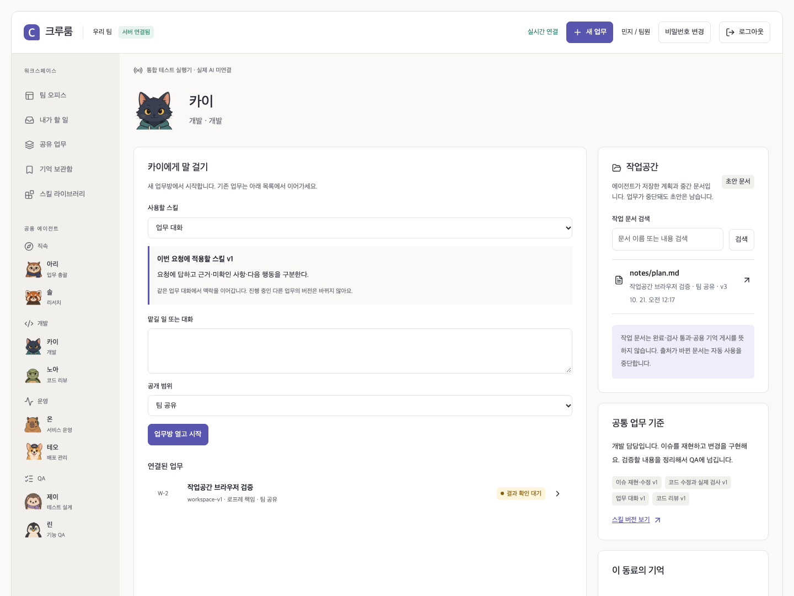

# 에이전트의 영속 작업공간

0.14.0. 공용 에이전트는 계획·진행 메모·Markdown 초안을 직접 만들고 수정한다. 모델이 선택한 행동을 서버가 실행하고 실제 저장 결과를 돌려준 다음, 모델이 다음 행동을 고른다. 에이전트 홈과 업무방에서 동일한 문서와 버전을 연다.

[](diagrams/agent-workspace.svg)

## 사용자 흐름과 구현 범위

1. 카이에게 “계획을 문서로 남기고 진행해줘”라고 요청한다.
2. `list_workspace`로 허용된 이전 문서를 찾고 `read_workspace`로 필요한 부분을 읽는다.
3. `write_workspace`로 계획이나 초안을 저장한다. 실제 DB 저장 receipt가 생긴 뒤에만 화면에 문서가 나타난다.
4. 문서 수정은 확인한 revision으로 수행한다. 이름 변경은 ID를 유지하고, 모든 버전은 DB에 남는다.
5. 실패·취소·재시작 후에도 **저장이 끝난 초안**은 남는다. 다음 실행에는 문서를 도구로 읽고 이어가도록 안내한다. 실제 조회 여부는 실행 기록으로 확인하며 조회를 강제하는 gate는 없다. 저장되지 않은 모델 내부 생각은 복구하지 않는다.

분석·대화는 기존 기억 도구와 작업공간 도구를 합쳐 최대 20회 행동을 수행한다. 코드·QA는 기존 30회 루프에 같은 도구를 연결한다. 코드 파일 수정과 실제 검사는 별도의 격리된 Runner에서 실행한다. 이 작업공간은 영속 텍스트 문서이며 OS 터미널·임의 네트워크·CLI 세션을 추가하지 않는다. 예약·이벤트에 의한 자동 업무 시작은 이번 변경에 포함하지 않았다.



## 저장과 출처

| 데이터 | 위치와 책임 |
| --- | --- |
| 문서 ID·경로·현재 revision·작성 agent·원래 업무 | `cr_workspace_documents` |
| 본문·이름·보관 상태·작성 Run/generation·출처 | `cr_workspace_versions`, 불변 버전 |
| 실제 조회의 당시 출처 | `cr_workspace_observations`, 추가만 하는 감사 기록 |
| 현재 실행이 기대하는 문서 버전 | `cr_workspace_reads`, 성공한 같은 generation의 CAS 저장만 갱신 |
| 저장 요청·입력 hash·실제 receipt | `cr_workspace_operations`, 재전송해도 중복 저장하지 않음 |
| 코드·빌드·검사 파일 | 업무별 Runner tmpfs; checkpoint patch와 검사 근거는 기존 DB 계약 유지 |

문서는 **task 소유**이며 작성 agent는 출처다. 에이전트 홈은 사용자가 볼 수 있는 업무 문서를 모은 가상 화면이다. 같은 공용 에이전트를 사용한다는 이유로 개인 문서가 공유되지 않는다. 다른 업무는 같은 agent·프로젝트·허용 공개 범위의 문서를 조회할 수 있다. 같은 업무의 다음 담당 QA는 개발자가 남긴 문서를 읽을 수 있다. 쓰기는 현재 실행의 업무·작성 agent에 한정한다.

새 문서는 `expectedRevision:0`, 수정은 현재 revision을 보낸다. 서버는 context 잠금 → task/run → 현재 Run·단계·대상·입력 결과·generation·lease·사용자·출처 → CAS 순으로 검사한다. 취소 후 늦은 쓰기는 거절하고 이미 commit한 초안은 보존한다. 모델의 “완료” 문장이나 문서 체크박스는 검사 receipt·업무 수용·공용 스킬 게시가 되지 않는다.

문서 목록의 제목도 읽은 자료다. 모델에게 반환한 목록의 출처를 기록하며, 원문 정정·삭제 또는 읽은 문서 변경으로 출처가 달라지면 이후 실행/결과 재사용을 막는다. 문서에 의존한 최종 답변과 파생 기억에도 출처가 이어진다. 초안은 자동 기억 검색과 embedding corpus에 넣지 않고 전용 도구로 찾는다.

## 이어가기에서 지키는 경계

기존 문서가 있는 업무는 과거 답변을 자동 입력으로 다시 주입하는 대신 **현재 문서를 도구로 다시 읽도록 안내한다.** 모델이 조회 없이 최종 응답을 선택할 수도 있으므로 실제 읽기는 도구 실행 기록으로 확인한다. 이전 답변은 UI 이력에 남는다. 현재 업무의 답변/episode와 해당 작업 문서에 의존한 파생 기억은 자동 문맥에서 제외한다. 문서가 없는 경우의 이전 답변 전달은 유지하며, 전달한 이전 결과·요약·재작업 본문의 출처를 고정해 문서에도 상속한다. 코드 QA는 summary 재주입 없이 정확한 patch와 등록 검사를 유지하고 개발자의 현재 문서를 도구로 조회할 수 있다.

문서 A를 참고해 B를 쓴 실행에서 다시 A를 고쳐 B의 출처가 끊어지는 변경은 commit 전에 거절한다. 이미 확정한 다른 실행에서 A가 바뀌면 B는 재검토 대상이다. 의존 문서를 자동으로 다시 작성하거나 과거 출처를 새 revision으로 조용히 바꾸지 않는다. 새 실행에서 현재 자료로 후속 문서를 작성한다. 이전 답변 본문을 모델도 읽으면서 그 출처 문서를 자유롭게 제자리 수정하는 일반 편집 세션과는 차이가 있다.

`archive_workspace`는 복원 가능한 버전 보존과 자동 사용 중단을 함께 수행한다. 목록에서 숨기고 이전 참조 revision을 무효화한다. 물리적 영구 삭제가 아니며 백업·버전은 남는다. 현재 화면은 조회·검색·버전 열기를 제공하고 사람의 직접 편집·보관 버튼은 제공하지 않는다. 정정은 대화에서 요청한다. 출처가 무효화된 문서는 내용·옛 제목을 노출하지 않으며 새 실행에서 현재 자료로 새 경로에 작성해야 한다.

## 장기 운영과 배포

| 한도 | 값 |
| --- | --- |
| 문서 목록·검색 | 20개/페이지, ID cursor; 허용 task/agent/프로젝트를 먼저 필터 |
| 본문 | 32,768자 및 UTF-8 64KB 이하 |
| 본문 응답 | 6,000자씩 부분 읽기 |
| 버전 목록 | 30개/페이지, revision cursor; 본문은 별도 조회 |
| 업무별 문서 | 보관 포함 최대 128개 |
| 업무별 버전 수 | 누적 4,096개; 빈 문서도 포함 |
| 업무별 전체 버전 본문 | 누적 16MiB; 초과 시 명시적으로 거절 |
| 실행 문맥 | 기존 모델 요청 200,000자 상한 유지; 초과 시 초안 보존 후 중단 |
| 기억 도구 | 기존 4회 한도 유지 |

별도 agent 컨테이너·FUSE·객체 저장소·새 프레임워크가 필요하지 않다. App/Worker를 같은 버전으로 배포하고 migration `013_agent_workspace.sql`을 적용한다. 기존 Compose의 PostgreSQL 영속 volume과 암호화 DB 백업에 문서도 포함된다. 복원 훈련은 head·버전·출처·보관 상태·조회 기록·멱등 receipt까지 비교한다. 이전 실행은 기존 복원 격리 절차로 차단한다.

문서 서비스는 `server/agent-workspace.js`, 실행 fencing은 `server/worker.js`, 행동 루프는 `server/memory-agent.js`·`server/runner-client.js`, 웹은 `src/live-app.js`에 구현했다. 새 외부 런타임 라이브러리를 추가하지 않았다.

## 화면 시연 재현

명시적으로 지정한 테스트 DB 안에 격리 schema를 만들고 종료 시 제거한다. 실제 운영 서버·계정·모델은 사용하지 않는다. FFmpeg는 화면 인코딩 도구이며 앱 의존성이 아니다.

```bash
TEST_DATABASE_URL=postgres://crewroom@127.0.0.1:5448/crewroom FFMPEG_BIN=/path/to/ffmpeg node scripts/capture-workspace.mjs
```

[스크린샷·GIF hash](media/workspace/manifest.json).

## 조사와 리뷰에서 선택한 방식

2026-10-20 확인. Anthropic은 memory 경로를 파일이나 DB 키에 연결하는 client-side 도구로 설명한다. 긴 작업 harness 예제는 진행 기록을 다음 실행에서 읽고 실제 검사와 완료 여부를 구분한다. [Memory tool](https://platform.claude.com/docs/en/agents-and-tools/tool-use/memory-tool), [Long-running harnesses](https://www.anthropic.com/engineering/effective-harnesses-for-long-running-agents).

AFS 논문은 파일 인터페이스와 저장 엔진을 분리하고 SQLite 기반 예제를 제시한다. AgentFS도 SQLite 파일 인터페이스 구현을 공개한다. 이번에는 구조를 참고하고 라이브러리는 도입하지 않았다. 이 자료는 DB 작업공간의 구현 근거이며 Crewroom의 실제 모델 품질이나 Claude Code와의 동등성을 증명하지 않는다. [AFS v1](https://arxiv.org/html/2512.05470v1), [고정 AgentFS SPEC](https://github.com/tursodatabase/agentfs/blob/0a014ebd4918615baff589ed17486e557e7c6a23/SPEC.md).

Astra 리뷰에서 자체 문서 출처·문서 간 전파·다음 대화의 자기 충돌·이력 경로 HTML 주입·조회 경합·코드 루프의 충돌 복구를 검토하고 회귀 검증을 추가했다. [검증 결과](evidence/0.14.0/verification.json). 화면과 프로토콜 검증은 합성 fixture/loopback이며 실제 endpoint에서 유용한 문서 관리 능력은 별도 평가가 필요하다.
