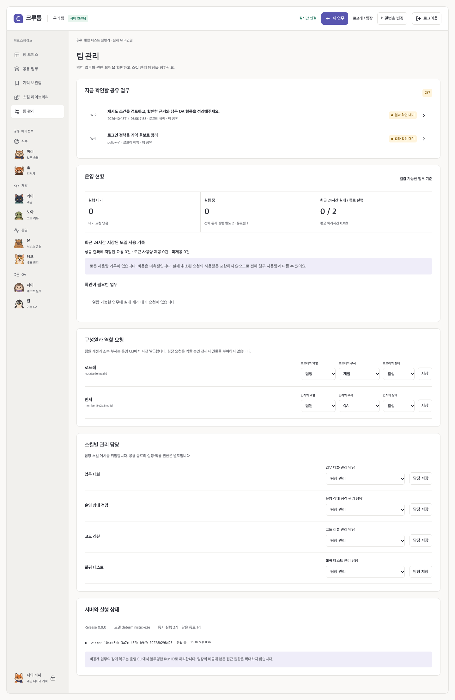

# 한국어 답변 평가

0.9.0은 실제 연결을 준비할 때 사용할 합성 20문항과 평가 CLI를 제공한다. 기본 실행은 계획만 출력하고 네트워크를 호출하지 않는다. 이번 릴리스 검증에서는 외부 모델 호출을 수행하지 않았다.

```bash
npm run evaluate:answers
npm run evaluate:answers -- --case=timeout-1,unknown-1 --repeat=2
```

계획에는 사례 ID, 반복 횟수와 예정 호출 수가 나온다. 사례당 한 번 호출하며 자동 재시도하지 않는다. 반복은 1~3회, 전체 호출 예산은 최대 60회다.

## 연결한 endpoint로 실행

[연결 설정](CONFIGURATION.md)에 따라 `MODEL_PROVIDER`, endpoint URL, `MODEL_NAME`과 비밀 파일 인증을 설정한다. 이 도구는 체크아웃의 Node 프로세스에서 실행한다. CLI는 실행 프로세스의 환경 변수를 읽으므로 `.env` 파일만 수정했다고 로드되지는 않는다. 키를 명령 인수나 Git에 넣지 않는다. fixture 설정은 거부한다.

기존 Compose용 `.env`와 비밀 파일을 사용한다면 Node 24에서 다음과 같이 실행한다. 명령에 들어가는 것은 키 파일의 경로이며 키 값이 아니다. 실행 머신에서 해당 endpoint에 접근할 수 있어야 한다.

```bash
MODEL_API_KEY_FILE=.local/secrets/model_api_key node --env-file=.env scripts/evaluate-answers.mjs --live --max-calls=20
```

환경 변수를 별도로 준비한 셸에서는 npm 명령도 사용할 수 있다.

```bash
# 전체 20문항: 명시적인 20회 호출 예산
npm run evaluate:answers -- --live --max-calls=20
# 먼저 두 문항만 확인
npm run evaluate:answers -- --live --case=timeout-1,unknown-1 --max-calls=2
```

예산을 생략하거나 예정 횟수보다 작게 지정하면 발송 전에 거부한다. `MODEL_MAX_OUTPUT_TOKENS`와 기존 모델 시간 제한도 적용된다. 호출 수는 금액 상한이 아니며 제공자별 요금과 입력 길이에 따라 비용이 달라진다. Ctrl+C로 중단한 보고서는 정상 비교 기준으로 사용할 수 없다.

보고서는 Git에서 제외된 `.local/answer-evaluation/`에 저장한다. 새 디렉터리는 `0700`, 새 파일은 `0600`으로 생성한다. 답변 원문, 사례별 실패 코드·지연·제공된 토큰 사용량, corpus hash·모델·profile ID를 포함한다. 인증값·endpoint URL·원본 제공자 오류 본문을 기록하지 않는다. 제공자가 사용량을 반환하지 않거나 일부만 반환하면 미측정으로 유지한다. 금액은 계산하지 않는다.

## 비교와 사람의 판정

```bash
npm run evaluate:answers -- --live --max-calls=20 --compare=.local/answer-evaluation/previous.json
```

같은 corpus hash·선택 문항 순서·반복 횟수·출력 토큰 예산을 가진 완전한 보고서끼리만 비교한다. 모델을 바꿀 수 있지만 제공자·profile·모델 차이를 함께 해석해야 한다. 자동 비교는 휴리스틱 통과 수와 평균 지연 차이이며 모델 우월성을 판정하지 않는다.

각 행의 `humanReview.accepted`와 `notes`는 사람이 읽고 판정할 자리다. 근거가 질문에 충분한지, 모르는 사실을 지어내지 않았는지, 실행하지 않은 검사를 성공했다고 쓰지 않았는지 검토한다. 자동 통과가 모두 나와도 이 판정을 생략하지 않는다. 실패·중단·금지 문구 또는 휴리스틱 실패는 CLI의 종료 코드 1로도 표시된다.

## 무엇을 평가하는가

| 범위                 | 검증 방법                                                                                                                 |
| -------------------- | ------------------------------------------------------------------------------------------------------------------------- |
| 제공 문맥으로 답하기 | `evaluation/answer-cases.ko.json`: 표현을 바꾼 질문, 답이 없는 질문, 정정된 사실, 적용 시점, 여러 근거, 원문 속 악성 지시 |
| 자동 표시            | 요구 문구·출처 key·불확실성·금지 문구의 규칙 검사. 의미적 정답 판정은 아님                                                |
| 기억 검색            | 별도 `npm run evaluate:memory`와 PostgreSQL 회귀 검사. 이 답변 CLI는 검색을 실행하지 않음                                 |
| 공유 경계·실행·협업  | 서버·Docker·브라우저 검사. 이 답변 CLI는 DB/Worker/Runner를 통과하지 않음                                                 |
| 실제 업무 효용       | [시범 운영](PILOT_GUIDE.md)에서 사람의 준비·검토·재작업과 결과 수용을 측정                                                |

CLI는 제품의 HTTP 모델 adapter를 사용하지만 문맥을 직접 제공한다. endpoint 응답만으로 해당 서비스가 실제 추론을 수행했는지 독립적으로 입증할 수 없다. 작은 합성 사례를 일반 정확도, 무제한 기억, 실사용 효율 또는 전체 비용으로 해석하지 않는다.

## 서버 화면에서 보이는 사용량

팀장용 운영 현황은 열람 가능한 업무의 최근 24시간 성공 산출물에 저장된 모델 요청 영수증을 합산한다. fixture는 제외하고 다중 요청을 한 번씩 센다. 사용량 누락 건수와 비용 미측정을 표시한다. 실패·취소 중 발생한 모든 요청을 청구 원장처럼 추적하는 기능은 아니므로 제공자 청구량과 다를 수 있다. 다른 구성원의 비공개 업무를 집계로 드러내지 않는다.


