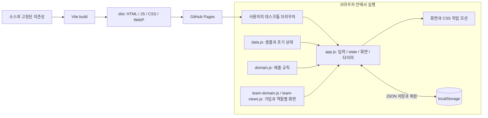
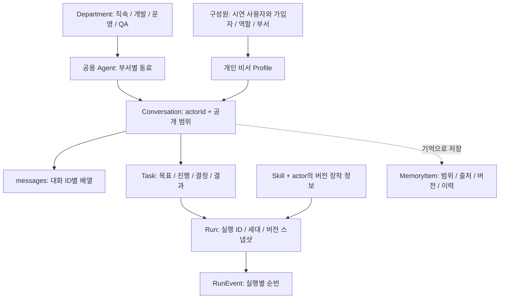
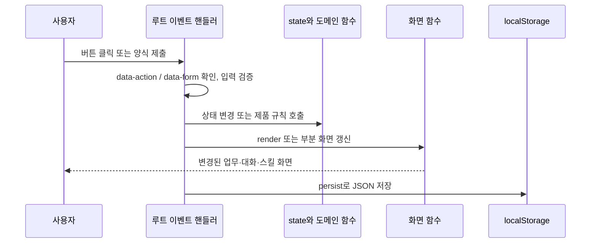
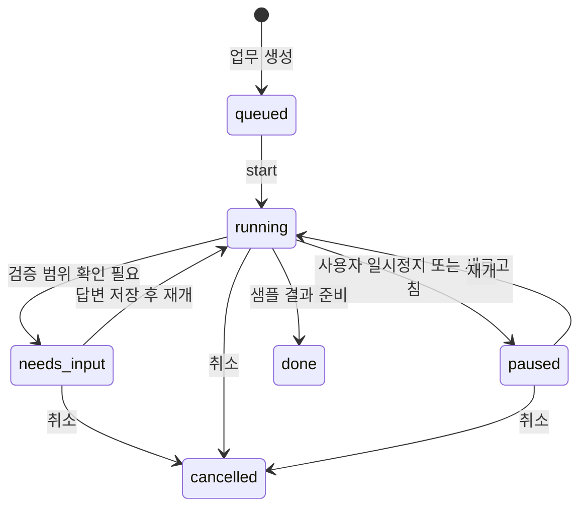
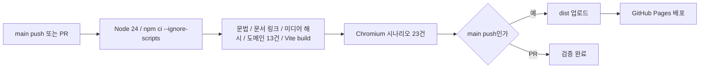
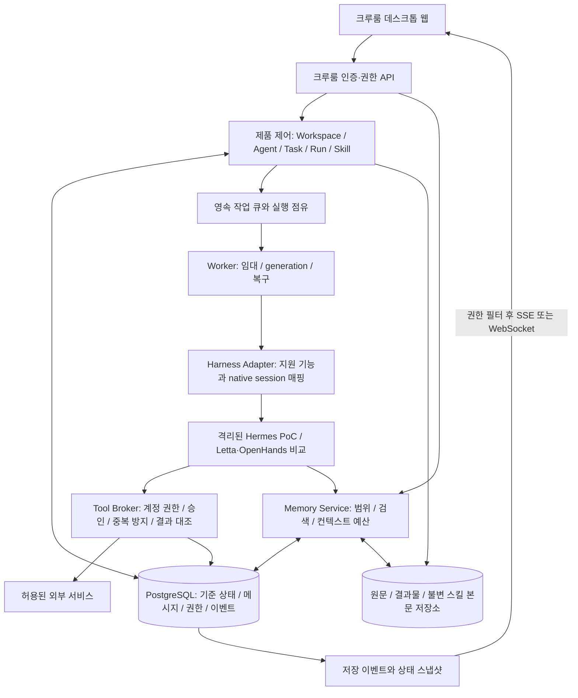

> **0.5 구현 안내:** 이 문서는 이전 기획·검토 기록입니다. 실제 서버의 현재 구조와 범위는 [서버 아키텍처](SERVER_ARCHITECTURE.md), [런타임 결정](ADR_001_RUNTIME.md), [운영 안내](SERVER_OPERATIONS.md)를 우선합니다.

# 크루룸의 기술스택과 구현 구조

> 2026-10-17 변경: 현재 정책·상태·Paperclip 재사용 경계·서버 복구 계약은 [리뷰 반영 확정 설계](DESIGN_IMPLEMENTATION.md)가 기준입니다. 이 문서의 기존 구조에 추가 적용합니다.

기준: 2026-10-17, 웹 프로토타입 `0.4.0`. 이 문서는 저장소의 실제 코드와 앞으로 연결할 서버 설계를 구분해 설명한다. 패키지 버전의 기준은 [package.json](../package.json)과 [package-lock.json](../package-lock.json)이다. 현재 제품 범위는 **하나의 공용 팀**이며, 팀 생성·초대·팀 전환 기능은 없다.

[README의 그림 중심 안내](../README.md#구현-구조)에서 전체 구성, 에이전트별 기억, 업무별 공유 세션, 실행 순서, 결과 검증과 서버 복구를 먼저 볼 수 있다. 아래는 그 구조에 대한 코드·데이터·서버 계약의 상세 설명이다.

Crewroom은 **설치마다 독립 워크스페이스를 제공하는 셀프 호스팅 플랫폼**이다. 하나의 서비스 인스턴스에 팀원·팀장·공용 동료·개인 비서를 두며, 부서와 개인 소유권을 구분한다. 아래 서버 구성 요소는 책임을 설명하며 각각을 별도 서비스로 배포해야 한다는 뜻은 아니다. 코드·샘플 데모와 각 설치의 계정·업무 데이터는 독립적으로 관리한다. [배포별 워크스페이스](TEAM_WORKSPACE.md#배포별-워크스페이스).

**주목표는 서버에 상주하는 공용 에이전트의 공동 사용**이다. 여러 팀원은 같은 Agent ID의 대화·업무·허용된 기억·스킬에 접근한다. 개인 비서는 보조 기능이며 공용 에이전트 요청의 필수 경유지가 아니다. [공용 에이전트 제품 계약](SHARED_AGENTS.md).

**현재 크루룸은 브라우저에서 상태를 관리하는 정적 웹 앱이다.** 대화·업무·기억·스킬의 상호작용은 구현되어 있고, 모델 응답과 에이전트 작업은 시뮬레이션한다. GitHub Pages는 이 앱의 파일을 제공한다. 실제 공용 에이전트 서버·개인 비서 프로세스·데이터베이스가 실행되고 있는 상태는 아니다.

- [현재 기술스택](#1-현재-기술스택)
- [실행 구조와 소스 지도](#2-현재-실행-구조와-소스-지도)
- [데이터 모델](#3-현재-데이터-모델)
- [상태 저장과 화면 갱신](#4-시작-상태-저장과-화면-갱신)
- [Task와 Run의 실행 흐름](#5-업무와-실행은-어떻게-움직이나)
- [대화와 공유](#6-공용-에이전트와-개인-대화의-공존)
- [기억 처리](#7-기억-저장검색정정삭제)
- [스킬과 하네스](#8-스킬-버전과-하네스-설정)
- [캐릭터·모션·접근성](#9-캐릭터와-작업-모션)
- [캡처·검증·배포](#10-캡처-검증과-배포)
- [실제 팀 서비스의 서버 설계](#11-다음-단계의-서버-아키텍처--설계안)
- [서버 연결 순서와 남은 검증](#12-서버-연결-순서와-완료-기준)
- [서버에 띄우는 방식과 운영 계약](#13-실제-서버-배포와-운영-설계)

## 1. 현재 기술스택

| 영역 | 실제 사용 기술 | 역할과 선택 이유 |
| --- | --- | --- |
| UI | HTML + CSS + JavaScript ES Modules | 화면과 상호작용을 직접 구성한다. 기존 목업의 시각 언어를 유지하면서 제품 계약을 빠르게 검증하는 범위다. |
| 개발·번들링 | Vite **8.3.4** | 개발 서버, 모듈·CSS·이미지 처리, `dist/` 정적 빌드. `base: './'`로 Pages의 하위 경로에서도 자산을 읽는다. |
| 브라우저 상태 | `app.js`의 단일 `state` 객체 | 명시적인 상태 변경 후 화면을 다시 그린다. 별도의 상태 관리 라이브러리는 사용하지 않는다. |
| 로컬 저장 | Web Storage의 `localStorage` | 현재 브라우저의 시연 상태를 JSON으로 저장·복원한다. 서버 DB나 사용자 계정 저장소를 대신하지 않는다. |
| 제품 규칙 | 순수 JavaScript 함수, `domain.js` | 대화 접근, 기억 범위, Run 스냅샷, 이벤트 세대, 스킬 적용 상태를 UI와 분리해 검사한다. |
| 아이콘 | Lucide **1.57.0** | 필요한 71개 아이콘을 명시적으로 import한다. 아이콘 전체를 번들에 포함하지 않는다. |
| 캐릭터 | WebP 아틀라스 + CSS | 10종의 캐릭터 초상을 한 이미지에 담고 배경 위치로 선택한다. 책상·손·상태 모션은 CSS로 구성한다. |
| 도메인 검사 | Node.js `node:test` + `assert` | 업무·대화 6건과 가입·역할·관리 7건, 총 13건을 검사한다. |
| 브라우저 검사 | Playwright **1.64.1**, Chromium | 업무·대화 13건과 가입·역할별 화면 10건, 총 23건을 검사한다. |
| 캡처 | Playwright + ffmpeg | 빌드한 앱을 조작해 PNG·WebM을 만들고 GIF로 변환한다. ffmpeg는 별도 실행 파일이다. |
| 서식 도구 | Prettier **3.9.10** | 개발용 서식 도구. 현재 `npm run check`에는 서식 검사를 포함하지 않는다. |
| CI / 호스팅 | GitHub Actions / GitHub Pages | 검사와 브라우저 테스트를 통과한 정적 빌드를 공개 배포한다. |
| 실행 환경 | Node.js **22.12 이상**, CI는 **24** | 개발·빌드·검사에 사용한다. 방문자의 브라우저에서 Node.js 서버가 실행되는 것은 아니다. |

React·Vue·Next.js·TypeScript·Redux·Zustand는 현재 의존성에 없다. LangChain·LangGraph·Mastra·Paperclip·Hermes·Letta·OpenHands도 설치하거나 호출하지 않는다. UI에 표시되는 하네스 이름은 [예시 프로필](../src/domain.js#L3)이다. `package.json`의 `private: true`는 npm 패키지의 우발적 발행을 막는 값이며, 공개 GitHub 저장소의 열람 범위와는 별개다.

이 선택은 **목업의 구현 선택**이다. 실제 공용 서비스에서는 인증·동시 수정·실행 복구가 추가되므로, 지금의 단일 컨트롤러를 그대로 서버로 옮기지 않는다. 실행 프레임워크의 도입 판단은 [공개 코드 조사](OPEN_SOURCE_CODE_RESEARCH.md)에서 다룬다.

## 2. 현재 실행 구조와 소스 지도

배포 서버는 파일을 제공하며, 업무 상태를 계산하는 주체는 브라우저다. 서로 다른 컴퓨터에서 데모를 열면 각자의 샘플 데이터로 시작한다. API 요청이나 WebSocket으로 에이전트 서버와 통신하는 경로는 없다. 개발 중에는 Vite의 개발 서버와 HMR이 별도로 동작한다.

| 파일 | 실제 책임 | 읽기 시작점 |
| --- | --- | --- |
| [index.html](../index.html) | 한국어 문서 메타데이터, 알림·화면·대화상자 컨테이너, 모듈 진입점 | `#gyeot-demo`, `#gyeot-frame`, `#gyeot-modal` |
| [src/data.js](../src/data.js) | 부서·공용 동료·개인 비서·스킬·기억·업무 샘플 | `departments`, `defaultAgents`, `memorySeeds`, `initial` |
| [src/domain.js](../src/domain.js) | DOM과 무관한 접근·범위·버전·실행 규칙 | `canReadConversation`, `createRunSnapshot`, `appendRunEvent` |
| [src/team-domain.js](../src/team-domain.js) | 단일 팀의 가입·역할·부서·스킬 편집 정책·변경 기록 | `initializeTeam`, `registerMember`, `updateMember` |
| [src/team-views.js](../src/team-views.js) | 가입·팀원 업무 공간·팀장 관리 탭 | `renderRolePage` |
| [src/team.css](../src/team.css) | 역할별 화면과 가입 장면 | 기존 제품 CSS 변수 재사용 |
| [src/app.js](../src/app.js) | 상태 소유, 화면 함수, 입력 처리, 실행 시뮬레이션과 로컬 저장 | `initializeModel`, `render`, `start`, 루트 이벤트 핸들러 |
| [src/styles.css](../src/styles.css) | 색상·타이포·데스크톱 레이아웃·캐릭터·모션 | `#gyeot-demo` 범위와 `gyeot-*` keyframes |
| [src/refinements.css](../src/refinements.css) | 대화 목록·공유·Run 이벤트·버전·업무 요약의 보완 스타일 | 각 화면의 `g-*` 클래스 |
| [src/icons.js](../src/icons.js) | 사용하는 아이콘의 import와 이름 매핑 | `appIcons` |
| [vite.config.js](../vite.config.js) | 상대 자산 경로, 개발 포트, ES2022 빌드 대상 | `base`, `server`, `build` |

`app.js`는 즉시 실행 함수 안에서 상태와 컨트롤러를 소유한다. 현재는 서비스 계층·컴포넌트 프레임워크·상태 reducer·URL 라우터를 갖춘 구조가 아니다. 화면 전환은 `state.view`를 바꾸는 방식이므로 특정 업무를 URL로 직접 열거나 브라우저 뒤로가기로 이동하는 기능도 구현하지 않았다.

### 0.4 업무 흐름 추가

| 파일 | 구현 책임 |
| --- | --- |
| [workflow-domain.js](../src/workflow-domain.js) | 공개 범위·책임자·단계별 Run·Artifact·인계·수용·재작업·요약 정정 |
| [workflow-views.js](../src/workflow-views.js) | 접수·외부 결과 미리보기·업무방·스킬 담당 화면 |
| [workflow.css](../src/workflow.css) | 접수대·현재 요약·결과 버전의 데스크톱 레이아웃 |
| [workflow.test.js](../tests/workflow.test.js) | 인계·권한·세대·재작업·공개 대상·출처 회귀 검사 |

localStorage schema 10은 기존 8/9 기록을 유지하면서 artifacts, 단계, 책임자, 요약 이력, 스킬 담당, 사용자별 접수 초안을 추가한다. 업무 링크는 `#/tasks/<id>`이며 브라우저 내부 기록에 대해 접근을 검사한다. 서버 API 경로가 아니다.

## 3. 현재 데이터 모델

핵심은 **동료의 정체성, 대화방, 맡긴 업무, 한 번의 실행을 서로 구분**하는 것이다. 아래는 현재 JavaScript 객체의 관계이며, DB 테이블이 생성되어 있다는 뜻은 아니다.

| 객체·저장 위치 | 주요 필드 | 구현 의미 |
| --- | --- | --- |
| `departments` / `state.agents` | `id`, `department`, `name`, `role`, `character`, `skills` | 4개 부서·8명의 공용 동료. 개인 비서는 `state.profiles`에 별도 보관한다. |
| `state.members[userId]` / `state.team` | 이름·이메일·팀장/팀원·부서 / 단일 팀 설정·부서·정책·기록 | 가입과 역할별 화면의 기준. 실제 인증 계정은 아니다. |
| `state.profiles[userId]` | 이름·역할·지침·캐릭터·업무 방식·실행 프로필 | 로프레의 루미, 민지의 모아와 가입자의 개인 비서. 사람의 관리 역할과 비서의 업무 역할은 별도다. |
| `state.conversations[]` | `id`, `actorId`, `owner`, `visibility`, `department`, `taskId?` | 같은 에이전트와 여러 대화를 열 수 있다. `taskId`는 현재 UI에서 연결한 업무 바로가기 하나다. |
| `state.messages[conversationId]` | `author`, `kind`, `text`, `recall?`, `memoryId?` | 에이전트 ID 전체에 메시지 하나를 공유하지 않고 대화별로 보관한다. |
| `state.tasks[]` | `owner`, `requesterAgent`, `skill`, `shared`, `status`, `stage`, `decision`, `conversationId`, `runId` | 업무의 목표와 사람의 답변, 진행·결과 화면의 기준이다. |
| `state.runs[]` | `taskId`, `agentId`, `attempt`, `generation`, `runtime`, `configVersion`, `skillVersion`, `snapshot`, `events` | 업무 실행 시점의 설정과 기록. `simulated: true`를 가진다. |
| `run.events[]` | `id`, `sequence`, `generation`, `type`, `text`, `at` | 한 Run 안에서 이벤트를 순서대로 읽기 위한 기록이다. |
| 스킬·장착 정보 | 기본/사용자 스킬, `skillOverrides`, `skillPins`, `effectiveSkills` | 라이브러리의 최신 버전, 동료가 선택한 버전, 시뮬레이션 실행에 적용한 버전을 구분한다. |
| `state.memories[]` | `scope`, `owner`, `agentId?`, `conversationId?`, `source`, `evidence`, `version`, `history` | 출처가 있는 기억 항목과 이전 내용이다. |

ID는 제품 내부 연결에 사용한다. 대화는 `crypto.randomUUID()`, 새 업무는 로컬 증가 카운터, Run은 `${taskId}-R${attempt}`를 사용한다. 서버 전체의 ID 유일성·원자적 발급을 보장하는 구현은 아니다.

## 4. 시작, 상태 저장과 화면 갱신

### 시작과 복원

1. [`initial()`](../src/data.js#L560)이 샘플 상태를 만들고 `initializeTeam()`이 단일 팀·초기 구성원·역할을 보완한다.
2. [`restore()`](../src/app.js#L89)가 `gyeot-prototype-v1` 키의 JSON을 읽는다. 스키마 `8` 또는 `9`, 업무 배열과 초기 개인 프로필의 존재를 확인하고 기본값과 합친다. `initializeTeam()`으로 기존 `8`을 현재 `9`로 이행한다. 이전 대화·기억·업무는 유지한다. 완전한 스키마 검증이나 임의 버전의 마이그레이션은 없다.
3. 저장되어 있던 일반 업무의 `running` 상태를 `paused`로 바꾼다. Run도 `recoverInterruptedRuns()`로 일시정지하고 `browser_reload` 사유를 남긴다. 기존 `needs_input` 대기는 유지한다.
4. [`initializeModel()`](../src/app.js#L543)이 실행 프로필·장착 정보·대화 기본값을 보완한다. 오피스 샘플 업무를 준비한 뒤 Run과 화면을 초기화한다.
5. `render()` → `persist()` → `scheduleOffice()` 순서로 초기 화면을 표시하고 저장한다. 복원 시 오피스의 자동 진행은 꺼진다. 오피스 샘플의 단계는 별도 시연 시계와 다시 동기화된다.

저장이나 JSON 복원에 실패하면 현재 페이지의 메모리로 계속 동작하며 **“현재 화면에만 보관”** 상태를 표시한다. `persist()`는 전체 `state`를 JSON으로 복사해 저장한다. 산출물이 참조하는 과거 Run이 끊기지 않도록 실행 이력을 100개로 자르던 처리를 제거했다. localStorage가 가득 차면 저장 실패를 표시하며 현재 메모리 상태는 유지한다.

이 앱은 localStorage의 용량 제한과 동기식 쓰기 비용을 받는다. 저장량이 계속 늘어나는 장기 운영, 탭 간 병합, 충돌 해결, 기기 간 동기화는 제공하지 않는다. 저장 JSON에는 시연 사용자와 가입한 구성원의 데이터가 함께 들어 있다.

### 가입과 역할별 진입

`registerMember()`는 입력을 검증한 뒤 같은 팀의 구성원, 개인 비서, 비공개 첫 대화를 만든다. **팀장 권한 요청** 체크는 `leadRequested: true`만 기록한다. 모든 가입자는 `role: 'member'`로 공용 오피스에 진입하며, 기존 팀장이 구성원 화면에서 역할을 부여한다. 비밀번호·이메일 인증·실제 계정 발급은 없다.

`render()`는 팀원의 관리 화면 진입을 막고, `actionAllowed()`와 양식 제출 규칙은 공용 동료·스킬·구성원 설정 변경을 다시 검사한다. `updateMember()`는 마지막 팀장 해제를 거부한다. `memberTeamSkills`가 켜지면 팀원도 공용 스킬을 편집할 수 있지만 공용 동료의 역할·하네스 관리 권한은 받지 않는다. 팀장이라는 이유로 다른 사람의 개인 대화·기억 접근 검사를 통과시키지 않는다.

가입 초안과 관리 탭, 변경 기록도 로컬 상태에 포함한다. 변경 기록은 최근 100건으로 제한하고 개인 메시지 본문을 넣지 않는다. 화면·권한 표·코드별 구현은 [팀원·팀장 설계](TEAM_WORKSPACE.md)에 있다.

### 입력과 렌더링

[`render()`](../src/app.js#L1471)는 현재 `state.view`에 대응하는 화면 함수를 호출하고 `frame.innerHTML`을 교체한다. 문자열 출력에 사용하는 `esc()`가 사용자 입력을 HTML escape한다. 이는 현재 텍스트 표시 방식의 처리이며, Markdown·임의 HTML 렌더러를 붙일 경우 별도의 검토가 필요하다.

입력 핸들러는 각 버튼마다 새로 등록하지 않고 루트에 위임한다. 화면을 교체해도 `data-action`·`data-form`으로 같은 핸들러를 사용한다. 전체 렌더링 전에 활성 입력의 ID와 선택 위치를 기록해 가능한 경우 복원한다. 오피스 자동 진행은 `renderOfficeUpdate()`로 필요한 영역을 갱신하며, 대화상자가 열려 있거나 입력 중인 상황의 불필요한 교체를 줄인다.

## 5. 업무와 실행은 어떻게 움직이나

### 일반 업무의 한 번의 흐름

[`createTask()`](../src/app.js#L2174)는 실행 폼의 대상·프로젝트·환경·공유 여부를 받아 Task를 만들고, 현재 대화 ID를 연결한다. `ensureRun()`이 Run을 준비하고 `start()`가 시뮬레이션을 시작한다.

이 그림은 주요 일반 업무의 전이만 요약한다. 현재는 서버 오류·도구 실패·승인 만료를 처리하는 상태 머신 라이브러리나 `failed` 복구 흐름이 없다. 대기 업무도 사용자 취소의 대상이 될 수 있다.

- [`ensureRun()`](../src/app.js#L721)은 기존 Run을 사용하거나 새 시도를 만든다. 실행 프로필, 설정 버전, 스킬 버전과 이름·완료 기준·단계·업무 방식을 고정한다. 환경 값 `demo/소유자/동료/업무`는 문자열 표식이며 실제 격리 환경을 생성하지 않는다.
- [`start()` / `advance()`](../src/app.js#L2127)는 첫 진행을 약 **1,150ms**, 이후 단계를 약 **1,450ms** 간격으로 예약한다. 검증 범위가 필요하면 `needs_input`에서 멈추고, 답변을 저장한 뒤 같은 업무를 이어간다. 타이머 간격은 실제 작업 시간이나 SLA를 뜻하지 않는다.
- [`finish()`](../src/app.js#L2066)는 완료 상태, 샘플 결과와 대화 알림을 남긴다. 실제 코드 수정·테스트·배포를 수행하는 함수는 아니다.

### 실행 ID, 이벤트와 generation

[`createRunSnapshot()`](../src/domain.js#L81)은 같은 Task의 다른 시도에 별도 Run ID를 부여한다. [`appendRunEvent()`](../src/domain.js#L119)는 `runId:sequence` 형태의 이벤트 ID와 순번을 추가하고, 전달받은 generation이 현재 값과 다르면 `STALE_GENERATION`으로 거부한다. 일반 업무의 일시정지 후 재개는 같은 Run의 generation을 올린다.

이것은 **로컬 제품 계약**이다. 실제 핸들러는 대체로 현재 generation을 사용하며, 여러 작업자가 경합하는 환경은 없다. DB의 유일 제약·임대·분산 잠금·도구 호출 중복 방지가 구현되어 있다는 뜻은 아니다. 설정 스냅샷도 위에 열거한 필드만 보관한다. 전체 프롬프트·모델·도구 정책까지 재현 가능한 서버 실행 패키지는 후속 구현 대상이다.

### 오피스의 동시 작업 시연

[`syncOfficeJobs()` / `scheduleOffice()`](../src/app.js#L922)는 일반 업무 타이머와 별도로 4초마다 샘플 시계를 진행한다. 여섯 개 오피스 업무의 담당·단계·상태를 계산하고, 대표 인계 업무는 답변 전까지 확인 대기에서 멈춘다. 대화상자가 열리거나 문서가 숨겨지면 해당 틱의 진행을 건너뛴다. 완료 뒤 시연 주기가 돌아오면 새 시도를 만들 수 있다.

[`officeActivity()`](../src/app.js#L1032)는 동료의 입력 대기·실행·완료 업무에서 대표 상태를 고른다. 사용자가 선택한 인계 결과는 완료 후에도 접근할 수 있게 유지한다. 서로 다른 서버 에이전트가 통신하며 협업한 기록을 재생하는 구조는 아니다.

## 6. 공용 에이전트와 개인 대화의 공존

공용 에이전트는 하나의 `actorId`를 유지하지만 대화방은 여러 개다. [`createConversation()`](../src/app.js#L661)이 기본 비공개 대화를 만들고, `activeConversations['사용자:동료']`가 그 사용자에게 선택된 대화를 기억한다. 메시지와 초안도 대화 ID로 관리한다.

[`canReadConversation()`](../src/domain.js#L26)의 현재 시연 규칙은 다음과 같다.

| 대화 범위 | 현재 UI가 허용하는 열람 |
| --- | --- |
| `private` | 소유자 |
| `department` | 소유자 또는 그 대화의 부서에 속한 시연 사용자 |
| `team` | 등록된 구성원 |
| 알 수 없는 사용자 | 거부 |

소유자만 선택한 대화의 공개 범위를 바꿀 수 있다. 다른 사람의 개인 비서가 공유한 대화는 [`sharedThreadPage()`](../src/app.js#L708)에서 메시지만 읽기 전용으로 보여 준다. 다른 개인 대화·비서 설정·개인 기억은 함께 열어 주지 않는다. Task의 `shared` 체크도 대화 공개 범위와 별도다.

**이 규칙은 현재 브라우저의 표시 정책이다.** 시연 사용자 전환은 로그인·인증이 아니며, 개발자 도구로 localStorage와 JS 상태를 읽는 사용자를 차단하지 않는다. 특히 기억의 현재 읽기 함수는 개인 소유권을 확인하고 선택한 동료의 부서 기억을 포함하지만, 모든 부서 기억에 인증된 멤버십을 적용하는 서버 ACL은 없다. 공용 동료를 사용할 권한·대화를 읽을 권한·기억을 읽고 쓸 권한을 완성된 RBAC로 해석하면 안 된다.

앱은 대화 접근 함수에 `state.members`를 전달하므로 새 가입자와 변경한 소속 부서도 같은 규칙을 사용한다. 역할은 공유 범위를 우회하는 조건으로 사용하지 않는다.

## 7. 기억 저장·검색·정정·삭제

### 저장 범위

대화 끝의 “기억해줘” 패턴을 인식하거나 메시지의 **기억에 남기기**를 누르면 항목을 만든다. 자동 의미 추출이나 LLM 분류는 수행하지 않는다. [`memoryScopeForConversation()`](../src/domain.js#L36)이 기본 범위를 결정한다.

| 저장한 대화 | 기억 범위 |
| --- | --- |
| 개인 비서 대화 | 현재 사용자의 `personal` |
| 공용 동료와의 비공개 대화 | `personal` + 동료 ID + 대화 ID |
| 공용 동료의 부서 대화 | 해당 `department` |
| 공용 동료의 팀 대화 | 해당 동료의 `agent` |

별도 기억 입력 폼에는 팀 공통 범위도 있다. 대화를 나중에 공유했다고 기존 개인 기억의 범위까지 자동 변경하지 않는다. 사용자 진술의 원문과 출처를 `evidence`·`source`로 남기며, 메시지는 저장된 기억 ID를 가리킨다.

### 회상 알고리즘

[`memoriesFor()` / `recallMemories()`](../src/app.js#L200)는 다음 순서로 동작한다.

1. **현재 표시 정책에 맞는 기억부터 선택**한다. 개인 비서에는 그 사용자의 개인 기억과 팀 공통 기억, 공용 동료에는 동료·부서·팀 기억과 현재 비공개 대화에 연결된 개인 기억을 포함한다.
2. 질문을 소문자로 바꾸고 한글·영문·숫자의 2자 이상 단어를 뽑는다. 인증·배포·결제 등 고정된 여섯 키워드 묶음으로 검색어를 넓힌다.
3. 검색어가 제목에 포함되면 **4점**, 본문에만 포함되면 **2점**을 더한다. 0점 항목은 제외하고, 점수와 날짜 내림차순으로 정렬한다.
4. **최대 3개, 제목+본문 합계 1,800자** 안에서 선택한다. 토큰 예산이나 모델 컨텍스트 길이를 계산하는 방식은 아니다.
5. 응답에 항목 ID와 버전을 남긴다. [`recallSources()`](../src/app.js#L291)가 현재 열람 가능 여부를 다시 확인하고, 이력이 있으면 당시 버전의 출처를 연다.

채팅은 기억 회상·배포/검증 요청·인사 등 정규식 분기로 응답한다. 모델, 임베딩, 벡터 DB, RAG 라이브러리를 사용하지 않는다. 지금은 **관련 샘플 기억을 찾아 근거와 함께 표시하는 기능**을 검증한다.

### 정정과 삭제

정정은 같은 ID의 `version`을 올리고 이전 제목·내용·출처·근거를 `history`에 남긴다. 삭제는 목록에서 항목을 빼고 삭제 ID를 기록하며 현재 회상 화면을 비운다. 바로 직전 항목은 페이지 메모리에 보관해 알림에서 되돌릴 수 있다. 이 되돌리기 버퍼는 새로고침 뒤까지 유지되는 휴지통이 아니다.

기억을 삭제해도 원래 대화 메시지나 이미 생성된 응답 문장 전체를 지우는 기능은 없다. 임베딩·캐시·요약·백업 삭제도 현재 구현 대상이 아니다. 실제 장기 기억은 **원문 보관 → 파생 기억 → 권한 안의 검색 → 제한된 컨텍스트** 구조로 확장한다. 저장량의 확장과 완벽한 회상은 별개이며, 자세한 목표는 [장기 기억 설계](MEMORY_ARCHITECTURE.md)에 있다.

## 8. 스킬 버전과 하네스 설정

스킬은 현재 JavaScript 데이터다. 이름·설명·입력·도구 설명·완료 기준·진행 단계·버전·공개 범위를 갖는다. `SKILL.md`를 읽어 외부 런타임에 설치하는 기능은 없다. 절차 기억에서 스킬을 만들면 사용자 스킬 데이터와 장착 정보를 추가하고 원래 기억에 `skillId`를 연결한다.

### 장착, 적용, 진행 버전

| 값 | 현재 의미 |
| --- | --- |
| 라이브러리 버전 | 기본/사용자 스킬 위에 `skillOverrides`를 합친 현재 버전 |
| `actor.skillPins[skillId]` | 동료가 선택한 다음 실행의 버전, desired |
| `actor.effectiveSkills[skillId]` | 현재 로컬 모델이 적용된 것으로 추적하는 버전. 새 Run 준비 시 갱신하며, 초기 샘플은 장착 버전과 같게 시작한다. |
| `run.skillVersion` + `run.snapshot` | 이미 준비된 실행이 고정한 버전과 단계 |

게시 폼은 버전의 마지막 숫자를 올리고 선택한 동료의 pin과 설정 버전을 갱신한다. 기존 Run의 스냅샷을 바꾸지 않으므로 진행 중 업무는 원래 단계와 완료 기준을 유지한다. [`bindingFor()`](../src/app.js#L762)와 [`skillBindingStatus()`](../src/domain.js#L65)가 **장착 가능 / 다음 실행부터 적용 / 진행 실행은 이전 버전 / 적용됨 / 미지원**을 계산한다. “적용됨”은 하네스에 실제 파일이 설치됐다는 확인 응답이 아니다.

현재 라이브러리는 모든 과거 스킬 본문을 별도 `SkillVersion` 객체로 보관하지 않는다. Run에 복사한 필드는 남지만, 오래된 pin과 새 라이브러리 본문의 관계까지 완전한 불변 버전 저장소로 검증하지는 않는다. 서버에서는 본문 해시를 가진 불변 버전과 적용 영수증을 저장해야 한다.

### 실행 프로필과 업무 방식

`runtime`은 Hermes·Letta Code·OpenHands의 예시 선택값이고, `harness`는 균형·개발 집중·검증 중심 같은 업무 방식 문자열이다. 이름은 비슷해도 실제 프로세스나 SDK 객체를 뜻하지 않는다. 현재 OpenHands 예시의 허용 스킬은 `bug`, `review`, `release`, `regression`이다. **크루룸의 시연 정책**이며 OpenHands SDK 전체의 기능 제한을 뜻하지 않는다.

설정을 바꿔도 기존 Run은 고정된 프로필을 유지하고, 새 Run은 변경된 설정을 읽는다. 실제 서비스에서는 하네스별로 재개·중단·승인·스킬 설치·구조화 이벤트의 지원 여부를 확인하는 어댑터가 필요하다. LangGraph는 이런 실행 요구를 검증한 뒤 선택할 수 있는 후보이며 현재 기반 스택은 아니다.

## 9. 캐릭터와 작업 모션

캐릭터의 정체성은 `character`·성격·말투로, 현재 작업은 Task의 상태·담당·단계로 관리한다. [WebP 아틀라스](../assets/gyeot-crew-v1.webp)는 **5열×2행**의 초상 이미지이며, 캐릭터 데이터의 `x`·`y` 좌표를 CSS `background-position`에 전달한다. 이미지 생성 경위는 [고지](../THIRD_PARTY_NOTICES.md)에 있다.

스타일은 `#gyeot-demo` 아래의 CSS 변수와 클래스로 묶는다. 글꼴은 설치된 Pretendard·Apple SD Gothic Neo·Malgun Gothic 등의 시스템 글꼴 순서로 선택하며, 별도 폰트 CDN 요청은 하지 않는다.

책상·모니터·앞발·전달 표시를 CSS로 그리고, 작업 상태에 따라 타이핑·읽기·손동작·완료 등의 keyframe을 선택한다. 아바타 자체를 프레임별 애니메이션 스프라이트로 재생하는 방식이나 3D 엔진은 사용하지 않는다. 현재 모션의 근거는 시뮬레이션 Task 상태이며, 실제 서버에서는 저장된 RunEvent와 갱신 시각에서 같은 표시 상태를 계산해야 한다.

- 오피스의 **진행/일시정지**는 샘플 업무의 자동 진행을 제어하고, **모션 끄기**는 장식 애니메이션을 제어한다.
- `prefers-reduced-motion: reduce`를 존중한다. 상태는 텍스트·상태 점·업무 바로가기로도 전달한다.
- 대화상자는 `aria-modal`, 배경 `inert`, Tab 순환과 닫은 뒤 초점 복원을 사용한다. 알림에는 `aria-live`를 둔다.
- `⌘/Ctrl+K`, `Escape`, `⌘/Ctrl+Enter` 흐름을 제공한다. 별도 접근성 인증이나 전체 WCAG 감사를 수행한 것은 아니다.

## 10. 캡처, 검증과 배포

### 재현 가능한 미디어와 코드 조사

[`scripts/capture.mjs`](../scripts/capture.mjs)는 빌드된 `dist/`를 포트 4174의 Vite preview로 연다. Chromium에서 **1440×1080** 실제 버튼·양식을 조작해 PNG 11개와 원본 영상을 만들고, ffmpeg로 **너비 1200px·12fps** GIF 3개를 만든다. 기존 업무 흐름과 가입·역할 전환을 함께 기록한다. 스크린샷은 애니메이션을 정지해 찍고 영상은 움직이는 UI를 녹화한다. 예상하지 않은 외부 요청과 페이지 오류는 캡처 실패로 처리한다.

[`media/manifest.json`](media/manifest.json)에 캡처 시각·시나리오·크기·SHA-256을 남긴다. 원본 영상과 임시 파일은 Git에서 제외하며 공개 결과물만 저장한다. 재생성 명령은 [README](../README.md#스크린샷gif-재생성)에 있다.

공개 코드 조사도 실행 의존성과 분리한다. [`scripts/fetch-research.mjs`](../scripts/fetch-research.mjs)는 13개 저장소의 **고정 커밋·경로·SHA-256**으로 자료 122개를 다시 받아 검증한다. upstream 프로젝트를 설치·import·실행하지 않는다. 선택한 60개 파일의 근거 범위와 링크는 [조사 evidence](research/2026-10-16-code-audit/evidence.json)에 있다.

### 검사와 공개 배포

실제 설정은 [워크플로](../.github/workflows/verify-and-deploy.yml)에 있다. 수동 실행도 지원하며, 배포 단계는 `main`의 비-PR 실행에만 열린다. 검사 작업은 저장소 읽기 권한, 배포 작업만 Pages 쓰기와 OIDC 권한을 가진다. 외부 Actions는 커밋 SHA로 고정한다. 미디어는 매 CI마다 재녹화하지 않고 체크인된 파일의 해시를 확인한다.

| 검사 | 확인하는 범위 | 확인하지 않는 것 |
| --- | --- | --- |
| [업무 도메인 6건](../tests/domain.test.js) | 대화 범위, 개인 기억 생성, 스냅샷, 시도별 ID·이벤트 순서·오래된 generation 거부, 복원, 버전 상태 | 서버 권한·DB 경합·실제 하네스 |
| [역할 도메인 7건](../tests/team-domain.test.js) | 스키마 이행·가입·개인 비서·관리 제한·마지막 팀장·부서·스킬 정책 | 실제 가입자 인증과 팀장 자격 |
| [기존 브라우저 13건](../tests/e2e/workspace.spec.js) | 네 부서, 개인/공유 대화, 버전 고정, 재개, 미지원 차단, 답변 후 진행, 키보드·결과 접근, 기억 정정·삭제 복구, 모션, 1280/1024px 가로 넘침 | 실제 팀원의 동시 접속, 모델 품질·장기 부하, 모바일 |
| [역할별 브라우저 10건](../tests/e2e/team.spec.js) | 두 역할의 가입·복원, 중복 오류, 관리 제한·역할 전환·부서·정책·개인 데이터·데스크톱 배치 | 인증 서버·여러 기기의 동시 사용자 |
| [문서·미디어 검사](../scripts/validate-docs.mjs) | 대상 Markdown의 상대 파일 링크 존재, 미디어 14개의 크기·해시·GIF 헤더, 캡처 오류 기록 | 모든 외부 URL, Markdown 앵커와 Mermaid 의미·구문 전체 |

`npm run check`는 문법·문서·미디어·도메인·빌드를 실행한다. 브라우저 검사는 `npm run test:e2e`로 분리되어 있으며 CI에서 둘 다 실행한다. 현재 결과는 [Actions](https://github.com/benny1020/crewroom-platform/actions)에서 확인할 수 있다.

## 11. 다음 단계의 서버 아키텍처 — 설계안

**이 장은 미구현 설계다.** 현재 배포물에 아래 서버·DB·하네스가 포함되어 있지 않다. [고정 커밋 조사와 채택 조건](OPEN_SOURCE_CODE_RESEARCH.md#9-크루룸에-제안하는-실제-구조)을 바탕으로, 제품 제어 서버는 Paperclip 재사용을 먼저 검증하고 하네스는 교체 가능한 구조로 둔다.

초기 배포 설계는 웹/API와 실행 제어를 한 코드베이스·배포 단위에서 시작하고, 공용 PostgreSQL에 업무·대화·권한·실행 상태를 영속 보관하는 범위로 잡는다. Worker·Memory Service·Tool Broker는 우선 그 안의 모듈 책임이며, 필요가 확인될 때 프로세스나 서비스를 분리한다. 에이전트별 파일·자격증명과 개인 데이터의 범위는 유지한다.

### 제안하는 서버 기술 선택과 책임

| 구성 | 우선 검증할 선택 | 결정 조건 |
| --- | --- | --- |
| 웹 | 현재 UI 계약을 유지하고 서버 클라이언트·화면 모듈을 분리 | 서버 연동 규모에 맞춰 TypeScript/컴포넌트 도입을 판단한다. React 도입 자체가 공용 에이전트의 필수 조건은 아니다. |
| 제어 API | Paperclip의 조직·업무·실행·어댑터 재사용 PoC, 크루룸의 권한·대화 확장 | 검증 뒤 기존 서버 확장과 별도 TypeScript API의 경계를 결정한다. Task/Run의 기준 데이터를 이중 소유하지 않는다. |
| 인증·권한 | 공용 팀 로그인과 user/department/resource 단위 권한 | 모든 API·이벤트·파일·기억 경로에 같은 권한을 강제하고 실제 팀장 자격을 확인한다. 로그인 제공자는 미선정이다. |
| 상태 DB | PostgreSQL | Task 점유, Run 세대, 메시지 순서, 승인, 버전·공유 관계를 트랜잭션과 제약으로 관리한다. |
| 파일 저장 | 우선 한 서버의 영속 파일 저장소, 필요 시 객체 저장소로 이행 | DB에는 해시·소유권·참조를 두고 다운로드 권한도 검사한다. DB와 파일을 함께 백업·복원한다. |
| 큐·작업자 | 우선 재사용 서버의 영속 점유·스케줄 구조 검증 | 별도 Redis·Temporal·그래프 실행기를 중첩하기 전에 미해결 요구를 측정한다. |
| 공용 에이전트 실행 | 제한된 환경의 Paperclip–Hermes 연결부터 검증 | 공용 Agent별 작업공간과 Run별 실행 맥락을 구분하고, 외부 계정의 권한·승인을 연결 주체별로 검사한다. Letta Code와 OpenHands는 비교/개발 업무 후속 후보다. |
| 기억 검색 | 원문+메타데이터를 기준으로 시작, 전문 검색·pgvector 조합 검증 | 권한 필터 뒤 검색하고, 회상 정확도·지연·비용을 측정한 뒤 전문 기억 엔진 도입을 판단한다. |
| 화면 갱신 | 영속 이벤트를 기반으로 SSE 또는 WebSocket | 커서·스냅샷·재접속 보완을 함께 정의한 뒤 선택한다. 전송 연결만으로 복구가 완성되지는 않는다. |

### 서버에 상주하는 공용 에이전트의 구현 방식

공용 에이전트마다 **안정적인 Agent ID, 부서·역할, 설정 버전, 공용 기억, 작업공간, 스킬 장착 정보**를 서버에 영속 보관한다. 여러 팀원은 이 동일한 에이전트를 사용한다. 사용자마다 공용 에이전트를 복제하지 않는다. 요청자·참여자·조작자는 대화·Task·Run·이벤트에 별도로 기록한다.

에이전트 운영 서버는 브라우저와 독립적으로 요청을 받고 실행을 관리한다. 메시지·수동 스킬 실행·허용된 일정의 트리거를 받으면 해당 공용 에이전트의 Run을 영속 큐에 접수한다. 실행 작업자는 모든 웹 사용자가 접속을 끊어도 작업을 수행하거나 진행 상태를 보관하고, 재접속한 웹은 같은 서버 상태를 복원한다. 대기 중에도 에이전트의 정체성과 기억은 유지된다. 프로세스와 네이티브 세션의 구체적인 유지·재개 방식은 하네스 검증에서 결정한다.

동일 대화·업무의 변경은 순서를 보장하고, 독립 업무는 분리된 세션·작업 사본에서 실행한다. 공용 Agent의 공동 작업공간·기억은 버전 검사와 충돌 처리로 갱신한다. 팀원이 같은 Agent를 사용해도 외부 도구의 권한은 연결 계정과 요청자의 허용 범위·승인 정책에 따라 검사한다. 부서 소속·보고 관계·열람 권한도 각각 관리한다.

구성원별 개인 비서는 이 구조의 보조 기능이다. 소유자별 ID·기억·파일·자격증명 범위를 분리하며, 공용 에이전트를 함께 사용한다는 이유로 개인 대화와 기억을 공개하지 않는다.

### 공용 스킬과 결과물 형식의 서버 계약

도입 목적은 개별 스킬·세션의 공유 단절과 제각각인 결과 형식을 해결하는 것이다. 따라서 공용 Agent ID에 더해 게시된 스킬 본문·프로젝트 정책·결과 스키마·표시 템플릿의 버전을 Run에 고정한다. 작업자는 실제 적용 버전을 확인하고, 서버는 생성 결과의 필수 구조와 가능한 검증 근거를 확인한다. 일상 대화와 공식 결과물 등록은 구분한다.

산출물은 Task·Run·프로젝트·대상 버전과 연결해 서버에 버전으로 보관한다. 웹과 내보내기는 같은 템플릿에서 생성한다. 구조에 맞지 않거나 미확인인 결과는 원본을 보존하고 보정 또는 검토 상태로 남긴다. 형식 통일이 사실 정확도를 보장하는 것은 아니다. [표준화 검토의 실행 계약·기존 사용 이관·통과 기준](TEAM_STANDARDIZATION_REVIEW.md)에 상세히 설명했다. 이 계약은 현재 목업에 구현되지 않았다.

### 요청에서 결과까지의 서버 계약

아래 API 이름과 이벤트 예시는 **구현 제안**이다. 현재 데모가 제공하는 엔드포인트가 아니다.

| 경로 예시 | 책임 |
| --- | --- |
| `POST /conversations/:id/messages` | 인증·열람/쓰기 검사, 요청 키 중복 확인, 대화 내 순서 부여 |
| `POST /tasks` | 입력·스킬·사용 권한 검사, Task와 초기 Run을 같은 기준 저장소에 기록 |
| `POST /runs/:id/inputs` | 입력/승인 대기 여부와 generation을 확인하고 사람의 결정을 기록 |
| `GET /runs/:id/events?after=42` | 권한 검사 후 42번 이후 이벤트 제공, 보존 범위 밖이면 상태 스냅샷 재조회 |
| `PUT /agents/:id/skill-bindings/:skillId` | 불변 스킬 버전 선택, 적용 요청과 실제 적용 확인을 구분 |
| `POST /memories/search` | 서버에서 허용 범위 계산 후 검색·원문 읽기·입력 예산 적용 |
| `DELETE /memories/:id` | 원문 참조·파생 기억·색인·캐시의 삭제/철회 작업을 추적 |

실행 이벤트의 최소 예시는 `runId`, `sequence`, `generation`, `type`, `at`, `payload`다. DB에서 `(runId, sequence)` 유일성을 보장하고, 클라이언트는 마지막으로 처리한 순번으로 중복·누락을 조정한다. 개인 대화의 제목·본문은 이벤트와 캐릭터 현황에도 권한 없이 노출하지 않는다.

Worker는 만료 시각과 generation을 가진 실행 소유권을 획득하고, 상태·이벤트 쓰기에도 현재 소유권 검사를 적용한다. 사람이 답변을 기다리는 상태는 장애와 구분한다. 소유권이 만료되면 저장된 버전과 실제 도구 결과를 확인한 뒤 새 세대로 복구한다.

외부 기록은 우리 DB 트랜잭션과 원자적으로 묶이지 않는다. 재시도에도 유지되는 논리 `ToolAction ID`, 가능한 경우 provider의 idempotency key, 실행 영수증을 기록한다. 상대에게 기록됐는지 확인할 수 없는 작업은 자동 재실행하지 않고 `reconciliation_required`로 남긴다. 이 경로는 현재 브라우저의 generation 검사만으로 구현되지 않는다.

## 12. 서버 연결 순서와 완료 기준

1. **제품 상태를 서버로 이동한다.** 시연 사용자 선택을 팀 로그인으로 교체하고 Conversation·Message·Task·Run·Memory·Skill의 기준 저장소와 권한을 만든다. UI의 로컬 표시 정책과 서버 판정을 일치시킨다.
2. **한 종류의 하네스로 한 업무를 끝까지 연결한다.** `start()`·`advance()`의 타이머를 API 요청과 서버 이벤트로 교체한다. 실제 결과물·도구 기록·비용·실패를 표시하고 `simulated` 경계를 해제할 조건을 정한다.
3. **복구와 버전 적용을 검증한다.** 작업자 종료·중복 메시지·오래된 generation·재접속·진행 중 스킬 변경을 주입해 같은 업무가 일관된 버전과 상태를 유지하는지 확인한다.
4. **기억을 원문과 연결한다.** 키워드 샘플 검색을 서버 검색으로 교체하고 관련 사실 회수·잘못된 회상·출처 정확도·철회/삭제를 측정한다. “무제한 기억”이라는 문구를 완료 기준으로 쓰지 않는다.
5. **공용 운영을 연다.** 두 실제 사용자·서로 다른 브라우저에서 개인/부서/팀 범위와 외부 도구 계정 분리를 검증하고, 큐 지연·실행 지연·비용·실패율·복구 현황을 운영자가 확인하게 한다.

현재 코드의 연결 지점은 `createTask`, `start`, `recordRun`, `conversationFor`, `memoriesFor`, `recallMemories`, `persist/restore`다. 다음 구현에서는 이를 API 클라이언트·상태 저장소·화면·모달·실행 이벤트 처리로 나눈다. 지금 이미 그 모듈들이 존재하는 것은 아니다.

공개 목업은 업무 흐름과 화면 사용성을 검증한 결과다. 실제 모델·하네스 통합, 서버의 데이터 격리, 장기간 기억 품질, 외부 동작의 복구와 팀 동시 사용은 위 단계의 별도 완료 증거가 필요하다. [현재 반영·검증 기록](IMPLEMENTATION.md), [조사 근거와 서버 검증 명세](OPEN_SOURCE_CODE_RESEARCH.md#12-채택-판단을-끝낼-실행-검증-명세)를 함께 참고한다.

## 13. 실제 서버 배포와 운영 설계

초기 배포는 한 Linux 서버에서 Docker Compose로 HTTPS 프록시·웹/API App·Worker·PostgreSQL을 운영하는 방식을 우선 제안한다. App과 Worker는 같은 코드베이스·릴리스의 프로세스이고, 실제 에이전트의 코드는 분리된 실행 환경에서 동작한다. 서버가 공용 Agent의 ID·설정·기억·스킬과 업무별 공유 세션을 유지한다.

[서버 배포·운영 설계](DEPLOYMENT.md)에 네트워크, 저장 경로, DB 준비·마이그레이션·기동 순서, 재시작과 업무 복구의 구분, 상태 확인, 백업·복원, 업데이트와 미구현 배포 파일 목록을 정리했다. **현재는 해당 서버 소스·Dockerfile·Compose 파일이 없고 실제 운영 서버를 기동하지 않았다.** GitHub Pages 배포는 웹 목업의 정적 배포다.
