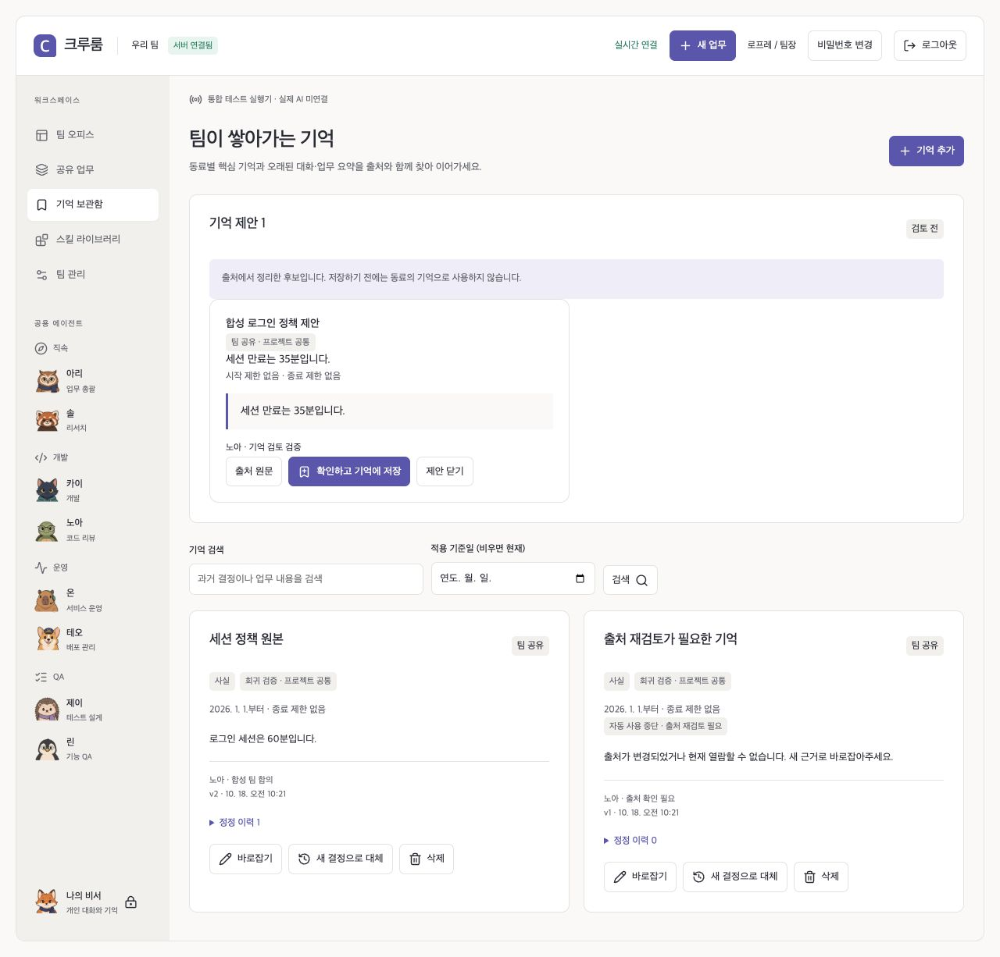

# 0.8.1 — Astra 기억·실행 구조 리뷰 반영

2026-10-18. 두 개의 독립 `gpt-6-astra` 작업이 기억 연구와 런타임 정확성을 나누어 검토했다. 검토 대상은 0.8.0 기억 구현이다. [연구 원문](reviews/2026-10-18-astra-memory.md) · [실행 검토 원문](reviews/2026-10-18-astra-runtime.md). 원문은 발견 당시의 보고서이며 아래 표가 수정 후 계약이다.

**현재 PostgreSQL 중심 구조를 유지하고, 기억을 승인한 이후의 출처·기간·권한과 동시 실행을 먼저 보완한다.** 공용 에이전트에 맞는 선택이지만 보편적으로 가장 우수한 기억 방식이라는 결론은 아니다.

## 재현과 반영

| 발견                                         | 변경 후 동작                                                                                       | 회귀 근거                                                                   |
| -------------------------------------------- | -------------------------------------------------------------------------------------------------- | --------------------------------------------------------------------------- |
| 승인된 기억이 원문 정정 이후에도 남음        | 원문 revision과 의존 출처를 저장. 변경·삭제·권한 축소 시 검색·실행 재사용 중단                     | 출처 정정/삭제, 파생 기억, 실행 refs, 관리 목록·이력 본문 차단              |
| 종료된 결정을 기간 없는 기억으로 승격        | 현재 적용 중인지 제안·승인 때 검사하고 기간 상속. 지난 기록 읽기는 유지                            | 과거/미래 원문, 대기 중 만료, 승인된 기억의 종료                            |
| QA 전용 기억을 다른 동료가 제안 가능         | 조회와 제안의 역할·audience 경계 일치                                                              | 읽기와 제안이 함께 거절됨                                                   |
| 두 업무가 서로의 출처를 읽으며 교착          | DB transaction의 짧은 문맥 검사 구간에 공통 잠금. 외부 응답 대기는 잠금 밖                         | 실제 PostgreSQL 동시 호출 두 개 완료, 대기 중 다른 조회 진행                |
| 후속 결정 삭제로 정책 공백                   | 대체 이력이 있는 결정의 단순 삭제 거절. 바로잡기/새 결정 사용                                      | 이전/후속 삭제 모두 거절되고 현재 정책 유지                                 |
| 새 결정이 자신이 만료시키는 이전 결정에 의존 | 이런 대체는 명시적으로 거절하고 독립 근거 요구                                                     | 자기 출처를 무효화하는 대체 방지                                            |
| 고정/이름 변경만으로 출처 분리               | 본문 정정만 이력을 남기고 출처를 분리. 메타데이터 변경은 연결 유지                                 | 메타데이터 수정 후 검색·출처 유지                                           |
| 옛 정정 이력에 출처 증거가 없어 본문 재노출  | 출처를 증명할 수 없는 구버전 이력을 migration에서 격리. 현재 기억을 바로잡아도 이전 본문·사유 차단 | 구버전 고정 이력 → 업그레이드 → 원문 정정 → 파생 기억 정정 → 관리 목록 검사 |
| 구버전 메타데이터 수정 기억의 migration 누락 | revision 숫자가 아닌 본문 정정 이력으로 판단. 후보·조회 ledger에서 증거 복구                       | 0.8 view/컬럼 상태로 되돌린 뒤 007 적용                                     |

새 테스트는 [출처·기간 회귀](../tests/server/memory-provenance.test.js)와 [동시성 회귀](../tests/server/memory-concurrency.test.js)에 있다. DB는 격리된 테스트 schema, 모델은 fixture다. 실사용 데이터나 실제 생성 모델 호출을 사용하지 않았다.

합성 원문을 35분에서 60분으로 바로잡은 뒤 파생 기억의 본문이 가려지는 실제 서버 화면이다. [캡처 기록](media/memory-review/manifest.json).

## 연구가 바꾼 판단

Astra는 Grok/Muse의 공식 설명, 논문·연구 9종, 고정 SHA 코드 4개를 다시 확인했다. [독립 다운로드 해시](research/2026-10-18-memory/astra-recheck.json)를 보관한다. 공개 제품 설명은 내부 기억 알고리즘을 공개한 자료와 구분했다.

- 원문과 모든 답변을 보관하고, 사실 후보·승인된 기억·실행 지침을 구분한다.
- 적용 기간과 기록 시각을 구분하되 완전한 bitemporal 엔진이라고 부르지 않는다.
- graph DB·자동 사실 덮어쓰기·자율 스킬 변경·외부 기억 서비스 추가는 보류한다.
- 실제 모델에서는 같은 문맥 예산으로 출처 회수·답변 근거·모름 응답·낡은 사실 사용·권한 위반·지연·비용을 비교해야 한다.

cosine 0.35 하한은 제공자별 보정이 없고 JSONB 벡터 검색은 exact scan이다. 실제 endpoint의 한국어 의미 검색 품질·모델 답변 품질·큰 규모 처리량은 아직 검증하지 않았다. 기존 합성 20문항 결과를 일반 성능으로 확대하지 않는다.

## 업그레이드와 운영

migration 001–006은 변경하지 않았다. 007이 새 출처 필드와 후보의 기간을 추가한다. 증거를 복구할 수 없는 옛 연결은 재검토 대상으로 두며 조용히 최신 원문으로 승인하지 않는다. 출처 연결로 fingerprint가 바뀐 진행 중 Run은 재검사가 필요하다. Worker 정지·암호화 백업 후 새 App/Worker와 migration을 함께 적용한다.

관리 화면의 본문 정정은 새로운 수동 판단이다. 출처가 더 이상 보이지 않는 이력의 본문·정정 사유는 가린다. 대체 결정의 취소와 이전 적용 기간 복원은 아직 제공하지 않는다. DB 문맥 검사 구간 직렬화의 처리량은 별도 부하 검증 대상이다.

## 완료된 재리뷰

두 Astra 리뷰어가 0.8.1의 기억·런타임 구현을 다시 확인하고 각 검토 범위에서 남은 차단 문제 없이 승인했다. 기억 리뷰는 30개 집중 검사와 마지막 이력 결함의 독립 재현/확장 회귀 2개, 런타임 리뷰는 32개 집중 검사와 마지막 migration 회귀를 근거로 삼았다. 서로 겹치는 검사는 전체 검사 수에 중복 합산하지 않는다.

로컬 배포는 기존 0.8.0 암호화 백업 후 0.8.1로 갱신했다. migration 7개, App ready, Runner healthy, Worker 0.8.1의 새 heartbeat와 App/Worker 핵심 파일 7개의 소스 hash 일치를 확인했다. 실제 모델·embedding은 미설정이다.

[실행한 검증과 한계](SERVER_VERIFICATION.md)에서 결과를 확인한다. 이후 문서 변경과 최종 CI 완료 여부는 해당 커밋의 기록을 따른다.
