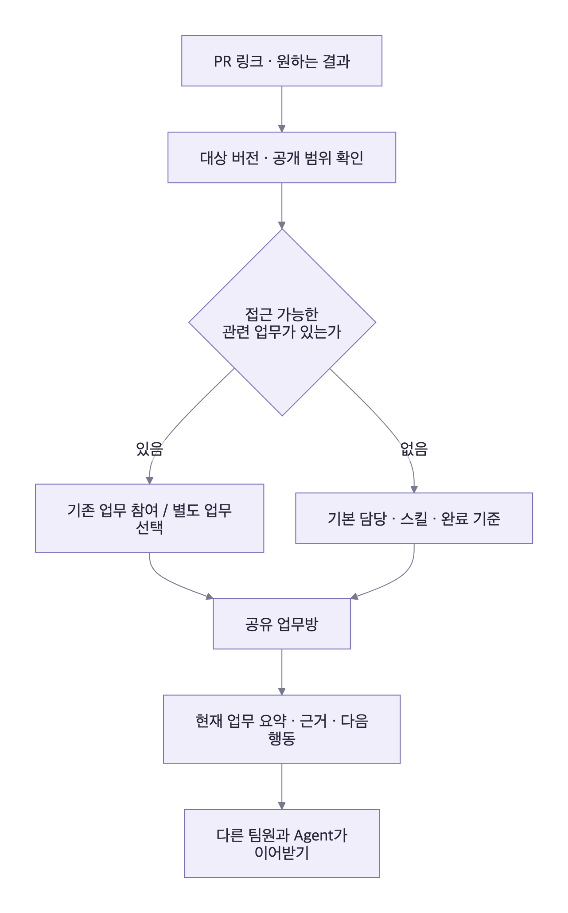

# 크루룸 · Astra 추가 제품 피드백

> 이 문서는 당시 리뷰 기록입니다. 사용자 승인 후 반영한 현재 정책·화면·미구현 서버 조건은 [리뷰 반영 설계와 추적표](DESIGN_IMPLEMENTATION.md)를 참고하세요.

2026-10-17 · 모델 **gpt-6-astra**, reasoning effort `high` · 검토 대상은 당시 웹 프로토타입과 설계 문서다. 아래 파일·행 참조는 당시 검토 위치이며 현재 동작을 뜻하지 않는다.

사용자가 더 나은 아이디어를 요청해 앞선 [기획·아키텍처 리뷰](ASTRA_REVIEW.md)에 이어 별도 Astra 에이전트에게 제품·UX·도입·운영 대안을 검토받았다. 현재 기획과 코드를 근거로 한 **제안이며, 채택하거나 구현한 정책이 아니다.** 아래 효과는 실제 팀에서 측정해야 할 가설이다.

## 가장 큰 개선 방향

팀원이 에이전트와 스킬의 구성을 먼저 배우지 않아도 **업무 대상을 넣고 같은 업무와 결과를 이어 쓰게 한다.** 직속·개발·운영·QA의 캐릭터와 공용 Agent 정체성은 유지한다. 업무 시작과 사람이 이어받는 과정을 단순하게 만드는 제안이다.

| 우선 검증 순서 | 제안 | 이유 |
| --- | --- | --- |
| 1 | 출처가 있는 현재 업무 요약 | 공유 세션이 실제 인계를 돕는지 직접 확인 |
| 2 | 업무 대상에서 시작하고 담당·스킬은 기본값으로 제공 | 첫 사용의 선택 부담과 중복 업무 감소 가능성 |
| 3 | 선택한 결과 공유부터 공용 실행으로 이동 | 기존 개인 작업 습관을 한 번에 바꾸지 않아도 시작 가능 |

## 1. 업무 대상을 넣으면 기존 업무와 담당을 안내한다

**기존 입력 양식 제안의 구체화 + 새로운 업무 중복 방지 제안.** 현재 요청 양식 (`src/app.js:1842`, 당시 검토)은 동료와 스킬 선택을 요구한다. 대표 입력 양식 제안 (`docs/TEAM_STANDARDIZATION_REVIEW.md:105`, 당시 검토)은 있지만 기본 흐름은 Agent 선택에서 시작한다.

- **사용 장면:** 오피스 상단에 PR URL을 붙이고 `QA 인계 준비`를 선택한다. 접근 가능한 기존 업무가 있으면 `민지가 진행 중인 검토에 참여`와 `별도 업무 시작`을 안내한다. 새 업무는 검토 Agent·스킬·완료 기준이 기본으로 정해진다.
- **최소 구현:** 첫 업무 유형 하나의 대상 URL·목적·공개 범위·완료 기준, 저장소/PR 식별, 규칙 기반 담당 매핑만 만든다. Agent를 직접 선택하는 경로도 유지한다. 매 요청마다 LLM 라우터나 총괄 Agent를 호출할 필요는 없다.
- **효과 가설:** 처음 쓰는 사람의 선택 부담과 다른 사람이 이미 시작한 업무의 중복 실행이 줄어든다.
- **비용·역효과:** 같은 PR의 보안 검토와 QA 계획은 다르다. URL만으로 자동 합치지 않는다. 목적·대상 SHA·공개 범위·완료 조건을 비교하고, 기존 업무 후보는 권한 필터 뒤 보여 준다. 접근할 수 없는 업무의 존재도 노출하지 않는다.
- **검증:** 처음 쓰는 사람이 설명 없이 올바른 업무를 시작하거나 기존 업무에 참여하는지, 담당 수정·중복 생성·잘못된 합류가 생기는지 관찰한다.

이 흐름은 후속 UX 권고다. 현재 화면의 기본 경로나 요청 동작을 바꾼 것은 아니다.

## 2. 긴 대화 위에 지금 이어받을 내용을 고정한다

**기존 구조화 인계·원문 보존을 사용자가 읽는 화면으로 구체화하는 제안.** 작업 맥락·기억 계층 (`docs/MEMORY_ARCHITECTURE.md:38`, 당시 검토)과 인계 설계 (`docs/OPEN_SOURCE_CODE_RESEARCH.md:359`, 당시 검토)를 이어 간다.

- **사용 장면:** B가 A의 업무를 열면 대화 80개를 읽기 전에 `목표·대상 SHA / 수용된 결과 / 확인된 사실과 근거 / 사람의 결정 / 미확인·막힌 사항 / 다음 행동·담당자`를 본다. 다시 방문하면 마지막 방문 이후 바뀐 결정·결과를 먼저 본다.
- **최소 구현:** Task·Artifact를 이용해 버전 있는 업무 요약을 저장한다. 상태·담당·대상은 DB에서 표시하고 서술형 요약은 근거 메시지·결정·산출물 버전과 연결한다. 오류는 정정 이력을 남기고 고친다. 원문은 보존한다. 새 서비스나 지식 그래프는 필요하지 않다.
- **효과 가설:** 다른 사람과 다음 Agent가 같은 현재 상황을 빠르게 파악한다. 긴 대화가 인계의 부담으로 이어지는 정도를 줄인다.
- **비용·역효과:** 잘못된 요약이 팀 전체로 퍼질 수 있다. 사람의 승인·결정은 요약기가 추측해 만들지 않는다. 근거가 없는 내용은 미확인으로 남긴다. QA는 개발 보고서를 반복 요약하는 데 그치지 않고 실제 코드·원문·도구 증거를 확인해야 한다.
- **검증:** B가 A에게 재설명을 요구하지 않고 대상 버전·미확인 사항·다음 행동을 정확히 파악해 이어가는지 확인한다. 잘못된 요약 한 항목을 넣어 근거에서 오류를 발견하고 정정할 수 있는지도 시험한다.

제품이 보장할 공동 작업의 연속성은 **원문·결정·산출물·현재 업무 상태가 이어지는 것**으로 정의한다. 하네스의 native resume은 지원되는 경우 활용한다. native session이 유실되거나 하네스가 바뀌면 제품 기록을 근거로 새 Run에 필요한 맥락을 제공하는 경로를 둔다. 요약만으로 원래 실행 상태를 완벽히 재현한다는 의미는 아니다.

## 3. 선택한 결과 공유부터 시작해 공용 실행으로 옮긴다

**기존 이관 정책의 시작점을 좁히는 새로운 도입 제안.** 기존 정책 (`docs/TEAM_STANDARDIZATION_REVIEW.md:100`, 당시 검토)은 새 업무를 공용 서버에서 시작하고 기존 세션은 지원되는 경우 가져오도록 한다.

- **사용 장면:** A가 익숙한 개인 도구에서 PR 검토를 마쳤다. 크루룸에서 `QA에 넘기기`를 선택하고 공유할 결과·대상 SHA·근거 링크만 넣는다. 공유본을 확인한 뒤 B가 공용 업무방에서 이어받는다. 다음 유사 업무는 `새 PR로 시작`으로 공용 Agent에게 처음부터 맡긴다.
- **최소 구현:** 사용자가 선택한 텍스트·파일·링크만 받는다. 개인 세션 전체·로컬 폴더·계정 자격증명을 가져오지 않는다. 가져온 결과는 `외부에서 작성됨 · 크루룸에서 미검증`으로 표시하고 출처·작성자·대상 버전을 남긴다. Artifact가 반드시 Crewroom Run에서 만들어졌다고 가정하지 않도록 출처 모델을 보완한다.
- **효과 가설:** 기존 방식을 즉시 버리지 않아도 인계·검색·공통 결과 형식의 가치를 경험한다. 그 경험이 다음 업무를 공용 실행으로 옮길 동기가 된다.
- **비용·역효과:** 결과만 올리는 보관함에 머물 수 있다. 한 업무 유형의 가져오기로 범위를 제한하고 모든 도구의 자동 수집기로 넓히지 않는다. 형식 변환으로 없는 근거나 검사 결과를 채우지 않는다.
- **검증:** B가 가져온 결과를 실제로 사용했는지, 다음 유사 업무를 공용 실행으로 시작했는지 본다. 가져오기 준비·편집이 기존 인계보다 오래 걸리면 축소한다.

공용 서버 Agent라는 목표를 바꾸는 제안은 아니다. 공동 사용의 효용을 먼저 경험할 진입 경로다. 무조건 필요한 MVP 기능으로 확정하지 않고 수동 실험부터 한다.

## 4. 좋은 결과에서 다음 업무를 시작한다

**기존 산출물 보관·스킬 개선의 구체화.** 산출물과 프로젝트 기준 (`docs/TEAM_STANDARDIZATION_REVIEW.md:66`, 당시 검토), 스킬 품질 관리 (`docs/PRODUCT_REVIEW.md:144`, 당시 검토)를 바탕으로 한다.

- **사용 장면:** 바로 활용할 수 있었던 로그인 PR 검토 결과에서 `이 기준으로 다음 업무 시작`을 누른다. 같은 입력 항목·완료 기준·결과 구조를 사용하고 이전 결과를 좋은 예시로 연결한다.
- **최소 구현:** 수용된 Artifact를 다음 업무의 예시로 선택한다. 스킬 버전·프로젝트 기준·예시로 입력 양식을 채우되 이전 SHA·검사 결과·승인 여부는 복사하지 않는다. 사용자가 고친 부분은 기본적으로 이번 업무에만 적용하고 반복 수정만 표준 개선 후보로 남긴다.
- **효과 가설:** 팀이 실제로 활용한 결과에서 표준을 발전시키고 같은 형식 오류를 반복해서 수정하는 일을 줄인다.
- **비용·역효과:** 이전 사실·승인·민감정보를 복사하거나 특정 사례에 과도하게 맞출 수 있다. 프로젝트·공개 범위를 확인하고 예시와 현재 업무의 증거를 구분한다.
- **검증:** 반복 수정이 줄었는지, 이전 업무의 사실이 섞이지 않았는지 확인한다. 표준 변경 전후에 대표 입력 몇 개로 결과를 비교한다.

처음부터 자동 학습·자동 스킬 게시를 만들 필요는 없다. 팀이 직접 고른 예시와 수정 이유부터 검증한다.

## 5. 캐릭터가 담당·진행·사람의 다음 행동을 알려 준다

**기존 오피스의 상태 표시를 구체화.** 화면 우선순위와 실제 상태 연결 (`docs/SHARED_AGENTS.md:42`, 당시 검토)을 따른다.

- **사용 장면:** 카이 옆에 `PR #124 검토 결과 준비 · 민지의 확인 대기`, 린 옆에 `테스트 실행 중 · 마지막 결과 2분 전`이 보인다. 여러 업무가 있으면 실행·입력 대기·대기열 건수를 나눈다.
- **최소 구현:** RunEvent·Task에서 마지막 의미 있는 작업, 대기 이유, 다음 행동 주체, 마지막 확인 시각을 계산한다. 모션을 이 상태에 연결한다. 상세 로그는 필요할 때 연다.
- **효과 가설:** 캐릭터로 담당자를 기억하고 화면에서 자신이 기다릴지 답할지 판단한다. 친근함과 상태의 일관성이 함께 작동한다.
- **비용·역효과:** 모델의 진행 멘트를 확인된 사실로 표시하거나 근거 없는 진행률·완료 시간을 만들기 쉽다. 토큰 생성량을 업무 진척으로 세지 않고 관측한 단계만 표시한다.
- **검증:** 실행 중·결과 준비·입력 대기·연결 끊김을 구분하고 다음 행동을 맞게 고르는지 본다. 지나친 알림이 집중을 방해하는지도 확인한다.

## 6. 팀장은 운영 경계를 정하고 일상 관리는 위임한다

**기존 업무 책임자·스킬 소유자의 운영 모델 구체화.** 현재 역할표 (`docs/TEAM_WORKSPACE.md:25`, 당시 검토), 공용 스킬 편집 정책 (`src/team-domain.js:223`, 당시 검토), 사람 책임자 제안 (`docs/PRODUCT_REVIEW.md:72`, 당시 검토)을 바탕으로 한다.

- **사용 장면:** QA 담당자가 위임받은 QA 스킬의 반복되는 형식 오류를 수정하고 예시 입력을 확인한 뒤 새 버전을 게시한다. 외부 도구 권한이나 실행 범위 확대는 별도로 다룬다.
- **최소 구현:** 전역 계정 역할은 팀장·팀원 두 개로 유지한다. 스킬별 관리 담당자·업무별 사람 책임자·연결별 관리자를 리소스 권한으로 지정한다. 팀장은 권한·예산·연결과 해결되지 않은 예외를 관리한다.
- **효과 가설:** 품질 개선·재작업·재개가 모두 팀장에게 몰리지 않고 현업이 스킬 품질을 유지한다.
- **비용·역효과:** 담당자가 늘면서 기준이 갈라질 수 있다. 공통 결과 구조를 유지하고 문구 수정과 실행 스크립트·도구 권한·외부 쓰기 범위 확대를 구분한다. 모든 변경에 별도 승인자를 추가하지 않는다.
- **검증:** 업무 한 건당 팀장 개입, 스킬 수정 대기 시간, 변경 후 되돌림·품질 저하를 본다. 담당자가 위임받지 않은 스킬·계정 권한을 바꿀 수 없어야 한다.

## 시작 방식과 아키텍처 선택

| 시작 방식 | 장점 | 비용·한계 | Astra 권고 |
| --- | --- | --- | --- |
| Agent → 스킬 선택 | 캐릭터와 담당 관계가 직접적 | 내부 구성을 먼저 알아야 함 | 직접 요청 경로로 유지 |
| 모든 요청을 총괄 Agent가 해석·배정 | 자유로운 자연어 요청 | 해석 오류·비용·설명 책임 증가 | 첫 기본값으로 보류 |
| 업무 유형·대상 → 기본 담당·스킬 | 범위와 결과가 예측 가능 | 지원 업무를 명시해야 함 | 첫 반복 업무의 기본값 |

업무 접수 규칙은 App 모듈, 현재 업무 요약은 Task·Artifact, 상태 표시는 저장 이벤트를 읽는 화면 모델, 위임은 리소스 권한으로 구현할 수 있다. **이 제안 때문에 새 프레임워크나 마이크로서비스를 추가하지 않는다.**

검토→QA도 모든 요청에 자동으로 붙이지 않는다. QA 계획을 요청했거나 추가로 수행할 독립 검사가 있을 때 실행한다. 단순 변경 요약까지 여러 Agent가 순서대로 재서술하면 비용·대기만 늘 수 있다.

## 다음 작은 실험: 실제 PR을 다른 팀원이 설명 없이 이어받는가

서버 전체 구현 전에 팀이 이미 이용할 수 있는 공유 문서나 화면에서 상위 3개를 수동으로 시험한다. **실험 제안이며 아직 수행하지 않았다.**

1. 실제 팀원 두 명과 비슷한 범위의 PR 4건을 고른다. 기존 방식 2건과 제안 방식 2건을 번갈아 수행한다.
2. 제안 방식에서는 A가 PR·목적·공유할 결과만 제공한다. 운영자가 출처 있는 현재 업무 요약을 작성하고 이 작업 시간도 비용에 포함한다.
3. B에게 링크만 전달한다. A의 구두 설명 없이 대상 SHA·완료된 것·미확인 사항·다음 행동을 찾아 QA 인계를 이어가게 한다.
4. 한 사례에는 SHA 변경이나 정정할 내용을 넣어 과거 결과를 현재 사실로 오인하는지 확인한다.
5. 준비·요약 작성·검색·재질문·수정의 전체 사람 시간, 누락, 결과 재사용 여부를 기록한다.

인계 가능 여부, 근거·대상 버전의 정확한 파악, 추가 운영 노동까지 포함한 부담을 기준으로 판단한다. 작은 표본이므로 생산성 향상률을 확정하지 않는다. 한 번의 결합 실험으로 세 아이디어 각각의 효과를 분리해 입증했다고 보지도 않는다. 효과가 확인되면 그 흐름을 첫 실제 서버 기능으로 구현한다.

이 실험은 진입·인계·습관 전환의 가설을 확인한다. 공용 서버의 실행 지속성·동시성·권한·복구는 [앞선 Astra 리뷰](ASTRA_REVIEW.md)의 별도 검증을 거쳐야 한다.

## 근거와 한계

- Astra는 고정 커밋의 현재 문서와 코드를 읽고 추가 제안을 작성했다. 새 외부 제품 비교나 성과 측정을 수행한 보고서가 아니다.
- 부모 에이전트는 현재 양식·화면 정책을 다시 확인하고, 동일 PR 자동 합류의 위험·요약의 근거·native resume의 한계·선택 공유 범위를 되물어 피드백에 포함했다.
- 본 변경은 추가 피드백 문서와 README 링크만 추가한다. UI·서버·기억·권한·하네스 동작은 변경하지 않는다.
- 보조 참고로 부모 에이전트가 확인한 [GitHub Issue Forms 공식 명세](https://docs.github.com/en/communities/using-templates-to-encourage-useful-issues-and-pull-requests/syntax-for-issue-forms)는 입력 유형·검증·기본 담당자와 입력의 Markdown 기록 변환을 설명한다. 정형 입력 패턴의 사례이며 크루룸의 도입 효과나 Agent 배정 방식이 검증됐다는 근거는 아니다.

관련 문서: [주목표](SHARED_AGENTS.md) · [표준화·이관 검토](TEAM_STANDARDIZATION_REVIEW.md) · [팀원·팀장 설계](TEAM_WORKSPACE.md) · [기존 Astra 리뷰](ASTRA_REVIEW.md).
