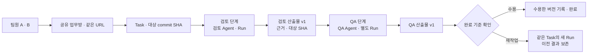

# 크루룸 · Astra 기획·개발 아키텍처 리뷰

> 이 문서는 당시 리뷰 기록입니다. 사용자 승인 후 반영한 현재 정책·화면·미구현 서버 조건은 [리뷰 반영 설계와 추적표](DESIGN_IMPLEMENTATION.md)를 참고하세요.

2026-10-17 · 리뷰 모델: **gpt-6-astra**, reasoning effort `high`.

검토 대상은 2026-10-17 당시의 웹 프로토타입과 설계 문서다. 사용자 요청으로 별도 Astra 에이전트가 기획·아키텍처 문서와 도메인·실행 연결 코드를 읽고 검토했다. 이 문서는 그 보고서를 정리한 기록이며, **권고를 채택하거나 서버에 구현했다는 뜻이 아니다.** 아래 파일·행 참조는 당시 검토 위치이며 현재 구현의 위치나 동작을 뜻하지 않는다.

## 판정

**제한된 실제 업무 PoC는 착수할 수 있다. 전체 MVP의 DB 스키마·권한·실행 계약을 확정하고 구현하기에는 결정이 더 필요하다.**

단일 팀, 한 Linux 호스트, App/API·Worker·PostgreSQL·영속 파일이라는 방향은 적절하다. 가장 큰 위험은 프레임워크 부족보다 **공유 업무의 소유 관계, 같은 Agent의 동시 실행, 하네스 내부 상태와 제품 권한의 연결**이 아직 구현 가능한 규칙으로 확정되지 않은 점이다.

현재 구현은 Vite·JavaScript·localStorage 목업이다. 서버·DB·실제 하네스가 없다는 알려진 경계를 새 결함으로 세지 않았다. 아래 P0는 적용 범위의 실제 데이터를 연결하기 전 확정할 계약이며, 운영 중 사고나 전 항목이 첫 읽기 전용 PoC의 차단 사유라는 의미는 아니다.

| 번호 | 우선순위·성격 | 발견 | 확정할 시점 |
| --- | --- | --- | --- |
| 1 | P0 · 신규 설계 공백 | PR 검토 → QA 인계의 Task·단계·Run·대화 관계 | 첫 흐름의 DB/API 설계 전 |
| 2 | P0 · 신규 계약 충돌 가능성 | Agent별 HOME만으로 같은 Agent의 병렬 Run 버전 고정 불가 | 병렬 실행 허용 전 |
| 3 | P0 · 기존 미결정 | 가입·부서·공유·업무 조작 권한 | 실제 계정·자료 연결 전 |
| 4 | P0 · 기존 미결정의 우회 경로 구체화 | 제품 기억 ACL 밖의 하네스 기억·세션 | 접근 범위가 다른 자료 연결 전 |
| 5 | P0 · 신규 복구 계약 공백 | 이전 Worker의 새 외부 도구 호출 차단 | 실제 외부 쓰기 허용 전 |
| 6 | P0 · 기존 미결정 | Run 성공·산출물 검증·Task 완료와 재작업 전이 | 첫 실제 업무 완료 판정 전 |
| 7 | P1 · 신규 운영 설계 공백 | 영속 대상과 백업·복원 집합의 연결 | 지속 운영 전 |

## 1. 첫 업무의 인계 관계를 명시한다

**시나리오·영향:** 두 팀원이 같은 업무방에서 개발 검토 결과를 QA로 이어받는 것이 첫 검증 목표다. 현재 대화는 단일 `actorId`, Task는 단일 `requesterAgent`, Run은 그 Agent를 복사한다. 인계가 담당 변경인지, 별도 Task인지, 같은 Task의 다음 단계인지 정해지지 않았다. 그대로 옮기면 대화를 복제해 맥락이 끊기거나 이전 Agent·실행의 의미를 덮어쓸 수 있다.

**근거:** 첫 PR→QA 목표 (`docs/PRODUCT_REVIEW.md:21`, 당시 검토), 현재 객체 관계 (`docs/ARCHITECTURE.md:108`, 당시 검토), 제안 서버 객체 (`docs/OPEN_SOURCE_CODE_RESEARCH.md:254`, 당시 검토), Task의 대화 연결 (`src/app.js:2208`, 당시 검토), Run의 Agent 연결 (`src/domain.js:94`, 당시 검토).

**최소 보완 권고:** 첫 흐름에는 공유 Conversation 하나 → Task 하나 → 명시된 검토/QA 단계 → 단계별 Agent·Run·Artifact로 고정한다. 인계에는 입력 Artifact 버전, 대상 commit SHA, 다음 담당, 완료 조건을 남긴다. native session은 Task·단계·Agent·하네스에 연결하고 Agent가 바뀌면 이전 Agent의 세션을 그대로 재사용하지 않는다. 범용 워크플로 엔진은 필요하지 않다.

이 그림은 첫 검증 흐름에 대한 권고이며 현재 구현된 관계가 아니다.

**통과 기준:** A가 시작한 업무를 B가 같은 URL로 열어 QA를 이어간다. QA 입력의 정확한 검토 산출물 버전과 SHA가 남고, 재작업 뒤에도 이전 결과·작성 Agent·Run을 보존한다.

## 2. Agent HOME과 Run의 불변 실행 묶음을 분리한다

**시나리오·영향:** 같은 카이의 R1이 v1 스킬로 실행되는 동안 R2가 v2 또는 변경된 스킬 목록으로 시작한다. 후보 Hermes 어댑터는 실행할 때 스킬 HOME을 동기화하고 선택 해제한 링크를 제거한다. 두 Run이 같은 Agent HOME을 쓰면 R1의 후속 스킬 읽기가 바뀐 본문이나 사라진 링크를 만날 수 있다. DB에는 v1로 남아도 실제 지침이 달라질 수 있다.

**근거:** Run 버전 고정 약속 (`README.md:207`, 당시 검토), 진행 중 버전 유지 (`README.md:233`, 당시 검토), Hermes 동기화·Agent별 HOME 채택 조건 (`docs/OPEN_SOURCE_CODE_RESEARCH.md:103`, 당시 검토). 고정 조사 원문의 `execute.ts:365–380`, `skills.ts:228–252`도 리뷰에서 대조했다.

**최소 보완 권고:** Agent의 영속 정체성·공용 기억과 Run이 읽는 불변 스킬·설정 묶음을 나눈다. Run별 읽기 전용 스킬 마운트와 쓰기 영역을 두고 공통 기억 갱신은 서버가 중재한다. 첫 PoC에서 이를 지원하기 어렵다면 **Agent별 활성 실행을 1개로 제한**하고 대기열을 표시한다. 중단된 Run이 구 버전으로 재개할 수 있도록 실제 적용 묶음은 별도로 보존한다.

**통과 기준:** R1이 스킬을 아직 읽지 않은 지점에서 멈춘 뒤 v2 게시·R2 시작·스킬 해제를 시도한다. 병렬 모델은 R1이 읽은 본문 해시가 끝까지 v1임을 확인한다. 직렬 모델은 R2가 대기하고, R1 재개·완료까지 그 실행 묶음이 바뀌지 않아야 한다.

기존 조사는 서로 다른 Agent가 HOME을 공유하는 위험을 지적했다. 이번 발견은 **동일 Agent의 여러 Run 사이 충돌 가능성**이다. 실제 통합 환경에서 실패를 재현한 결과는 아니다.

## 3. 가입·공유·업무 조작 정책을 확정한다

**시나리오·영향:** 원본 공개 범위 상속, 부서의 의미, 요청자·책임자·열람자 구분, 첫 팀장 지정은 기존 문서에 권고로 남아 있다. 목업 동작을 그대로 서버로 옮기면 가입자가 역할을 정하거나 공유 업무 열람자가 실행을 조작하는 정책이 굳어질 수 있다. 부서가 분류인지 접근 제한인지에 따라 검색·첨부·이벤트까지 달라진다.

**근거:** 제안의 미합의 상태 (`docs/PRODUCT_REVIEW.md:3`, 당시 검토), 기존 정책 공백 (`docs/PRODUCT_REVIEW.md:46`, 당시 검토), 권고 역할표 (`docs/PRODUCT_REVIEW.md:74`, 당시 검토), 목업의 대화 열람 (`src/domain.js:26`, 당시 검토), 가입 역할 처리 (`src/team-domain.js:100`, 당시 검토).

**최소 보완 권고:** 첫 파일럿은 사전 허용 계정, 배포 시 지정하는 첫 팀장, 기존 팀장의 후속 권한 부여로 고정한다. 부서 비공개를 지원하면 모든 리소스에 같은 규칙을 적용하고, 미루면 파일럿의 공용 업무 자료를 팀 공개 자료로 제한한다. 기본 요청자=책임자, 열람자는 읽기·댓글, 책임자는 답변·재개·재작업, 팀장은 기록을 남기는 재배정·긴급 중단으로 정할 수 있다. **팀장 체크는 권한 요청이며 실제 권한 부여가 아니다.**

**통과 기준:** 직접 API 요청에도 같은 판정이 나온다. 계정 중지·역할 변경·부서 이동 뒤 기존 연결과 이벤트 구독에도 권한 변경이 반영된다. 같은 대기 질문에 대한 동시 답변은 한 번만 적용된다.

## 4. 하네스 기억·세션도 제품의 접근 범위에 묶는다

**시나리오·영향:** 공용 카이가 비공개 업무와 팀 업무를 모두 수행한다. 제품 Memory 검색은 권한을 거르더라도 Agent HOME의 native memory·세션 검색 또는 이미 로딩된 프롬프트가 이전 비공개 내용을 재사용할 수 있다. 공개 범위 변경·권한 철회·삭제는 새 검색의 필터만 바꿔서는 충분하지 않다.

**근거:** 제품 기억 범위 (`docs/ARCHITECTURE.md:224`, 당시 검토), 기억 정정·삭제 계약 (`docs/MEMORY_ARCHITECTURE.md:95`, 당시 검토), Hermes 메모리 조사 (`docs/OPEN_SOURCE_CODE_RESEARCH.md:139`, 당시 검토), 기존 권한·메모리 과제 (`docs/OPEN_SOURCE_CODE_RESEARCH.md:340`, 당시 검토). 고정 Hermes `memory_tool_store.py:221–245,618–621`의 로딩 시점 프롬프트 스냅샷도 대조했다.

**최소 보완 권고:** 첫 구현의 기억 기준은 제품 저장소로 둔다. ACL을 적용할 수 없는 native cross-session 검색·자동 공통 기억 저장은 끄거나 Run별 영역으로 제한한다. 입력 컨텍스트의 읽기 범위와 결과 게시 범위를 연결한다. 공유 확대·권한 철회 때 native session을 재사용할 수 있는 조건과 실행 중 컨텍스트의 중단·재구성 규칙을 정한다. 공통 기억 승격은 출처와 공개 범위를 검사하는 별도 쓰기다.

**통과 기준:** 비공개 업무에 고유 문장을 넣고 같은 Agent의 다른 업무, native 검색, 재개된 Run, 요약에서 노출되는지 검사한다. 권한 철회 후에는 이미 진행 중인 컨텍스트를 처리하는 규칙도 확인한다.

이는 새 보안 사고 보고가 아니다. 기존 문서가 인정한 검색 전 권한 검사·native memory 동기화·컨텍스트 무효화를 실행 가능한 정책으로 닫아야 한다는 지적이다.

## 5. 외부 도구 발송에도 실행 소유권을 검사한다

**시나리오·영향:** Worker 1의 임대가 만료되어 Worker 2가 새 generation을 얻는다. 뒤늦게 살아난 Worker 1은 상태 쓰기가 거부되더라도 새로운 논리 ToolAction을 요청할 수 있다. 동작 ID가 다르면 중복 방지만으로 이전 실행의 외부 변경을 막을 수 없다.

**근거:** 상태·이벤트의 generation 검사와 외부 기록 (`docs/ARCHITECTURE.md:393`, 당시 검토), Run·ToolAction·Grant 제안 (`docs/OPEN_SOURCE_CODE_RESEARCH.md:260`, 당시 검토), 현재 복구 검증 기준 (`docs/OPEN_SOURCE_CODE_RESEARCH.md:382`, 당시 검토).

**최소 보완 권고:** Broker가 도구를 발송하는 경계에서 현재 Run·generation·임대·취소 상태·사용자/연결 Grant·승인 입력 해시를 확인하도록 계약을 추가한다. 확인과 발송 기록 사이의 경쟁도 처리하고 런타임의 직접 외부 쓰기가 이 경계를 우회하지 못하게 한다. 이미 발송한 요청의 취소 성공을 보장하는 것은 아니며, 그 결과는 별도 대조한다.

**통과 기준:** 구 Worker를 도구 요청 직전 멈추고 새 generation을 얻은 뒤 구 Worker를 재개한다. 새 action ID를 사용해도 구 Worker의 새 외부 호출은 0건이어야 한다. 이미 발송된 요청은 중복 재시도하지 않고 결과를 대조한다.

읽기 전용 첫 PoC의 차단 사유는 아니다. 실제 외부 쓰기를 허용하기 전 조건이다.

## 6. 실행 성공과 업무 완료의 전이를 확정한다

**시나리오·영향:** 검토 보고서가 생성됐지만 QA가 미확인 사항을 발견하거나 대상 PR에 새 커밋이 추가된다. 어떤 결과가 유효한 입력이고 누가 어떤 버전을 수용해 완료하는지 정해져 있지 않다. 형식 준수율이 높아도 실제 완료율과 절감 시간은 잘못 측정될 수 있다.

**근거:** 기존 완료·재작업 권고 (`docs/PRODUCT_REVIEW.md:85`, 당시 검토), 근거·산출물 버전 (`docs/TEAM_STANDARDIZATION_REVIEW.md:64`, 당시 검토), Run 상태 제안 (`docs/OPEN_SOURCE_CODE_RESEARCH.md:289`, 당시 검토).

**최소 보완 권고:** 첫 PR→QA Task를 접수/진행/결과 준비/완료/취소로 정의하고 재작업은 같은 Task의 새 Run으로 기록한다. 산출물의 구조 검사, 실제 근거 확인, 사람의 수용을 별도로 남긴다. Run 실패·입력 대기는 Task의 다음 행동과 연결한다. 대상 SHA가 바뀌면 이전 결과가 새 SHA까지 검토한 것으로 표시되지 않게 한다.

**통과 기준:** 잘린 출력, 스키마만 맞는 허위 검사 주장, 실제 검사 실패, 새 커밋, 재작업 각각의 상태와 다음 행동을 확인한다. 책임자가 수용한 산출물 버전을 남긴다.

## 7. 하네스 세션까지 포함해 복원 계약을 정한다

**시나리오·영향:** 호스트 장애 뒤 DB·산출물·스킬은 복원했지만 하네스의 세션 DB·Agent HOME·Run 체크포인트가 없다. 저장된 native session ID가 없는 파일을 가리키면 대화 열람은 가능해도 입력 대기 업무 재개는 실패한다. 이를 원래 실행의 재개로 처리하면 맥락을 잃거나 단계를 반복할 수 있다.

**근거:** Agent·Run 영속 경로 (`docs/DEPLOYMENT.md:75`, 당시 검토), 실행 복구 (`docs/DEPLOYMENT.md:102`, 당시 검토), 백업·복원 범위 (`docs/DEPLOYMENT.md:123`, 당시 검토).

**최소 보완 권고:** 하네스별 재개에 필요한 파일·DB·버전·키의 복원 목록을 만든다. 백업에 포함할지, 유실 시 native 재개를 포기하고 제품 기록에서 새 Run으로 전환할지 명시한다. 첫 운영의 허용 데이터 손실(RPO), 복구 시간(RTO), 보존 기간·복원 담당자도 정한다.

**통과 기준:** 입력 대기 업무가 있는 환경을 별도 빈 호스트에 복원한다. 외부 쓰기를 막은 상태에서 원래 세션 재개 또는 명시적인 새 Run 전환까지 확인한다. 파일 해시 일치만으로 완료하지 않는다.

현재 문서가 세션 상태를 백업에서 명시적으로 제외했다는 뜻은 아니다. 영속 대상과 복구 집합의 연결이 빠진 것이다.

## 유지할 설계

- 안정적인 Agent 정체성과 Task·Run·native session의 분리.
- 같은 업무의 공유 맥락과 다른 업무의 실행 환경 분리.
- 공용 스킬·결과 스키마·템플릿의 불변 버전과 실제 적용 기록.
- 단일 팀·단일 호스트·한 코드베이스와 PostgreSQL 중심의 초기 구성.
- 형식 검사와 사실 확인 분리, 영속 이벤트·재접속 복원, 불명확한 외부 동작의 자동 재실행 금지.

## 지금 확정할 결정과 미룰 결정

| 지금 확정 | 후속으로 미뤄도 되는 것 |
| --- | --- |
| 첫 PR→QA의 Task·단계·Run·Conversation 관계 | 범용 다중 에이전트 워크플로 |
| 가입 허용 계정·첫 팀장·업무 책임자·부서 공개 정책 | 조직 생성·멀티테넌트·과금 |
| 완료·재작업 전이, 수용할 산출물의 기준 | 여러 업무의 복잡한 자동 완료 정책 |
| 첫 실행기의 동시 실행 한도·HOME·스킬·세션 격리 | Agent별 상시 컨테이너 유지 여부 |
| 제품 기억과 native memory의 기준 관계 | 자동 기억 추출·pgvector·전용 기억 엔진 |
| 재개 상태의 복원 목록과 운영 책임 | 고가용성·다중 호스트 |
| Paperclip 재사용 범위, Task·Run의 단일 소유자 | 두 번째 하네스·엔진 간 진행 세션 이식 |

**Paperclip–Hermes는 첫 검증 후보로 유지할 근거가 있으며, 채택은 아직 확정하지 않는다.** PoC에서 Task·Run·큐·권한을 얼마나 재사용할 수 있고 공유 대화·인계·격리에 어떤 변경이 필요한지 기록한다. Task·Run·큐를 별도로 구현한 뒤 Paperclip을 겉에 연결해 기준 상태를 중복 소유하지 않는다. Letta·OpenHands 비교는 첫 후보가 충족하지 못하는 요구가 확인된 경우로 좁힐 수 있다.

## 가장 작은 실제 공동 사용 검증

1. 실제 팀원 두 명, 저장소 한 개, 고정 SHA 하나, 검토·QA Agent 두 명으로 시작한다. 개인 비서 확대는 선행 조건으로 두지 않는다.
2. 첫 화면에서 **PR 검토 시작 / 기존 업무 이어가기**로 진입한다. 사용자가 스킬·하네스를 직접 조합할 필요는 없게 한다.
3. A가 공유 업무를 만들고 검토 Agent가 실제 저장소를 읽어 근거 있는 표준 산출물을 저장한다. 첫 검증의 외부 권한은 읽기로 제한한다.
4. B가 같은 링크에서 책임을 인수한다. QA는 정확한 검토 결과 버전과 같은 SHA를 받아 QA 범위·재현 절차·미확인 사항을 작성한다.
5. 중간 질문에서 두 브라우저를 닫고 Worker를 재시작한다. 다시 접속해 같은 질문에 답한 뒤 결과 수용 또는 이유 있는 재작업을 끝낸다.
6. 같은 Agent에 별도 업무를 접수해 맥락·파일 분리를 확인한다. 직렬 실행이면 대기열에서 순서대로 처리해도 된다.
7. 스킬 변경, 중복 답변, 권한 거부, 출력 오류, 백업 복원을 검증한다. 도구 기록·산출물 해시·실제 적용 버전·Run 이력을 증거로 남긴다.
8. 유사한 실제 업무 여러 건에서 기존 방식 대비 준비·지시·검토·재작성·복구의 사람 시간을 측정한다. 품질·인계 성공·비용과 함께 사전에 정한 기준으로 판단한다.

## 검토 증거와 한계

| 확인 | 범위와 한계 |
| --- | --- |
| 별도 모델 검토 | gpt-6-astra가 핵심 문서 10개와 도메인·실행 연결 코드를 대조. 이는 사람의 독립 감사가 아니다. |
| 원문 대조 | 저장소에 보관된 Paperclip/Hermes 원문 4개의 해시가 고정 manifest와 일치하는 것을 리뷰에서 확인. 최신 릴리스나 실제 실행 동작을 보증하지 않는다. |
| 회귀 확인 | Astra가 `npm test` 13건 통과 확인. 목업 도메인 테스트이며 실제 서버·다중 사용자·외부 도구의 검증이 아니다. |
| 검토 시점 | 대상 HEAD와 clean 상태 유지. 리뷰 에이전트의 파일 변경·설치·실계정 실행 없음. 이후 이 보고서와 README 문서 링크만 추가. |
| 부모 에이전트 확인 | 주요 지적의 저장소 근거를 다시 대조하고, 발생 가능한 설계 충돌·기존 미결정·실제 재현을 구분해 정리. |

관련 문서: [제품 계약](SHARED_AGENTS.md) · [기획 검토](PRODUCT_REVIEW.md) · [표준화 검토](TEAM_STANDARDIZATION_REVIEW.md) · [기술 아키텍처](ARCHITECTURE.md) · [배포·복구](DEPLOYMENT.md) · [고정 소스 조사](OPEN_SOURCE_CODE_RESEARCH.md).
