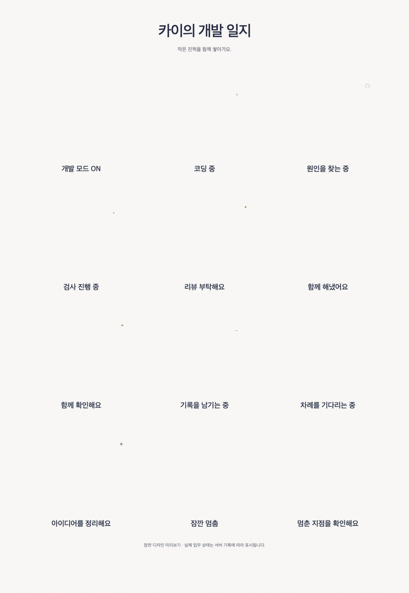

# 함께 일하는 캐릭터와 개발 일지

0.15.1 · 2026-10-21. 부서·역할·기존 이름을 유지하면서 크림색 봉제 질감과 남색·민트 포인트를 가진 캐릭터로 바꿨다. 작은 초상은 사이드바·대화·동료 목록에, 큰 작업 장면은 오피스와 업무방에 사용한다. 0.15.1은 장면별 동작과 작은 효과를 추가한다.


| 부서 | 동료 | 캐릭터 |
| --- | --- | --- |
| 직속 | 아리 · 업무 총괄 | 구름 친구 |
| 직속 | 솔 · 리서치 | 사막여우 |
| 개발 | 카이 · 개발 | 수달 |
| 개발 | 노아 · 코드 리뷰 | 거북이 |
| 운영 | 온 · 서비스 운영 | 헤드셋을 쓴 카피바라 |
| 운영 | 테오 · 배포 관리 | 모자를 쓴 코기 |
| QA | 제이 · 테스트 설계 | 고슴도치 |
| QA | 린 · 기능 QA | 펭귄 |

여우·토끼를 포함해 개인 비서용 초상도 같은 스타일로 제공한다. 데모의 캐릭터 선택기와 기존 저장값을 유지한다. 서버의 설정 UI는 이름·지침 편집을 제공하며, 캐릭터 선택기는 아직 데모 기능이다. 서버의 기존 역할 ID와 `owl`·`red-panda`·`cat` 값은 화면에서 새 초상으로 해석하므로 DB 데이터를 일괄 수정할 필요가 없다.

## 카이의 개발 일지


장면은 동료의 상태를 읽기 쉽게 보여주는 보조 수단이다. 오피스에서 카이를 선택하면 현재 업무와 다음 행동을 함께 볼 수 있다. 에이전트 홈과 업무방에도 일지가 열리고, 업무방에서는 현재 Run의 도구 행동을 더 구체적으로 반영한다. 다른 동료는 자신의 초상과 업무 일지를 사용한다.

카이를 다른 캐릭터로 바꾸면 선택한 초상과 같은 개발 일지 상태를 보여준다. 수달 전용 12장면은 카이의 캐릭터가 수달일 때만 사용한다. 예전 `cat` 저장값은 수달로 해석해 전용 장면을 유지한다.

| 저장된 기록 | 일지 장면·표시 |
| --- | --- |
| 업무 없음 | 새 업무를 기다리는 인사 |
| 실행 대기 | 닫힌 노트북에서 차례 기다리기 |
| 실행 중, 세부 행동 없음 | 진행 중인 업무의 기본 장면·일반 상태 문구 |
| 현재 실행의 코드 저장 | 코딩 |
| 현재 실행의 코드·문서·기억 읽기 | 돋보기로 살펴보기 |
| 현재 실행의 문서 저장·이동 | 기록 작성 |
| 현재 실행의 등록 검사 | 체크리스트 · **아직 결과 미확정** |
| 결과 준비, 실행 근거 없음 | 리뷰 요청 |
| 현재 결과에 종료·검사 통과 기록 있음 | 검사 통과 · **사람의 수용은 아직 남음** |
| 사람의 결과 수용 | 업무 마무리 |
| 입력 요청 / 일시 정지 / 실패·중단 | 질문 / 커피 휴식 / 멈춘 지점 확인 |

검사 통과는 현재 단계가 가리키는 artifact ID, 대상 버전, 서버의 native 실행 결과, 종료 확인, 하나 이상의 성공한 검사·exit 0을 모두 확인한다. 모델의 요약 문장이나 외부에서 가져온 결과, 이전 Run의 도구 행동을 성공 근거로 쓰지 않는다. 정적 데모의 가상 업무는 **샘플 상태**, 서버 일지는 **기록 기준**으로 구분한다. 업무 목록만 가진 화면은 목록의 상태까지만 표시하며 현재 도구를 추정하지 않는다.

모션은 기존 그림의 자세를 CSS transform과 opacity로 움직인다. 손·꼬리를 독립적으로 그린 프레임 애니메이션이나 실시간 화면 스트리밍은 아니다. 새 이미지·모션 라이브러리·외부 호출을 추가하지 않는다.

| 장면 | 동작 |
| --- | --- |
| 코딩 | 짧게 두 번 톡톡 움직인 뒤 쉬는 리듬과 작은 활동 점 |
| 조사·계획 | 궁금한 듯 고개 기울이기·잠깐 나타나는 발견 표시 |
| 검사 | 차분한 끄덕임과 순서대로 나타나는 대기 점. 체크 통과 표시는 없음 |
| 문서 작성 | 작게 기울이며 기록하는 리듬과 짧은 선 |
| 리뷰·질문 | 긴 휴지 사이 한 번의 부드러운 요청 동작 |
| 확인된 검사 성공·업무 수용 | 두 번의 작은 점프와 별 세 개. 한 번 재생 후 정지 |
| 대기·휴식 | 느린 호흡. 커피 그림에만 작은 김이 올라옴 |
| 실패·중단 | 한 번 조용히 내려앉고 정지. 반복 흔들림 없음 |
| 업무 없음 | 선택한 일지 또는 직접 hover/focus한 동료만 짧게 인사 |

같은 업무·실행·상태·결과·캐릭터라면 장면 DOM과 CSS animation 재생 위치를 유지한다. 실시간 갱신 때문에 완료 동작이 반복되거나 활동 루프가 처음으로 돌아가지 않는다. 작업이 바뀌거나 다른 캐릭터를 고르면 이전 장면을 재사용하지 않는다. 현재 화면의 노드만 잠시 보관하며 과거 장면을 쌓는 전역 캐시는 없다. 다른 화면으로 이동했다가 새로 여는 경우는 새 장면이다.

기존 **모션 끄기**와 OS의 **동작 줄이기**를 적용하며, 후자는 장식 효과도 숨긴다. 브라우저 문서가 숨겨졌을 때에는 동작을 일시정지한다. 개별 요소가 스크롤로 가려졌는지 판정하는 기능은 없다. 작은 사이드바 초상과 업무 라벨·버튼은 움직이지 않는다. 모션을 멈춰도 상태·담당·다음 행동은 글자로 남는다.




## 구현과 재현

- [초상 atlas](../assets/plush-crew-v2.webp): 10종, 1983×793 RGBA WebP.
- [개발 일지 atlas](../assets/developer-diary-v1.webp): 12장면, 1086×1448 RGBA WebP.
- [생성 방식·최종 프롬프트](../assets/plush-generation.md): 내장 image_gen으로 생성·여백 보정했다. 참고 원본은 공개 소스에 포함하지 않는다.
- [초상 viewport](../src/plush-sprites.js), [기록→일지 상태](../src/work-diary.js), [스타일](../src/plush.css), [장면별 CSS 모션](../src/plush-motion.css), [갱신 시 재생 유지·숨김 정책](../src/plush-motion.js)을 데모와 서버가 공유한다. 같은 bitmap을 불러오고 측정된 CSS viewport로 이웃 그림을 가린다. 비율을 유지하며 맞추므로 작은 귀·꼬리가 찌그러지지 않는다.
- [단위 검사](../tests/work-diary.test.js)는 이전 캐릭터 ID, Run/결과의 현재성, 잘못된 성공 표시, HTML escape를 확인한다. 브라우저 검사는 선택·상태 전환·모션 제어와 실제 서버의 미검증 결과 표시를 확인한다.

스크린샷과 GIF는 아래 명령으로 실제 정적 UI를 조작해 다시 만든다. 개발 일지 시트는 장면 디자인 미리보기다. 서버 실행·모델 품질 검증으로 해석하지 않는다. [캡처 영수증](media/plush/manifest.json).

```sh
npm run build
FFMPEG_BIN=/path/to/ffmpeg node scripts/capture-plush.mjs
```
