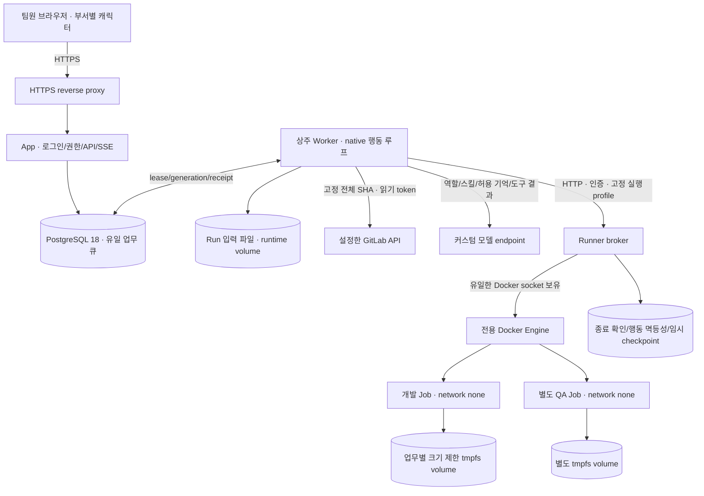
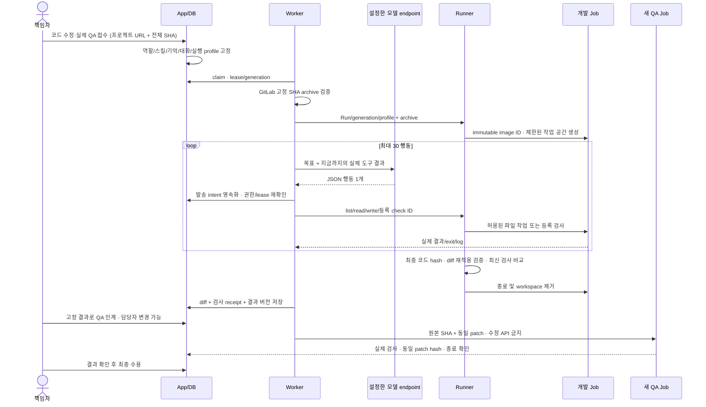
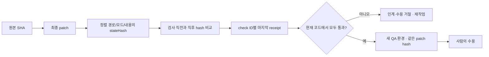

# 0.6 코드 수정과 실제 QA 실행

0.6은 공용 협업 서버에 native 실행 루프를 추가한다. Hermes·LangChain·LangGraph 의존성은 없다. 모델은 설정한 endpoint를 통해 호출하고, 실제 코드 실행은 별도 Runner가 관리한다. 자동 commit/push/MR 생성·배포는 제공하지 않으며 사람은 검토한 patch를 저장소에 적용한다.

## 전체 구조



비밀 파일은 신뢰된 init-secrets 단계가 App/Worker/Runner별 소유권의 볼륨으로 준비한다. Linux 호스트 uid와 비루트 컨테이너 uid가 달라도 입력 파일을 0600으로 유지한다. App에는 DB 비밀만, Worker에는 모델/GitLab/Runner 비밀, Runner에는 Runner token만 전달한다.

App과 Worker는 Docker socket을 갖지 않는다. Job에는 모델/GitLab/DB/Runner token이 없다. Runner는 별도의 실행 전용 Docker host/VM에 배치할 수 있다. 기본 Compose는 같은 Engine에서 동작한다. 여러 배포는 서로 다른 `COMPOSE_PROJECT_NAME`과 Runner namespace를 사용한다.

에이전트는 항상 DB에 존재하는 역할·설정·스킬·기억이다. 상주 프로세스는 App/Worker/Runner이고, 개발·QA 컨테이너는 **업무 Run의 generation마다 생성**한다. 분석 대화·PR 검토는 모델 HTTP 호출만 수행한다. 개인마다 상주 컨테이너를 유지할 필요가 없다.

## 실제 업무 흐름



모델이 실행할 수 있는 행동은 `list_files`, `read_file`, `write_file`, `run_check`, `finish`다. 임의 shell, Docker 옵션, 이미지, host mount, URL, command argv를 모델이 지정하지 않는다. `run_check`에는 운영자가 등록한 ID만 보낸다. 명령 배열·timeout은 실행 profile에서 결정한다.

기본 profile은 Node 24의 `node --test`다. `package.json`에 외부 의존성이 있으면 준비한 이미지가 없을 때 `DEPENDENCIES_NOT_PREPARED`로 중단한다. 설치를 생략하고 통과로 표시하거나 Job 네트워크를 임의로 켜지 않는다.

## 검사 결과를 믿는 기준



- 검사 후 수정하면 이전 receipt는 현재 코드에서 제외된다. 같은 check를 다시 실행해 실패하면 이전 성공을 재사용하지 않는다.
- 검사 중 소스가 달라져도 통과하지 않는다. 정상 종료 코드 0만으로 충분하지 않다.
- Job의 `.git`을 믿지 않는다. Job을 pause하고 신뢰된 별도 helper가 workspace를 읽기 전용으로 수집한다. 링크·특수 파일·경로 이탈을 거절한 regular file map을 broker의 독립 Git에 넣어 diff를 계산한다.
- `.gitignore` 때문에 실제 파일 수정이 누락되지 않도록 전체 스냅샷을 index에 반영하고, 원본에 patch를 재적용한 treeHash가 최종 스냅샷과 같은지 확인한다.
- QA는 원본 archive와 정확한 patch를 새 환경에 넣는다. 빈 patch도 유효한 고정 입력이다. 개발 컨테이너를 그대로 재사용하지 않는다.
- 등록 검사 통과는 해당 검사의 증거다. 테스트 범위·정확성, 실제 모델의 구현 품질, 배포 환경에서의 정상 작동은 사람이 확인한다.

## 프로젝트별 실행 이미지

1. 프로젝트의 언어/toolchain과 의존성이 포함된 이미지를 준비한다. 기본 `Dockerfile.job`은 Node 기본 기능만 포함한다. Python/Java 등은 같은 Node 제어 도구를 유지하면서 필요한 toolchain을 추가한 이미지로 확장한다.
2. Node 의존성은 프로젝트의 lock 파일로 이미지 빌드 때 준비해 `/opt/crewroom-deps/node_modules`에 둔다. Job root는 읽기 전용이고 설치 시점의 키는 최종 이미지에 남기지 않는다.
3. `RUNNER_JOB_IMAGE`를 해당 이미지로 지정한다. Broker는 tag를 실제 image ID로 해석하고 전용 pin tag로 보존한다. 배포 tag를 재빌드해도 진행 중 Job은 그 image ID만 사용하며 자동 pull하지 않는다.
4. [실행 profile 예제](../deploy/runner-profile.example.json)를 대상 프로젝트에 맞춘다. Node 외부 의존성이 있으면 `preparedDependencies=true`, `expectedLocks`에는 **package.json과 lock 파일 SHA-256**을 넣는다. 다른 toolchain도 `expectedLocks`에 의존성 명세를 넣어 변경을 감지할 수 있다.
5. `checks`의 ID/label/argv/timeout을 실제 검사에 맞춘다. `npm test`도 shell 해석 없이 `['npm','test','--','--runInBand']` 같은 배열을 사용한다. network none에서 검사할 수 있어야 한다.
6. [profile override](../deploy/compose.runner-profile.yaml)를 배포 Compose에 더한다. 기본 제공 파일은 외부 의존성이 없는 Node 예제다.

```bash
docker compose --profile images build app runner job-image
docker compose -f compose.yaml -f deploy/compose.reverse-proxy.yaml -f deploy/compose.runner-profile.yaml up -d
```

현재 배포 하나는 실행 profile 하나를 쓴다. 여러 언어/프로젝트별 이미지를 자동 선택하는 UI는 아직 없다. 첫 도입은 **등록한 한 프로젝트와 검사가 준비된 이미지**로 시작한다. profile/image를 바꾸면 기존 Run을 다른 환경에서 조용히 이어가지 않고 새 실행을 요구한다.

## 중단·재개·장애 복구

- Runner 행동은 `(Run,generation,sequence)`와 입력 hash로 기록한다. 응답을 잃어 같은 행동을 요청하면 완료 캐시를 돌려주고, 기록이 prepared 상태면 자동 재실행하지 않는다.
- 취소/일시정지는 generation을 바꿔 늦은 결과를 막는다. Worker는 모델 호출을 abort하고 컨테이너를 종료한 뒤 소유권을 해제한다. Docker 종료를 확인하지 못하면 lease를 보유한 채 운영 확인을 요구한다.
- Worker 종료도 진행 중 루프를 abort하고 Job 종료를 기다린다. Runner 재시작은 자기 namespace의 남은 컨테이너를 제거하고 과거 generation을 재생성하지 않는다.
- 재개는 마지막 확인한 patch를 새 generation의 컨테이너에 복원한다. 실패·복원으로 새 Run을 만들 때도 같은 SHA/profile의 checkpoint를 새 snapshot에 명시적으로 인계한다. 이전 통과 receipt는 복사하지 않고 다시 검사한다.
- 외부 요청의 발송·응답이 불명확한 경우는 자동 재발송하지 않는다. [운영 CLI](SERVER_OPERATIONS.md)의 종료 확인은 Runner Job도 실제 중지한 후 기록한다.
- 30분 이상 활동 없는 Job은 watchdog이 종료한다. 기본 전체 동시 실행 2개/동료 1개다.

## 저장·한도·백업

| 항목                                | 위치/기본 한도                                                            |
| ----------------------------------- | ------------------------------------------------------------------------- |
| 업무·스킬·기억·결과·최종 patch/검사 | PostgreSQL, 단일 기준                                                     |
| 고정 입력                           | DB snapshot + runtime volume의 input.json                                 |
| 행동 멱등 기록/임시 archive         | Runner 전용 state volume, 운영자가 보존 주기 관리                         |
| Job workspace                       | Run별 local tmpfs volume, 기본 256MB, 종료 시 제거                        |
| 실행 격리                           | network none, root read-only, uid1000, caps0, CPU1, memory512MB, pids128  |
| 입력 archive                        | 압축 20MB/해제 64MB, 파일 5천 개, 파일당 8MB                              |
| 모델 파일 도구                      | text 파일당 128KB, 모델 문맥 200K문자, 최대 30행동                        |
| patch                               | 1MB, 현재 text patch만 지원; 링크/submodule/binary 변경은 명시적으로 중단 |
| 검사                                | 등록된 argv만, 최대 5분/검사, stdout/stderr 각 마지막 60K문자             |

백업은 App/Worker/Runner를 정지하고 DB+runtime을 암호화한다. Runner state는 실행 캐시이므로 백업하지 않는다. 복원은 옛 세션을 폐기하고 미완료 Run을 격리한다. 다른 host로 복원했다면 기존 host 실행 종료도 운영자가 확인한다. 백업 키·모델 endpoint token·실행 이미지/profile은 별도 보관한다.

## 구현 위치

| 계약                                   | 소스                                      |
| -------------------------------------- | ----------------------------------------- |
| 코드 입력/전체 SHA/등록 프로젝트       | `server/inputs.js` collectCodeInput       |
| native 모델 행동 루프/진행/Job 정지    | `server/runner-client.js`                 |
| lease/권한/발송 intent/generation      | `server/worker.js`                        |
| 업무 단계/인계·수용 검사               | `server/tasks.js`, `server/work-types.js` |
| Job/멱등성/스냅샷/diff/검사 receipt    | `runner/broker.mjs`                       |
| HTTP 인증                              | `runner/server.mjs`                       |
| archive 경로·크기·타입 검사            | `runner/archive.mjs`                      |
| 컨테이너 내부 파일/검사 도구           | `runner/job/`                             |
| 실제 Docker 회귀                       | `tests/runner-docker.test.mjs`            |
| 모델 계약→코드수정→실검사→팀원 QA→수용 | `tests/server/execution.test.js`          |
