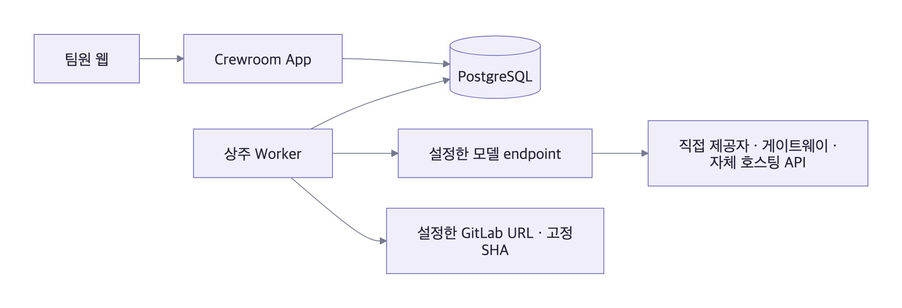

# 커스텀 모델·저장소 연결

Crewroom은 원하는 모델 endpoint와 GitLab URL을 연결해 직접 호스팅하는 팀 에이전트 플랫폼이다. 모델 제공자에 직접 연결하거나 호환 API를 제공하는 게이트웨이·자체 호스팅 서버를 사용할 수 있다. 현재 지원하는 통신 형식은 **OpenAI 호환 Chat Completions**와 **Claude Messages**이며, URL만으로 다른 API 형식을 자동 변환하지는 않는다.

[](diagrams/custom-endpoints.svg)

설정한 주소로만 모델을 호출하며 다른 제공자로 자동 fallback하지 않는다. 별도 SDK 없이 Node HTTP를 사용한다. API 형식이 두 계약과 다르면 `server/provider.js`의 요청·응답 adapter와 계약 검사를 확장해야 한다.

## 1. 모델 URL과 인증

처음 설치할 때 예제를 복사한다. 기존 설치는 현재 `.env`에 필요한 항목만 반영한다.

```bash
cp deploy/custom.env.example .env
node scripts/init-secrets.mjs
```

| 항목          | 설정                                                                 |
| ------------- | -------------------------------------------------------------------- |
| API 형식      | `MODEL_PROVIDER=openai-compatible` 또는 `anthropic`                  |
| 최종 요청 URL | `MODEL_ENDPOINT_URL` — 경로를 포함한 전체 URL                        |
| API root      | `MODEL_BASE_URL` — 전체 URL을 지정하지 않을 때 기본 경로 조합에 사용 |
| 모델 ID       | `MODEL_NAME` — 연결한 endpoint에서 제공하는 모델 ID                  |
| 인증          | `MODEL_AUTH_HEADER`, `MODEL_AUTH_SCHEME=auto/raw/bearer`             |
| API 키        | `.local/secrets/model_api_key` 파일                                  |

OpenAI 호환 Chat Completions 예제:

```dotenv
MODEL_PROVIDER=openai-compatible
MODEL_ENDPOINT_URL=https://models.example.com/v1/chat/completions
MODEL_NAME=your-model-id
MODEL_AUTH_HEADER=authorization
MODEL_AUTH_SCHEME=bearer
```

Claude Messages 예제:

```dotenv
MODEL_PROVIDER=anthropic
MODEL_ENDPOINT_URL=https://models.example.com/v1/messages
MODEL_NAME=your-model-id
MODEL_AUTH_HEADER=x-api-key
MODEL_AUTH_SCHEME=raw
MODEL_API_VERSION=2023-06-01
```

예제 도메인과 모델 ID는 실제 연결 값으로 바꾼다. `MODEL_PROVIDER`는 모델 브랜드가 아니라 통신 형식을 선택한다. `MODEL_ENDPOINT_URL`은 `MODEL_BASE_URL`보다 우선한다. 사용자 지정 token header에는 `MODEL_AUTH_HEADER`를 사용하고, 원문 token은 `raw`, `Bearer TOKEN` 형식은 `bearer`로 지정한다. 키는 비밀 파일에만 저장한다.

현재 adapter는 비스트리밍 JSON 응답을 검사한다. 모델은 [결과 형식과 제한된 JSON 행동](CODE_EXECUTION.md)을 따라야 한다. text·usage·request ID를 기록하며, 예상하지 않은 도구 요청이나 잘린 출력은 실패로 처리한다. 실제 모델의 형식 준수와 결과 품질은 작은 업무로 확인한다.

사용자 지정 CA가 필요하면 인증서 파일을 컨테이너에 read-only 마운트하고 Node의 `NODE_EXTRA_CA_CERTS`를 지정한다. TLS 검증은 유지한다.

## 2. GitLab URL과 프로젝트

GitLab.com 또는 직접 호스팅한 GitLab의 API v4를 연결한다. 공개 GitHub PR 분석은 별도 기능이며 `GITHUB_ENABLED`로 선택한다.

```dotenv
GITHUB_ENABLED=1
GITLAB_BASE_URL=https://git.example.com
GITLAB_PROJECTS=team/project,team/subgroup/another-project
GITLAB_SHARED_PROJECTS=
```

하위 경로에 배포했다면 `GITLAB_BASE_URL=https://git.example.com/gitlab`처럼 root에 경로를 포함한다. MR 입력도 같은 root의 `https://git.example.com/gitlab/team/project/-/merge_requests/123` 형식으로 넣는다. token은 `.local/secrets/gitlab_token`에 저장한다. 현재 adapter는 `PRIVATE-TOKEN` header를 사용한다.

`GITLAB_PROJECTS`는 읽을 수 있는 프로젝트 목록이다. 개인 업무가 기본이며 부서·팀 공유 업무에 사용할 프로젝트는 `GITLAB_SHARED_PROJECTS`에도 넣는다. 공유 대상 전원의 저장소 접근권을 확인한 프로젝트만 등록한다. 서비스 token의 권한을 팀원 전원의 권한으로 간주하지 않는다. 사용자별 GitLab OAuth·그룹 동기화는 구현하지 않았다.

MR 분석은 `diff_refs.base_sha/head_sha`를 고정해 compare를 수집한다. SHA 불일치·누락·timeout·생략된 diff는 거절하며 diff 분석을 실제 테스트 통과로 표시하지 않는다. 코드 실행은 등록한 프로젝트 URL과 **40/64자리 전체 SHA**의 archive를 사용한다. GitLab token은 실행 Job에 전달하지 않는다.

`GITHUB_ENABLED=0`이면 공개 GitHub PR 입력을 거절한다. 이 설정은 해당 연동을 끄며, 호스트 전체의 네트워크 정책을 변경하지 않는다.

## 3. 배포 주소와 HTTPS 프록시

로컬 실행은 기본 Compose를 사용한다. 기존 HTTPS reverse proxy를 연결하는 배포에서는 다음 override를 사용한다.

```bash
docker compose --profile images build app runner job-image
docker compose -f compose.yaml -f deploy/compose.reverse-proxy.yaml up -d
```

`PUBLIC_ORIGIN`은 팀원이 접속할 HTTPS 주소다. 기본 App 바인딩은 loopback이며 프록시를 App으로 연결한다. 이 override는 별도 인증서 발급 서비스를 시작하지 않는다. Caddy를 사용하는 구성은 [운영 안내](SERVER_OPERATIONS.md)를 따른다. 실제 token 파일은 Worker에만 마운트한다.

모델 URL·인증 형식·저장소 설정이 바뀌면 기존 queued Run을 변경된 연결로 전송하지 않고 새 실행을 요구한다. token 값 자체는 실행 profile에 저장하지 않으므로 정상적인 token 교체는 가능하다. 업데이트 시에도 `npm run secrets:init`를 실행하면 기존 비밀값을 보존하면서 누락된 파일만 추가한다.

## 4. 프로젝트별 실행 환경

기본 Job 이미지는 외부 의존성이 없는 Node 예제다. 실제 프로젝트의 언어·의존성이 포함된 이미지와 등록 검사를 [실행 환경 안내](CODE_EXECUTION.md)에 따라 준비한다. 배포당 실행 profile 하나를 지원하며, Hermes 의존성 없이 native 루프와 Docker Runner가 동작한다.

## 5. 소스 패키지와 CI

커밋된 소스의 배포 패키지를 만들 수 있다. 작업트리가 clean이어야 하며, 무시된 `.env`, `.local`, 비밀 파일·DB volume·`node_modules`는 포함하지 않는다.

```bash
npm run export:source
```

`.local/exports/`에 source tar와 SHA-256 receipt를 만든다. 이 파일은 의존성을 포함한 오프라인 설치 패키지가 아니다. 배포 환경의 npm registry·Docker registry에서 의존성과 이미지를 준비한다.

GitHub Actions는 단위·PostgreSQL·Docker·브라우저·복원 검사를 수행한다. `.gitlab-ci.yml`은 GitLab CI용 기본 검사이며 `CREWROOM_NODE_IMAGE`, `CREWROOM_POSTGRES_IMAGE`와 npm registry를 환경에 맞게 지정할 수 있다. Docker와 브라우저 검사는 해당 도구를 사용할 수 있는 Runner에서 추가한다. 제공된 GitLab CI 파일의 실제 Runner 실행은 미검증이다.

## 검증 범위

로컬 HTTP endpoint와 실제 PostgreSQL Worker를 사용해 커스텀 URL·인증·MR 수집·고정 SHA·공유 제한·결과 저장을 검증했다. 실제 배포에서는 endpoint의 API 계약·인증·CA·모델 ID, GitLab 접근권, 프로젝트 이미지와 검사, 결과 품질을 확인한다. [시범 운영 가이드](PILOT_GUIDE.md) · [검증 보고서](SERVER_VERIFICATION.md)

통신 계약: [Claude Messages API](https://platform.claude.com/docs/en/api/messages/create), [GitLab MR API](https://docs.gitlab.com/api/merge_requests/), [GitLab Repository Compare](https://docs.gitlab.com/api/repositories/#compare-branches-tags-or-commits).

## 선택적 의미 검색

`EMBEDDING_ENDPOINT_URL`, `EMBEDDING_MODEL`과 선택적 인증 헤더를 별도로 설정한다. 키 파일은 `.local/secrets/embedding_api_key`이고 Worker에만 전달한다. 미설정이면 로컬 키워드 검색이 동작한다. 모델 추론 URL을 embedding URL로 자동 재사용하지 않는다. [캐시·재시도·정정·운영 한도](MEMORY_ARCHITECTURE.md)를 확인한다.
