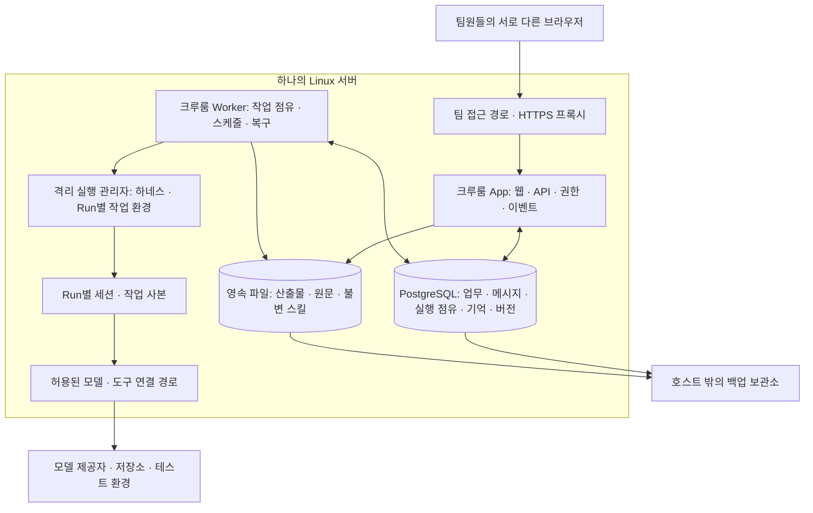

> **0.5 구현 안내:** 이전 단계의 기록입니다. 현재 실행 구조는 [서버 아키텍처](SERVER_ARCHITECTURE.md), 실제 배포는 [운영 안내](SERVER_OPERATIONS.md), 검증 범위는 [리뷰 보고서](SERVER_VERIFICATION.md)를 우선합니다.

# 공용 에이전트 플랫폼 · 배포와 운영 설계

> 2026-10-17 변경: 현재 정책·상태·Paperclip 재사용 경계·서버 복구 계약은 [리뷰 반영 확정 설계](DESIGN_IMPLEMENTATION.md)가 기준입니다. 이 문서의 기존 구조에 추가 적용합니다.

2026-10-16. 당시의 웹 프로토타입을 점검해 보완한 설계다. **공용 에이전트 구조는 문서에 있지만, 실제 팀 서버를 기동하는 코드·배포 파일은 아직 없다.** 이 문서는 목표 배포 방식과 구현해야 할 운영 계약을 설명하며 배포 완료 보고가 아니다.

[README의 배포 순서·기억 보관·복구 그림](../README.md#서버-배포와-운영)을 먼저 보고, 아래에서 기동 조건·저장 경로·운영 절차·미구현 파일을 확인할 수 있다.

## 현재 가능한 배포와 실제 팀 서버의 차이

| 항목 | 현재 상태 |
| --- | --- |
| 데스크톱 웹 목업 빌드·검사 | 구현됨. [package.json](../package.json)의 기존 명령 사용 |
| 공개 샘플 배포 | [GitHub Actions](../.github/workflows/verify-and-deploy.yml)가 정적 `dist/`를 GitHub Pages에 배포 |
| 공용 API·로그인·서버 DB | 미구현 |
| 서버에 상주하는 공용 에이전트·Worker·실제 모델 | 미구현 |
| 공용 스킬·결과 스키마 검증·산출물 저장 | 설계 상태 |
| Dockerfile·Compose·서버 환경 설정·마이그레이션 | 미구현 |
| 운영 서버 기동·재부팅·백업 복원 검증 | 미실행 |

기존 `npm run dev`와 `npm run preview`는 웹 목업을 확인하는 명령이다. 이를 서버에서 실행하는 것만으로 공유 에이전트·서버 저장·다중 사용자 기능이 생기지 않는다. 현재 `Verify and deploy` 성공도 팀 운영 서버가 배포됐다는 증거가 아니다.

## 첫 배포의 기본 구성

한 팀의 배포는 **한 Linux 서버에 Docker Compose로 웹/API·Worker·PostgreSQL·역방향 프록시를 운영**하는 구성으로 시작할 수 있다. 앱과 Worker는 같은 코드베이스·같은 릴리스 이미지에서 역할을 나눈 프로세스다. 기억·스킬·큐를 각각 별도 마이크로서비스로 분리하지 않는다.

배포 운영자가 서버 제공자·도메인·접근 경로를 선택한다. 공개 Pages는 샘플용이며 실제 팀 데이터는 직접 운영하는 서버에 둔다. 서버 사양과 동시 실행 수는 실제 저장소·도구·하네스 부하를 확인한 뒤 정한다.

| 구성 요소 | 실행·배포 책임 |
| --- | --- |
| HTTPS 프록시 | Caddy를 우선 후보로 두고 웹/API를 같은 서비스 주소로 제공. 인증된 파일 다운로드와 이벤트 연결도 같은 정책 적용 |
| 크루룸 App | 로그인·팀장 권한·공유 대화·Task·산출물·기억·스킬 관리와 서버 이벤트 전송 |
| 크루룸 Worker | PostgreSQL의 영속 큐·실행 점유·스케줄을 사용해 Run 수행. 웹 접속 여부와 무관하게 동작 |
| 실행 관리자 | 검증한 하네스 하나로 시작. 공용 Agent의 정체성과 Run별 세션·파일 환경을 매핑하고 실행 한도를 적용 |
| PostgreSQL | 기준 상태와 메시지·이벤트 순서·Run 세대·스킬 및 산출물 메타데이터 보관 |
| 영속 파일 저장 | 초기에는 서버 디스크의 전용 경로를 사용하고 앱의 저장 인터페이스로 접근. 큰 규모의 객체 저장소 이행은 별도 판단 |

Paperclip 재사용과 Hermes 연결은 기존의 우선 검증 후보다. 실제 재사용 범위와 실행 명령은 PoC로 결정해야 한다. 이 문서가 해당 서버나 SDK의 설치·실행 성공을 주장하는 것은 아니다.

## 네트워크와 실행 환경

팀원이 접근하는 입구는 HTTPS 프록시 하나로 모은다. DB·Worker·실행 관리자 포트를 외부에 직접 공개하지 않는다. 비공개 네트워크·VPN을 쓰더라도 서버의 사용자 인증과 자료별 권한 검사를 유지한다. 사용할 도메인의 인증서 발급 방식은 배포 환경의 DNS·인증서 구성에 맞춰 선택한다. [Caddy 역방향 프록시 문서](https://caddyserver.com/docs/quick-starts/reverse-proxy).

공용 Agent는 DB의 ID·설정·기억·장착 스킬과 영속 작업공간으로 유지한다. 실행 요청은 Worker가 처리한다. 같은 업무방의 팀원은 같은 세션을 이어가고, 별개 업무는 Run별 작업 사본에서 실행한다. 모델을 대기 중에도 계속 호출할 필요는 없지만 요청 수신과 실행 관리는 서버에서 계속 유지되어야 한다.

에이전트가 실행하는 저장소 코드·스킬 스크립트는 App·DB와 다른 실행 환경에 둔다. DB 암호·전체 서비스 환경 변수·다른 Agent의 파일을 통째로 상속하지 않는다. 웹/API나 에이전트 컨테이너에 호스트 Docker 제어 소켓을 직접 제공하지 않는다. 별도 권한의 실행 관리자가 제한된 실행 요청을 받아 환경을 준비하는 경계를 검증해야 한다. 구체적인 컨테이너·네이티브 세션 유지 방식은 하네스 PoC의 미결정 항목이다.

모델·외부 도구의 자격증명은 연결 주체별로 보관하고 필요한 권한만 실행에 제공한다. 런타임이 자격증명 대행과 제한을 실제로 지원하는지 확인하기 전에는 격리가 완성됐다고 판단하지 않는다.

## 디스크와 데이터 보관

아래는 Linux 운영 서버의 **제안 경로**다. 현재 저장소가 이 경로를 생성하거나 마운트하지 않는다.

| 경로 | 보관 대상 | 주의할 수명 |
| --- | --- | --- |
| `/srv/crewroom/postgres` | PostgreSQL 데이터 볼륨 | 앱 재배포·컨테이너 재생성과 무관하게 유지 |
| `/srv/crewroom/artifacts` | 원문·첨부·버전 있는 결과물 | DB의 파일 참조·해시·공개 범위와 함께 보관 |
| `/srv/crewroom/skills` | 게시된 불변 스킬 본문·결과 스키마·표시 템플릿 | Run이 사용한 과거 버전까지 유지 |
| `/srv/crewroom/agents/<agentId>` | 공용 Agent의 허용된 영속 작업공간 | Agent 정체성 유지. 실행별 쓰기는 충돌 처리 |
| `/srv/crewroom/runs/<runId>` | 실행별 작업 사본·체크포인트·도구 영수증 | 재개 필요 여부와 보존 정책을 확인한 뒤 정리 |
| `/srv/crewroom/secrets` | 런타임이 필요한 비밀 설정의 제한된 마운트 원본 | 접근 권한 제한. 공개 Git·산출물·로그에 포함하지 않음 |
| `/srv/crewroom/caddy` | 프록시 운영 상태·인증서 관련 데이터 | 인증서 발급 방식에 맞춰 보관 |

파일을 정적 공개 디렉터리로 노출하지 않는다. 다운로드마다 서버가 자료 접근 권한을 검사한다. 사용자 입력 경로로 임의 파일을 읽는 방식 대신 서버의 산출물 ID와 실제 파일 참조를 사용한다.

DB에는 Task·Run·대화·메시지·기억·스킬 버전·산출물 메타데이터를 저장한다. 큰 원문과 파일은 영속 파일 저장에 두고 참조한다. 컨테이너 내부 임시 파일이나 브라우저 localStorage를 기준 저장소로 쓰지 않는다.

## 최초 기동 순서

다음은 **구현해야 할 배포 절차**다. 현재 실행 가능한 Compose 파일이나 서버 시작 명령은 없다.

1. 검증한 App·Worker·하네스 이미지와 DB 버전을 고정한다. 릴리스 식별자와 이미지 digest를 기록한다.
2. 운영 디스크·접근 권한·비밀 설정·팀 로그인·첫 팀장 계정을 준비한다. 공용 Agent와 초기 스킬의 ID·버전도 정한다.
3. DB를 기동하고 실제 접속 준비 상태를 확인한다.
4. 단일 마이그레이션 프로세스로 스키마를 적용한다. 실패하면 App·Worker를 시작하지 않는다.
5. App을 기동하고 DB 연결·스키마 버전·로그인 준비 상태를 확인한다.
6. 실행 관리자·Worker를 기동하고 점유·심박·하네스·도구 연결 상태를 확인한다. 정기 작업은 DB 점유를 얻은 한 실행 주체만 접수한다.
7. 프록시를 통해 접근을 열고 서로 다른 두 계정으로 공용 Agent·공유 업무·공통 결과 형식을 확인한다.

Compose의 시작 순서만으로 DB 준비가 확인되지는 않는다. DB 준비는 `healthcheck`와 `service_healthy`, 마이그레이션 완료는 `service_completed_successfully` 같은 명시적인 조건으로 연결해야 한다. App도 재접속과 일시적인 DB 장애를 처리해야 한다. [Docker 시작 순서 문서](https://docs.docker.com/compose/how-tos/startup-order/).

## 재시작·작업 복구·정지

컨테이너 재시작은 Compose의 재시작 정책으로 관리하고, 컨테이너 종료를 두 개의 감독자가 경쟁해서 처리하지 않게 한다. 호스트 부팅 때 컨테이너 엔진과 관리 대상이 시작되는지도 실제 서버에서 확인한다. [Docker 재시작 정책 문서](https://docs.docker.com/engine/containers/start-containers-automatically/).

프로세스가 다시 떠도 업무가 안전하게 재개된다는 뜻은 아니다. 업무 복구는 DB의 Run 세대·점유 만료·체크포인트·도구 영수증을 읽어 별도로 처리한다. 외부 변경 결과가 불명확하면 확인이 필요한 상태로 두고 같은 변경을 자동 반복하지 않는다. 취소·정지·입력 대기를 진행 중 업무와 구분한다.

정상 종료 시 Worker는 새 Run 점유를 중단하고 진행 중 단계의 상태·결과를 보관한다. 제한 시간 안에 종료되지 못한 실행은 점유 만료 후 복구 대상으로 남긴다. 이미 외부에 반영한 변경은 중단 버튼이나 프로세스 종료로 되돌아가지 않는다.

브라우저는 재접속 시 서버 스냅샷과 마지막 처리 이벤트 이후 기록을 복원한다. 캐릭터 모션은 서버가 확인한 실행 상태에 연결하고, 연결이 끊기면 갱신 중단·마지막 확인 시각을 표시한다.

## 운영 상태 확인

| 확인 지점 | 확인할 내용 |
| --- | --- |
| App 생존·준비 | 프로세스 응답과 DB·스키마 준비를 구분. 구체적인 health API는 미구현 |
| Worker | 최근 심박·실행 점유·대기열·오래 멈춘 Run·도구 연결 상태 |
| 공용 Agent | 사용 가능한 하네스·적용된 스킬 버전·진행 업무·대기 질문·마지막 활동 |
| 결과물 | 스키마 검증·근거 확인·저장 성공과 해당 Run의 연결 |
| 자원·한도 | 디스크·실행 시간·동시 실행 수·모델 사용량·재시도 누적 |
| 보관·복구 | 호스트 밖의 최신 백업·복원 검증 시점·실패 기록 |

상태가 `unhealthy`로 표시되는 것만으로 애플리케이션 교착이나 멈춘 업무의 복구가 완성되지는 않는다. 감지한 상태를 운영자가 확인하고 재시작·연결 복구·업무 재개 중 어떤 행동을 할지 결정할 수 있어야 한다. 로그에는 Run ID·작업 단계·오류 원인을 남기고 자격증명과 접근 불가한 개인 내용을 출력하지 않는다.

## 백업과 복원

초기 운영은 PostgreSQL 논리 백업과 버전 있는 산출물·원문·불변 스킬의 파일 백업을 함께 보관하는 방식을 제안한다. 파일은 먼저 영속 저장한 뒤 DB 참조를 확정하고, 백업 중 참조 파일이 정리되지 않게 보존한다. 복원 시 DB의 모든 참조 파일과 해시를 확인한다. 덤프만 성공했다고 모든 업무 파일의 복구가 보장되는 것은 아니다. [PostgreSQL 백업·복원 문서](https://www.postgresql.org/docs/current/backup.html).

백업은 운영 서버와 다른 저장소에 보관하고 접근 권한·암호화 키 복구 경로를 정한다. 실행 중인 DB 데이터 디렉터리를 임의 복사하는 방식은 백업 절차로 사용하지 않는다. 주기·보존 기간·허용 데이터 손실·복구 시간 목표는 실제 팀 운영 요구를 확인해 정한다.

복원은 별도 환경에서 DB와 파일을 함께 복구한 뒤 참조·권한·스킬 버전·공유 대화를 확인한다. 복원 환경에서는 실제 외부 쓰기를 막는다. 복원된 과거 Run을 바로 실행하지 않고 외부 반영 여부와 점유 상태를 대조한 뒤 복구한다. 복원 성공 기록이 있어야 백업 경로를 운영 가능으로 판단한다.

## 업데이트와 되돌리기

배포 전 새 요청·Run 접수를 조절하고 일관된 백업과 현재 릴리스 정보를 남긴다. 마이그레이션 뒤 같은 릴리스의 App·Worker로 교체하고 준비 상태·공용 업무·결과 형식을 확인한다. 진행 Run은 고정한 스킬·템플릿 버전을 유지한다.

이전 이미지로 되돌릴 수 있는지는 DB 스키마 호환성과 진행 작업의 상태를 함께 판단해야 한다. 되돌리기 어려운 데이터 변경에는 별도 복구 계획이 필요하다. 이미 반영된 외부 변경을 이미지 롤백이 취소한다고 간주하지 않는다.

## 서버를 바로 띄우기 전에 만들어야 할 파일

아래는 **예정 산출물과 미구현 상태**다. 존재하지 않는 파일의 실행 명령을 현재 지원 명령처럼 제공하지 않는다.

| 예정 산출물 | 필요한 내용 |
| --- | --- |
| App·Worker 서버 소스와 시작 명령 | 동일 코드베이스의 API·Worker 역할, 종료 처리·상태 확인 |
| `Dockerfile` | 고정한 런타임·빌드·일반 사용자·실행 역할 |
| `deploy/compose.yaml` | App·Worker·DB·프록시·마이그레이션, 네트워크·영속 저장·상태 확인·재시작 |
| `deploy/Caddyfile` | 설정한 서비스 주소·TLS·API/이벤트 라우팅·인증된 파일 경로 |
| `.env.example` 또는 동등한 설정 명세 | 서비스 주소·DB·첫 팀장·하네스·연결 설정의 이름과 필수 여부. 실제 비밀 값 제외 |
| 마이그레이션·초기화 절차 | 스키마·팀 구성원·공용 Agent·승인된 스킬의 중복 없는 초기화 |
| 실행 관리자와 하네스 설정 | 격리 실행·세션 매핑·외부 연결·자원 및 실행 한도 |
| 백업·복원·업데이트 절차 | DB·파일의 일관성·호스트 밖 보관·검증·복구 |
| 실제 서버 검증 기록 | 릴리스·환경·두 사용자·실제 실행·복구·백업 복원 결과 |

## 배포 완료로 인정할 증거

- 서로 다른 두 실제 사용자·브라우저가 동일 공용 Agent와 같은 업무 대화·결과를 본다.
- 두 브라우저를 모두 닫아도 실제 업무가 진행되거나 대기 상태가 유지되고 재접속 뒤 복원된다.
- 공용 스킬·결과 스키마·템플릿의 실제 적용 버전과 실제 도구·산출물 기록이 남는다.
- Worker·컨테이너·호스트 재시작 뒤에도 업무·기억·스킬·파일이 남고 외부 작업이 중복되지 않는다.
- 다른 업무·개인 자료·외부 계정이 섞이지 않고, 같은 업무의 동시 지시 순서와 조작자가 확인된다.
- DB와 파일의 별도 환경 복원을 성공하고, 이미지 업데이트·복구 경로를 확인한다.

위 증거는 아직 없다. 현재는 제품 목표·논리 아키텍처와 이 배포 설계를 검토한 단계다. 실제 호스트에 배포하거나 새 서버를 구매·생성하지 않았다.
