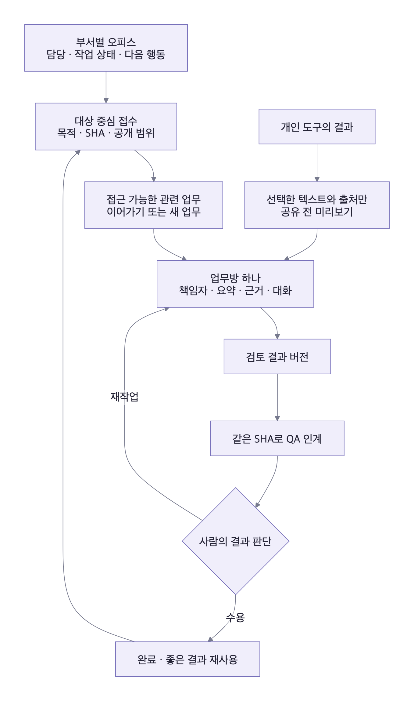
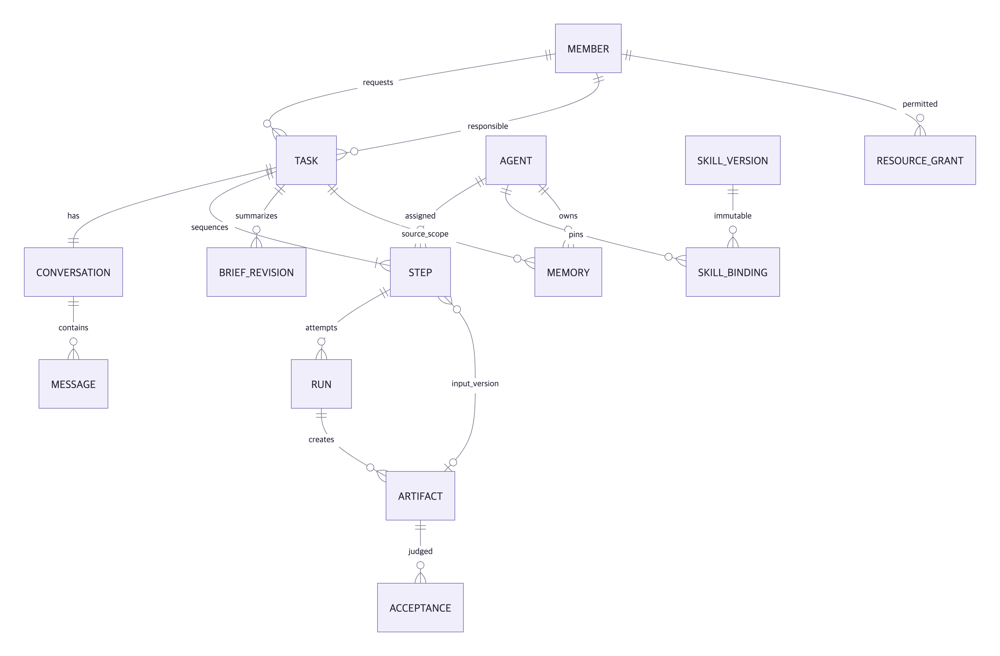
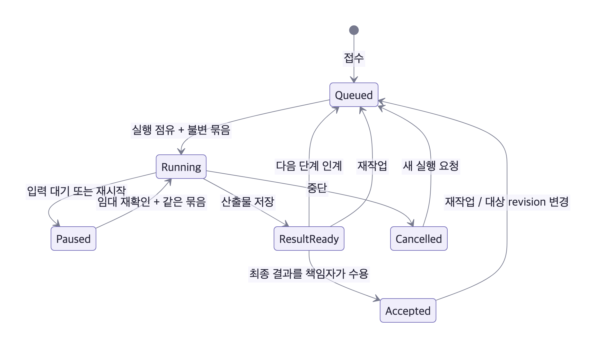
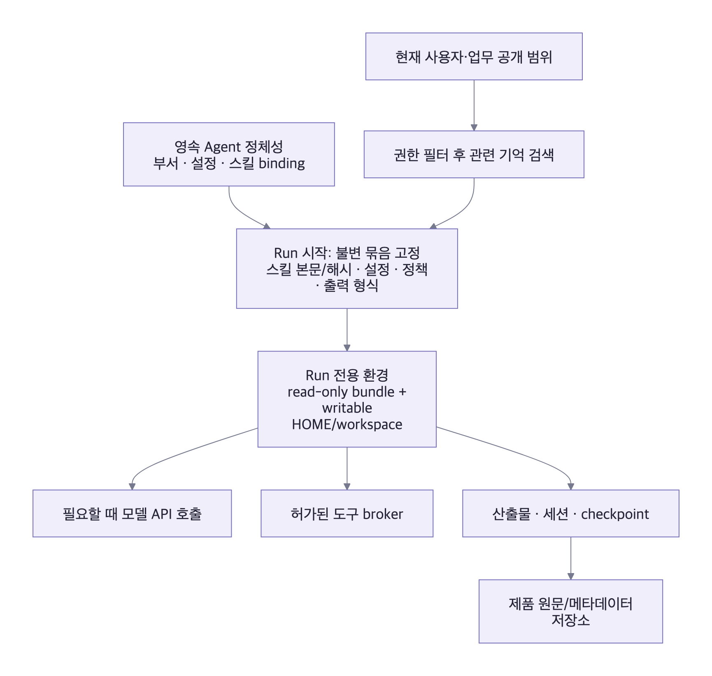
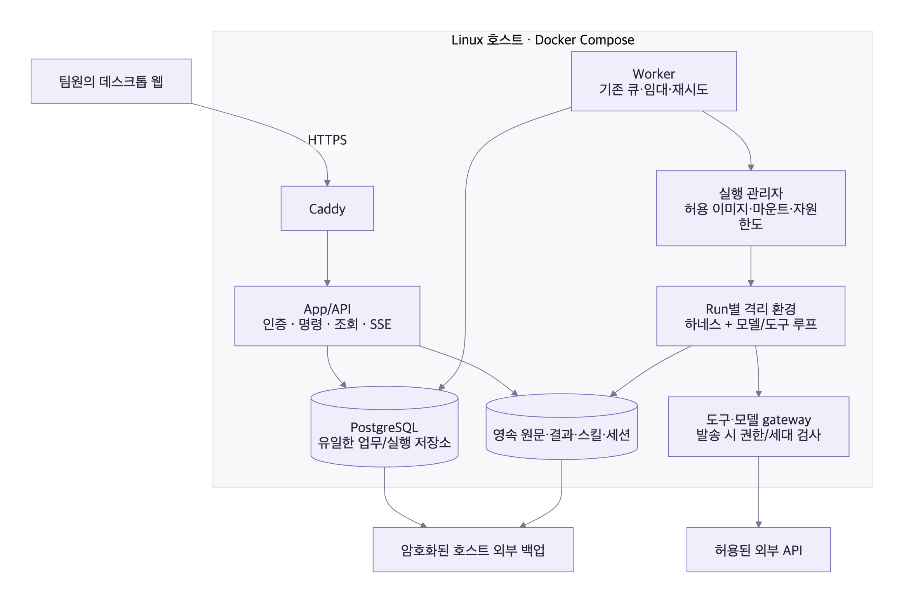

> **0.5 구현 안내:** 이 문서는 이전 기획·검토 기록입니다. 실제 서버의 현재 구조와 범위는 [서버 아키텍처](SERVER_ARCHITECTURE.md), [런타임 결정](ADR_001_RUNTIME.md), [운영 안내](SERVER_OPERATIONS.md)를 우선합니다.

# 크루룸 · 리뷰 반영 설계

2026-10-17. 사용자 승인 범위: 두 Astra 리뷰의 기획·아키텍처·디자인 개선을 설계와 동작하는 데스크톱 목업에 반영한다. 실제 인증·서버 실행·외부 계정 연결은 이번 목업 구현의 범위가 아니다.

## 디자인 계획

- 색: 기존 크루룸의 종이 `#faf9f7`, 표면 `#ffffff`, 잉크 `#292b34`, 선 `#e4e3e0`, 강조 `#5956b0`, 확인 `#20755d`를 유지한다. 주의 상태는 기존 amber를 사용한다.
- 글꼴: 로컬 한국어 시스템 산세리프. 업무 제목 26px, 구획 17px, 본문 14px, 메타정보 12px. 긴 내용은 왼쪽 정렬한다.
- 구조: 부서별 캐릭터 오피스 위에 업무 접수대를 둔다. 공유 업무방은 목록·현재 업무 요약·근거 있는 결과로 구성한다. 관리 화면은 사람이 처리할 예외와 위임에 집중한다.
- 특징: 캐릭터는 담당과 관측한 상태를 나타낸다. 작업 단계, 사람이 할 일, 이전 결과와 현재 결과의 차이를 중심으로 디자인한다.

```text
팀 오피스
  업무 접수: 대상 링크 / 원하는 결과 / 기존 결과 가져오기
  이어받을 업무: 담당 · 마지막 변화 · 다음 행동
  직속 / 개발 / 운영 / QA의 캐릭터와 실제 목업 상태

공유 업무방
  목록 | 목표·대상 버전·책임자·공개 범위
       | 현재 업무 요약 / 대화 / 결과 / 실행 기록
       | 확인된 근거 · 사람의 결정 · 미확인 · 다음 행동

팀 관리
  예외·역할 요청 / 구성원 / 공용 Agent / 스킬별 담당·정책
```

계획 검토: 지표 카드나 별도 AI 채팅을 더 추가하는 구성은 사용하지 않는다. 기존 캐릭터 공간은 남기고 접수·인계라는 크루룸의 주목표를 먼저 배치한다. 모바일은 사용자 요청에 따라 제외하며 1440/1280/1024px, 키보드·초점·모션 중단을 검증한다.

## 확정한 제품 정책

| 결정        | 적용 기준                                                                                                                                 |
| ----------- | ----------------------------------------------------------------------------------------------------------------------------------------- |
| 팀 범위     | 설치별 워크스페이스 하나. 팀 생성·조직 전환·결제 없음                                                                                                 |
| 가입·팀장   | 가입 체크는 요청. 새 계정은 팀원, 기존 팀장이 역할을 승인. 실제 서버는 허용 계정·로그인·첫 팀장 bootstrap 별도                            |
| 공개 범위   | 나만/부서/팀. 파생 업무는 원본 범위 상속. 선택 공유는 별도 공유본으로 만들고 원문 범위를 확대하지 않음                                    |
| 업무 책임   | 요청자와 현재 사람 책임자 분리. 기본은 요청자. 열람자는 댓글·인수 요청. 책임자는 답변·실행·수용·재작업. 팀장은 공유 업무 재배정·긴급 중단 |
| 인계        | 공유 업무방 하나, Task 하나, 단계별 Agent·Run·Artifact. 인계에 입력 산출물 버전·대상 SHA 고정                                             |
| 완료        | Run 성공은 결과 준비. 사람이 특정 결과 버전을 수용해야 Task 완료. 재작업은 같은 Task의 새 Run                                             |
| 결과 신뢰   | 시연/외부 가져오기/실제 도구 실행의 출처를 분리. 형식 적합과 사실 확인·사람 수용도 분리                                                   |
| 기억        | Agent별 기억을 유지하되 검색·원문·요약·세션·파일 모두 같은 공개 범위를 적용. 공통 기억 승격은 명시적 동작                                 |
| 스킬 운영   | 전역 역할은 팀장/팀원, 스킬별 담당 위임. 다른 Agent의 설정·외부 도구 권한은 자동으로 얻지 않음                                            |
| 시작        | 업무 유형·대상에 기본 담당·스킬 매핑. 관련 업무는 접근 권한 확인 후 제안하며 자동 병합하지 않음                                           |
| 결과 재사용 | 형식·완료 기준·예시만 재사용. 대상 SHA·검사 결과·사람의 승인은 복사하지 않음                                                              |
| 장기 상태   | 제품 기록이 기준. native resume 가능 시 사용, 유실 시 근거를 확인하고 새 Run으로 전환                                                     |

서버 실행·저장·복구 계약과 구현 현황은 후속 섹션에 기록한다. 기존 리뷰 문서는 당시의 관찰 이력으로 보존하고 이 문서를 현재 결정의 기준으로 삼는다.

## 사용자 여정과 화면

[](diagrams/design-implementation-1.svg)

- 오피스: 캐릭터와 네 부서 배치를 유지한다. 상단 접수대에서 새 업무/외부 결과를 시작한다. 최근 공유 업무 행에는 책임자·대상 버전·다음 행동을 표시한다. 모션은 관측한 목업 상태를 표현하며 중지할 수 있다.
- 접수: PR 검토→QA, PR 검토, 운영 점검 세 기본 경로. 사용자에게 하네스나 모델을 먼저 고르게 하지 않는다. 동일 대상의 업무도 목적·버전·공개 범위를 확인하고 직접 선택한다.
- 업무방: 하나의 대화 안에 단계, 현재 요약, 근거, 사람의 결정, 미확인 사항, 다음 행동을 배치한다. URL은 `#/tasks/<id>`. 현재 목업에서는 같은 브라우저에 해당 기록이 있어야 링크가 열린다.
- 책임: 열람자는 대화와 인수 요청을 남긴다. 책임자/권한 있는 팀장이 인수자를 지정한다. 요청자는 유지한다. 관리자는 타인의 비공개 업무를 읽을 수 없다.
- 결과: 시연 또는 외부 작성 표시를 유지한다. 형식 검사, 사실 확인, 사람의 수용은 별도 속성이다. 시연 결과를 수용해도 실제 검증됨으로 바뀌지 않는다.
- 재작업: 동일 SHA여도 항상 첫 단계부터 시작하는 단순 정책을 채택한다. 이전 요약·산출물·Run은 이력으로 남기고 현재 입력/인계/수용은 초기화한다.
- 관리: 구성원 역할 요청과 공유 업무 예외, 스킬별 담당 위임. 스킬 담당은 원본 새 버전을 게시할 수 있지만 Agent 적용 버전 변경 권한을 자동으로 얻지 않는다.

## 데이터와 기준 저장소

아래는 **서버 구현 계약**이다. 목업은 같은 개념을 localStorage 배열로 표현한다. Paperclip 채택은 아직 PoC 결정이며, 구현 검증 없이 기존 코드가 이 구조를 지원한다고 가정하지 않는다.

[](diagrams/design-implementation-2.svg)

| 대상               | 서버의 단일 기준                  | Crewroom 확장                                                          |
| ------------------ | --------------------------------- | ---------------------------------------------------------------------- |
| Agent              | Paperclip `agents`                | 부서·캐릭터·공용 설정 참조                                             |
| Task               | 일반 `issues` 1행                 | 대상 revision, 책임자, 현재 단계, 공개 대상                            |
| Run/실행 점유      | `heartbeat_runs`와 기존 큐        | 불변 실행 묶음, 단계/대상/입력 산출물 FK                               |
| Native session     | `agent_task_sessions`             | `taskKey = issue + step + targetRevision + audienceRevision` 매핑 검증 |
| 업무방/메시지      | issue ID를 참조하는 Crewroom 확장 | 메시지를 Paperclip 댓글에 이중 동기화하지 않음                         |
| Artifact/요약/수용 | issue/run FK 확장 테이블          | 버전·출처·검증·수용 이력, 외부 결과의 run FK는 null                    |
| 스킬/기억          | 제품의 불변 원문·정책 저장소      | 검색 인덱스와 native context는 파생본                                  |

**중복 Task·Run 테이블과 두 번째 큐를 만들지 않는다.** Crewroom 명령은 재사용 서버 내부 서비스 계층을 통해 처리한다. 단계 인계·issue 담당 Agent·입력 산출물·이벤트를 같은 DB 트랜잭션으로 바꾼다. App과 별도 API가 같은 상태를 독자적으로 쓰지 않는다.

Paperclip의 특수 `conversationAgentId/conversationUserId` 필드는 사용하지 않는다. 고정 조사본의 특수 conversation issue는 사용자·Agent별 유일성, 담당 일치, 완료/취소 제한이 있고 visibility도 open/private이므로, 업무마다 방이 생기고 QA로 담당이 바뀌는 본 제품과 맞지 않는다. 부서 ACL은 확장 계층이 담당하고 기존 API·파일·로그·Agent 토큰이 이를 우회하지 못하게 막는다. [고정 코드와 원문 링크](OPEN_SOURCE_CODE_RESEARCH.md#4-paperclip--크루룸에-가장-가까운-업무-제어-구조)

### 상태 소유와 전이

[](diagrams/design-implementation-3.svg)

| 제품 상태           | issue 기준 상태 | 파생 근거                             |
| ------------------- | --------------- | ------------------------------------- |
| 접수/실행 대기      | todo            | 현재 단계에 활성 Run 없음             |
| 실행 중             | in_progress     | 유효한 점유와 활성 Run                |
| 입력/재개/복구 대기 | blocked         | 별도 reason 코드와 checkpoint         |
| 결과 준비           | in_review       | 현재 단계의 저장된 산출물, 수용 전    |
| 업무 완료           | done            | 최종 단계·현재 revision의 Acceptance  |
| 중단                | cancelled       | 취소 시각, 발송된 외부 동작 대조 결과 |

위 매핑을 PoC에서 고정 스키마/서비스 검증으로 확인한다. UI의 `result_ready`는 별도 Task 원본 상태 테이블을 만드는 이유가 아니다. 인계는 같은 issue를 todo로 바꾸고 다음 Agent와 입력 Artifact를 지정한다. 같은 목적·대상·SHA라도 다른 공개 대상을 자동 병합하지 않는다.

### 명령·동시성·결과 계약

| 명령           | 필수 검사와 변경                                                                                |
| -------------- | ----------------------------------------------------------------------------------------------- |
| 접수           | 인증·접근 범위·대상 revision·목적. idempotency key로 중복 클릭 처리                             |
| 실행           | 책임자, 기대 taskRevision, 대상 Agent·스킬 존재, 실행 한도. 잠금 후 Run과 immutable bundle 생성 |
| 댓글/인수 요청 | 현재 열람 권한. 책임자/실행 상태는 변경하지 않음                                                |
| 인계           | 책임자, 현재 단계·산출물·SHA·artifact hash 일치. 다음 단계 입력을 버전 ID로 고정                |
| 책임자 변경    | 현재 책임자 또는 공유 업무 관리자, 대상자의 열람 권한, revision 비교. 이벤트 기록               |
| 수용           | 책임자, 최종 단계, 최신 대상, 특정 Artifact ID/hash. 검증 수준은 변경하지 않음                  |
| 재작업         | 책임자와 이유. 모든 단계의 활성 참조/승인 무효화, 과거 Artifact 유지, 요약 새 revision          |
| 요약 정정      | 책임자, task-local 근거, 사유와 이전 버전 보관. 다른 Task의 원문 직접 참조 금지                 |
| 예시 재사용    | 읽기 권한·프로젝트·공개 유형·실제 부서/소유자 일치. 이전 SHA/검사 사실/승인 복사 금지           |
| 스킬 게시/적용 | 스킬 담당은 immutable version 게시. Agent binding 변경은 별도 권한 확인                         |

동시 편집은 `If-Match: taskRevision`과 서버 트랜잭션으로 처리하고 충돌 시 최신 상태를 다시 보여준다. 자동 완료는 `actorType=run`, 사람의 결정은 `actorType=user`; 외부 결과는 `importedByUserId`와 원작성자를 구분한다. 원작성자를 알 수 없으면 미확인이다. SSE 재연결 후에는 마지막 sequence 이후 이벤트를 읽고 누락 시 권한 확인된 상태를 다시 조회한다.

산출물 기본 스키마: `taskId, stepId, runId?, targetRevision, schemaVersion, templateVersion, origin, bodyRef, evidence[], unknowns[], nextActions[], contentHash`. `origin`은 simulation/external/tool-run, `structure`는 draft/valid/invalid, `verification`은 unverified/evidence-backed, 수용은 별도 Acceptance다. 스키마 적합만으로 evidence-backed를 부여하지 않는다.

## Run 격리와 기억

[](diagrams/design-implementation-4.svg)

Agent별 상시 컨테이너 8개가 필수인 구조가 아니다. DB에 정체성을 유지하고 일이 있을 때 Worker가 Run 전용 환경을 만든다. 모델은 준비한 컨텍스트로 API를 호출하고 도구 루프를 이어간다. Docker는 실행 격리 수단이고 영속 기억 자체는 아니다.

첫 PoC는 **Agent당 활성 Run 1개, 전체 2개**로 제한한다. 입력/재개 대기도 점유 논리상 활성으로 보며 종료/취소 후 다른 업무가 시작한다. 이후 병렬화는 Run별 HOME·세션 격리를 검증한 뒤 늘린다. 서로 다른 Agent도 같은 쓰기 workspace를 공유하지 않는다.

Run 묶음에는 Agent 설정 revision, 모델/하네스 버전, 스킬 본문과 digest, 도구 정책 revision, 출력 schema/template, 원본 권한 revision, 입력 Artifact ID/hash를 고정한다. 단순 버전 문자열이나 공유 `~/.hermes` 덮어쓰기로 재현성을 주장하지 않는다. 재개 시 최신 스킬을 읽지 않으며 변경은 다음 Run부터 적용한다. 없는 스킬/Agent/버전은 실행 실패로 처리한다.

기억은 원문 보관·업무 요약·Agent별 장기 기억·검색 인덱스로 나눈다. 모든 파생본에 원본 scope와 resource ID를 전파한다. 검색 전에 ACL을 적용하고 원문 열람·인용·파일 다운로드·로그도 다시 검사한다. native 하네스의 전역 자동 기억/과거 세션 검색은 기본 비활성화한다. 제품 계층이 허가한 최소 컨텍스트만 Run HOME에 제공한다. 권한 철회/삭제 시 활성 실행을 중지하고 파생 캐시를 무효화하며 새로운 audience revision으로만 재개한다.

‘무제한 기억’은 모든 과거를 매번 문맥에 넣거나 영구히 정확하게 회상한다는 뜻으로 사용하지 않는다. 장기 원문을 보관하고 관련 근거를 제한된 컨텍스트 안에서 검색한다. 사용자는 출처·정정·삭제를 확인할 수 있어야 한다.

## 서버 배포와 복구의 확정 계약

[](diagrams/design-implementation-5.svg)

App/Worker는 같은 릴리스의 논리 모듈을 별도 프로세스로 실행한다. 기존 Paperclip의 Worker 분리 가능성은 PoC에서 확인한다. 실행 관리자는 제한된 RPC를 받는 별도 권한 프로세스이며 App·Worker·하네스에 Docker 소켓을 전달하지 않는다. 초기 구현 산출물은 `compose.yaml`, 이미지, 마이그레이션, 설정 명세, health/readiness, 백업/복원 명령이 필요하다. **이 저장소에는 아직 존재하지 않는다.**

### 발송 시 fencing

1. DB lease에 `runId, ownerId, generation, expiresAt`를 둔다. lease 기본 60초, 갱신 15초, 서버 시간 기준. 값은 파일럿 초기값이다.
2. 이벤트/상태 저장과 **새 도구 발송 직전**에 현재 lease·generation·취소 상태·resource grant·승인 input hash를 확인한다. Run ID, generation은 필수다.
3. 런타임에 장기 외부 토큰을 주지 않는다. 네트워크는 broker 경유만 허용하고 직접 API/파일 접근 우회를 차단한다. 모델 호출도 같은 경로로 사용량과 취소를 통제한다.
4. 쓰기 도구는 외부 idempotency key 또는 사전/사후 조회를 사용한다. 발송 후 통신 단절은 `reconcile_required`; 외부 결과 확인 전 자동 재발송하지 않는다.
5. 재점유 전 구 실행의 접근 철회·종료를 확인한다. generation 증가만으로 이미 발송된 외부 동작을 되돌렸다고 간주하지 않는다.

### 운영 초기값과 복원 세트

| 항목             | 파일럿 결정                                                                | 검증 기준                                         |
| ---------------- | -------------------------------------------------------------------------- | ------------------------------------------------- |
| 운영 책임        | 팀장 역할 담당자가 복구 승인, 지정 운영 담당자가 실행                      | 실제 담당자 계정 지정 전 운영 시작 금지           |
| RPO / RTO        | 24시간 / 4시간                                                             | 빈 호스트 복원 훈련으로 측정; 아직 미검증         |
| 백업             | 매일 일관 snapshot, 배포 전 추가, 외부 암호화 보관                         | DB LSN/시간과 파일 manifest 연결                  |
| 보존             | daily 14개 + weekly 8개; 업무 원문·결과는 삭제 요청 전 보관                | 접근 제어·저장용량 확인. 무한 보존 보장 아님      |
| 복원 구성        | DB, 결과/원문, 불변 스킬, native 세션 DB, HOME, checkpoint, manifest       | release/schema/harness versions 및 파일 hash 일치 |
| 키 복구          | 서비스 데이터와 분리된 운영 비밀 저장소                                    | 복원 담당자의 접근/회전 절차 검증                 |
| native 상태 유실 | 과거 Run을 재개하지 않고 `recovery_required`                               | 외부 반영 여부 대조 후 같은 Task의 새 Run         |
| health           | App readiness, 최근 Worker heartbeat, lease, 저장공간, 최근 backup/restore | PID/컨테이너 생존만으로 정상 표시 금지            |

기동 순서: DB 준비 → 단일 migration job → App readiness → 실행 관리자/Worker readiness → 요청 수신. 업데이트는 신규 점유를 멈추고 checkpoint·manifest를 기록한 후 같은 릴리스로 교체한다. 롤백은 schema 호환성 확인 또는 DB/파일 동시 복원으로 수행한다. 이미지 태그만 내리지 않는다. [운영 체크 항목](DEPLOYMENT.md)

## 리뷰 추적과 구현 경계

| 리뷰 항목               | 이번 반영                                         | 실제 서버에서 남은 검증               |
| ----------------------- | ------------------------------------------------- | ------------------------------------- |
| Task/대화/단계/Run 관계 | 목업 단일 업무방·단계별 Run·Artifact 인계         | 기존 issue 서비스와 트랜잭션 통합     |
| 동시 Run/설정 고정      | 목업 직렬 실행, generation, 스냅샷, 이전 Run 보존 | read-only bundle와 Run HOME 실제 격리 |
| 역할·범위·조작          | 역할 요청, 책임자·인수·위임 UI/규칙               | 서버 API·파일·로그 ACL 전체 경로      |
| native 기억 ACL         | 제품 원문 기준·native 검색 비활성 계약            | 하네스 세션/검색 우회 차단 실험       |
| 구 Worker 도구 호출     | Run 세대 필수 검사, broker 발송 계약              | 만료 Worker의 외부 요청 차단          |
| 성공/준비/수용          | 별도 상태와 사람 수용, 미검증 유지                | 결과 schema/evidence 검사             |
| 세션·HOME 백업          | 복원 manifest, 초기 RPO/RTO, native 유실 경로     | 빈 호스트 복원 훈련                   |
| 현재 업무 요약          | 근거 열기·정정 이력·다음 행동·대상 revision       | 실사용 요약 정확도/인계시간           |
| 대상 중심 시작          | 세 기본 업무, 관련 업무 비교, 명시적 접수         | 실제 저장소 권한·SHA 조회             |
| 외부 결과 가져오기      | 텍스트/Markdown 선택·미리보기·출처·실행 없음      | 파일 저장소와 제한 검사               |
| 좋은 결과 재사용        | 수용한 예시, 대상/검증/승인 초기화                | 팀별 표준 형식 실효성                 |
| 캐릭터/위임             | 상태 모션 유지·다음 행동·스킬 담당 관리           | 실제 이벤트와 연결                    |

아스트라 추가 검토 5건도 반영: 공개 대상 ID 비교, 재작업 요약 초기화, 스킬 게시/Agent 적용 분리, 사람/Run/가져온 사람 기록 구분, 없는 스킬·잘못된 generation 거부.

## 다음 개발의 완료 조건

1. **재사용 PoC:** 고정 Paperclip/Hermes 버전으로 일반 issue + 단계 확장 + 단일 Run 큐를 실행. 기존 화면/API 우회 권한까지 점검. 동등 구조를 구현하지 못하면 채택 결정을 다시 한다.
2. **한 업무의 실제 실행:** 허가된 읽기 전용 PR에 2명이 접속해 접수→검토→QA→수용을 수행. 출처·SHA·Run·비용·오류 영수증을 보관한다.
3. **실패 복구:** 입력 대기 재시작, 같은 Agent에 두 요청, 진행 중 스킬 게시, 늦은 Worker 완료와 도구 호출, 권한 철회, 외부 응답 유실을 재현한다.
4. **운영 복원:** 빈 호스트에서 manifest 전체를 복원하고 RPO/RTO를 측정한다. 재개 또는 새 Run 전환이 중복 외부 동작 없이 작동해야 한다.
5. **효용 실험:** 2명·4개 PR로 인계시간, 누락된 근거, 결과 편집량을 기존 개인 세션 방식과 비교. 측정 전 생산성 향상을 수치로 주장하지 않는다.

이번 변경은 제품 정책·디자인·동작하는 목업과 개발 계약을 완성하는 범위다. 서버 PoC, 실제 팀 공동 사용, 실계정·모델 실행, 복원 성능은 미실행이다.

최종 연결 검토: Agent 대화 선택기에서 업무 대화를 선택해도 동일 업무방의 맥락 탭으로 이동한다. 일반 대화의 공개 범위 편집은 업무 대화에 적용하지 않는다. 기존에 분리 저장된 업무 메시지는 초기화 과정에서 canonical 업무 맥락으로 한 번 이관한다.

## 반영 후 검증

- 도메인 검사 23건 통과: 기존 권한/스냅샷 + 인계/수용/재작업/기억 이관 계약.
- Playwright 브라우저 시나리오 31건 통과: 기존 화면 + 접수/가져오기/담당 인계/수용/재사용/스킬 담당/업무방 단일 경로.
- 1440/1280/1024px 데스크톱, 가로 넘침·모션 중단·키보드와 모달 초점을 검사한다.
- 오피스·접수·업무 요약·스킬 담당 화면의 실제 렌더링을 시각 검토했다. 미디어는 production build UI를 직접 조작해 생성하며 [manifest](media/manifest.json)에 파일 해시와 페이지 오류를 기록한다.
- Astra 최종 재검토: 앞선 추가 5건 반영 확인, 새 P1 대화/범위 분리 문제 수정 후 해결 확인. Astra는 읽기 전용 코드 검토를 했고, 테스트 실행 결과는 구현 담당자가 별도로 확인했다.

위 검증은 로컬 목업의 계약·상호작용 증거다. 실서버·멀티 브라우저 동시 사용·모델·외부 도구·복원 검증과 구분한다.
