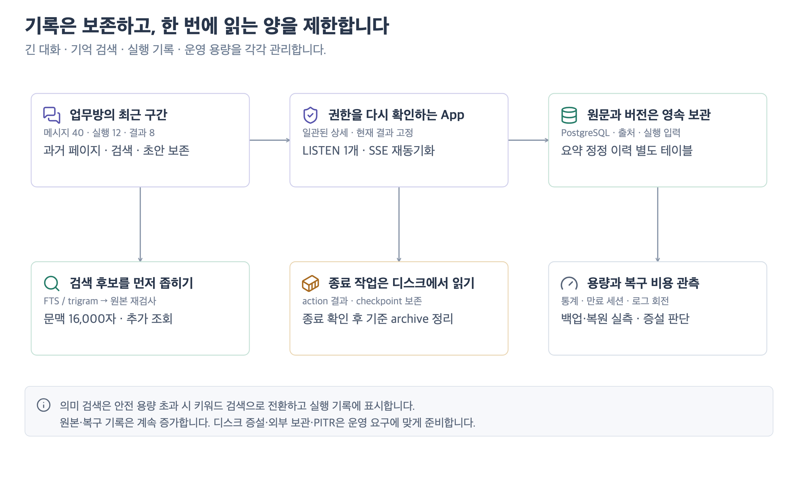

# 장기 운영과 긴 대화 · 0.11

데이터가 쌓여도 매번 전체 이력을 웹이나 모델에 싣지 않는다. 원본의 영속 보존, 조회할 분량, 모델의 문맥 예산을 각각 관리한다. 한 서버의 단일 팀 배포를 위한 개선이며 수년간 무중단 운영을 입증한 것은 아니다.

[](diagrams/long-operation.svg)

## 긴 업무방

- 처음에는 메시지·이벤트 각 40개, 실행 메타데이터 12개, 결과 8개, 질문 20개, 요약 정정·수용 이력 각 12개를 읽는다. 현재 실행·단계별 현재/입력 결과·재작업 기준·활성 수용 결과와 직전 비교 결과는 페이지 밖에 있어도 별도로 고정한다.
- 과거/다음/최근 이동은 페이지를 교체한다. 무한 스크롤로 DOM을 계속 늘리지 않는다. 메시지 검색은 이 업무의 보존된 원문 전체를 대상으로 하며 접근 범위를 다시 검사한다. 상세 API는 repeatable-read snapshot 안에서 현재 포인터와 각 이력을 읽는다.
- 커서는 업무·종류·검색 조건·순서에 묶인 불투명 위치 정보다. 암호화나 권한 증명은 아니다. 매 요청에서 현재 세션과 업무 열람 권한을 확인한다. bigint ID는 문자열, UUID 이력의 시간은 PostgreSQL microseconds를 보존한다.
- 과거 구간을 읽거나 검색 중이면 실시간 변경을 배너로 알리고 렌더링을 보류한다. 초안을 보존하고 사용자가 최근 구간으로 돌아갈 수 있다. 대화 원문을 삭제하거나 AI 요약으로 대체하지 않는다.
- 사무실은 최신 업무 200개만 보여준다. 전체 업무 페이지는 서버 검색·상태 필터·40개씩 페이지 이동으로 오래된 업무에 접근한다. 순서 기준은 바뀌는 수정 시각 대신 고정 업무 번호다.
- 요약 정정 이력은 `cr_brief_revisions`에 분리한다. 자주 읽는 Task JSON 배열이 정정 횟수만큼 커지지 않는다. 기존 정정 이력도 migration으로 옮긴다.

## 모델이 읽는 대화와 기억

화면에 과거 메시지가 있다고 모델 호출에 전체 대화를 넣지는 않는다. 기존의 최근 대화 12,000자, 기억 16,000자, 실행당 최대 4회 추가 원문 조회 예산을 유지한다. 명시적 재작업 이유·질문 답변·현재 결과는 별도의 실행 입력 계약으로 고정한다. 오래된 합의는 검색하고 출처를 붙여 읽는다. 전체 보존과 완벽한 회상은 다른 보장이다.

`cr_recall_text`는 재생성 가능한 검색용 텍스트 투영이다. PostgreSQL FTS와 `pg_trgm` GIN 인덱스로 후보를 좁힌 뒤 최대 160개의 원본을 읽고, 현재 공개 범위·에이전트·기간·출처 버전·의존 근거를 확인한다. 원본 수정과 투영 갱신은 같은 트랜잭션의 trigger로 처리한다. 검색용 테이블의 범위 값만 믿고 원본을 반환하지 않는다. 최신 자료만 미리 잘라서 오래된 정확한 일치를 버리지 않는다.

기존 의미 검색은 선택적 embedding endpoint의 JSON 벡터를 정확 비교한다. **프로필당 2,000개 문서, 총 200만 좌표, 직렬화 벡터 32MB 중 하나라도 넘으면 의미 비교를 생략**하고 인덱스 기반 키워드 검색을 유지한다. 실행 입력과 추가 조회 응답에 `semanticStatus=capacity_limited`를 남기고 ‘참고한 기억’에서 안내한다. 이것은 대규모 의미 검색을 구현했다는 뜻이 아니다. 규모가 큰 배포에서 동의어·유사 의미 회상이 필수라면 pgvector/HNSW 같은 ANN 인덱스와 범위 필터 후 재검증을 별도 도입·평가해야 한다. 용량 초과 후 새 embedding 인덱싱도 멈춰 외부 호출과 캐시가 계속 늘지 않게 한다. 이번 버전에는 pgvector 의존성을 추가하지 않았다.

`pg_trgm`은 PostgreSQL contrib의 trusted extension이다. DB에 extension 바이너리와 CREATE 권한이 필요하다. 기본 PostgreSQL 18 이미지에서 migration을 검증한다. 대량 기존 데이터의 009/010 migration은 backfill·GIN 생성에 시간과 디스크가 필요하다. 백업 후 App/Worker를 멈춘 점검 시간에 실행하고 일반 쿼리 15초와 별도로 migration 30분/lock 대기 10초 예산을 사용한다. 실패하면 트랜잭션이 rollback되며 데이터 크기에 맞는 점검 시간을 다시 확보한다. 짧거나 흔한 검색어는 넓은 후보를 만들 수 있다. GIN이 있다고 모든 검색이 일정 시간에 끝나는 것은 아니며, 프로젝트·구체적 검색어로 좁히고 15초 SQL timeout 실패를 관찰해야 한다. [PostgreSQL 인덱스 동작과 짧은 패턴의 한계](https://www.postgresql.org/docs/18/pgtrgm.html)

## 실시간 갱신

App 하나당 PostgreSQL LISTEN 연결 하나로 변경을 모은다. 브라우저마다 전체 이벤트 이력의 MAX를 반복 계산하지 않는다. 각 구독은 본문 없이 최근 이벤트 ID 최대 256개만 보유한다. 현재 세션·권한으로 읽을 수 있는 변경만 refresh 신호를 보낸다. ID 발급 순서와 commit 순서가 달라도 낮은 ID의 늦은 commit을 버리지 않는다.

NOTIFY는 영속 큐가 아니다. 초기 연결·재연결 때 원본 상태를 다시 읽고, 신호 유실/구독 버퍼 넘침에 대비해 60초마다 전체 상태 재동기화 신호를 보낸다. 정상 신호는 최대 약 2초 주기로 반영하지만 복구 경로에서는 60초까지 걸릴 수 있다. 세션·권한은 이벤트가 없어도 재검사한다. [PostgreSQL NOTIFY 계약](https://www.postgresql.org/docs/18/sql-notify.html)

## Runner·파일·로그

Runner는 시작 시 종료된 모든 Job을 RAM Map에 올리지 않는다. 디렉터리를 순회해 미종료 Job을 종료 확인하고, 종료 Job은 `terminal/`로 옮겨 시작 시 본문 스캔에서 제외하고 요청 시 디스크에서 읽는다. 기존 루트의 종료 기록은 최초 시작 시 한 번 옮긴다. Run별 최대 generation 파일을 유지해 오래된 생성 요청이 다시 컨테이너를 만들지 못하게 한다.

컨테이너·작업 volume 종료가 확인되고 진행 중 action/stop/snapshot/create가 없는 Job의 `.base.tgz`, `.source.tgz`, `.setup.json`만 정리한다. 종료 JSON의 action 해시·결과·실패·checkpoint는 보존한다. 늦은 action 재시도는 저장된 결과를 돌려주며 `prepared` 상태는 자동 재실행하지 않는다. 실제 finish 결과를 checkpoint에도 남긴다. 원본 diff·검사 결과와 Worker의 복구 기록은 삭제하지 않는다.

`runtime/runs/*/input.json`, DB 원문·산출물·메모리·실행 감사 기록과 종료 JSON은 계속 보존하므로 디스크는 증가한다. 자동 무기한 무료 보관을 보장하지 않는다. 이번 버전은 이를 임의 삭제하는 TTL을 넣지 않는다. 용량 임계치 전에 volume 증설 또는 검증된 외부 보관 정책을 운영자가 정해야 한다.

Compose App/Worker/Runner/DB와 제공하는 Caddy는 Docker `local` 로그 드라이버를 10MB × 3파일로 제한한다. 이는 컨테이너 stdout/stderr에 적용되며 업무 원본/DB/WAL/백업 크기를 제한하지 않는다. 기존 컨테이너는 재생성해야 새 설정이 적용된다. [Docker 로그 회전](https://docs.docker.com/engine/logging/drivers/local/)

## 운영 루틴

```bash
# DB 통계, 테이블/인덱스 크기, dead tuples·autovacuum, 연결, 의미 검색 용량
# DATA_DIR의 파일시스템 통계이며 DB/백업 volume의 여유 공간은 별도 확인
docker compose exec -T worker node server/cli.js stats

# 만료 세션만 최대 500개: 기본은 dry-run
# 데이터 양에 맞게 운영 스케줄러에서 반복하며 실패·완료를 기록
docker compose exec -T worker node server/cli.js maintain
docker compose exec -T worker node server/cli.js maintain --apply

docker system df -v
docker compose logs --tail 100 app worker runner db
```

이 명령들은 정기 실행·알림 서비스를 설치하지 않는다. `stats`의 행 수는 PostgreSQL 추정치다. 대량 이관 후 ANALYZE하고 실제 행 수와 혼동하지 않는다. 기본 autovacuum은 계속 사용하며 dead tuples·분석 시각·쿼리 지연을 관찰해 튜닝한다. WAL·인덱스·백업용 여유 공간까지 포함해 호스트/volume 별 용량을 모니터링한다.

| 운영자가 설정할 경계 | 권장 시작 기준과 조치                                                                                               |
| -------------------- | ------------------------------------------------------------------------------------------------------------------- |
| 디스크               | 사용률 70%에서 증가율/백업 피크 점검, 85% 전에 증설·외부 보관 실행. 수치는 초기 경보 정책이며 현재 자동 경보가 아님 |
| 조회 지연            | 실제 서버에서 목록/최근 대화/과거 검색 p95와 오류율을 따로 측정. timeout 증가 시 쿼리 계획·범위·인덱스·IO 확인      |
| DB 정리              | dead tuples 증가와 autovacuum/autoanalyze 지연 확인. 전체 VACUUM FULL을 무작정 운영 중 실행하지 않음                |
| 대기열               | Worker heartbeat, 오래된 queued/paused, 불확실한 종료·복구 필요 상태를 확인. 외부 요청 자동 중복 발송 금지          |
| 의미 회상            | capacity_limited 발생 시 ANN 도입 여부 결정. 키워드 전환을 의미 품질 유지로 간주하지 않음                           |
| 백업                 | 마지막 성공 시각·서버 외부 사본·키 별도 보관·정기 복원 실측. 파일 생성만으로 복원 가능 판정 금지                    |

## 백업과 확장 경계

현재 백업은 App/Worker/Runner를 정지하고 Job 종료/checkpoint를 확인한 뒤 DB dump + runtime + Runner state를 암호화한다. 데이터가 많아지면 중단 시간과 백업/복원 시간이 증가한다. RPO/RTO는 실제 데이터 크기로 실측해야 한다.

무중단·짧은 RPO가 필요해지면 온라인 base backup + 연속 WAL archive/PITR, runtime/Runner 파일과 DB의 일관된 복구 경계, 외부 암호화 저장·수명 정책·복원 리허설을 설계한다. PostgreSQL만 PITR해도 외부 Job이 자동 안전해지는 것은 아니다. 복구한 실행은 격리하고 기존 Worker/Runner 종료를 검증한다. **이번 Compose에는 WAL 보관/PITR/고가용성/자동 failover를 설치하지 않았다.** [PostgreSQL PITR 요구사항](https://www.postgresql.org/docs/18/continuous-archiving.html)

파티셔닝·읽기 replica·검색 서비스 분리는 실제 지연·보관 요구가 입증될 때 검토한다. 단일 팀 단계에서 먼저 페이지 제한·인덱스·관측·백업 비용을 확인한다.

## 재현 검증

```bash
# 별도 개발 PostgreSQL에 임시 schema를 만들고 마지막에 제거
BENCHMARK_DATABASE_URL=postgresql://crewroom@127.0.0.1:5448/crewroom \
  node scripts/benchmark-long-operation.mjs
```

기본 코퍼스는 업무 100,001건·한 방의 메시지 1,000,000개다. 인덱스 trigger를 끄지 않고 넣으며, 최근 상세·업무 목록·대화 페이지·오래된 원문 검색·기억 검색을 각 10회 측정한다. 결과 JSON에 조건·응답 크기·단일 로컬 테스트의 한계를 기록한다. 동시 부하·실제 모델·실제 embedding 품질·수년 운영 검증을 대신하지 않는다. [검증 기록](SERVER_VERIFICATION.md)

로컬 PostgreSQL 18의 합성 코퍼스(업무 100,001건, 메시지 1,000,000개, 인덱스 포함 약 1.48GB)에서 각 경로 10회 측정했다. 현재 코드 fingerprint와 원자료는 [측정 영수증](evidence/0.11/scale.json)에 있다.

| 경로                  | p50 / p95           | 응답 크기·분량                   |
| --------------------- | ------------------- | -------------------------------- |
| 최근 업무방 상세      | 5.1 / 11.6ms        | 13,443 bytes · 메시지 40개       |
| 전체 업무 최근 페이지 | 0.8 / 1.8ms         | 21,205 bytes · 업무 40개         |
| 과거 대화 원문 검색   | 0.7 / 1.3ms         | 364 bytes · 가장 오래된 합의 1개 |
| 한국어 기억 검색      | 1,476.6 / 1,827.9ms | 830 bytes · 원문 1개             |
| 최근 기억 목록        | 963.3 / 1,549.1ms   | 33,365 bytes · 최대 40개         |
| 8개 동시 업무방 상세  | 11.4 / 38.5ms       | 묶음 전체 107,553 bytes          |

짧은 합성 본문·단일 로컬 DB에서의 관측값이며 운영 서버의 지연 보장이 아니다. 특히 기억 검색은 최근 대화 페이지보다 무겁다. 흔한 검색어·훨씬 큰 원문·동시 대규모 검색은 별도 측정과 쿼리/검색 엔진 확장이 필요하다.
