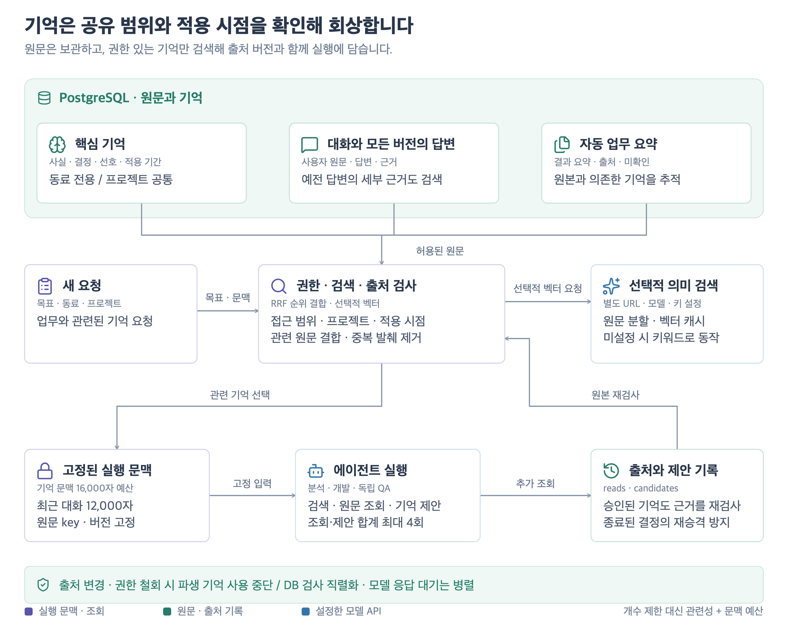
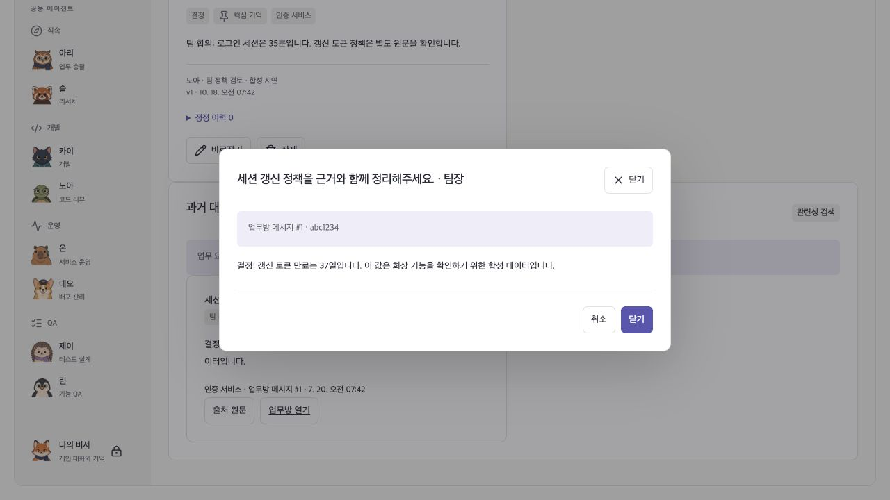
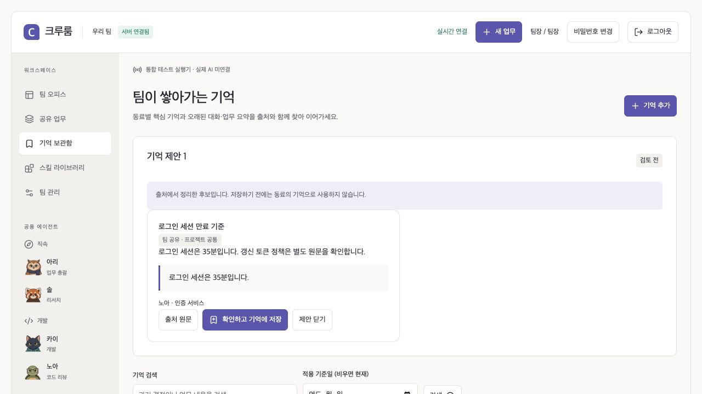

# 0.8.1 장기 기억: 원문, 적용 시점, 검토 가능한 학습

2026-10-18. 기존의 `최근 기억 8개` 선택을 관련성 검색으로 교체했다. 원문을 보관하면서 핵심 기억·과거 대화·업무 요약을 찾아 현재 실행에 넣는다. 0.8은 모든 답변 버전, 프로젝트 공통 기억, 적용 기간, 근거가 있는 기억 제안과 스킬 초안을 추가한다. [제품·논문·코드별 채택 결정](MEMORY_RESEARCH_DECISION.md)을 함께 관리한다.

[](diagrams/memory-retrieval.svg)

## 현재 동작

| 계층             | 저장·생성 방식                                                                                           | 사용 방식                                                                                |
| ---------------- | -------------------------------------------------------------------------------------------------------- | ---------------------------------------------------------------------------------------- |
| 핵심 기억        | `cr_memories`: 사실·결정·선호·업무 규칙, 고정 여부, 프로젝트, 출처·정정 이력                             | 고정한 기억을 우선하고 나머지는 질문 관련성으로 선택한다. 개인 비서는 소유자만 접근한다. |
| 대화 원문        | `cr_messages`: 기존 원문을 유지하며 새 메시지는 당시 대상 버전도 기록                                    | 최근 대화 밖의 메시지도 검색한다. 기존 메시지의 미기록 버전을 추정해서 채우지 않는다.    |
| 업무 요약        | `cr_recall_documents` view가 요청·현재 업무 요약·같은 대상 버전의 최신 결과 요약·미확인 사항을 자동 발췌 | 별도 사실을 생성하지 않고 원본의 요약·출처를 조합한다. 원문의 변경이 바로 반영된다.      |
| 선택적 의미 검색 | Worker가 설정한 embedding URL에 원문을 분할 전송하고 `cr_memory_embeddings`에 캐시                       | 현재 원문 버전·접근권·연결 profile과 맞는 벡터만 키워드 결과에 결합한다.                 |
| 실행 입력        | Run의 불변 `memoryContext`                                                                               | 원문 key·버전 fingerprint와 의존 출처를 고정한다.                                        |
| 추가 조회        | `search_memory`, `read_memory`, `cr_memory_reads`                                                        | 모델이 부족한 내용을 읽기 전용으로 조회한다. 분석과 개발·QA 모두 지원한다.               |

에이전트 답변은 모든 버전의 summary/evidence/unknowns/nextActions를 개별 원문으로 검색한다. 과거 답변의 검사나 승인은 현재 업무에 승계되지 않는다. 도구 로그·patch 전체를 기억 색인으로 바꾸지는 않는다.

업무 요약은 **자동 발췌 요약**이다. 원래 모델 결과의 `summary`를 재사용하지만 기억 정리용 LLM을 별도로 호출해 새로운 사실을 추출하거나 승인된 규칙으로 게시하지 않는다. 중요한 사실·결정·규칙은 사용자가 핵심 기억으로 남기고 바로잡는다.

## 검색과 문맥 예산

조회는 활성 사용자·개인 비서 소유권·개인/부서/팀 범위를 먼저 제한한다. 기본 실행은 현재 동료의 기억과 같은 프로젝트의 공개 원문·프로젝트 공통 기억을 대상으로 한다. 개인 원문과 동료 전용 기억은 자동으로 다른 동료에게 공유하지 않는다. `search_memory`의 `project:"*"`는 접근 가능한 다른 프로젝트의 사례를 명시적으로 검색한다. 프로젝트는 검색 구분이며 접근 권한을 넓히지 않는다.

키워드는 Unicode 정규화, PostgreSQL full-text rank, 제목/본문 부분 일치를 결합한다. 한국어는 앞부분 2–3음절 anchor를 보완해 띄어쓰기·조사 차이를 일부 흡수한다. 한국어 형태소 분석기나 학습한 reranker는 아니다. 키워드와 선택적 의미 검색을 각각 순위화하고 RRF로 결합한다. 서로 다른 점수 단위를 그대로 더하지 않으며 같은 본문은 문맥에서 중복 제거한다. 결과는 고정 여부·결합 순위·시각 순으로 정렬하며, 최신 기록만 먼저 잘라서 검색하지 않는다. 관련 구절을 발췌하고 출처 원문을 따로 읽는다.

- 기본 기억 문맥은 JSON 항목 기준 **16,000자**다. 개수 8개를 제한하는 방식은 제거했다. 토크나이저에 따른 실제 token 수와는 다르다.
- 최근 대화는 최대 20개·본문 합계 12,000자다. 그 밖의 대화도 원문 검색과 추가 조회로 접근한다.
- 키워드 후보는 관련성으로 최대 160개를 선정한다. 최종 입력은 문자 예산과 출처 수로 제한한다. 모든 관련 기록을 한 번에 넣는다는 보장은 아니다.
- 추가 조회는 Run의 generation마다 조회·기억 제안 합계 최대 4회다. 원문 읽기는 7,000자씩 `offset`으로 넘겨 읽을 수 있다. 코드 실행의 30단계 한도에도 포함되며 Docker 행동 sequence와 별도로 관리한다.
- 자동 발송 뒤 나온 새 자료를 조용히 섞지 않도록 추가 조회는 Run 생성 시각까지의 원문을 사용한다. 이후 정정은 새 실행에서 반영한다.
- 원문·인덱스 크기에 인위적인 저장 개수 제한은 두지 않는다. 저장 용량·검색 비용·모델 입력은 유한하며 완벽한 무제한 회상을 보장하지 않는다.

## 출처, 정정, 삭제

실행마다 선택한 원문의 key·버전과 파생 요약의 의존 출처를 저장한다. 대기·발송 직전·실행 중·결과 저장 때 원본과 접근 범위를 다시 검사한다. 기억을 정정하거나 삭제하면 이전 버전에 의존한 파생 요약도 새 회상에서 제외한다. 삭제·정정 시 해당 벡터와 의존 요약 캐시를 제거한다.

원본 업무에 연결해 만든 기억을 정정·삭제하면, 출처 key가 있는 경우 해당 원문 부분을 회상에서 제외한다. 기존처럼 업무에만 연결된 기억은 그 업무의 요약·메시지·답변 회상을 보수적으로 제외한다. 같은 오래된 내용을 다시 학습하는 것을 막기 위한 결정이다. 원래 업무방·기존 실행 이력·백업 자체를 삭제하는 기능은 아니다. 별도로 작성한 동일 내용의 독립 원문까지 자동 식별해 모두 지우지는 않는다.

자기 업무의 동적 요약을 다시 자기 요약의 근거로 삼는 순환을 피한다. 현재 업무의 이전 결과는 기존 인계 입력으로 받고, 회상에서는 현재 업무 episode 및 그것에 의존한 요약을 제외한다. 검사 통과·수용·현재 진행 상태는 기억 문장을 근거로 확정하지 않고 원본 DB/검사 receipt를 확인한다.

업무방의 **참고한 기억**에서 현재 유효한 출처를 확인할 수 있다. 삭제·접근권 변경·버전 불일치 출처는 본문을 노출하지 않고 확인 불가 개수로 표시한다. 기억 보관함에서는 과거 기록 검색, 출처 원문 열기, 업무방 이동, 핵심 기억 고정·종류 선택을 지원한다.




실제 PostgreSQL·웹 UI에서 합성 계정과 기록으로 캡처했다. 화면의 통합 테스트 표시는 실제 외부 모델 미연결 상태를 뜻한다. [캡처 manifest](media/memory/manifest.json)

## 개별 기억과 프로젝트 공통 기억

`visibility`는 개인/부서/팀 접근권이고 `audience`는 동료 전용/프로젝트 공통 사용 대상이다. 두 조건을 함께 검사한다. 프로젝트 공통 기억은 이름이 있는 공유 프로젝트에만 만들 수 있다. 개인 비서와 개인 대화의 메모는 동료 전용이다. 공유 업무방에서 공개한 원문·답변은 같은 프로젝트의 공용 동료가 찾을 수 있다. Grok의 기본 비공개 채팅을 그대로 복제하지 않고 요청한 공유 업무방 계약을 유지한 결정이다.

## 정정과 새 결정의 적용 기간

핵심 기억은 `valid_from/to`, `supersedes_id`를 갖는다. **새 결정으로 대체**는 같은 동료·프로젝트·공개 범위·사용 대상의 이전 기억을 새 적용 시작에 종료한다. 후속 결정은 하나만 연결하고, 기존 기록은 삭제하지 않는다. 과거 잘못된 본문은 기존 **바로잡기**를 사용한다. 기본 검색은 현재 적용되는 기억, `search_memory.asOf`는 지정한 적용 시각을 사용한다. 해당 시각 이후 생성된 대화·답변도 후보에서 제외한다. 기억에 적힌 적용일은 실제 코드 배포·승인 결과를 증명하지 않는다.

직접 원문 읽기는 종료된 기억도 제공한다. 이는 접근권을 우회하지 않으며 기간을 표시한다. 실행 중 추가 조회는 별도로 Run 생성 시각까지의 자료만 허용한다. 이 계약은 적용 시간 질의와 실행의 고정된 관측 범위를 구분하며, 모든 지식 변경의 완전한 bitemporal history를 구현한 것은 아니다.

## 제안에서 학습하기

에이전트는 `propose_memory`에 원문 key, 정확한 인용(8–1,000자), 제목·후보 본문·종류·사용 대상을 담는다. 서버가 출처의 접근 범위·버전·Run 생성 cutoff와 인용 포함 여부를 확인한다. 최대 2개의 제안을 `cr_memory_candidates`에 보관하고 출처를 읽기 ledger에 기록한다. 모델이 제안을 선택적으로 생성하는 구조이며 모든 발언을 자동 추출한다는 보장은 없다.

제안은 검색·모델 입력에 사용하지 않는다. 요청자 또는 공유 기억 관리자가 보관함에서 인용과 **출처 원문**을 열어 확인하고 저장한다. 적용할 범위는 원래 업무보다 넓어지지 않는다. 저장 직전 출처를 다시 검사하며 처리와 기억 생성을 같은 transaction으로 수행한다. 원문이 바뀐 제안은 본문을 숨기고 닫을 수 있다. 정확한 인용이 존재한다고 후보의 해석이 항상 참인 것은 아니므로 사람의 검토를 남긴다.

수용한 업무의 **반복 업무 스킬 초안**은 기존 스킬 지침·완료 기준·참고 업무를 바탕으로 편집 가능한 새 스킬을 준비한다. 새 대상 입력과 재검사를 명시하고, 과거 승인이나 SHA를 새 업무에 복사하지 않는다. 자동 게시·장착은 하지 않으며 기존 권한과 버전 적용 계약을 따른다. 개인 업무에서 만든 초안은 기본 비공개다.

[](diagrams/memory-learning.svg)




합성 계정·실제 API/PostgreSQL을 CUA 브라우저로 확인한 화면이다. GIF는 화면 캡처를 순서대로 연결한 시연이며 실제 모델의 자율 판단 영상이 아니다. [캡처 manifest](media/memory-learning/manifest.json)

## 승인 뒤에도 유지하는 출처 계약

0.8.1은 [Astra 조사·리뷰](ASTRA_MEMORY_REVIEW.md)에서 재현한 수명주기 문제를 보완한다. `cr_memories.source_refs`에 승인 당시 원문 fingerprint와 의존 출처를 저장하고 검색·실행 입력·발송·완료 시 다시 검사한다. 원문의 정정·삭제·공개 범위 변경으로 근거가 달라지면 파생 기억을 재사용하지 않는다. 관리 화면에서도 본문·과거 본문을 숨기고 재검토 상태를 표시한다.

제안은 조회와 동일한 동료 전용/프로젝트 공통 경계를 따른다. 현재 적용 중인 출처만 제안할 수 있으며 승인 때 다시 검사한다. 출처와 그 의존 기억의 적용 기간을 교차해 후보와 승인된 기억에 보존한다. 지난 원문 조회는 계속 지원한다. 기간이 없는 대화가 여전히 맞는 주장인지는 검토자가 판단한다.

`source_task_id`는 저장·검토가 이루어진 업무방 문맥이다. 실제 직접 출처의 업무방은 `origin_task_id`, 원문 식별자는 `source_key`다. 더 이전 원문은 `source_refs`로 추적한다. 다른 프로젝트를 명시적으로 조회해 얻은 근거도 출처 권한을 검사하며 목적지 프로젝트를 바꾸지 않는다.

본문을 사람이 바로잡으면 이전 출처 연결을 정정 이력에 남기고 새로운 수동 기억으로 취급한다. 제목·고정·종류만 바꾸면 연결을 유지한다. 원문이 가려진 이전 이력의 본문도 관리 화면에 노출하지 않는다. 새 결정으로 대체할 때는 대체될 기억에 의존하지 않는 근거가 필요하다. 대체 이력이 있는 결정의 단순 삭제는 거절하며 바로잡기나 후속 결정을 사용한다. 자동 취소·이전 기간 복원은 아직 제공하지 않는다.

migration 007은 이전 후보의 저장된 revision과 조회 ledger로 출처를 복구한다. 복구할 증거가 없는 옛 sourceKey 연결은 현재 원문으로 조용히 승인하지 않고 재검토 대상으로 둔다. 출처 증거가 없는 구버전 정정 이력도 격리해 현재 기억을 바로잡은 뒤 옛 본문이 다시 노출되지 않게 한다. 근거 연결을 추가한 기억의 fingerprint는 바뀔 수 있어 진행 중 실행은 재검사가 필요하다. 배포 시 Worker를 정지하고 백업한 뒤 migration과 새 App/Worker를 함께 적용한다.

업무·기억 변경과 Worker의 출처 검사에는 DB transaction 범위의 공통 잠금이 있다. 서로 다른 업무가 서로의 출처를 읽을 때 잠금 순서가 뒤집히는 문제를 막는다. 외부 응답을 기다리는 동안에는 잠금을 보유하지 않는다. 짧은 DB 처리 구간을 직렬화하므로 큰 규모의 처리량은 부하 검증 후 별도 설계해야 한다. 발송 transaction을 자동 재시도하지 않는다.

## 기억 품질 평가

`npm run evaluate:memory -- --baseline`은 별도 테스트 DB에 한국어 합성 corpus를 만들고 0.7 검색 모듈/원래 view와 현재 구현을 같은 결과 5개 한도로 비교한다. 20문항은 이번 변경의 검색 범위를 검증하기 위한 회귀이며 공개 벤치마크나 무작위 실사용 표본이 아니다. 기존 버전이 지원하지 않던 프로젝트 공유·과거 답변·적용 시점 문항이 많아 전체 수치로 일반 검색 정확도 향상을 주장할 수 없다. Recall@5는 필요한 출처 key를 찾는지 측정하며 생성 답변의 정확도를 측정하지 않는다.

`--embeddings`를 명시하면 환경의 embedding URL/모델/키로 이 합성 corpus의 인덱싱·검색을 수행한다. 설정이 없거나 인덱스가 실패하면 평가를 거부한다. 이 모드는 실제 요청과 비용이 발생한다. 기본 평가와 CI는 외부 모델을 호출하지 않는다. [평가 원본](../tests/fixtures/memory-retrieval.ko.json) · [기록](evidence/0.8/memory-evaluation.json)

## 선택적 embedding 연결

기본값은 꺼져 있다. 기존 모델 추론 URL이 embeddings API도 제공한다고 가정하지 않는다. 별도 OpenAI 호환 embedding endpoint를 등록해야 한다.

```dotenv
EMBEDDING_ENDPOINT_URL=https://embedding.example.com/v1/embeddings
EMBEDDING_MODEL=your-embedding-model
EMBEDDING_AUTH_HEADER=
EMBEDDING_AUTH_SCHEME=auto
```

키는 `.local/secrets/embedding_api_key`에 보관한다. `npm run secrets:init`은 기존 값을 보존하고 빈 파일만 추가한다. Compose staging은 이 키를 Worker에만 전달하며 App·Runner·Job에는 전달하지 않는다. 공개 설정 예제에는 키를 넣지 않는다.

Worker는 5초마다 최대 한 문서를 claim하며 각 문서는 2,400자/200자 겹침으로 최대 16조각을 만든다. 인덱싱 lease와 연결 profile·원문 버전을 DB에 기록한다. 실패는 1분 간격으로 최대 3회 시도하며 URL·모델 변경은 새 profile로 재구성한다. 동일 문서의 오래된 응답이 새 캐시를 덮어쓸 수 없다. 외부 embedding 서비스에는 구성된 범위의 문서 본문이 전송되므로 해당 배포가 선택한 endpoint를 사용한다.

실행은 질문 벡터와 캐시의 정확 cosine 유사도를 결합한다. 현재는 확장 설치가 필요 없는 PostgreSQL JSONB 캐시와 Worker 계산을 사용한다. cosine 0.35 하한은 아직 실제 제공자별로 보정하지 않았으므로 의미 검색 품질을 보장하지 않는다. HNSW/ANN 인덱스는 구현하지 않았다. 문서가 크게 늘면 벡터를 읽고 비교하는 비용도 늘어나므로 별도 부하 검증 후 pgvector 같은 인덱스로 교체해야 한다. 이번 검증은 아래 작은 팀 규모의 합성 corpus이며 대규모 처리량 보장이 아니다.

캐시가 아직 준비되지 않았거나 대응 결과가 없으면 키워드 검색을 사용한다. 정상 응답의 형식 오류·HTTP 거절도 키워드로 대체하고 `semanticStatus`로 표시한다. 발송 여부가 불명확한 실행 요청은 기존 quarantine 규칙을 유지하며 조용히 재발송하지 않는다. 기본 검색 UI는 로컬 키워드 검색이고 의미 검색은 Worker의 에이전트 실행에서 사용한다.

## 조사 근거와 채택 판단

Muse/Grok Bot의 공개 설명과 오픈소스 구현을 비교했다. Muse/Grok Bot의 비공개 검색·랭킹 코드를 본 것으로 주장하지 않는다. 아래 코드를 라이브러리로 도입하거나 실행 코드를 복사하지 않았다.

| 자료                                                                                                                                                                         | 확인한 공개 동작/구현                                                                 | 반영한 점                                                                                 |
| ---------------------------------------------------------------------------------------------------------------------------------------------------------------------------- | ------------------------------------------------------------------------------------- | ----------------------------------------------------------------------------------------- |
| [Meta Muse 제품 설계](https://introducing.muse.ai/) · [기술 구조](https://research.meta.ai/blog/security-and-safety-for-ai-agents-our-approach-with-muse)                    | 대화 사이 기억 유지, 읽고 수정하는 기억 파일, VM의 데이터와 별도 PostgreSQL 영속 상태 | 기억 원문·실행·UI를 분리하고 사용자가 출처와 정정을 확인                                  |
| [Grok Bot Team Bots](https://docs.x.ai/grok-bot/team-bots)                                                                                                                   | 팀 공용 기억과 사람별 비공개 메모, 명시적인 공유 범위                                 | 기억과 원문의 범위를 상속하고 개인→팀 자동 승격 금지                                      |
| [Hindsight recall.py](https://github.com/vectorize-io/hindsight/blob/761c79aebf4aed5d386e6c538e535d8f72c15c7d/hindsight-api-slim/hindsight_api/engine/memories/pg/recall.py) | bank/tag/time filter, 의미 검색과 BM25 arm, fact type별 후보와 HNSW                   | 관련성 후보·권한 필터·입력 예산 구분. 복잡한 graph/ANN 서비스는 이번 구성에 도입하지 않음 |
| [Mem0 memory/main.py](https://github.com/mem0ai/mem0/blob/0724291bd864cf807e88ee8981c8226644e8fb42/mem0/memory/main.py)                                                      | 추출·검색·수정·삭제·이력의 별도 경로                                                  | 캐시만 지우는 삭제 대신 원본 버전·파생 출처까지 검사                                      |
| [Letta Code memory-worker.ts](https://github.com/letta-ai/letta-code/blob/cc4654acc3b424a68c385bce0fe0c00edaad5d7e/src/agent/subagents/memory-worker.ts)                     | lease 안의 기억 갱신과 private worktree, 완료 후 동기화                               | 백그라운드 인덱스와 진행 중 실행 문맥의 분리. Git 기억 저장소는 추가하지 않음             |
| [pgvector](https://github.com/pgvector/pgvector)                                                                                                                             | PostgreSQL exact/approximate vector search                                            | 큰 corpus에 대한 후속 인덱스 선택지로 구분하고 현재 exact 구현의 비용을 명시              |

고정 커밋·원문 크기·SHA-256은 [조사 manifest](research/2026-10-18-memory/manifest.json)에 보관한다. 원문은 내려받아 확인했으며 upstream 코드의 설치·빌드·실행은 하지 않았다. LangChain/LangGraph·외부 기억 SaaS는 추가하지 않았다.

## 검증과 운영

새 테스트는 1,200개 최신 메모 뒤의 오래된 결정, 최근 대화 밖의 발언, 개인/부서/개인 비서 경계, 자동 업무 요약, 파생 출처 취소, 추가 조회 후 재검사, 다른 프로젝트의 명시적 검색, vector cache 정정·profile 변경·재시도, 로컬 HTTP embedding→추가 조회→결과 저장을 확인한다. 개발·QA Docker 통합 검사에도 기억 조회 행동을 넣어 Runner sequence와 실제 검사가 유지되는지 검사한다.

브라우저는 과거 대화 검색→출처 원문→당시 대상 버전 확인과 핵심 기억 종류·고정 설정의 reload 보존을 확인한다. 합성 임베딩/모델 응답을 사용한 계약 검증이며 실제 embedding 모델의 의미 품질, 실제 추론 품질과 대규모 recall 정확도를 증명하지 않는다.

```bash
npm run check
TEST_DATABASE_URL=postgresql://crewroom@127.0.0.1:5448/crewroom TEST_RUNNER_DOCKER=1 npm run test:server
TEST_DATABASE_URL=postgresql://crewroom@127.0.0.1:5448/crewroom npm run test:server:e2e
```

업그레이드는 기존 DB를 백업한 뒤 `npm run secrets:init`, Compose 이미지 build와 `up -d`로 migration 006을 적용한다. 기존 기억의 동료 전용 기본값과 0.7 출처 fingerprint를 보존한다. 복원은 기존 미완료 Run 격리 계약을 따르며 새 테이블·view도 DB 백업에 포함된다. 선택적 캐시 실패는 `cr_memory_embeddings.status/error_code/attempts`로 확인한다. 키나 본문을 로그에 출력하지 않는다.
