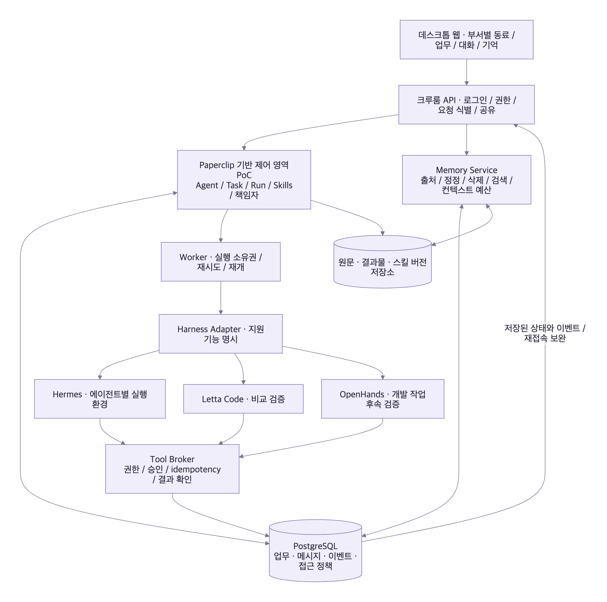

# 크루룸 — 공개 코드로 다시 정한 제품 구조

조사 기준일: **2026-10-16 KST**. 이전 대화의 프레임워크 제안을 선정 근거에서 제외했다. 11개 프로젝트의 13개 저장소를 커밋에 고정하고, 실행·저장·공유·기억·스킬 경로를 선별해서 읽었다. 이는 소스 조사와 설계 판단이며, 후보를 설치해 같은 과제로 비교한 실행 실험은 아니다.

**후속 구현:** 이 조사 뒤 대화 분리·공개 범위·Task/Run·스킬 버전 고정·로컬 복원을 웹 프로토타입에 반영했다. 아래의 서버 미구현 항목과 현재 브라우저에서 동작하는 기능은 [반영 내역과 검증](IMPLEMENTATION.md)을 기준으로 구분한다.

## 1. 내가 처음부터 선택한다면

**첫 검증 대상은 Paperclip의 조직·업무·실행 관리 구조다.** 크루룸은 직속·개발·운영·QA에 소속된 동료와 개인 비서가 함께 일하는 제품이다. 먼저 필요한 것은 에이전트의 신원, 업무의 소유권, 실행 기록, 결과물, 사람의 입력 대기와 공유 범위를 일관되게 관리하는 서버다.

그 아래 실행 하네스는 교체 가능하게 둔다. Paperclip에 이미 구현된 Hermes 연결을 제한된 실행 환경에서 먼저 검증한다. Letta Code는 에이전트별 기억 파일과 기억 변경 관리의 비교 대상, OpenHands SDK는 개발 작업 전용 실행기의 비교 대상이다. **Mastra와 LangGraph는 구체적인 실행 요구가 남았을 때 선택하는 내부 구성 요소로 순서를 낮춘다.**

이 판단은 Paperclip 전체를 그대로 포크하자는 확정 결정이 아니다. 팀의 개인 대화·기억을 보호하는 권한과 하네스 격리를 검증한 뒤, 기존 API·서버를 어느 범위까지 재사용할지 결정한다. 현재 크루룸에는 백엔드나 해당 실행기가 연결되어 있지 않다.

| 제품의 층 | 이번 우선순위 | 크루룸에서 직접 소유할 책임 |
| --- | --- | --- |
| 조직·업무·실행 관리 | Paperclip의 DB·업무 점유·실행·어댑터 구조 재사용 검증 | 부서, 개인 소유권, 대화·기억·결과물의 접근 정책 |
| 데스크톱 웹 경험 | 자체 UI, LobeHub의 대화·그룹·사람 개입 구조 참고 | 부서별 동료, 업무와 연결된 대화, 주의가 필요한 일, 캐릭터 |
| 기본 비서 하네스 | 기존 Paperclip–Hermes 어댑터부터 검증 | 에이전트별 홈, 제한된 환경·자격증명, 도구 실행 정책 |
| 기억 | 제품의 원문·출처·권한 저장 + Hermes/Letta 방식 비교 | 정정·삭제, 개인→부서 공유, 검색 전 권한 검사, 보존 정책 |
| 개발 작업 | OpenHands SDK 어댑터 후속 검증 | 저장소·작업 사본·산출물·리뷰 인계 |
| 단계 실행 | 필요가 확인되면 Mastra 또는 LangGraph 한 개 | 외부 동작의 중복 방지, 버전 고정, 업무별 복구 계약 |

### 이전 추천에서 바뀐 점

이전의 “새 팀 웹 서비스라면 Mastra를 먼저 검증”은 서버를 새로 작성한다는 가정이 강했다. 실제 제품에 가까운 공개 코드를 보니, 이미 조직·업무·실행·스킬을 관리하는 제어 서버를 먼저 평가하는 편이 요구사항에 더 직접적이다. **검증 순서를 Paperclip → 연결 하네스와 격리 → 남은 실행 엔진 요구 순으로 수정한다.**

LangChain 사용은 기본 조건으로 두지 않는다. LangGraph를 선택하더라도 그것은 특정 업무의 상태 전이와 재개를 위한 선택이다. 부서와 동료를 보여주는 화면 자체가 그래프 프레임워크를 요구하지는 않는다.

## 2. 조사 방법과 증거 범위

- 기본 브랜치의 HEAD를 각각 고정했다. **LobeHub는 `canary`**다. 본문의 기능이 최근 정식 릴리스에 모두 포함됐다는 뜻은 아니다.
- Git 트리로 실제 코드 위치를 찾고, 고정 SHA의 원문 파일을 확보했다. README 외에 스키마, 실행 어댑터, 업무 점유, 기억 파일, 락, 스트림과 복구 코드를 읽었다.
- `manifest.json`은 확보한 파일 목록이다. `evidence.json`은 실제 판단에 사용한 파일·줄 범위·심볼을 구분한다. 확보한 모든 파일을 처음부터 끝까지 감사한 것으로 계산하지 않았다.
- **관찰**은 코드 또는 저장소 안 설계 문서에 있는 내용, **판단**은 크루룸에 적합하다는 해석, **제안**은 아직 구현하지 않은 우리 계약이다. 스키마의 필드 존재만으로 모든 API의 권한 집행을 입증하지 않았다.
- 외부 프로젝트의 설치·빌드·모델 호출·복구 실험·실사용 벤치마크는 수행하지 않았다. 공개 코드의 패턴을 비교했으며, 업계 전체의 점유율이나 성능 순위를 주장하지 않는다.

| 프로젝트 / 저장소 | 고정 커밋 앞 12자리 | 살핀 층 |
| --- | --- | --- |
| paperclipai/paperclip | `afe5b3418dbd` | 조직, 업무, 점유, 실행, 어댑터, 스킬, 화면 동기화 |
| lobehub/lobehub | `aa8da805e404` | 공유 대화, 실행 상태, 권한 설정, Redis 스트림 |
| NousResearch/hermes-agent | `7520c4e8b379` | 비서의 기억, 세션 검색, 스킬 로딩 |
| letta-ai/letta | `5bcdd177d70f` | 현재 구현 저장소로의 이동 확인 |
| letta-ai/letta-code | `cc4654acc3b4` | 에이전트별 기억, 작업 사본, 스킬 범위 |
| openclaw/openclaw | `c8260d933e58` | 개인 비서의 신뢰 경계, 혼합 기억 검색 |
| OpenHands/OpenHands | `9c301106a051` | 현재 앱과 SDK의 코드 위치 구분 |
| OpenHands/software-agent-sdk | `f5f849f5ab51` | 영속 이벤트, 실행 임대와 쓰기 소유권 |
| mastra-ai/mastra | `9cf0fe4731d6` | 실행 복구·fencing, 관찰·압축 기억 |
| langchain-ai/langgraph | `5eb60aef6f38` | 체크포인트, 장기 store, 사람 개입 후 재실행 |
| langgenius/dify | `f7840ab2134b` | 대화의 범위, 컨텍스트 예산, 중단된 실행 |
| vectorize-io/hindsight | `761c79aebf4a` | 기억 검색, 인입 예산, tenant 기본값 |
| mem0ai/mem0 | `0724291bd864` | 기억의 식별자 범위, 현재 추출 파이프라인 |

정식 릴리스 메타데이터도 별도로 남겼다. 예를 들어 수집 당시 Paperclip 최신 비사전 릴리스는 `v2026.1012.0`, LobeHub는 `v2.2.19`였지만, 여기서 읽은 HEAD와 동일한 코드라고 취급하지 않았다. Mastra의 릴리스 태그는 패키지별이며 LangGraph API 응답의 `prebuilt` 태그를 전체 프레임워크 버전으로 기록하지 않았다.

## 3. 현재 코드에서 반복해서 나타나는 여섯 가지 방향

1. **에이전트의 신원과 실행을 분리한다.** 동료의 ID·설정·기억은 남고, 실제 프로세스는 업무를 수행할 때 생성·재개된다. 상주 비서 경험을 만들기 위해 사용자마다 모델 프로세스를 항상 켜 둘 필요는 없다.
2. **업무를 대화와 별도 객체로 관리한다.** 대화에는 요청·수정·판단이, 업무에는 목표·담당·기한·완료 조건·결과가, 실행에는 하네스·비용·복구 상태가 붙는다.
3. **사람의 입력 대기도 실행 상태다.** 승인·추가 정보·외부 응답 대기를 구분하고, 서버 재시작 뒤 이어갈 정보를 저장한다.
4. **기억을 여러 층으로 나누고 컨텍스트에는 예산을 둔다.** 작은 상시 기억, 과거 원문 검색, 작업의 현재 맥락, 비동기 정리 작업을 조합한다.
5. **스킬은 점진적으로 읽고 버전과 적용 상태를 관리한다.** 짧은 목록과 실제 본문 로딩이 분리된다. 사용자가 장착한 버전과 실행 환경에 실제 적용된 버전도 다를 수 있다.
6. **관찰 화면은 이벤트와 저장된 상태를 함께 사용한다.** 실시간 스트림, 재접속 커서, 상태 재조회, 실행 소유권을 각각 설계한다.

이는 아래 선택 표본에서 관찰한 공통 방향에 대한 해석이다. 모든 프로젝트가 여섯 가지를 동일하게 구현한 것은 아니다.

## 4. Paperclip — 크루룸에 가장 가까운 업무 제어 구조

### 4.1 Agent, Task, Run, native session을 나눈다

`agents`에는 `companyId`, `reportsTo`, `role`, `appearance`, `adapterType`, `adapterConfig`, `runtimeConfig`, 예산과 상태가 있다. 캐릭터·역할·보고 관계는 에이전트의 정체성에 속하고, 특정 실행은 다른 테이블에서 관리한다. [agents.ts][P-agent]

업무인 `issues`에는 담당 에이전트/사용자, `checkoutRunId`, `executionRunId`, 실행 정책과 상태, 책임 사용자, 대화 소유자, 공개 범위가 따로 있다. 실행인 `heartbeat_runs`에는 트리거, 시작·종료, 사용량, 결과, 다음 이벤트 순번, native session, 실행 제어 임대 정보가 있다. [issues.ts][P-issue], [heartbeat_runs.ts][P-run]

`agent_task_sessions`의 유일성 기준은 `companyId + agentId + adapterType + taskKey`다. 공용 에이전트 한 명을 여러 업무에 사용하면서도, 모든 요청을 하나의 거대한 네이티브 세션에 몰아넣는 구조를 피한다. [agent_task_sessions.ts][P-session]

**크루룸에 적용할 판단:** 에이전트 하나가 여러 업무를 맡을 수 있다. 업무별 대화·실행을 구분하고, 같은 대화의 입력과 기억 갱신은 순서를 보장한다. 개인 비서는 별도 소유권과 실행 환경을 가진 Agent로 만든다. `reportsTo`만으로 부서 권한이 완성되는 것은 아니므로 Department와 접근 정책을 추가한다.

### 4.2 업무를 잡는 동작은 조건부 원자 갱신이다

`issueService.checkout()`의 핵심 UPDATE는 기대 상태, 담당 에이전트, 기존 checkout과 execution run 조건을 WHERE에 함께 넣고 성공한 행을 반환한다. 두 작업자가 읽은 뒤 각자 무조건 `in_progress`로 덮어쓰는 방식이 아니다. 실패한 경우 현재 점유 상태를 다시 읽는다. [issues.ts: checkout][P-checkout]

큐 코드에는 같은 업무 범위의 진행·대기 요청을 찾고, 조건에 따라 요청을 기존 실행에 합치면서 wakeup receipt를 남기는 경로가 있다. 명시적 사용자 요청과 자동 트리거를 무조건 같은 요청으로 취급하지 않는다. 이것이 전체 큐의 장애 안전성을 증명하는 것은 아니지만, 중복 요청에 실행 ID와 수신 기록이 필요한 이유를 보여 준다. [queue.ts][P-queue]

**크루룸에 적용할 판단:** 같은 공유 업무를 두 사람이 동시에 실행하면 서버가 점유를 결정한다. 화면에서는 누가 요청했고 어떤 실행에 합쳐졌는지 표시한다. 여러 대화의 동시 실행과 같은 대화의 동시 쓰기는 별도 정책으로 둔다.

### 4.3 스킬은 ‘장착’과 ‘실제 적용’을 구분한다

스킬 계약에는 `available`, `configured`, `installed`, `missing`, `stale`, `external` 상태, `desiredSkillEntries`, `effectiveSkillEntries`, 버전 ID, 경고가 있다. 동기화 방식도 `unsupported`, `persistent`, `ephemeral`로 나눈다. [adapter-skills.ts][P-skill-contract]

라이브러리에는 조직 범위, 신뢰도, 파일 목록, 현재 버전, 해시가 있고 버전과 시험 스냅샷 테이블이 분리돼 있다. UI도 에이전트를 바꿀 때 초안을 초기화하고, 저장 중 과거 응답이 버전 선택을 되돌리지 않게 처리한다. [company_skills.ts][P-skill-db], [AgentSkillsTab.tsx][P-skill-ui]

**크루룸에 적용할 판단:** `장착됨 · v3`만 보여 주지 않는다. `다음 실행부터 v3`, `현재 실행 v2`, `적용 실패`, `이 하네스에서 미지원`을 구분한다. 실행 시작 시 설정·스킬 버전을 고정하고, 변경은 기본적으로 다음 실행에 반영한다.

### 4.4 실시간 알림과 영속 실행 기록은 다르다

`heartbeat_run_events`에는 `(runId, seq)` 유일성, 외부 이벤트 ID/순번 중복 방지 인덱스가 있다. 반면 일반 `live-events.ts`는 프로세스의 EventEmitter다. 웹은 연결을 복구한 뒤 이벤트 재생을 가정하지 않고 관련 쿼리를 무효화해 상태를 다시 읽는다. [실행 이벤트 스키마][P-events], [live-events.ts][P-live], [LiveUpdatesProvider.tsx][P-reconnect]

**크루룸에 적용할 판단:** DB의 업무·실행 상태를 기준으로 삼고, 실시간 알림은 변화를 빨리 보여 주는 수단으로 사용한다. 캐릭터가 뛰거나 타이핑하는 것만으로 업무가 진행됐다고 판단하지 않는다. 재접속 시 누락을 보완하는 API가 필요하다.

### 4.5 기존 Hermes 어댑터의 중요한 채택 조건

연결 코드는 이전 `sessionId`를 `--resume`에 전달하고, 이번 실행에서 선택된 Paperclip 스킬을 Hermes 스킬 홈에 반영한다. 결과의 세션 ID도 다음 실행을 위해 저장한다. [execute.ts][P-hermes-session]

다만 실제 코드에서 다음을 확인했다.

- 실행 인자에 **`--yolo`를 항상 추가한다.** 비대화식 subprocess의 승인 프롬프트를 우회하기 위한 코드다. 주석에서 샌드박스를 전제하지만 이 함수만으로 격리 환경 생성까지 입증할 수는 없다. [execute.ts:487–505][P-hermes-env]
- 자식 환경에 `process.env`를 먼저 복사한다. 제품의 비서마다 허용된 자격증명만 전달하도록 환경 변수 allowlist가 필요하다. Paperclip API 키는 기존 값을 제거하고 실행 토큰으로 다시 설정하는 처리가 있다. [execute.ts:498–525][P-hermes-env]
- 스킬 홈은 설정된 `HERMES_HOME`, 설정된 HOME 아래 `.hermes`, 또는 서버 사용자 홈으로 해석한다. 해당 함수가 Agent ID를 자동으로 경로에 넣지는 않는다. 선택 해제한 관리 스킬 링크를 지우는 경로도 있으므로, 같은 홈을 공유하면 에이전트별 스킬 선택의 독립성까지 검증해야 한다. [skills.ts:28–35][P-hermes-home], [스킬 반영 코드][P-hermes-sync]

**크루룸의 채택 조건:** 에이전트마다 별도 홈·작업 볼륨과 실행 신원을 제공하고, 외부 기록 도구는 서버의 권한 검사와 ToolAction 기록을 통과시킨다. 첫 PoC는 가짜 도구와 제한된 환경에서 한다. 현재 어댑터의 존재는 연결 개발량을 줄이는 근거이며, 팀의 개인 비서 격리를 이미 해결했다는 근거가 아니다.

## 5. LobeHub — 협업 대화와 실행 관찰

### 5.1 에이전트 공유와 대화·기억 공유는 독립적인 권한이다

에이전트 스키마에는 사용자/워크스페이스, 모델·역할·프로필과 공개 범위가 있다. `chatGroupsAgents`는 여러 에이전트를 하나의 그룹 대화에 배치하며 순서·활성화·역할을 관리한다. 이것은 부서의 인간 멤버십과는 별도의 모델이다. [agent.ts][L-agent], [chatGroup.ts][L-group]

외부 공유 설정인 `AgentShareConfig`는 `allowCreatorViewSessions`, `allowReadMemory`, `skillGrants`, `toolGrants`를 구분한다. 앞의 두 항목은 기본 false라는 설명이 있고, 스킬 허용 목록은 도구 허용 목록과 별도로 다룬다. **공유된 에이전트를 사용할 수 있다는 사실로 제작자의 기억이나 방문자의 대화까지 공유하지 않는다.** 이는 외부 agent-share 계약을 확인한 것이며 모든 workspace API의 권한 구현을 감사한 결과는 아니다. [agentShare.ts][L-share]

또한 월 비용 제한 필드에는 실제 billing 집행이 Cloud 저장소에 있다는 설명이 있다. OSS에 필드가 존재한다는 이유로 해당 기능의 완전한 집행까지 있다고 평가하지 않았다. [agentShare.ts:35–44][L-share]

**크루룸에 적용할 판단:** `에이전트 사용`, `대화 열람`, `기억 읽기/쓰기`, `스킬 편집`, `도구 실행`, `결과물 열람`을 나눠 부여한다. 개인 비서의 특정 대화를 부서에 공유해도 다른 개인 대화와 개인 기억 전체의 공개 범위는 바뀌지 않는다.

### 5.2 실행 상태, 스트리밍, 사람 개입을 별도 책임으로 둔다

`AgentRuntimeCoordinator`는 상태 관리자와 스트림 관리자를 조립한다. `AgentStateManager`에는 Redis의 NX/EX 락, 소유자 비교를 거친 갱신·해제가 있고, 상태에는 TTL이 있다. 정규 메시지는 DB에서 다시 읽기 때문에 상태 직렬화에서 제외하는 경로가 있다. [Coordinator][L-coordinator], [AgentStateManager][L-state]

`StreamEventManager`는 Redis Streams의 XADD/XREAD와 마지막 이벤트 ID를 사용한다. 저장 길이를 대략 1,000개로 제한하고 TTL을 2시간으로 둔다. 재접속할 수 있는 스트림이지만 영구 실행 감사 기록과 같은 보존 계약은 아니다. [StreamEventManager][L-stream]

`HumanInterventionHandler`는 승인 내용을 메시지에 반영하고, 아직 기다리는 도구가 있으면 `waiting_for_human`을 유지한다. 단순히 “승인” 메시지가 대화에 나타났다고 모든 도구를 재개하지 않는다. [HumanInterventionHandler][L-human]

**크루룸에 적용할 판단:** 승인 카드는 대상 동작, 사용할 계정, 입력 값, 승인자, 만료와 재개할 Run을 연결한다. 대화는 승인 버튼을 담는 표면이고, 서버의 보류 동작이 실제 상태를 소유한다.

## 6. Hermes와 Letta Code — 지속적인 비서의 기억

### 6.1 Hermes: 작은 상시 기억 + 과거 대화 검색 + 필요할 때 스킬 읽기

`MemoryStore`는 모든 과거 대화를 시스템 프롬프트에 누적하지 않는다. `MEMORY.md`와 `USER.md` 성격의 작은 기억을 다루고, 생성자 기본 예산은 각각 2,200/1,375자다. 실제 배포 설정의 상한이라고 일반화하지 않는다. 세션 시작의 프롬프트 스냅샷과 이후 파일 변경도 구분한다. [memory_tool_store.py][H-memory]

세션 검색의 `_discover()`는 FTS5 검색을 호출하고 세션 계보와 시간 범위·중복을 고려한다. 원문을 별도로 보관한 뒤 필요한 과거 대화를 찾아 읽는 경로다. [session_search_tool.py][H-search]

`skills_list()`는 이름·설명 위주의 목록을 반환하고 `skill_view()`로 본문과 연결 파일을 읽는다. 스킬을 전부 항상 프롬프트에 넣는 방식보다, 먼저 찾고 필요한 내용을 로딩하는 구조다. 일부 로딩 경로에는 전처리나 의존성 처리가 있으므로, 크루룸에서는 스킬을 단순 텍스트로만 취급하지 않고 실행 권한과 버전을 별도로 관리한다. [목록][H-skill-list], [본문 읽기][H-skill-view]

**크루룸에 적용할 판단:** 반복 업무를 스킬로 승격하되, 결과가 좋았던 한 번의 대화를 곧바로 모든 팀원의 자동 실행 규칙으로 배포하지 않는다. 초안 → 시험 → 게시 → 에이전트 장착 → 실행 시 버전 고정의 흐름을 둔다.

### 6.2 Letta: 현재 구현 저장소를 찾아야 한다

조사 시점의 `letta-ai/letta` 기본 브랜치는 이전 V1 서버의 구현을 담은 것으로 평가할 수 없었다. README가 현재 구현을 `letta-ai/letta-code`로 안내한다. 따라서 실제 조사는 현재 저장소를 추가해 진행했다. [현재 저장소 안내][T-move]

`memory-filesystem.ts`는 에이전트 ID에 따른 기억 루트를 계산한다. local backend의 저장 위치를 별도로 처리하고, 기억 디렉터리를 결정할 때 실행 중인 agent context를 일반 환경 변수보다 우선한다. 디렉터리 트리를 프롬프트에 표시하는 함수에도 줄·문자·자식 개수 예산이 있다. [기억 범위][T-scope], [트리 표시 예산][T-tree]

`memory-worktree.ts`는 백그라운드 기억 작업의 별도 Git 작업 사본과 브랜치를 만든다. 통합 결과를 merged/no-changes/discarded/conflict/failed로 나누고, 충돌 때 merge를 중단해 작업 브랜치를 보존하는 경로가 있다. **동시에 같은 기억 파일을 무조건 덮어쓰는 대신, 변경을 분리하고 통합하는 설계다.** [작업 사본 생성][T-worktree], [통합 처리][T-merge]

`skills.ts`에는 사용자 호출 가능 여부와 모델 호출 가능 여부가 구분돼 있다. `shared-memory-skills.ts`는 local agent인 경우와 Letta Cloud 연결 여부를 명시적으로 다루므로, Cloud 공유 기능을 local backend에 그대로 있다고 가정하지 않았다. [스킬 호출 범위][T-skills], [공유 기억 스킬 탐색][T-cloud]

**크루룸에 적용할 판단:** 사용자에게 보이는 기억은 출처와 변경 이력이 있는 편집 가능한 자료로 만든다. 비동기 기억 정리는 원문을 바꾸지 않고 파생 기억의 새 버전을 제안한다. 공유 기억과 개인 기억을 서로 다른 쓰기 범위로 둔다.

## 7. OpenHands·Mastra·LangGraph — 실행 복구의 실제 의미

### 7.1 OpenHands SDK: 저장된 이벤트와 실행 소유권

현재 앱 저장소와 실제 실행 SDK 저장소를 나누어 확인했다. SDK의 `EventLog.append()`는 파일 락 안에서 디스크 상태를 동기화하고 중복 ID·부모 이벤트를 검사한 뒤 이벤트를 저장한다. 파일 락이 같은 프로세스의 모든 스레드 경쟁까지 해결한다는 식으로 일반화하지 않는다. [event_store.py][O-event]

서버의 `ConversationLease`에는 owner instance, 단조 증가하는 generation, 만료 시간이 있다. `guarded_write()`는 락을 잡은 상태에서 자신이 여전히 소유자인지 확인하고 쓴다. 오래 멈췄던 이전 작업자가 뒤늦게 깨어나 새 작업자의 상태를 덮어쓰는 상황을 다루는 장치다. [conversation_lease.py][O-lease]

**크루룸에 적용할 판단:** 살아 있는 것처럼 표시하는 heartbeat와 쓰기 권한을 구분한다. 복구로 소유자가 바뀌면 오래된 generation의 이벤트·상태 갱신은 거절한다. 개발 작업은 저장소별 작업 사본·도구 정책·결과물 증거를 연결할 수 있는 하네스로 다룬다.

### 7.2 Mastra: 관찰 기억과 복구 모두 조건이 있다

`execution-fence.ts`에는 저장소의 영속 소유권/fencing을 사용하는 방식, pubsub 임대에 의존하는 방식, 제한된 no-op 방식이 구분된다. 해당 저장소가 지원하는 기능이 실제 보장 수준을 바꾼다. [execution-fence.ts][M-fence]

저장소 안 `run-recovery.md`는 복구의 전제인 running snapshot, 저장소, 등록된 agent, 자동 복구 설정을 설명한다. 마지막 snapshot 뒤의 모델·도구 호출은 다시 수행될 수 있으며, 외부 부작용을 되돌리지 못한다고 명시한다. 문서의 known gaps도 남아 있다. 이는 코드와 설계 문서에서 확인한 조건이며, 우리가 그 실패를 재현했다는 뜻은 아니다. [복구 설계][M-recovery]

관찰 기억의 `Observer`/`Reflector` 구성은 원문 대화를 관찰로 정리하고 다시 압축하는 두 단계다. 메시지·관찰 토큰 예산과 thread/resource 범위 설정이 있다. 무제한 컨텍스트가 아니라 컨텍스트를 관리하는 구성이다. [observational-memory.ts][M-observe], [설계 불변식][M-memory-design]

**판단:** 직접 실행 서버를 작성해야 하는 요구가 남을 경우 좋은 비교 대상이다. 조직·개인 비서·공유 업무까지 새로 구현하는 첫 전제로 두기보다, Paperclip 재사용에서 해결되지 않은 구체적인 요구로 도입 여부를 결정한다.

### 7.3 LangGraph: 체크포인트와 장기 기억 저장은 다르다

`BaseCheckpointSaver`는 `thread_id`에 묶인 실행 상태를 저장한다. `BaseStore`는 여러 thread에 걸친 namespace 기반 데이터를 다룬다. Store가 있다고 의미 검색이 항상 활성화되는 것도 아니다. [CheckpointSaver][G-checkpoint], [BaseStore][G-store]

`interrupt()`의 설명은 재개 시 해당 노드가 처음부터 다시 실행된다고 명시한다. 중단 앞의 외부 기록 동작을 그대로 노드에 두면 복구 때 중복 실행을 고려해야 한다. [types.py: interrupt][G-interrupt]

**판단:** 개발 → QA 같은 인계가 분기·반복·사람 입력과 함께 복잡해질 때 검증할 실행기다. 현재 요구에 대한 기본 채택 근거로는 부족하다. 체크포인터도 팀의 접근 권한, 모든 외부 동작의 중복 방지, 장기 기억 품질까지 자동으로 제공하지 않는다.

## 8. Dify·OpenClaw·Hindsight·Mem0의 채택 범위

### Dify

`AgentAppSessionScope`와 조회 경로는 tenant/app/conversation/config 범위를 연결한다. 대화 기록 처리의 `PreparedHistory`는 토큰 예산을 넘으면 오래된 메시지를 제외한다. 중단된 workflow의 snapshot을 다시 이벤트로 구성하는 별도 서비스도 있다. [세션 범위][D-scope], [컨텍스트 예산][D-history], [중단 snapshot][D-pause]

**판단:** 업무 제작과 워크플로 관리 패턴은 참고할 만하다. 사용자마다 정체성과 기억을 가진 동료를 중심으로 한 크루룸의 첫 기반으로는 Paperclip보다 직접적이지 않다. 컨텍스트 버퍼를 장기 기억으로 평가하지 않는다.

### OpenClaw

`SECURITY.md`는 한 gateway를 신뢰된 운영자용 구조로 설명하고, 서로 신뢰하지 않는 사용자를 분리하는 다중 tenant 경계로 취급하지 않는다. 세션 구분과 사용자 간 접근 통제를 동일하게 보면 안 된다. [신뢰 경계][C-security]

기억의 `mergeHybridResults()`는 키워드와 벡터 결과를 합치며 경로·줄 번호를 보존한다. 검색 결과의 중복·다양성·시간 요소를 다루는 설정도 있다. [hybrid.ts][C-hybrid]

**판단:** 개인 비서의 경로와 출처 있는 검색을 참고한다. 공용 gateway 하나를 팀원별 개인 비서의 보안 경계로 채택하지 않는다.

### Hindsight

PostgreSQL 검색 코드에 dense와 BM25 검색을 결합하는 SQL, bank 범위와 시간 정보를 다루는 경로가 있다. `MemoryBudget`는 기억 인입 중 RAM 사용량을 예약·해제하는 backpressure다. 이것은 무한 저장이나 무한 프롬프트의 근거가 아니다. [recall.py][R-recall], [memory_budget.py][R-budget]

기본 tenant extension은 **인증 없는 단일 tenant**이며, 내장 API 키 방식도 인증된 요청을 같은 configured schema로 보낸다. bank ID가 있다는 이유만으로 제품의 사용자·부서 권한이 해결되지는 않는다. [tenant.py][R-tenant]

**판단:** 독립 기억 서비스가 필요해지면 비교할 후보다. 첫 버전부터 추가 서비스로 붙이는 것은 보류한다. 기억 품질·지연·비용·삭제 전파의 실제 측정을 먼저 요구한다.

### Mem0

`_build_filters_and_metadata()`는 user/agent/run 식별자를 검증하고 자유 metadata의 식별자 키를 제거한다. 어느 식별자 범위로 저장·검색할지 명시하지만, 해당 식별자가 로그인한 사용자의 권한인지 확인하는 크루룸의 서버는 별도로 필요하다. [식별자 처리][V-scope]

현재 `_add_to_vector_store()`는 최근 메시지와 기존 기억 검색 결과를 참고하는 **V3 additive batch 추출 경로**다. 과거 소개 글의 ADD/UPDATE/DELETE/NOOP 구조를 현행 구현이라고 그대로 쓰지 않았다. [현재 추출 경로][V-extract]

**판단:** 범용 추출 모듈의 후보이며 장기 기억 제품 전체로 취급하지 않는다. Hindsight와 함께 곧바로 중복 도입하지 않는다.

## 9. 크루룸에 제안하는 실제 구조

아래는 조사 결과에 근거한 **우리 설계안**이다. 구현 완료를 뜻하지 않는다.

[](diagrams/open-source-code-research-1.svg)

Paperclip 재사용 시 그 기존 Task/Run과 같은 정보를 별도 엔진 DB에 이중으로 소유하지 않는다. 크루룸 확장 테이블과 기존 데이터의 기준 관계를 정한다. UI가 Paperclip의 미필터 API·로그·파일 URL로 우회 접근하지 못하도록 인증 경계도 함께 검증한다.

### 9.1 제품이 소유할 객체

| 객체 | 필요한 필드·계약 |
| --- | --- |
| Department | tenant, 이름, 멤버십, 관리자. 직속/개발/운영/QA는 초기 값 |
| Agent | tenant, department, owner_user(개인 비서), 이름·캐릭터·역할, 설정 버전, harness binding |
| Conversation | 참여자, visibility, 메시지 원문, version/sequence. Agent ID와 구분 |
| Task | 목표, 완료 기준, 요청자·책임자·담당, 상태·대기 사유, 결과물 |
| Run | task/conversation/agent, harness/native session, attempt/generation, 고정된 설정·스킬 버전, 시작·종료·비용 |
| RunEvent | run, sequence, generation, source event ID, type, 시각, payload. DB 유일성 보장 |
| ToolAction | 논리 동작 ID, 허용 계정, 입력 해시, 승인 ID, provider receipt, 결과·불확실 상태 |
| SkillVersion / Binding | 원본과 버전 해시, 시험 결과, desired/effective 버전, 적용 시점, 지원 상태 |
| MemoryItem / Source | 범위, 출처, 내용 버전, 유효 시간, 정정·삭제 상태, 요약·색인 의존 관계 |
| Grant | principal, resource, 권한(use/read/write/share/approve/manage), 만료·철회 |
| Artifact | 만든 Run, 파일 버전, 미리보기, 공유 범위, 검증 상태 |

캐릭터는 Agent에 붙지만 타이핑·검토·대기·오류 모션은 RunEvent에서 파생한다. 한 동료가 여러 일을 맡으면 대표 업무와 추가 업무 수를 보여 주고, 개인 대화 제목을 권한 없는 관찰자에게 노출하지 않는다.

### 9.2 요청에서 결과까지의 흐름

```text
사용자 → 스킬 실행 폼 또는 대화
  → 로그인·부서·리소스 권한 확인
  → 요청 ID로 Task/Run 생성 또는 기존 수신 기록 반환
  → 같은 대화의 입력 순서와 업무 점유 확인
  → 설정·스킬·정책 버전 고정
  → 허용된 기억을 검색하고 예산 안에서 컨텍스트 조립
  → Worker가 generation을 가진 실행 소유권 획득
  → Adapter가 격리된 하네스에 전달
  → 도구 동작은 ToolAction·승인·결과 기록을 통과
  → 이벤트·상태·결과물 저장
  → 웹 상태와 캐릭터 갱신
  → 별도 기억 작업이 출처 있는 파생 기억을 제안·저장
```

같은 Conversation의 변경은 직렬화하고, 독립 Task는 각자의 세션·작업 사본에서 병렬 실행할 수 있게 한다. 같은 Agent가 공유 파일이나 기억을 갱신할 때는 변경 버전 검사와 충돌 처리가 추가로 필요하다. 홈 디렉터리 분리만으로 모든 동시 쓰기를 해결했다고 보지 않는다.

### 9.3 상태와 복구 규칙

```text
queued → running → waiting_for_input / waiting_for_approval / waiting_for_external
                → succeeded / failed / cancelled

소유권 만료 → recovering → 새 generation으로 running
외부 동작 결과 불명 → reconciliation_required
```

`blocked` 같은 UI 분류와 Run의 실행 상태는 분리한다. 사용자의 승인 대기는 장애가 아니며, 작업자가 꺼진 것은 성공이 아니다. 정지된 실행을 자동 복구할 때는 원래 버전, 실제 도구 결과, native session 재개 지원 여부를 확인한다.

외부 시스템의 기록과 우리 DB 기록은 하나의 트랜잭션이 아니다. 논리 ToolAction ID를 모델의 매번 달라질 수 있는 tool-call ID와 별도로 두고, 재실행에도 유지한다. 외부 API가 idempotency key를 지원하면 전달한다. 응답을 받기 전에 프로세스가 죽고 상대의 기록 여부를 확인할 방법도 없으면 자동 재시도 대신 `reconciliation_required`로 남긴다. ‘모든 동작 exactly once’를 약속하지 않는다.

### 9.4 하네스 공통 인터페이스

```ts
type HarnessCapabilities = {
  resumeSession: boolean;
  resumeAfterHumanInput: boolean;
  cancelRunningTool: boolean;
  structuredEvents: boolean;
  skillVersions: 'pinned' | 'latest-only' | 'unsupported';
};

// 설계 계약. 특정 SDK에서 이미 동작하는 API라는 뜻은 아니다.
type HarnessBinding = {
  agentId: string;
  adapter: string;
  nativeSessionId?: string;
  environmentId: string;
  capabilities: HarnessCapabilities;
};
```

`start`, `sendInput`, `events`, `cancel`, `status`를 공통으로 매핑하고 재개는 capability에 따라 제공한다. 미지원 기능을 성공처럼 표시하지 않는다. 하네스를 바꿀 때는 제품의 Agent ID·기억 출처·업무 기록을 유지하면서 새 Run을 시작한다. 진행 중인 native session을 다른 엔진으로 이식하는 기능은 기본 계약에서 제외한다.

## 10. ‘계속 기억하는 동료’를 만드는 기억 구조

제품 목표는 대화가 오래되어도 관련된 사실·결정·업무를 찾아 근거와 함께 활용하는 것이다. 저장량, 컨텍스트 크기와 회상 정확도는 서로 다른 지표로 관리한다.

| 기억의 층 | 보관할 것 | 읽는 방법 |
| --- | --- | --- |
| 원문 | 메시지, 파일, 도구 결과, 업무 결정 | 검색·인용 가능한 기준 자료. 보존 정책 적용 |
| 상시 기억 | 역할, 핵심 선호, 반드시 지킬 팀 규칙 | 작은 고정 예산으로 컨텍스트에 포함 |
| 작업 기억 | 진행 중 목표·결정·남은 일·대기 대상 | 해당 Task/Conversation에 한정 |
| 장기 기억 | 사실·선호·경험·결정과 유효 기간 | 권한·시간 필터 뒤 키워드/벡터 검색 |
| 절차 기억 | 검증된 반복 업무의 스킬 | 이름·설명으로 찾고 필요한 본문 로딩 |

공통 필드는 `source_refs`, `scope`, `valid_from/to`, `updated_at`, `version`, `supersedes`, `deleted_at`이다. 확실하지 않은 추론은 사용자 직접 진술이나 검증된 문서와 구분한다. 오래된 선호와 현재 선호가 충돌하면 최신이라는 이유만으로 원문을 지우지 않고 정정 관계를 유지한다.

검색은 **인증된 서버가 접근 가능한 범위를 계산 → 그 범위 안에서 검색 → 순위 결정과 출처 읽기 → 컨텍스트 예산 적용** 순서로 한다. 전체 팀의 비공개 기억을 먼저 검색한 후 마지막 화면에서 가리는 구조는 사용하지 않는다. 요약·임베딩·백그라운드 기억 작업에도 같은 범위를 적용한다.

개인 기억의 일부를 부서에 공유할 때는 선택된 항목·출처의 공유 가능 여부를 검사하고 별도 공유 버전이나 참조를 만든다. 나머지 개인 기억은 그대로 둔다. 철회·삭제 시 원문뿐 아니라 검색 색인, 요약, 임베딩, 캐시와 실행 중인 컨텍스트의 무효화 범위를 기록한다. 백업의 보존과 복구 후 삭제 재적용도 별도 정책으로 정한다.

첫 버전의 기준 저장소는 PostgreSQL과 원문/파일 저장소로 단순화한다. 검색 요구가 생기면 전문 검색과 pgvector 조합을 검증한다. Hermes나 Letta의 네이티브 기억을 사용하는 동안에도 제품의 공유·삭제 상태와 동기화하는 계약이 필요하다. Hindsight·Mem0를 곧바로 병렬 도입하지 않는다.

## 11. UI/UX에 적용할 판단

아래 판단을 후속 Vite/JavaScript 웹 프로토타입에 반영했다. [현재 기술스택·구현 구조](ARCHITECTURE.md)와 [반영·검증 기록](IMPLEMENTATION.md)에서 완료 범위를 확인할 수 있다. 실제 백엔드는 연결 전이며, 아래 서버 계약 전체가 구현됐다는 뜻은 아니다.

### 11.1 부서의 공간과 실행 중인 업무를 함께 본다

- 왼쪽: 직속·개발·운영·QA의 동료 목록, 별도 ‘내 비서’. 동료와 부서의 즐겨찾기.
- 중앙 기본 화면: 입력·승인이 필요한 일, 진행 중인 업무, 새 결과물. 같은 영역에서 부서별 캐릭터 현황으로 전환.
- 캐릭터 현황: 실제 상태, 현재 업무, 최근 의미 있는 동작, 마지막 업데이트 시각. 상태 글자와 아이콘을 함께 사용하고 모션만으로 정보를 전달하지 않는다.
- 오른쪽 또는 상세 화면: 선택한 업무의 대화, 진행 이벤트, 결과물. 옆 대화로 이동해도 원래 업무 맥락을 유지.

캐릭터의 개성과 작은 작업 모션은 유지한다. 사용자가 해야 할 판단·막힌 일·완성된 결과가 한눈에 들어오도록 우선순위를 정한다. 전체 공간의 의미 없는 상시 움직임은 줄이고 입력 대기·검토 완료·오류처럼 의미 있는 변화에 모션을 사용한다. 움직임 줄이기와 일시 정지 설정도 제공한다.

### 11.2 대화에는 업무를 연결하고, 업무에는 결과를 남긴다

대화 상단에는 공유 범위, 참여자, 연결 Task와 담당을 고정한다. 새 질문, 현재 업무 수정, 새 업무 생성의 결과가 구분되도록 문구와 UI를 만든다. 한 에이전트의 모든 대화가 하나의 채팅방에 누적되는 구조는 피한다.

개발 → QA 인계 시 결과 파일·변경 사항·검증 결과·남은 문제·완료 기준을 구조화해 전달한다. QA가 `완료`로 표시하려면 해당 기준과 결과물을 연결한다. 인계마다 모델들이 서로 인사하는 텍스트를 늘리지 않는다.

### 11.3 반복 업무는 ‘누르면 실행되는 양식’으로 제공한다

스킬 상세 화면에는 사용 예시, 입력 값, 예상 결과물, 사용 계정·접근 자료, 필요한 승인, 최근 실행 결과를 보여 준다. 사용자는 즐겨찾기 버튼, `/명령`, 자연어 추천 중 편한 방식으로 실행한다. 도구·모델·하네스의 내부 설정은 관리 화면으로 둔다.

관리자는 버전·시험 결과·사용 대상·장착/적용 상태를 본다. 입력 스키마와 결과물 스키마는 크루룸의 실행 양식이며, Markdown 스킬 형식만으로 모든 하네스가 동일한 구조를 강제한다고 가정하지 않는다.

### 11.4 기억과 공유를 사용자가 이해할 수 있게 한다

기억 패널은 ‘기억한 내용 → 근거 → 마지막 수정 → 범위 → 정정/삭제’로 구성한다. 에이전트 사용 권한과 대화 공유, 기억 공유를 한 개 스위치로 합치지 않는다. 개인 비서의 업무를 부서에 넘길 때는 선택한 자료와 공개 범위를 확인할 수 있게 한다.

## 12. 채택 판단을 끝낼 실행 검증 명세

아래는 **아직 수행하지 않은 합격 기준**이다. 문서 생성 검증과 구분한다.

| 시나리오 | 확인할 증거와 합격 기준 |
| --- | --- |
| 개인 비서 두 명의 동시 사용 | 서로 다른 고유 문장을 기억시킨 뒤 다른 사용자·부서·공유 에이전트의 검색/요약/로그/파일 다운로드에 노출 0건 |
| 같은 공유 업무의 동시 실행 | 요청 receipt 보존, 한 개의 유효 점유자, 입력 순서 보장, 합쳐진 요청의 실행 ID 표시 |
| 작업자 강제 종료와 지연된 이전 작업자 | 새 generation만 상태·이벤트 기록 가능. 이전 작업자의 지연 쓰기 거부 |
| 외부 기록 직후 응답 전 종료 | 같은 논리 동작 ID로 중복 방지 또는 결과 조회. 확인 불가능하면 명시적 대조 대기 |
| 승인 대기 중 서버 재시작 | 승인 대상·입력·버전·만료 보존. 올바른 승인자만 재개 가능. 중복 승인에도 한 동작 |
| 두 웹 클라이언트와 스트림 재접속 | cursor 보완 또는 snapshot 재조회로 같은 최종 상태. 보존 기간을 넘긴 스트림도 명시적으로 보완 |
| 스킬 변경과 하네스 교체 | 진행 Run의 버전 유지, 새 Run에 새 버전 적용, 미지원 상태 표시, Agent ID와 제품 기록 유지 |
| 기억 정정·삭제·공유 철회 | 원문·요약·색인·캐시 의존 관계 처리. 이전 기억 작업이 삭제된 내용을 재등록하지 못함 |
| 모션과 실제 실행 상태 | 동작·대기·복구·오류가 실제 이벤트와 일치. 연결 끊김·갱신 지연·추정 상태를 명시 |

이 결과가 나오기 전 채택 상태는 **소스 기반 우선 검증 후보**다. 속도·비용·기억 회상 품질은 같은 모델·동일 데이터·동일 업무로 따로 측정한다.

## 13. 라이선스와 공개/Cloud 경계

저장소에서 읽은 라이선스 분류다. 라이선스 이름과 추가 조건이 있는지 기록했으며, 특정 배포의 적법성을 확정한 법률 의견은 아니다.

| 후보 | 확인한 파일의 성격 | 재사용 판단 |
| --- | --- | --- |
| Paperclip, Hermes, OpenClaw, OpenHands SDK, LangGraph, Hindsight | MIT | 고지 등 해당 파일의 조건을 보존하며 검토 |
| Letta Code, Mem0 | Apache-2.0 | 고지·변경 표시 등 해당 조건을 확인하며 검토 |
| Mastra | 일반 영역 Apache-2.0, `ee/` 별도 조건 | 재사용할 경로의 라이선스를 구분 |
| LobeHub | Community License, Apache-2.0 기반 추가 조건 | 상업용 파생물 개발·배포 관련 조건이 있어 UI/UX 원칙 참고와 소스 재사용을 구분 |
| Dify | 수정된 Apache-2.0, 추가 조건 | multi-tenant와 프런트엔드 표기 조건이 있어 전체 포크를 기본안으로 잡지 않음 |

근거: [Paperclip][X-paperclip], [Hermes][X-hermes], [OpenClaw][X-openclaw], [OpenHands SDK][X-openhands], [LangGraph][X-langgraph], [Hindsight][X-hindsight], [Letta Code][X-letta], [Mem0][X-mem0], [Mastra][X-mastra], [LobeHub][X-lobehub], [Dify][X-dify].

Cloud의 조직 공유·과금·운영 기능이 OSS의 모든 배포 방식에 있다고 가정하지 않는다. 특히 Letta의 Cloud shared-memory 경로, LobeHub의 share billing 주석, OpenClaw의 신뢰 경계, Hindsight의 기본 tenant 설정을 개별 조건으로 남겼다.

## 14. 이번에 완료한 것과 남은 것

**완료:** 현재 공개 구현 위치 확인, 커밋 고정, 핵심 코드 경로 비교, 반례·제한 확인, 우선 검증 순서 수정, 크루룸의 객체·권한·기억·실행·UX 계약 작성, 증거 파일 목록 보존.

**미구현·미검증:** 실제 백엔드 통합, 후보 간 동일 과제 성능 비교, 실계정 도구 실행, 장애 주입, 다중 사용자 권한 검증, 장기 기억 품질 측정. 공개 웹 프로토타입의 모델 응답과 에이전트 작업은 계속 시뮬레이션이다.

관련 자료: [고정 커밋과 원문 목록](research/2026-10-16-code-audit/manifest.json), [실제 사용한 코드 근거](research/2026-10-16-code-audit/evidence.json), [조사 자료 안내](research/2026-10-16-code-audit/README.md), [이전 프레임워크 비교](FRAMEWORK_RESEARCH.md), [기억 설계](MEMORY_ARCHITECTURE.md).

<!-- PINNED_SOURCE_REFERENCES -->

[P-agent]: https://github.com/paperclipai/paperclip/blob/afe5b3418dbdf48aca5791f8fc8df12c7a75a246/packages/db/src/schema/agents.ts#L17-L58
[P-issue]: https://github.com/paperclipai/paperclip/blob/afe5b3418dbdf48aca5791f8fc8df12c7a75a246/packages/db/src/schema/issues.ts#L26-L110
[P-run]: https://github.com/paperclipai/paperclip/blob/afe5b3418dbdf48aca5791f8fc8df12c7a75a246/packages/db/src/schema/heartbeat_runs.ts#L23-L112
[P-session]: https://github.com/paperclipai/paperclip/blob/afe5b3418dbdf48aca5791f8fc8df12c7a75a246/packages/db/src/schema/agent_task_sessions.ts#L16-L56
[P-checkout]: https://github.com/paperclipai/paperclip/blob/afe5b3418dbdf48aca5791f8fc8df12c7a75a246/server/src/services/issues.ts#L11650-L11835
[P-queue]: https://github.com/paperclipai/paperclip/blob/afe5b3418dbdf48aca5791f8fc8df12c7a75a246/server/src/services/heartbeat/queue.ts#L4148-L4230
[P-skill-contract]: https://github.com/paperclipai/paperclip/blob/afe5b3418dbdf48aca5791f8fc8df12c7a75a246/packages/shared/src/validators/adapter-skills.ts#L1-L72
[P-skill-db]: https://github.com/paperclipai/paperclip/blob/afe5b3418dbdf48aca5791f8fc8df12c7a75a246/packages/db/src/schema/company_skills.ts#L19-L114
[P-skill-ui]: https://github.com/paperclipai/paperclip/blob/afe5b3418dbdf48aca5791f8fc8df12c7a75a246/ui/src/pages/agent-skills/AgentSkillsTab.tsx#L120-L200
[P-events]: https://github.com/paperclipai/paperclip/blob/afe5b3418dbdf48aca5791f8fc8df12c7a75a246/packages/db/src/schema/heartbeat_run_events.ts#L1-L50
[P-live]: https://github.com/paperclipai/paperclip/blob/afe5b3418dbdf48aca5791f8fc8df12c7a75a246/server/src/services/live-events.ts#L1-L66
[P-reconnect]: https://github.com/paperclipai/paperclip/blob/afe5b3418dbdf48aca5791f8fc8df12c7a75a246/ui/src/context/LiveUpdatesProvider.tsx#L1974-L2045
[P-hermes-session]: https://github.com/paperclipai/paperclip/blob/afe5b3418dbdf48aca5791f8fc8df12c7a75a246/packages/adapters/hermes/src/server/execute.ts#L347-L382
[P-hermes-env]: https://github.com/paperclipai/paperclip/blob/afe5b3418dbdf48aca5791f8fc8df12c7a75a246/packages/adapters/hermes/src/server/execute.ts#L487-L525
[P-hermes-home]: https://github.com/paperclipai/paperclip/blob/afe5b3418dbdf48aca5791f8fc8df12c7a75a246/packages/adapters/hermes/src/server/skills.ts#L25-L46
[P-hermes-sync]: https://github.com/paperclipai/paperclip/blob/afe5b3418dbdf48aca5791f8fc8df12c7a75a246/packages/adapters/hermes/src/server/skills.ts#L220-L271
[P-adapter]: https://github.com/paperclipai/paperclip/blob/afe5b3418dbdf48aca5791f8fc8df12c7a75a246/packages/adapter-utils/src/types.ts#L1-L155
[P-registry]: https://github.com/paperclipai/paperclip/blob/afe5b3418dbdf48aca5791f8fc8df12c7a75a246/server/src/adapters/registry.ts#L825-L846
[L-agent]: https://github.com/lobehub/lobehub/blob/aa8da805e40445bc3d79b772c932b817ee7a92f7/packages/database/src/schemas/agent.ts#L29-L120
[L-group]: https://github.com/lobehub/lobehub/blob/aa8da805e40445bc3d79b772c932b817ee7a92f7/packages/database/src/schemas/chatGroup.ts#L1-L120
[L-share]: https://github.com/lobehub/lobehub/blob/aa8da805e40445bc3d79b772c932b817ee7a92f7/packages/database/src/schemas/agentShare.ts#L1-L105
[L-coordinator]: https://github.com/lobehub/lobehub/blob/aa8da805e40445bc3d79b772c932b817ee7a92f7/apps/server/src/modules/AgentRuntime/AgentRuntimeCoordinator.ts#L74-L125
[L-state]: https://github.com/lobehub/lobehub/blob/aa8da805e40445bc3d79b772c932b817ee7a92f7/apps/server/src/modules/AgentRuntime/AgentStateManager.ts#L14-L63
[L-stream]: https://github.com/lobehub/lobehub/blob/aa8da805e40445bc3d79b772c932b817ee7a92f7/apps/server/src/modules/AgentRuntime/StreamEventManager.ts#L158-L175
[L-human]: https://github.com/lobehub/lobehub/blob/aa8da805e40445bc3d79b772c932b817ee7a92f7/apps/server/src/services/agentRuntime/HumanInterventionHandler.ts#L25-L58
[H-memory]: https://github.com/NousResearch/hermes-agent/blob/7520c4e8b3791f081b2c26d5ea9a0c07b0363401/tools/memory_tool_store.py#L175-L298
[H-search]: https://github.com/NousResearch/hermes-agent/blob/7520c4e8b3791f081b2c26d5ea9a0c07b0363401/tools/session_search_tool.py#L354-L400
[H-skill-list]: https://github.com/NousResearch/hermes-agent/blob/7520c4e8b3791f081b2c26d5ea9a0c07b0363401/tools/skills_tool.py#L269-L296
[H-skill-view]: https://github.com/NousResearch/hermes-agent/blob/7520c4e8b3791f081b2c26d5ea9a0c07b0363401/tools/skills_tool.py#L571-L640
[T-move]: https://github.com/letta-ai/letta/blob/5bcdd177d70fa2b31a754cfcd801e77b2e1ab16a/README.md#L1-L39
[T-scope]: https://github.com/letta-ai/letta-code/blob/cc4654acc3b424a68c385bce0fe0c00edaad5d7e/src/agent/memory-filesystem.ts#L46-L132
[T-tree]: https://github.com/letta-ai/letta-code/blob/cc4654acc3b424a68c385bce0fe0c00edaad5d7e/src/agent/memory-filesystem.ts#L312-L450
[T-worktree]: https://github.com/letta-ai/letta-code/blob/cc4654acc3b424a68c385bce0fe0c00edaad5d7e/src/agent/memory-worktree.ts#L125-L191
[T-merge]: https://github.com/letta-ai/letta-code/blob/cc4654acc3b424a68c385bce0fe0c00edaad5d7e/src/agent/memory-worktree.ts#L659-L745
[T-skills]: https://github.com/letta-ai/letta-code/blob/cc4654acc3b424a68c385bce0fe0c00edaad5d7e/src/agent/skills.ts#L148-L206
[T-cloud]: https://github.com/letta-ai/letta-code/blob/cc4654acc3b424a68c385bce0fe0c00edaad5d7e/src/agent/shared-memory-skills.ts#L87-L195
[O-event]: https://github.com/OpenHands/software-agent-sdk/blob/f5f849f5ab51502cdfff97870f29de95307882a4/openhands-sdk/openhands/sdk/conversation/event_store.py#L34-L42
[O-lease]: https://github.com/OpenHands/software-agent-sdk/blob/f5f849f5ab51502cdfff97870f29de95307882a4/openhands-agent-server/openhands/agent_server/conversation_lease.py#L101-L216
[M-fence]: https://github.com/mastra-ai/mastra/blob/9cf0fe4731d6186be20c890dba27ba3a2c134f5e/packages/core/src/agent/durable/execution-fence.ts#L1-L150
[M-recovery]: https://github.com/mastra-ai/mastra/blob/9cf0fe4731d6186be20c890dba27ba3a2c134f5e/packages/core/src/agent/durable/run-recovery.md#L1-L105
[M-observe]: https://github.com/mastra-ai/mastra/blob/9cf0fe4731d6186be20c890dba27ba3a2c134f5e/packages/memory/src/processors/observational-memory/observational-memory.ts#L388-L455
[M-memory-design]: https://github.com/mastra-ai/mastra/blob/9cf0fe4731d6186be20c890dba27ba3a2c134f5e/packages/memory/src/processors/observational-memory/ARCHITECTURE.md#L1-L110
[G-checkpoint]: https://github.com/langchain-ai/langgraph/blob/5eb60aef6f3837a1fb632a8abc6cf8e8da81785b/libs/checkpoint/langgraph/checkpoint/base/__init__.py#L199-L230
[G-store]: https://github.com/langchain-ai/langgraph/blob/5eb60aef6f3837a1fb632a8abc6cf8e8da81785b/libs/checkpoint/langgraph/store/base/__init__.py#L708-L745
[G-interrupt]: https://github.com/langchain-ai/langgraph/blob/5eb60aef6f3837a1fb632a8abc6cf8e8da81785b/libs/langgraph/langgraph/types.py#L903-L932
[D-scope]: https://github.com/langgenius/dify/blob/f7840ab2134bbc0b34ca4a58a47381fbbf2d1e35/api/core/app/apps/agent_app/session_store.py#L1-L112
[D-history]: https://github.com/langgenius/dify/blob/f7840ab2134bbc0b34ca4a58a47381fbbf2d1e35/api/core/memory/token_buffer_memory.py#L1-L165
[D-pause]: https://github.com/langgenius/dify/blob/f7840ab2134bbc0b34ca4a58a47381fbbf2d1e35/api/services/workflow_event_snapshot_service.py#L1-L125
[C-security]: https://github.com/openclaw/openclaw/blob/c8260d933e58a84ded513f929391b7bb990665c4/SECURITY.md#L1-L13
[C-hybrid]: https://github.com/openclaw/openclaw/blob/c8260d933e58a84ded513f929391b7bb990665c4/extensions/memory-core/src/memory/hybrid.ts#L1-L160
[R-recall]: https://github.com/vectorize-io/hindsight/blob/761c79aebf4aed5d386e6c538e535d8f72c15c7d/hindsight-api-slim/hindsight_api/engine/memories/pg/recall.py#L1-L265
[R-budget]: https://github.com/vectorize-io/hindsight/blob/761c79aebf4aed5d386e6c538e535d8f72c15c7d/hindsight-api-slim/hindsight_api/engine/retain/memory_budget.py#L1-L165
[R-tenant]: https://github.com/vectorize-io/hindsight/blob/761c79aebf4aed5d386e6c538e535d8f72c15c7d/hindsight-api-slim/hindsight_api/extensions/builtin/tenant.py#L1-L90
[V-scope]: https://github.com/mem0ai/mem0/blob/0724291bd864cf807e88ee8981c8226644e8fb42/mem0/memory/main.py#L314-L403
[V-extract]: https://github.com/mem0ai/mem0/blob/0724291bd864cf807e88ee8981c8226644e8fb42/mem0/memory/main.py#L881-L990
[X-paperclip]: https://github.com/paperclipai/paperclip/blob/afe5b3418dbdf48aca5791f8fc8df12c7a75a246/LICENSE
[X-hermes]: https://github.com/NousResearch/hermes-agent/blob/7520c4e8b3791f081b2c26d5ea9a0c07b0363401/LICENSE
[X-openclaw]: https://github.com/openclaw/openclaw/blob/c8260d933e58a84ded513f929391b7bb990665c4/LICENSE
[X-openhands]: https://github.com/OpenHands/software-agent-sdk/blob/f5f849f5ab51502cdfff97870f29de95307882a4/LICENSE
[X-langgraph]: https://github.com/langchain-ai/langgraph/blob/5eb60aef6f3837a1fb632a8abc6cf8e8da81785b/LICENSE
[X-hindsight]: https://github.com/vectorize-io/hindsight/blob/761c79aebf4aed5d386e6c538e535d8f72c15c7d/LICENSE
[X-letta]: https://github.com/letta-ai/letta-code/blob/cc4654acc3b424a68c385bce0fe0c00edaad5d7e/LICENSE
[X-mem0]: https://github.com/mem0ai/mem0/blob/0724291bd864cf807e88ee8981c8226644e8fb42/LICENSE
[X-mastra]: https://github.com/mastra-ai/mastra/blob/9cf0fe4731d6186be20c890dba27ba3a2c134f5e/LICENSE.md
[X-lobehub]: https://github.com/lobehub/lobehub/blob/aa8da805e40445bc3d79b772c932b817ee7a92f7/LICENSE
[X-dify]: https://github.com/langgenius/dify/blob/f7840ab2134bbc0b34ca4a58a47381fbbf2d1e35/LICENSE
