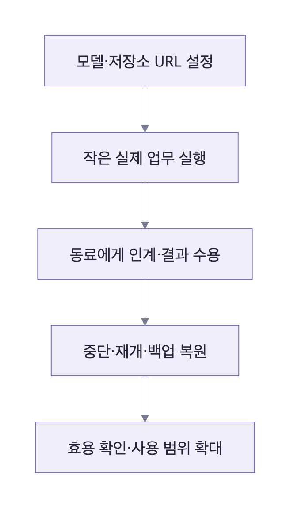

# 팀 시범 운영 가이드

Crewroom 0.13.1은 공용·개인 에이전트, 공유 업무방, AI와 대화하는 스킬 설계·기억 관리와 native 코드 수정·Docker 검사·독립 QA를 제공한다. 원하는 모델 endpoint와 GitLab URL을 연결하고 작은 프로젝트부터 공동 사용을 확인한다. 한 배포는 한 팀을 대상으로 하며 팀 생성·조직 전환 기능은 제공하지 않는다.

실제 모델 검증·서버 UX·공동 사용·운영 단계의 상태와 완료 기준은 [마일스톤](MILESTONES.md)에서 관리한다.

[0.10 요청·질문·재작업 안내](WORKFLOW_IMPROVEMENTS.md)에서 담당자 답변과 새 실행의 반영 방식을 확인한다.

## 첫 업무 선택

한 프로젝트, 3~5명으로 시작한다. 반복되는 검토나 작은 코드 수정처럼 입력과 완료 기준이 명확한 업무를 고른다.

| 경로      | 팀에서 하는 일                                                            | 준비할 설정                                          |
| --------- | ------------------------------------------------------------------------- | ---------------------------------------------------- |
| 공유 검토 | 같은 PR·MR·커밋을 분석하고 QA 계획으로 인계한 뒤 사람이 수용              | 모델 endpoint, 저장소 접근권, 사용자 계정, 공유 범위 |
| 개발·QA   | 고정 커밋의 격리 사본을 수정하고 실제 검사를 수행한 뒤 새 QA Job으로 검증 | 위 설정과 프로젝트용 실행 이미지·등록 검사           |
| 개인 비서 | 개인 업무방에서 대화하고 전용 스킬과 기억을 사용                          | 개인 계정과 모델 endpoint                            |

모델이 검사를 제안한 것과 실제 Job에서 검사가 통과한 것을 구분한다. 코드 결과는 사람이 검토한 patch로 전달하며 자동 push·MR 생성·merge·배포는 제공하지 않는다.

## 설정과 확인 순서

| 순서            | 담당            | 완료 증거                                                        |
| --------------- | --------------- | ---------------------------------------------------------------- |
| 모델 연결       | 운영 담당자     | 선택한 URL·모델 ID·인증 형식으로 실제 결과와 receipt 저장        |
| 저장소 등록     | 프로젝트 담당자 | 고정 SHA 입력, 지정 프로젝트 접근, 공유 대상의 접근권 확인       |
| 계정·HTTPS 설정 | 운영 담당자     | 팀원별 로그인, 개인·부서·팀 공개 범위 확인                       |
| 실행 환경 준비  | 개발 담당자     | 프로젝트 의존성과 검사가 포함된 이미지, 실제 검사 로그·종료 코드 |
| 공동 업무 수행  | 팀원 두 명 이상 | 요청→실행→책임 인계→수용 기록                                    |
| 복구 확인       | 운영 담당자     | 중단·재개와 백업을 새 환경에 복원한 기록                         |
| 효용 확인       | 팀 담당자       | 준비·검토·수정에 쓴 사람 시간, 결과 오류, 비용·재사용 기록       |

모델 연결은 [커스텀 연결 설정](CONFIGURATION.md), 실행 이미지는 [코드 실행 구조](CODE_EXECUTION.md), 계정·백업은 [운영 안내](SERVER_OPERATIONS.md)를 따른다. `npm run doctor`는 일반 대화·스킬의 준비를 검사하며 GitLab을 요구하지 않는다. `-- --code`는 코드 실행용 Runner·GitLab 설정을 추가 검사한다. 실제 추론·저장소 접근권 검증은 별도다. [직접 사용 시작](READINESS.md)에서 정확한 순서와 판정 범위를 확인한다.

## 사용 전 알아둘 범위

- OpenAI 호환 Chat Completions와 Claude Messages 계약을 지원한다. 연결할 모델의 JSON 형식 준수와 작업 품질을 확인한다.
- 공개 GitHub PR 분석과 설정한 GitLab MR 분석을 지원하며, 코드 실행 입력은 등록한 GitLab 프로젝트의 전체 SHA다.
- 기억은 에이전트별로 영속 저장하고 과거 대화·자동 업무 요약을 관련성으로 회상한다. 실행은 기억 16,000자·최근 대화 12,000자와 최대 4회 추가 조회를 사용한다. 선택적 의미 검색은 별도 embedding 연결이 필요하다. 자동 요약은 발췌이며 완벽한 무제한 회상은 보장하지 않는다. [장기 기억](MEMORY_ARCHITECTURE.md)
- 계정은 운영자가 사전 발급한다. 비밀번호 변경·운영자 초기화는 제공하며 SSO·사용자별 GitLab OAuth는 제공하지 않는다.
- Job은 네트워크 없는 격리 컨테이너에서 실행한다. 모델·저장소 URL 등록이 호스트 전체의 egress 통제를 대신하지 않는다.
- 기본 검사는 Node 예제다. 프로젝트별 toolchain·의존성·검사를 준비하고, 해당 배포의 HTTPS·접근권·보존 기간·백업 보관 위치와 키 관리자를 정한다.

## 확대 판단

실제 팀원 두 명이 같은 업무를 끝내고, 로그아웃·서버 재기동 후에도 결과·대화·기억이 유지되는지 확인한다. 권한 밖의 개인·부서 자료가 목록·검색·다운로드·SSE에 나타나지 않아야 한다. 실패한 모델 호출이나 중단된 Job을 복구하고, 운영 담당자가 복원 절차를 재현할 수 있어야 한다.

첫 주에는 처리 건수보다 사람의 준비·검토·재작업 시간이 줄었는지, 결과 형식이 일관적인지, 다음 담당자가 설명 없이 이어받을 수 있는지를 기록한다. 비용·지연·오류를 함께 보고 사용 범위를 조정한다. 로컬 자동 검사와 실제 배포의 사용성 검증은 별도로 기록한다.
