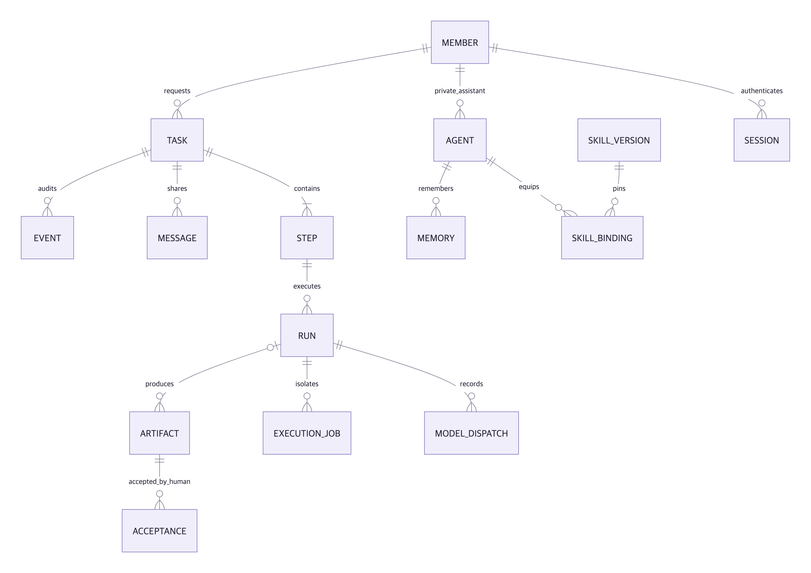
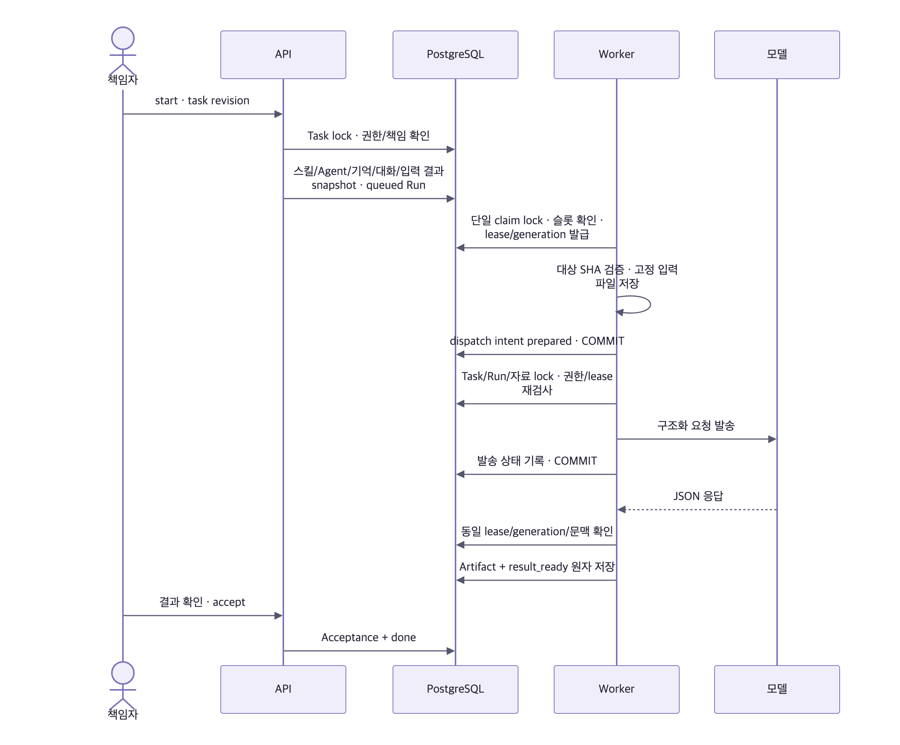
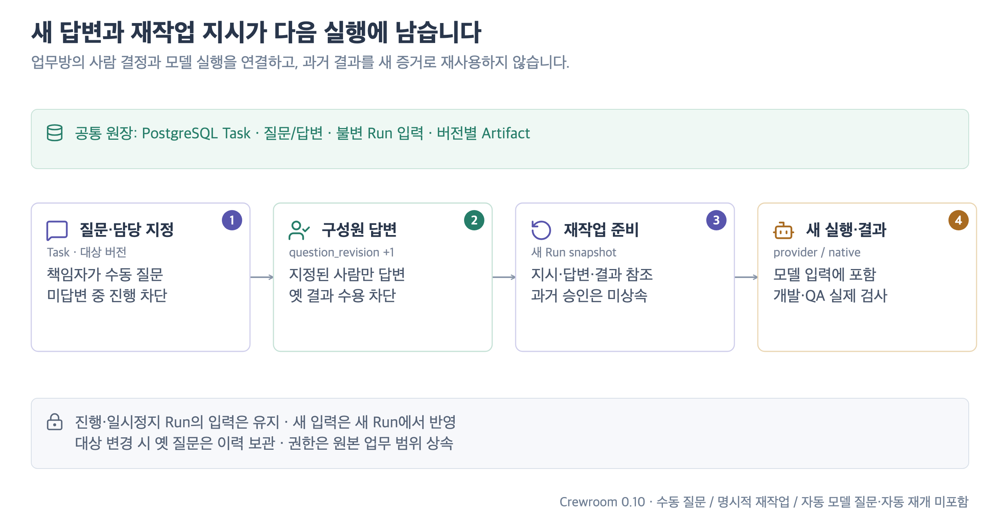

# 실제 서버 아키텍처

0.14의 [영속 작업공간](AGENT_WORKSPACE.md)은 task 소유 문서·불변 버전·출처·저장 receipt를 PostgreSQL에 보관하고 기존 모델 행동 루프에 연결한다. 코드 실행 tmpfs와 별도이며 별도 agent 컨테이너가 필요하지 않다.

0.14.1은 HTTP 문서 조회에 공유 context 잠금·잠금 후 재인증을 적용한다. 모델 도구·변경은 기존 배타 잠금을 사용한다. 현재 업무 목록이 기본이며, 문서별 출처 기록을 일괄 저장한다. 책임 인계는 이전 실행 종료 확인 후 새 요청자의 snapshot을 만들고, 코드 checkpoint에는 기억·문서 출처를 상속한다. [검증과 데이터 규모](TEAM_QUALITY.md).

0.11의 긴 대화·검색 투영·SSE·종료 Job 보관·용량 한도는 [장기 운영 설계](LONG_TERM_OPERATIONS.md)를 따른다. 아래의 기본 업무/기억 계약과 함께 읽는다.

**코드 실행 추가 구조와 실제 검사 계약은 [0.6 실행 아키텍처](CODE_EXECUTION.md)가 기준이다.** 아래 협업·인증·큐 계약은 유지한다.

2026-10-20. 이 문서와 소스가 현재 구현의 기준이다. [README의 에이전트 동작 방식](../README.md#에이전트는-어떻게-실행되나요)에 Agent/Task/Run·상주 서비스·행동 루프·기억/문서/코드 저장·복구를 함께 정리했다. 0.4 문서의 Paperclip 재사용·원격 하네스는 이전 검토안이다.

## 구성과 데이터 소유권

App과 Worker는 같은 릴리스를 사용하되 별도 프로세스다. 큐·세션·상태를 메모리/localStorage에 두지 않는다. API가 HTML에 서버 모드 메타 태그를 넣어 `src/live-app.js`를 선택한다. Pages는 기존 `src/app.js`로 동작한다.

실제 이름은 `cr_*` 테이블이다. UUID를 참조에 사용하며 W-number는 표시용이다. 메시지·산출물·수용은 서로 다른 기록이다. 외부 결과는 Run 없이도 Artifact가 될 수 있다. 결과 본문은 불변이며 새 실행은 새 버전을 생성한다.

## 실행 계약

- 큐는 PostgreSQL 하나다. 전체 2개, 같은 Agent 1개까지 실행한다. paused 중 이미 시작한 실행·해제 전 lease도 슬롯을 점유한다.
- Task→Run 순으로 잠근다. claim은 advisory lock과 `FOR UPDATE SKIP LOCKED`를 사용한다. UI 수정에는 Task revision을 요구하여 늦은 덮어쓰기를 409로 거절한다.
- lease 60초, 실행 중 최대 2초 간격으로 권한과 lease를 갱신한다. DB의 `clock_timestamp()`로 lock 대기 중 경과한 시간까지 검사한다.
- 정지·취소는 generation을 바꾸고 이전 응답의 결과 게시를 막는다. Worker stop은 진행 중 tick과 실행을 기다린다.
- 임대 만료는 자동 재시도하지 않는다. 기존 실행 종료를 확인해야 한다. 모델 요청은 DB와 원자적으로 결합할 수 없으므로 **exactly-once 외부 호출을 보장하지 않는다**. 발송 intent를 먼저 저장하고 불명 상태는 격리한다.
- 취소·일시정지와 발송 오류가 겹쳐도 `prepared/launched/unknown` intent가 있으면 lease를 자동 해제하지 않는다. 운영 CLI가 근거 해시를 남기며 확인한다.
- Agent·스킬·provider endpoint/model profile은 Run 시작 시 고정한다. 최근 대화는 최대 20개·12,000자다. 장기 기억은 관련성 검색으로 16,000자까지 고정하며 모든 답변 버전·프로젝트 공통 기록을 조회하며 조회·기억 제안 합계는 최대 4회다. 제안은 사람이 저장하기 전까지 기억으로 사용하지 않는다. 출처 key/버전과 의존 자료를 발송·완료 때 다시 검사한다. [0.8 장기 기억](MEMORY_ARCHITECTURE.md)
- 기억 삭제·정정·소속/계정 변경은 발송 전/갱신/완료 때 재검사한다. 이미 발송한 데이터를 외부 모델에서 회수할 수는 없다. 결과 게시는 막는다.

## 질문·재작업과 결과의 유효성

Migration 008은 `cr_tasks.rework`, `question_revision`, 대상별 `cr_questions`를 추가하고 `analysis` 업무 유형을 허용한다. 질문은 책임자가 만들고 지정한 활성·열람 가능한 구성원이 답한다. Task의 기존 공개 범위를 상속하며 Task 문맥 잠금→질문 잠금 순서와 revision으로 늦은 수정·중복 답변을 거절한다. 새 답변은 Task 답변 revision을 증가시킨다.

시작은 미답변 질문을 검사한다. 수용·QA 인계는 현재 대상의 미답변 질문과 결과를 만든 Run의 답변 revision을 검사한다. 결과 뒤 새 답변이 생기면 새 Run이 필요하다. 실행 중·일시정지 Run의 입력은 바꾸지 않으며 자동 발송하지 않는다. 대상 변경 시 옛 질문·답변은 superseded로 보관하고 새 입력에서 제외한다.

새 Run은 재작업 지시, 서버가 고른 같은 단계 기준 결과의 제한된 참조, 현재 대상 답변을 snapshot에 고정한다. `server/provider.js`와 `server/runner-client.js` 모두 이를 모델 최초 입력에 넣는다. 과거 검사·수용은 참고 자료로만 구분하며 새 증거로 상속하지 않는다. [UI·필드·한도·상태 계약](WORKFLOW_IMPROVEMENTS.md)

## 입력과 모델

설정한 GitLab MR URL 또는 공개 GitHub PR URL과 head SHA를 받는다. GitLab은 프로젝트/공유 프로젝트 목록과 API token을 설정하고 40/64자리 전체 SHA(접두사 입력 가능)를 검증한다. MR diff_refs의 base/head를 고정해 compare를 읽으며 누락·timeout·생략된 diff는 거절한다. 공개 GitHub 연결은 설정으로 끌 수 있다. [커스텀 연결 설정](CONFIGURATION.md)

GitHub PR은 7~40자리 head SHA를 받는다. head를 확인하고 불변 base/head SHA compare diff를 가져온다. GitHub 고정 host만 호출하며 redirect·응답 크기·시간을 제한한다. GitHub private 저장소·임의 URL 크롤링은 지원하지 않는다. 다른 대상은 사용자가 입력한 내용만 분석하고 실제 환경을 조회하지 않았음을 남긴다.

`server/provider.js`는 설정한 endpoint의 Claude Messages 또는 OpenAI 호환 `chat/completions` 계약을 사용한다. 전체 endpoint와 인증 header/raw·bearer 설정을 지원하며 외부 모델 주소로 자동 fallback하지 않는다. Claude는 system/user를 Messages body로 보내고 text·usage·request ID를 읽는다. 제공자의 native function calling은 사용하지 않으며 OpenAI 호환 요청은 `tools: []`, `tool_choice: none`이다. 모델이 본문으로 응답한 JSON `action`을 앱이 검증·실행하고 실제 결과를 다음 요청에 넣는다. 일반 분석은 기억·영속 문서 도구를, 코드 업무는 여기에 Runner의 허용 행동을 더한다. 모델이 임의 command argv를 정하지 못한다. 최종 JSON의 summary/evidence/unknowns/nextActions를 검사하고 모델/요청 ID/사용량을 receipt로 남긴다. 허용 입력 크기를 넘으면 명시적으로 실패한다. fixture는 test 플래그와 비운영 환경에서만 허용된다. Hermes runtime은 명시적 미설정 오류이며 기본 CLI 실행으로 대체하지 않는다.

## 인증과 정보 경계

비밀번호는 scrypt(N=32768,r=8,p=1)+salt로 해시한다. 랜덤 세션 토큰은 DB에 해시로 저장하고 12시간 만료, HttpOnly/SameSite Strict/HTTPS Secure cookie를 사용한다. 변경 API는 정확한 Origin·JSON·CSRF를 요구한다. 계정 활성/소속을 매 요청 다시 읽는다. 로그인 실패 시 IP+이메일 기반 제한을 사용한다.

공개 가입은 차단한다. 운영 CLI가 구성원과 소속을 발급한다. 팀장 요청은 승인 전 권한이 없다. 마지막 활성 팀장의 강등은 막는다. 구성원 비활성화 시 세션을 폐기한다.

| 정보                      | 나만              | 부서                   | 팀                   |
| ------------------------- | ----------------- | ---------------------- | -------------------- |
| 업무/메시지/결과/다운로드 | 소유자            | 같은 부서              | 활성 구성원          |
| 기억 검색/모델 입력       | 소유자·해당 Agent | 같은 부서·해당 Agent   | 해당 Agent의 팀 기억 |
| 팀장 개입                 | 본인 업무만       | 읽을 수 있는 공유 업무 | 공유 업무            |

공개 범위가 넓은 Task에는 더 좁은 기억을 주입하지 않는다. 원본 Task에서 기억·예시를 만들 때 범위를 넓힐 수 없다. 결과 예시는 프로젝트와 실제 청중 범위가 같아야 한다. 개인 정보가 있는 snapshot은 API에서 그대로 노출하지 않는다. SSE는 본문 없이 허용된 갱신 ID만 보내며 재접속 시 DB snapshot을 다시 가져온다.

브라우저는 계정 전환 시 요청을 abort하고 session generation을 바꾼다. 이전 계정의 늦은 200/401 응답과 SSE가 새 세션을 덮어쓰지 못한다.

## API와 소스

0.9.0의 오피스는 `src/office-station.js`를 데모와 서버에서 공유한다. 실제 서버는 Task의 현재 단계에 연결된 `agent_id`로 업무와 동료를 연결한다. 최근 열람 가능한 업무 최대 200건을 표시하며, 목록에 없음을 유휴 상태로 단정하지 않는다. 스킬 요청 화면의 완료 기준은 최신 게시본이 아닌 에이전트에 적용한 버전에서 읽는다.

`GET /api/admin/operations`는 팀장 역할을 확인한 뒤 기존 Task 열람 조건으로 대기·실행·실패·24시간 처리 시간과 성공 산출물의 모델 영수증을 집계한다. 집계도 비공개 업무 권한을 확대하지 않는다. 누락된 사용량은 0으로 채우지 않으며, 실패/취소의 전체 청구량과 금액은 측정하지 않는다. [답변 평가·사용량의 범위](ANSWER_EVALUATION.md)

| 경로                                                | 역할                                | 구현                          |
| --------------------------------------------------- | ----------------------------------- | ----------------------------- |
| `/api/auth/*`                                       | 로그인·세션·로그아웃·팀장 요청      | auth.js, app.js               |
| `/api/workspace`, `/api/events`                     | 범위별 목록·실시간 갱신             | app.js, permissions.js        |
| `/api/admin/operations`                             | 팀장용 열람 범위 내 운영 집계       | operations.js, permissions.js |
| `/api/tasks`, `/:id/commands`, `/:id/messages`      | 접수·상태·책임·대화                 | tasks.js                      |
| `/api/tasks/:id/questions`, `/:questionId`          | 책임자 질문·담당자 답변·닫기·재배정 | questions.js                  |
| `/api/artifacts/:id`                                | 범위 검사 후 Markdown 다운로드      | app.js                        |
| `/api/memories`                                     | 검색·출처·정정·삭제                 | resources.js                  |
| `/api/memory/search`, `/sources/:key`, `/proposals` | 시점 검색·원문·제안 검토            | memory.js, memory-learning.js |
| `/api/agents`, `/api/skills`, `/api/members`        | 설정·버전·담당·역할                 | resources.js                  |
| `/api/agents/:id/workspace`, `/api/tasks/:id/workspace` | 에이전트/업무의 허용된 작업 문서 목록 | app.js, agent-workspace.js |
| `/api/workspace/documents/:id`                     | 현재/이전 문서·부분 본문·버전 조회 | app.js, agent-workspace.js |
| `/api/health`, `/api/ready`                         | 프로세스 / DB·복원 준비 상태        | app.js                        |

기억 원문·정정 이력은 DB에 보관한다. 핵심 기억과 대화 원문·자동 발췌 업무 요약을 검색하고 출처를 추적한다. 선택적 embedding URL은 Worker가 별도로 호출한다. 자동 요약을 승인된 사실·검사 결과로 승격하지 않는다. [구조·설정·검증](MEMORY_ARCHITECTURE.md)
