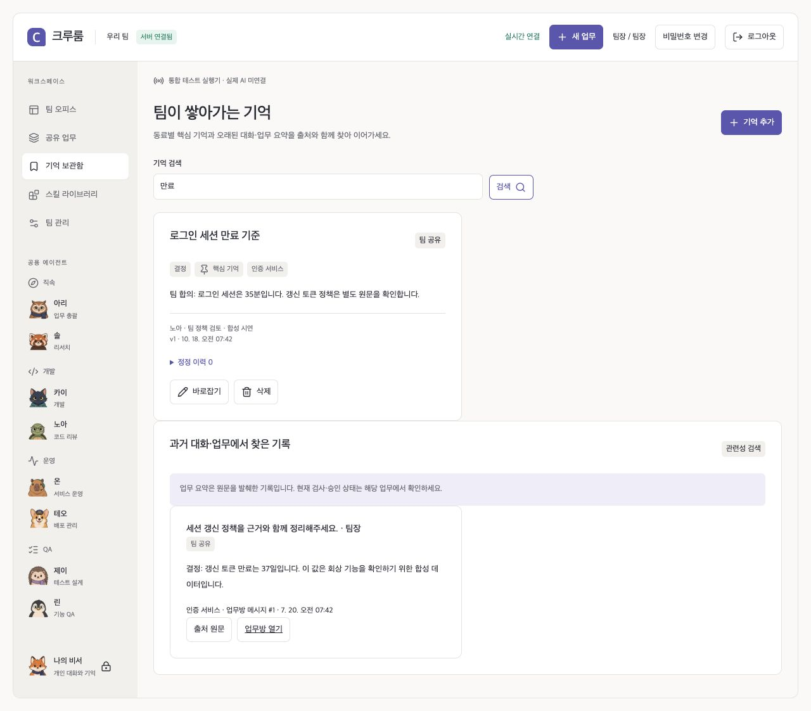
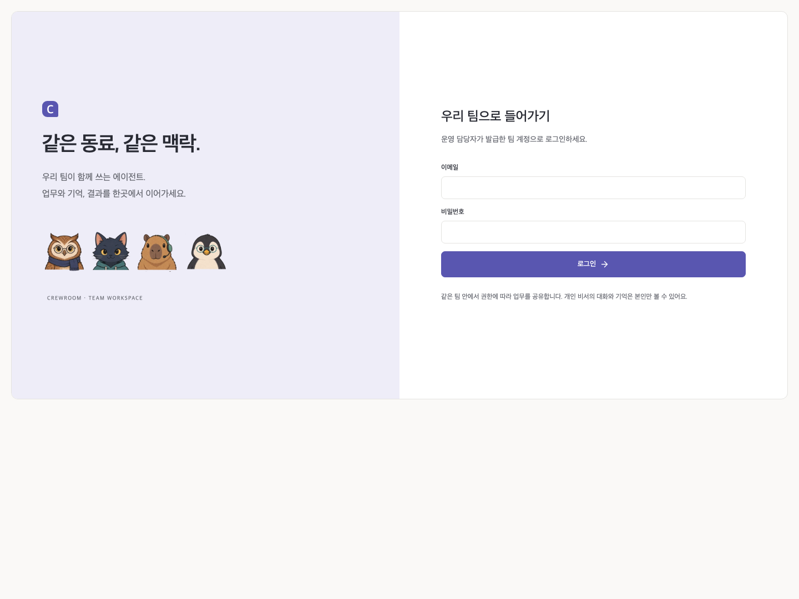
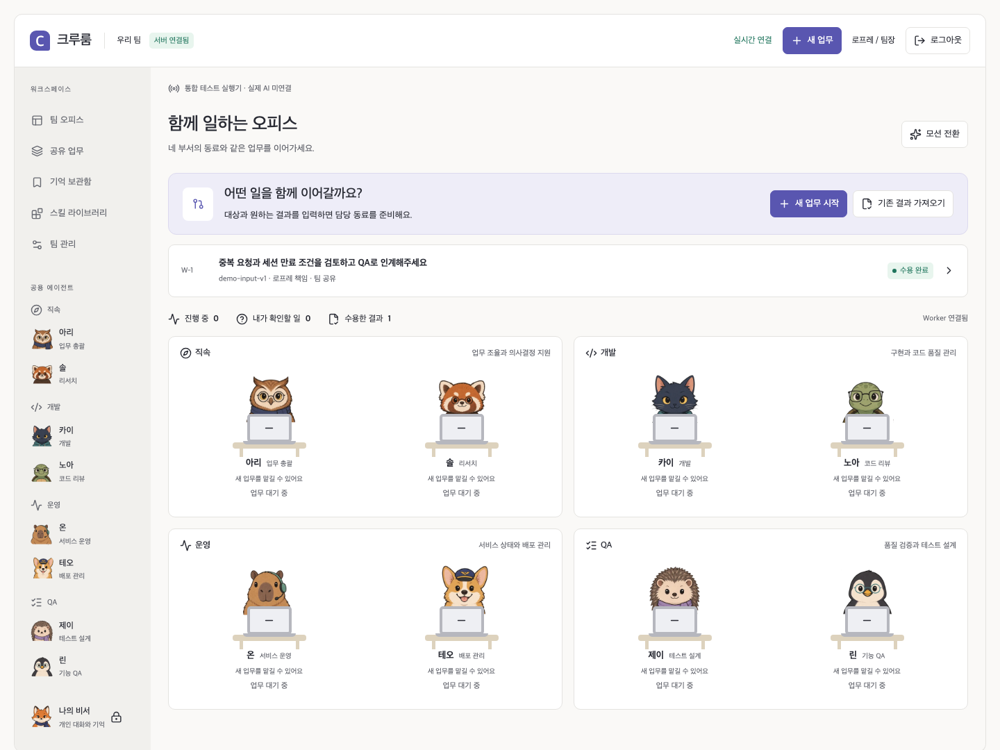
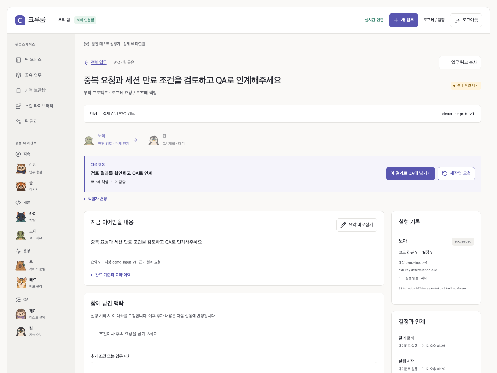
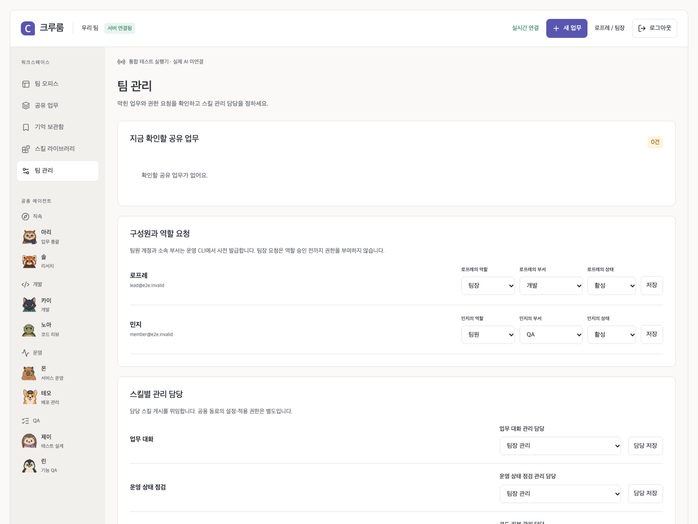
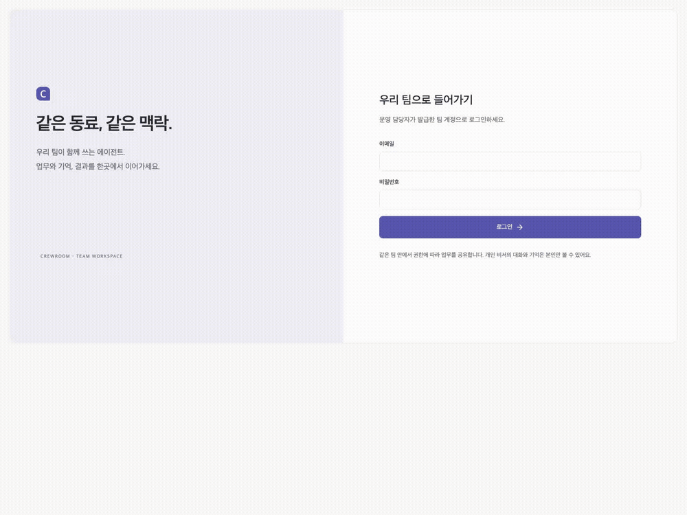

# 0.7 장기 기억 검증

2026-10-18. 장기 기억 구현은 [검색·출처·선택적 의미 검색 설계](MEMORY_ARCHITECTURE.md), 코드 실행은 [실행 아키텍처](CODE_EXECUTION.md)를 따른다. 아래 0.6·0.5 기록은 이전 릴리스의 검증 이력이다.

| 검사                             | 결과            | 검증한 범위                                                                                                                                                                                 |
| -------------------------------- | --------------- | ------------------------------------------------------------------------------------------------------------------------------------------------------------------------------------------- |
| 단위·HTTP adapter                | 44 통과         | 한국어 검색어·긴 원문 발췌·문맥 예산·범위 상속·별도 embedding 인증/응답·native 추가 조회와 기존 계약                                                                                        |
| 실제 PostgreSQL + Docker 개발/QA | 39 통과, skip 0 | 1,200개 최신 기록 뒤의 옛 결정, 최근 창 밖 대화, 개인/부서/동료/프로젝트 경계, 파생 출처 무효화, 추가 조회 재검사, 원문 task 잠금, 벡터 버전/재시도, 로컬 HTTP→결과 저장, 실제 개발→독립 QA |
| 실제 Docker Runner               | 5 통과          | 수정·검사·실패 우선·빈 patch QA·재시작·멱등·취소·고정 이미지 보존                                                                                                                           |
| 정적 화면 브라우저               | 31 통과         | 기존 캐릭터·모션·업무·데스크톱 회귀                                                                                                                                                         |
| 실제 서버 브라우저               | 12 통과         | 기존 협업 + 기록 검색→원문/당시 버전→종류/고정 저장→실행이 참고한 기억 확인                                                                                                                 |
| 서비스별 비밀 파일 소유권        | 통과            | embedding 키는 Worker만 읽음, App/Runner 격리와 재준비                                                                                                                                      |
| 암호화 백업·복원 훈련            | 통과            | 새 기억 종류/고정·조회 ledger·벡터 cache·view fingerprint 일치와 실행 중 수정본 checkpoint/새 Run 실제 검사                                                                                 |

총 **131개 자동 검사**와 별도 Linux 비밀 파일/복원 훈련을 통과했다. [기계 판독 검사 기록](evidence/0.7/verification.json) · [복원 영수증](evidence/0.7/restore.json) · [화면 캡처 manifest](media/memory/manifest.json). 최종 커밋의 CI 결과는 해당 GitHub Actions run에서 확인한다.

## 이번 검토에서 보강한 부분

- 조회 출처에 의존한 옛 요약도 원문 버전·접근 범위를 다시 확인한다. 정정된 내용을 참고한 요약은 검색과 실행 참고 화면에서 제외한다.
- 대화 원문의 task 잠금도 유지해 원문 관련 정정과 발송 전 검사가 엇갈리지 않게 한다. PostgreSQL의 실제 충돌 검사로 확인한다.
- 기억 조회 순서와 Docker 행동 순서를 분리해 조회 뒤 파일 검사/QA가 건너뛰지 않도록 한다.
- 별도 endpoint·연결 profile·원문 fingerprint·인덱싱 lease로 벡터 캐시를 제한하고, 실패 재시도/변경/삭제 경로를 검사한다.
- 브라우저 검사 산출물 디렉터리를 분리해 정적·서버 검사 결과가 서로 덮어쓰지 않게 한다.

## 증거의 한계

DB·파일 수정·Docker 검사·브라우저·백업은 실제 실행이다. 모델과 embedding 응답은 **결정적 로컬 HTTP fixture**다. 벡터 테스트는 합성 벡터로 결합/권한/캐시 무효화를 검증하며 실제 모델의 한국어 의미 검색 품질·비용·지연을 입증하지 않는다. 외부 모델·embedding·GitLab 연결 정보와 실제 프로젝트 toolchain은 배포별 검증이 필요하다.

원문 개수에 인위적 보관 한도는 두지 않지만 모델 문맥은 16,000자와 추가 조회 4회로 제한한다. 자동 업무 요약은 원문 발췌이며 완벽한 회상이나 자동 사실 승격을 보장하지 않는다. 선택적 벡터 검색은 exact scan이므로 큰 corpus의 처리량은 별도 부하 검증이 필요하다. 이번 변경에 대한 새 독립 리뷰 승인을 주장하지 않는다.

---

# 0.6 검증·리뷰

2026-10-17. 현재 구현은 [코드 실행 아키텍처](CODE_EXECUTION.md)가 기준이다. 아래 0.5 기록은 이전 릴리스의 이력이다.

| 검사                                 | 결과                      | 실제 검증 범위                                                                                                                 |
| ------------------------------------ | ------------------------- | ------------------------------------------------------------------------------------------------------------------------------ |
| 단위/모델·GitLab 계약/archive/암호화 | 36 통과                   | 경로·링크·PAX·해시·프로토콜·이전 도메인                                                                                        |
| 실제 PostgreSQL                      | 28 통과                   | ACL/세션/업무/스킬/큐/세대 경쟁 + native 실행 인계                                                                             |
| 실제 Docker Runner                   | 5 통과                    | 수정·검사·같은 코드 재기록 후 검사 무효·마지막 실패 우선·빈 patch QA·재시작·행동 멱등·실행 중 취소·배포 tag 교체 중 image 보존 |
| 정적 화면 브라우저                   | 31 통과                   | 기존 오피스/모션/데스크톱 회귀                                                                                                 |
| 실제 서버 브라우저                   | 11 통과                   | 공유/개인/담당/QA/수용 + 스킬 생성→장착→선택 실행 + 이전 답변을 이어가는 대화 + 비밀번호 변경                                  |
| Linux 비밀 파일 소유권               | 통과                      | uid1001의 0600 입력 접근 거절→서비스별 uid0/1000 준비→App token 격리→재준비                                                    |
| 암호화 백업/복원 훈련                | 통과                      | 실행 중 수정분 DB checkpoint·빈 서버 복원·새 Run 수정본 재개·실제 검사·세션 폐기·실패 복원 차단                                |
| Compose 실제 기동                    | App/DB/Worker/Runner 정상 | Node24 이미지, socket 분리, 4191 HTTP profile, Job 이미지 고정                                                                 |

총 **111개 자동 검사**와 별도의 Docker 복원 훈련을 수행했다. [검사 기록](evidence/0.6/verification.json) · [복원 영수증](evidence/0.6/restore.json) · [새 화면 manifest](media/execution/manifest.json). 최종 커밋의 GitHub Actions가 다시 전체 검사를 수행하며 성공 여부는 해당 commit run을 따른다.

실제 흐름은 고정 SHA 입력→개발 파일 수정→Docker 실제 검사→동일 patch의 새 QA 컨테이너→다른 팀원의 최종 수용이다. **모델 응답은 로컬의 결정적 Claude 프로토콜 fixture**다. 실제 파일/검사/DB/브라우저 검증과 연결한 모델의 실제 추론 품질을 구분한다.

## 0.6 독립 리뷰 반영

| 발견                                                  | 수정·회귀                                                                               |
| ----------------------------------------------------- | --------------------------------------------------------------------------------------- |
| ignored 파일 수정이 patch에서 누락                    | 강제 index + 원본에 patch 재적용 treeHash 일치                                          |
| 마지막 재검사 실패 후 과거 통과 재사용                | check ID별 마지막 receipt, 수정 epoch/hash 일치                                         |
| 빈 patch 독립 QA 실패                                 | 빈 문자열도 고정·전송·해시 검증                                                         |
| 과거 UNKNOWN 오류가 같은 Worker의 재개 Run을 실패시킴 | generation 검사 + PostgreSQL 실패 주입 회귀                                             |
| Worker와 Runner 동시 정지로 checkpoint 유실           | Worker 정지→DB checkpoint 수집→Runner 정지→Job 0 확인→백업                              |
| 복구 CLI에 Runner token이 없음                        | token이 있는 Worker 서비스에서 운영 CLI 실행                                            |
| Job 생성 전 연속 실패가 상속 checkpoint를 잃음        | 현재 Run snapshot을 대체 checkpoint로 이어주고 동일 SHA/profile 검사, 연속 실패 PG 회귀 |
| 복원 후 새 Run이 checkpoint를 잃음                    | 동일 SHA/profile의 patch를 새 Run snapshot에 명시 전달, 실제 복원/재개 검사             |

서버 리뷰어는 수정 후 PostgreSQL/빈 patch Docker 회귀를 재실행했다. 배포 리뷰의 마지막 수정은 활성 Job 복원 훈련으로 재검증했다. Astra는 중간 정확성 피드백을 제공했으나 최종 보고를 반환하지 못했으므로 최종 승인으로 계산하지 않는다.

## 배포별로 확인할 부분

설정한 endpoint·인증/CA·모델 ID, GitLab 실제 접근권, 대상 프로젝트의 **offline toolchain/의존성 이미지와 등록 검사**는 이 환경에서 확인하지 못했다. 기본 Job은 Node 기본 검사 예제이며 배포당 실행 profile 하나를 제공한다. 자동 push/MR/배포는 구현 범위가 아니다. `npm run doctor`는 연결 설정 유무와 서비스 응답을 확인하며 실제 추론 품질을 보증하지 않는다.

기억은 장기 영속 저장하되 최근 허용 기억 8개/대화 20개를 실행에 고정한다. 완벽한 무제한 회상·의미 검색·자동 기억 추출은 제공하지 않는다. 실제 팀의 시간 절감도 시범 사용으로 측정해야 한다.

---

# 0.5 검증·독립 리뷰 보고서

검증일: 2026-10-17. 대상은 실제 App/PostgreSQL/Worker와 데스크톱 웹이다. GitHub Pages는 API 없는 정적 화면 데모다. 실제 외부 모델 추론·사용자 계정·운영 도메인 검증과 구분한다.

## 커스텀 연결 adapter 추가 검증

Claude Messages/OpenAI 호환 endpoint와 GitLab용 표준 adapter를 추가했다. 계약 검사 9개·기존 비밀 보존 검사 1개와 실제 PostgreSQL Worker의 GitLab→Claude 형식 로컬 HTTP→산출물 저장 검사 1개를 추가했다. 로컬 전체 검사는 단위 34·서버 22·실제 서버 웹 9·정적 웹 31, 총 96개가 통과했다. [추가 검증 기록](evidence/custom-endpoints/verification.json)과 [새 Compose 복원 재검증](evidence/custom-endpoints/restore.json)을 보관한다. 모델·저장소 endpoint와 인증값은 각 배포에서 설정한다. 이는 실제 외부 모델·저장소에 연결한 증거가 아니다. [상세 연결 계약](CONFIGURATION.md)

아래 0.5 최초 릴리스 기록은 보존하며, 최신 검사는 새 커밋의 CI를 따른다.

## 실행 증거

| 검사                         | 결과                    | 범위                                                                                                      |
| ---------------------------- | ----------------------- | --------------------------------------------------------------------------------------------------------- |
| 도메인·백업 암호화 단위 검사 | 24 통과                 | 상태 전이·수용·공유·정정 + 잘못된 백업 키의 인증 실패/평문 삭제                                           |
| PostgreSQL 서버 통합         | 21 통과                 | 실제 SQL transaction·동시 Worker·ACL·세션·스킬·기억·장애 경쟁                                             |
| 정적 데모 브라우저           | 31 통과                 | 기존 화면·모션·키보드·역할·업무 흐름 회귀                                                                 |
| 실제 서버 브라우저           | 9 통과                  | 두 독립 쿠키 세션·공유 대화·책임 이전·QA 인계·수용·개인 격리·기억 정정·담당 위임·계정 전환 경쟁·팀장 요청 |
| Docker Compose               | 기동·ready·Worker 확인  | Node 24 이미지, PostgreSQL 18, 비밀 파일, read-only root, named volume                                    |
| 암호화 백업→새 프로젝트 복원 | 통과                    | Task ID·Artifact hash·Memory·입력 파일 보존, 세션 폐기, 미완료 Run 격리                                   |
| 파일 복원 실패 훈련          | 통과                    | 유효하게 암호화된 잘못된 tar, DB 격리 유지, App/Worker startup 거부                                       |
| GitHub 공개 PR 입력          | 실연결 확인             | 불변 base/head compare diff. 모델 호출 없음                                                               |
| GitHub Actions               | 최종 커밋 실행에서 확인 | 단위·정적 웹 + PostgreSQL·실제 서버 웹을 별도 job으로 검사                                                |

[기계 판독 검증 기록](evidence/0.5/verification.json) · [Docker 복원 훈련 영수증](evidence/0.5/restore.json)

서버 테스트는 지정한 테스트 DB의 고유 schema만 생성·삭제한다. 운영 DB를 기본값으로 사용하지 않는다. Docker 복원 훈련은 고유 이름의 임시 Compose 프로젝트만 정리한다. 재현 명령은 `npm run test:server`, `npm run test:server:e2e`, `npm run test:restore`이며 [운영 안내](SERVER_OPERATIONS.md)의 환경을 사용한다.

브라우저 화면은 실제 API와 PostgreSQL을 사용하되 결정적 테스트 fixture로 결과를 만든다. 서버 화면에 **통합 테스트 실행기 · 실제 AI 미연결**을 표시한다. 로컬 HTTP 모델 계약 테스트는 요청 본문·버전 고정·도구 차단·JSON 응답 처리를 확인하며 실제 외부 추론의 품질·비용·지연을 증명하지 않는다.

## 독립 리뷰와 수정

Astra 아키텍처 리뷰와 별도 서버/배포 리뷰를 반복했다. 아래 결함을 수정하고 해당 경로를 회귀 검사에 포함했다. 리뷰어가 직접 실행한 검사와 코드 검토만 한 범위를 구분한다.

| 발견                                                     | 수정·증거                                                                      |
| -------------------------------------------------------- | ------------------------------------------------------------------------------ |
| Paperclip 내부 API의 결합, 기존 Hermes adapter 권한 충돌 | [ADR 001](ADR_001_RUNTIME.md), 단일 Crewroom DB 큐 선택. Astra 재검토          |
| 공개 가입에서 동료 이메일·부서를 사칭할 수 있음          | 공개 가입 차단, 운영자 사전 발급, 역할 요청과 승인 분리                        |
| 현재 요약·대화가 모델 입력에서 빠짐                      | 실행 시작 전 내용 snapshot 고정, 실제 로컬 HTTP 요청 본문 검사                 |
| queued Run이 바뀐 provider로 자료를 보낼 가능성          | endpoint/model profile 고정, 변경 시 0회 발송 검사                             |
| 기억 취소와 모델 발송 사이 경쟁                          | 자료 lock·발송 직전 ACL/generation/lease 검사, 취소 후 결과 게시 거부          |
| 시작 전 paused Run이 동일 Agent의 작업을 막음            | 시작한 hold만 슬롯 예약                                                        |
| 개인 업무 복구가 팀장 본문 접근을 요구함                 | 불투명 Run ID·근거 해시로 운영 CLI 복구                                        |
| Worker stop 반환 후 tick이 새 Run을 잡을 수 있음         | tick 대기·claim 전후 stop 검사. 독립 리뷰어가 재현한 2개 회귀 검사 재실행 통과 |
| DB lock 대기 중 lease 만료를 transaction 시간으로 놓침   | `clock_timestamp()`와 최종 조건부 갱신. 독립 리뷰어가 직접 재검증              |
| 이전 계정의 늦은 200/401 응답이 새 세션을 덮어씀         | session generation·AbortController·SSE guard, 두 브라우저 회귀 시나리오        |
| 발송 직후 DB commit 실패로 요청 흔적이 사라짐            | 먼저 영속 intent commit, 발송 불명 격리·운영 CLI 확인                          |
| pause/cancel/lease 만료와 불명 발송이 겹치면 lease 해제  | 미해결 intent도 검사, paused→abort→재개/HTTP 거절→CLI 확인 회귀                |
| 파일 복원 실패 전 DB가 사용 가능해짐                     | atomic import+session revoke+restore_blocked, tar 성공 뒤만 해제               |
| 복원 잠금을 일반 HTTP 확인으로 우회 가능                 | restore/unknown intent는 운영 CLI 전용                                         |
| 실제 pg_restore 뒤 search_path가 비어 격리 SQL 실패      | `SET search_path TO public`, Docker에서 다시 전체 복원 훈련                    |

최종 검토 범위에서 리뷰어가 남긴 중대한 미해결 요청은 없다. 이는 버그가 없거나 운영 준비가 무조건 끝났다는 보장이 아니다. 테스트·동시 실행량·제공자 계약의 범위를 넘어서는 동작은 별도로 확인해야 한다.

## 실제 서버 화면

6개 PNG와 GIF 1개를 실제 서버 fixture에서 캡처했다. [해시·뷰포트·브라우저 오류 manifest](media/server/manifest.json)를 함께 보관한다. 데스크톱 1440/1280/1024의 수평 넘침과 키보드 dialog를 검사했다.

## 남은 연결과 한계

- 실제 모델 API 키/endpoint를 사용한 추론은 실행하지 않았다. 팀이 승인한 제공자 연결 뒤 작은 업무로 형식·지출·품질을 확인해야 한다.
- 실제 코드 수정·테스트·브라우저·배포·외부 메시지·private GitHub 연결은 구현하지 않았다. GitLab MR 읽기는 별도 설정 adapter를 추가했으나 실제 배포 연결은 미검증이다. 현재는 제공한 입력의 구조화 분석이다.
- 기억은 영속 원문·정정 이력과 범위 검사, 제한된 최근 검색이다. 의미 검색·자동 기억 추출·모든 과거를 완벽하게 회상하는 기능은 없다.
- 계정은 운영 CLI로 사전 발급한다. SSO·메일 인증·비밀번호 재설정 UI는 후속 범위다.
- 운영 서버·도메인·TLS·서버 밖 백업 보관·팀원 실사용 및 사람 시간 절감은 아직 검증하지 않았다.

화면 재캡처는 테스트 DB로 `scripts/server-e2e.mjs`를 실행한 뒤 `FFMPEG_BIN=/path/to/ffmpeg npm run capture:server`를 사용한다. 녹화는 합성 계정만 사용하며 fixture 문구를 유지한다. 복원 훈련 영수증의 소요 시간은 작은 합성 데이터의 전체 훈련 시간이며 운영 RTO가 아니다.
