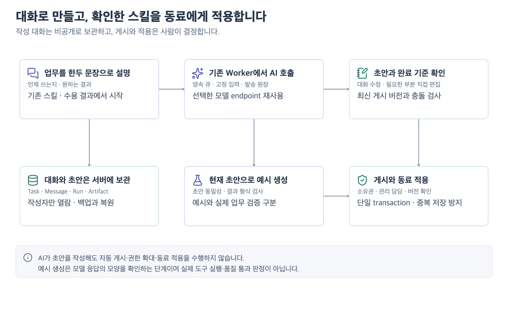
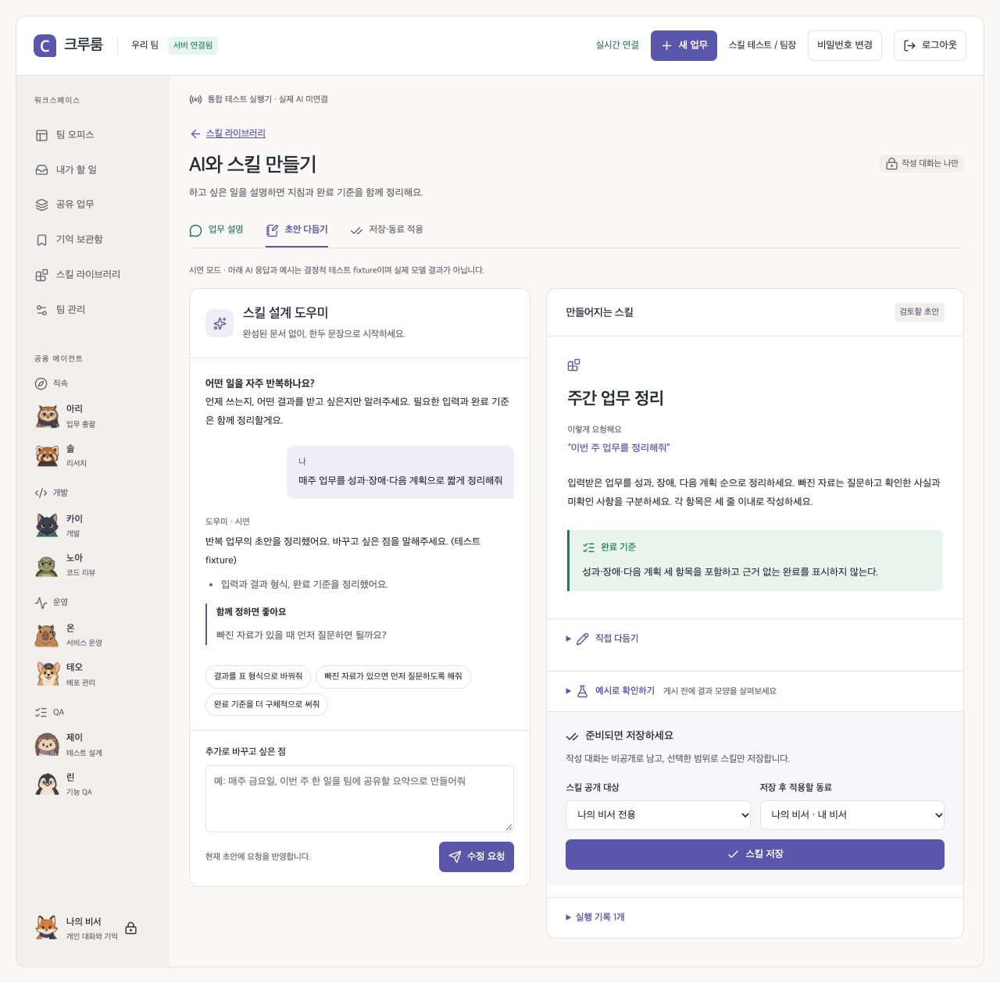
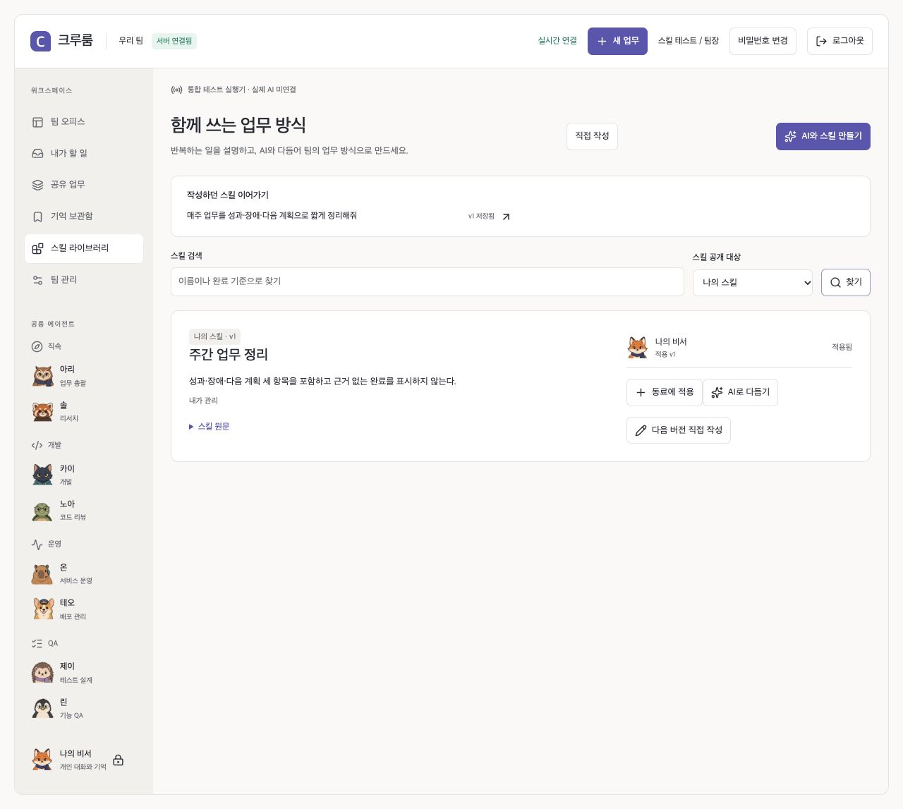

# AI와 함께 스킬 만들기 · 0.12.0

스킬 라이브러리에서 **AI와 스킬 만들기**를 누르고 반복하는 일을 한두 문장으로 설명한다. AI가 사용 시점·입력·수행 순서·결과 형식·완료 기준을 초안으로 정리한다. Markdown을 직접 작성할 필요가 없다.

실제 서버의 격리된 테스트 계정으로 캡처했다. 화면의 AI 응답은 **결정적 fixture 시연**이며 실제 모델의 작성 품질을 보여주는 자료가 아니다. [화면 manifest](media/skill-studio/manifest.json)

## 사용 흐름

1. **업무 설명:** “매주 한 일을 성과·장애·다음 계획으로 세 줄씩 정리해줘”처럼 요청한다. 예시 버튼으로도 시작할 수 있다.
2. **함께 수정:** 왼쪽 대화에서 “표로 바꿔줘”, “빠진 자료는 먼저 질문해줘”라고 요청하고 오른쪽에서 초안·완료 기준을 확인한다. 직접 편집은 접힌 영역에서 필요한 부분만 고친다.
3. **예시 확인:** 짧은 입력으로 현재 초안의 응답 예시를 만든다. 예시는 실제 코드·업무·도구 실행이나 품질 통과 판정이 아니다. 초안이 바뀌면 이전 예시와 구분한다.
4. **저장·적용:** 공개 대상과 적용할 동료를 확인하고 저장한다. 내 비서 적용을 기본으로 제안하며, 저장만 하거나 권한이 있는 공용 동료를 선택할 수도 있다. AI 응답만으로 게시하거나 적용하지 않는다.
5. **이어가기:** 라이브러리의 최근 작성 목록에서 다시 연다. 저장한 초안·대화·AI 결과·실행 입력은 서버에 남는다. 아직 전송하지 않은 편집값은 현재 브라우저 화면에서 보존되며 AI 요청이나 저장 시 서버에 반영된다.

기존 스킬의 **AI로 다듬기**는 해당 게시 버전을 기준으로 새 버전을 준비한다. 게시해도 다른 동료의 적용 버전이나 진행 중 실행은 바꾸지 않는다. 동시에 다른 사람이 게시하면 기존 초안을 보관하고 최신 게시 내용과 함께 새 대화에서 다시 다듬을 수 있다.

수용한 업무의 **반복 업무 스킬 초안**은 서버가 현재 수용 결과를 선택한다. 원래 목표·완료 기준·제한된 결과 내용과 Artifact ID·버전·hash를 고정해 참고한다. 원본의 권한·fingerprint가 바뀌면 실행과 저장을 차단한다. 과거 검사를 새 업무의 승인으로 재사용하지 않는다.

## 구현 구조

| 영역 | 구현과 계약 |
| --- | --- |
| 웹 | 대화와 초안의 두 열 구성, 빠른 수정, 예시, 직접 편집, 범위·동료 선택, 최근 설계, 검색·개인/공용 필터 |
| App | `POST /api/skill-studio`, `/:id/turns`, `/:id/save`. 인증·CSRF·소유권·게시/적용 권한·revision 확인 |
| PostgreSQL | migration 011. 비공개 `skill-design` Task와 `skill_design` 상태. 원래 Message·Run·Artifact·고정 입력·이벤트 테이블 재사용 |
| Worker | `runSkillDesigner`가 기존 큐·lease·generation fence·모델 발송 원장·출처/기억 품질 검사를 거쳐 실행 |
| 모델 연결 | 기존 OpenAI 호환 또는 Claude Messages endpoint·모델·인증 설정 재사용. 별도 외부 서비스나 SDK 의존성 추가 없음 |
| 결과 계약 | 이름·지침·완료 기준의 엄격한 스키마와 수정 요약·질문·요청 예시. 예시 생성은 초안을 변경할 수 없음 |
| 게시 | 기존 생성·버전 게시·binding 함수를 하나의 transaction에서 실행. 잘못된 동료 적용은 게시도 rollback. 동일 저장 재전송은 중복 버전을 만들지 않음 |
| 복구 | 불명확한 발송은 기존 격리 규칙 유지. 자동 중복 요청 금지. 암호화 백업에 설계 상태·대화·결과·스킬 버전·binding 포함 |

현재 초안의 기준은 `cr_tasks.skill_design.draft` 하나다. AI 완료와 수동 저장 모두 같은 필드를 갱신한다. 이전 AI Artifact가 나중에 직접 저장한 초안을 덮어쓰지 않는다. 일반 업무 생성과 Studio 저장은 같은 짧은 context transaction gate를 먼저 얻어 잠금 순서를 맞춘다.

초안은 항상 작성자 비공개다. 공용 스킬의 게시 권한은 팀장 또는 지정 관리 담당이며, 공용 동료 적용은 팀장 권한을 별도로 확인한다. 개인 스킬을 공용 동료에 붙일 수 없다. 생성한 custom 스킬은 업무 지침이며 도구·실행 권한을 추가하지 않는다. 코드 수정·독립 QA의 실행 계약은 기존 전용 흐름을 사용한다.

## 연결과 검증 범위

실제 AI를 사용하려면 [연결 설정](CONFIGURATION.md)의 모델 URL·이름을 설정한다. 모델 연결이 없으면 화면에 원인과 직접 작성 경로를 보여주며, 성공한 AI 응답을 만들어내지 않는다. 테스트 fixture 화면은 시연임을 표시한다.

로컬 HTTP fixture로 OpenAI 호환·Claude 요청/응답과 엄격한 결과 형식, 잘린 응답 차단을 검사한다. 실제 DB·브라우저에서는 설명→수정→예시→새로고침→저장·적용, 권한·중복·버전 충돌·출처 변경·동시성·복원을 검증한다. 실제 모델의 스킬 작성 능력과 사용자 업무 절감은 별도 실평가가 필요하다. [검증 기록](SERVER_VERIFICATION.md) · [품질 기준](QUALITY.md)
