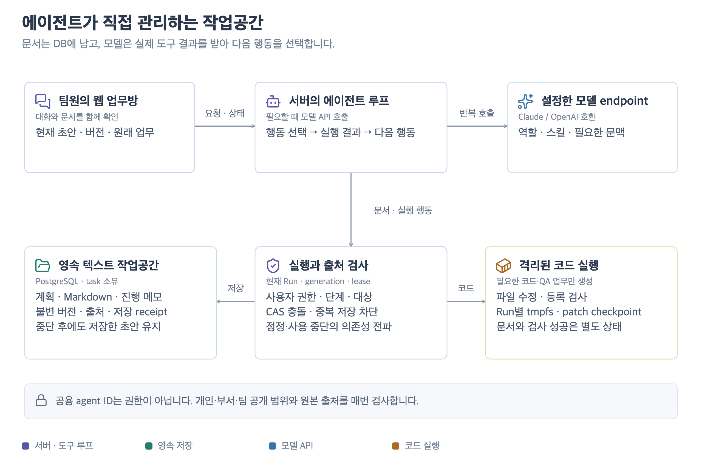

# 공용 에이전트의 협업·장기 운영 품질 · 0.14.1

2026-10-21. 공용 에이전트를 여러 사람이 이어서 사용하며 자료가 누적되는 경로를 점검했다. 비용 최적화와 모델 선택은 이번 변경 범위에 포함하지 않았다. 아래 자동 검사와 실제 모델의 판단 능력은 구분한다.

[](diagrams/agent-workspace.svg)

## 발견한 문제와 개선

| 상황 | 변경한 동작 | 확인 방법 |
| --- | --- | --- |
| 다른 업무의 문서가 많아 현재 초안이 목록 뒤로 밀림 | 모델의 기본 목록을 현재 업무로 한정. 다른 업무는 `scope:"project"`와 검색어로 조회 | 앞선 문서 400개 뒤의 현재 초안을 즉시 발견·조회·수정 |
| 대기·일시정지 업무의 책임자가 바뀜 | 종료가 확인된 옛 Run을 취소하고 새 요청자의 권한·지침으로 새 snapshot 생성 | 옛 요청자 비활성화 후 새 책임자가 실행·수용. 종료 미확인은 인계 거절 |
| 저장한 코드 patch를 새 실행에서 이어감 | 기억·문서·이전 실행의 출처를 새 요청자로 재검증하고 checkpoint와 함께 상속 | 현재 출처는 인계, 정정된 출처는 거절. legacy retry의 이전 실행도 추적 |
| 긴 문서 이력을 열 때 같은 출처를 반복 검사 | 같은 조회 transaction 안에서 동일 출처 집합을 한 번만 검증 | 문서별 32버전·버전 목록 30개 합성 부하 |
| 여러 사람이 문서를 동시에 조회 | HTTP GET은 공유 잠금, 변경·모델 도구는 배타 잠금. 잠금을 얻은 뒤 재인증 | 두 조회 동시 진행, 변경 대기, 대기 중 부서/계정 회수 즉시 반영 |
| 목록 20개 각각에서 출처·기록 쿼리 반복 | 권한·현재 출처를 LIMIT 전에 SQL로 검사하고 문서별 읽기 기록을 일괄 저장 | 목록 두 번 조회 시 관찰 기록만 누적. 중간 INSERT 실패는 전체 rollback |
| 모델이 문서를 읽지 않고 “읽었다”고 답함 | 성공한 도구 호출의 본문 조회 수·글자 수·저장 수를 별도 표시 | 본문만 가진 표식을 모델 입력에 넣지 않고 조회 0회 표시 확인 |
| 계획 A → 초안 B 후 A 수정으로 출처 충돌 | 실패를 모델에 반환하고 새 후속 문서 작성 안내 | 실제 JSON 행동 루프에서 충돌을 받아 새 문서로 복구. 실패 저장은 집계 제외 |

문서 목록을 읽은 것과 본문을 읽은 것은 다르다. 표시하는 글자 수는 도구가 반환한 문자열 길이의 합이며 중복 부분 읽기도 포함한다. 모델의 이해·기억·정확성을 보증하는 수치가 아니다. 이전 결과에는 새 계측값을 추정해 채우지 않는다.

## 합성 부하 측정

같은 로컬 PostgreSQL18·본문 512자 조건에서 문서 하나의 30개 이력 조회 p95는 변경 전 **28,068.5ms**, 변경 후 **1,088.0ms**였다. 변경 전 동시 부하 검사는 실패했고 변경 후 아래 경로를 모두 완료했다. 로컬의 다른 검사가 일부 겹친 짧은 측정이며 운영 서버의 속도 보장이나 일반 성능 향상률로 해석하지 않는다.

| 최종 측정 · 각 10회 | p50 | p95 |
| --- | ---: | ---: |
| 현재 문서 + 이력 30개 | 794.8ms | 1,088.0ms |
| 현재 업무 문서 20개 목록 | 2,523.9ms | 3,748.6ms |
| 모델 목록·문서별 출처 기록 + lease 갱신 | 5,316.8ms | 6,539.6ms |
| 8명 동시 본문 조회 + 갱신 + 다른 업무 claim | 2,904.5ms | 3,826.5ms |
| 본문 조회 4명 + 목록 4명 + 갱신 | 4,620.7ms | 4,934.8ms |

lease 갱신과 혼합 부하 갱신은 각각 10/10, 모델 목록의 출처 기록은 10/10, 두 합성 업무 완료는 2/2였다. 출처 정정 후 문서·파생 답변 재사용 거절과 버전 보존도 확인했다. [변경 전](evidence/0.14.1/workspace-before.json) · [최종 조건·소스 hash·검사 결과](evidence/0.14.1/workspace-scale.json).

100만 메시지·100,001개 업무의 별도 검사에서 최근 업무방 p95는 16.8ms, 8개 동시 업무방은 24.8ms였다. 과거 한국어 원문 검색은 1건을 반환했고 p95 1,782.0ms였다. 원문 검색·최근 자료 검색을 포함한 넓은 경로도 끝까지 실행했다. [최종 전체 측정](evidence/0.14.1/long-operation-scale.json) · [이전 조건](evidence/0.14.1/long-operation-before.json). 두 실행에서 일부 다른 로컬 검사가 겹쳤으므로 작은 지연 차이를 회귀나 일반 성능 향상률로 판정하지 않는다.

별도 종료 Run 100,000개에서 대기열 claim 두 번·만료 검사 p95는 13.4ms였다. 미확인 실패는 계속 슬롯을 점유하고, 전역·agent별 실행 한도를 유지했다. [쿼리 계획과 조건](evidence/0.14.1/runtime-scale.json).

쿼리 계획도 별도 격리 schema에서 비교했다. 종료 Run 100,000개 중 결과를 가진 Run 하나를 조회하는 조건에서 013은 Run 100,000개를 materialize했고, 014는 index로 필요한 Run 하나만 읽었다. 전체 반환 행·출처 배열·fingerprint는 같았다. 이 검사는 출력 3행의 작은 fixture와 조건별 EXPLAIN 1회이며, 대규모 출력 검색의 측정은 위 100만 메시지 검사와 구분한다. [SQL·전체 실행 계획·조건](evidence/0.14.1/recall-query-plans.json).

## 재현 명령

명시적으로 지정한 별도 테스트 PostgreSQL 안에서 매번 고유 schema를 생성하고 마지막에 제거한다. 운영 DB를 자동으로 선택하지 않는다. 모델 응답은 fixture/loopback이며 실제 Docker 검사와 별개다.

```bash
TEST_DATABASE_URL=postgres://crewroom@127.0.0.1:5448/crewroom TEST_RUNNER_DOCKER=1 npm run test:server
TEST_DATABASE_URL=postgres://crewroom@127.0.0.1:5448/crewroom npm run test:server:e2e
BENCHMARK_DATABASE_URL=postgres://crewroom@127.0.0.1:5448/crewroom npm run benchmark:workspace
BENCHMARK_DATABASE_URL=postgres://crewroom@127.0.0.1:5448/crewroom npm run benchmark:long-operation
```

작업공간 부하는 보관 문서 20,000개·각 8버전, 종료 Run 100,000개, 현재 문서 20개·각 32버전·출처 20개를 사용한다. 본문은 512자다. 단일 조회와 8명 동시 GET, GET/목록 혼합, 모델 목록의 출처 기록, lease 갱신·대기열 처리·두 업무 완료를 확인한다. 출처 정정 뒤 문서와 파생 결과가 재사용되지 않으며 32개 이력은 남는지도 별도로 검사한다.

각 동시 부하 직전에 lease를 직접 60초로 재설정하며, 마지막 보조 Run도 완료 전에 연장한다. 이는 유효한 lease 안의 경합·갱신·완료 검사다. 장시간 자연 heartbeat나 만료 후 자동 복구의 증거로 해석하지 않는다. 대기 시간은 API 지연에 포함하며 잠금 대기를 따로 계측하지 않았다.

100만 메시지·10만 업무의 긴 대화 검사는 원문·목록·과거 자료 검색을 확인한다. 한국어 기억 20문항 평가는 필요한 출처와 금지 자료의 부재를 확인한다. 이는 합성 자료의 검색 평가이며 생성 답변의 의미적 정답률이 아니다. [측정 원자료와 전체 검증](SERVER_VERIFICATION.md).

## 운영과 남은 확인

0.14.0에서 migration `014_recall_source_planning.sql`을 적용하고 App/Worker/Runner를 0.14.1로 함께 교체한다. 014는 읽기 전용 출처 CTE를 inline하도록 바꾸며 013의 모든 출력·출처 배열·fingerprint 계산식을 유지한다. 업그레이드 회귀에서 전체 recall 행과 저장된 참조의 동일성을 확인한다. DB 문서·버전·기존 patch를 유지한다. 변경 전에 암호화 백업을 만들고 [운영 절차](SERVER_OPERATIONS.md)에 따라 진단·복원을 확인한다. 새 외부 런타임 의존성은 없다.

잠금은 PostgreSQL transaction 공유/배타 advisory lock을 사용한다. HTTP 조회끼리는 함께 진행하지만 출처를 바꾸는 작업은 기다린다. 수십 명의 장기 부하나 큰 문서 전체를 연속 읽는 운영 SLO를 이 짧은 측정으로 보장하지 않는다. [PostgreSQL 공식 잠금 설명](https://www.postgresql.org/docs/current/functions-admin.html#FUNCTIONS-ADVISORY-LOCKS).

실제 모델 URL·ID가 설정되면 [답변 평가](ANSWER_EVALUATION.md)와 [시범 사용](PILOT_GUIDE.md)을 진행한다. 현재 문서의 임의 표식을 다음 실행에서 찾아 수정하는지, 팀원 인계 뒤에도 근거를 유지하는지, 모르는 사실을 추정하지 않는지 실제 응답으로 판정한다. 모델 미연결 상태에서 자율 업무 품질이나 CLI 세션과의 동등성을 판정하지 않는다.
