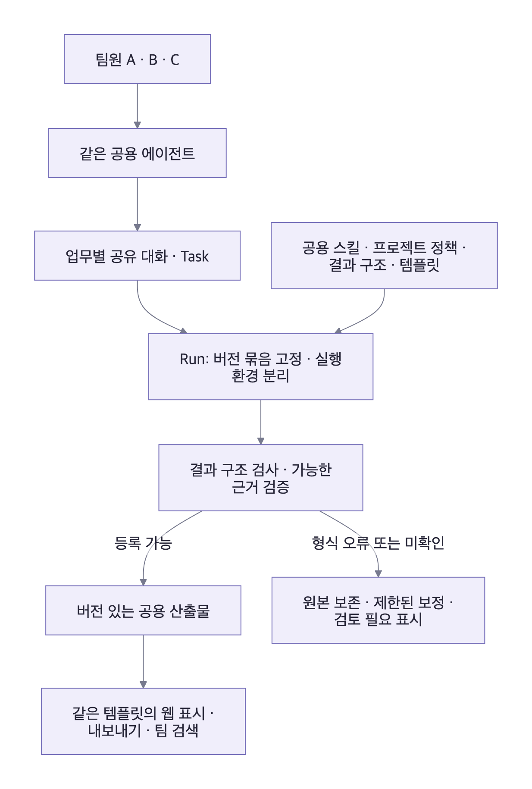

# 공용 에이전트 검토 · 흩어진 세션과 결과물 형식 통일

2026-10-16. 제품 과제: 팀원마다 스킬과 세션을 따로 사용해 맥락·결과 공유가 어렵고 결과물 형식도 달라진다. **같은 서버의 공용 에이전트로 업무 방식과 산출물 기준을 맞추는 것**이 목적이다. 검토 대상은 당시의 웹 프로토타입과 기획이다. 아래 파일·행 참조는 당시 검토 위치이며 현재 동작을 뜻하지 않는다.

문제 배경은 사용자 확인 사항이다. 아래 구현 방식과 운영 규칙은 이를 만족시키기 위한 제안이며, 현재 목업에 서버·모델·산출물 검증기를 구현했다는 뜻은 아니다.

## 결론

**공용 에이전트의 방향은 이 문제에 맞는다. 다만 서버에 실행기만 모아 놓아서는 결과물 통일과 맥락 공유가 완성되지 않는다.** 공용 스킬의 기준 버전, 업무별 공유 세션, 결과 형식 검증, 산출물 보관을 하나의 흐름으로 묶어야 한다.

같은 모델이나 같은 스킬을 사용해도 내용의 정확성과 반복 실행의 일관성은 별도 검증 대상이다. 형식 통일의 목표는 문구가 완전히 같은 답변을 만드는 것이 아니라, **필요한 정보와 근거를 같은 구조로 찾고 비교할 수 있게 하는 것**이다.

## 현재 코드에서 확인한 빈틈

| 확인한 사실 | 목적에 미치는 영향 | 근거 |
| --- | --- | --- |
| 스킬은 이름·설명·입력·완료 기준·단계 등의 샘플 데이터다. 결과 구조를 검증하는 스키마는 없다 | 같은 스킬의 실제 모델 결과가 같은 형식을 지킨다고 보장할 수 없음 | baseSkills (`src/data.js:1`, 당시 검토) |
| Run에는 스킬·설정 버전과 이름·완료 기준·단계·하네스의 일부 스냅샷이 있다 | 버전 표시의 기반은 있지만 불변 스킬 본문·결과 스키마·템플릿·실행 환경 전체를 재현하는 계약은 미완성 | createRunSnapshot (`src/domain.js:81`, 당시 검토) |
| 결과 화면은 조건별로 정해진 문자열을 표시한다 | 화면의 형식이 같아 보이는 것으로 실제 생성 결과의 표준 준수를 검증할 수 없음 | taskResult (`src/app.js:1352`, 당시 검토) |
| 기억 검색은 허용된 샘플을 키워드로 고르고 프로젝트·대상 버전별 검색 계약은 없다 | 서로 다른 프로젝트의 규칙이나 과거 결정이 잘못 재사용될 수 있음 | recallMemories (`src/app.js:235`, 당시 검토) |
| 서버 저장·실제 공유 세션·동시 사용은 미구현이다 | 같은 브라우저의 계정 전환만으로 팀 공동 사용을 증명할 수 없음 | [구현 경계](../README.md#구현-경계) |

## 우선 해결할 이슈

### 1. 공용 스킬에 결과물 계약을 포함한다

현재의 스킬 이름·설명에 더해 입력 조건, 실행 지침, 참조 자료, 결과 구조, 표시 템플릿, 검증 규칙, 예시 결과를 버전으로 묶는다. 서버가 게시된 버전을 선택하고 실행 작업자가 실제 적용한 버전을 확인한다. 개인별 로컬 파일이나 브라우저가 보내는 버전 문자열을 기준으로 삼지 않는다.

[Agent Skills 공식 명세](https://agentskills.io/specification)는 지침·스크립트·참조 자료·템플릿을 묶는 형식을 제공한다. 명세의 검증은 메타데이터·이름 규칙 등을 확인하며, 업무 산출물이 팀 형식을 지켰는지까지 판정하는 기능은 아니다. **크루룸의 결과 검증은 별도로 구현해야 한다는 것이 이 검토의 판단**이다. 하네스마다 지원 기능도 확인한다.

공용 에이전트의 역할·장착 스킬·업무 정책은 팀이 관리한다. 개인 비서의 말투·캐릭터나 개인 스킬을 바꾸어도 공용 업무의 필수 결과 형식을 우회하지 않게 한다. 공용 변경은 초안·시험 실행·게시·이전 버전 복구를 거치고, 이미 진행 중인 Run은 시작할 때의 버전을 유지한다.

### 2. 세션은 업무를 기준으로 함께 사용한다

공용 에이전트는 같은 Agent ID와 공통 스킬을 유지하고, **같은 업무의 세션에는 여러 팀원이 참여**한다. 서로 다른 업무는 별도 맥락과 실행 환경을 갖는다. 사용자가 접속했다는 이유만으로 개인 전용 세션을 새로 만들어 팀 맥락을 끊지 않는다.

예를 들어 로그인 수정 PR 검토 방에는 A와 B가 함께 참여해 같은 맥락을 이어간다. 결제 장애 조사는 같은 에이전트를 사용하더라도 별도 업무방에서 수행한다. 각 업무방의 대화·적용된 지시·산출물·대기 질문은 팀원이 찾아서 이어갈 수 있어야 한다.

실행기 네이티브 세션 ID는 서버가 업무에 연결해 저장한다. 작업 디렉터리의 가장 최근 세션을 추측해 재개하지 않는다. [공식 SDK의 세션 설명](https://code.claude.com/docs/en/agent-sdk/sessions)도 특정 세션의 재개와 기록이 갈라지는 fork를 구분한다. 이는 세션 매핑을 명시해야 한다는 근거이며, 크루룸의 실행기로 해당 SDK를 채택했다는 뜻은 아니다.

### 3. 동시 지시와 파일 변경의 적용 순서를 보장한다

같은 업무에 두 사람이 지시할 때 덮어쓰지 않고 메시지와 조작 순서를 남긴다. 실행 중 추가 지시는 `기록됨 / 다음 단계에 적용 / 범위 변경 확인 필요`처럼 접수 상태를 구분한다. 중단·재개·범위 변경을 누가 할지는 업무 정책으로 정한다.

독립 업무는 Run별 작업 사본·출력 경로를 분리한다. 공유 파일이나 코드의 최종 반영에는 기준 버전 확인과 충돌 처리를 적용한다. 다른 업무의 작업 디렉터리·임시 파일·세션을 덮어쓰지 않는다. 대기열과 동시 실행 한도를 보여 주고, 긴 작업이 다른 요청을 무기한 막지 않게 한다.

### 4. 결과는 공통 구조로 검증하고 같은 템플릿으로 보여 준다

일상 대화는 자연어로 유지한다. 업무 결과를 공식 산출물로 저장할 때 결과 구조를 검증하고, 버전이 정해진 템플릿으로 웹과 내보내기를 생성한다.

**팀 공통 항목 제안:** 요약, 대상·범위, 수행 내용, 검증 근거, 미확인·실패 항목, 다음 행동. 여기에 업무별 항목을 더한다.

| 업무 유형 | 추가로 필요한 항목 |
| --- | --- |
| PR 검토 | 저장소·기준 커밋, 발견 위치·중요도·설명, 실행한 검사와 미실행 검사 |
| QA | 대상 버전·환경, 시나리오, 재현 절차, 예상·실제 결과, 증거 |
| 운영 점검 | 서비스·관측 시간·환경, 이상 징후·근거, 대응안, 실제 변경 여부 |
| 회의 정리 | 결정 사항, 담당자별 할 일, 미결정 질문 |

모든 업무를 같은 내용의 보고서로 만들지 않는다. 같은 업무 유형의 필수 항목·상태·표시 순서가 사용자와 실행기에 관계없이 유지되는 것이 목표다.

지원하는 모델·하네스에는 구조화 출력을 사용하고 서버에서 다시 검사한다. 미지원 경로도 같은 검사에 통과해야 공식 산출물로 등록한다. [구조화 출력 공식 문서](https://platform.claude.com/docs/en/build-with-claude/structured-outputs)는 스키마 기반 출력을 설명하면서 거절·출력 잘림 같은 예외도 명시한다. 따라서 응답을 받았다는 사실만으로 성공 처리하지 않는다.

형식 검증과 내용 검증은 별도다. 필수 항목이 있어도 근거가 없거나 틀릴 수 있다. 테스트 통과를 주장하면 실제 실행 기록과 연결하고, 미확인 항목은 그대로 표시한다. 형식 보정 과정에서 없는 근거나 결과를 만들어 채우지 않는다. 제한된 보정 횟수를 넘으면 원본과 오류를 보관하고 검토가 필요한 초안으로 남긴다.

### 5. 산출물을 채팅에서 다시 찾을 수 있게 보관한다

산출물을 Task·Run·프로젝트·작성 에이전트·요청자·대상 버전에 연결해 서버에 보관한다. 같은 결과를 업무방, 에이전트 이력, 팀 검색에서 찾을 수 있어야 한다. 대화가 길어지거나 사용자 접속이 끊겨도 링크와 버전은 유지한다.

수정은 새 산출물 버전으로 남기고 이전 결과를 덮어쓰지 않는다. 초안·형식 검증·근거 확인·사용자 수용을 구분한다. 검색 결과의 최신 버전도 어떤 프로젝트·대상을 기준으로 한 것인지 표시한다.

### 6. 팀의 공통 기억과 프로젝트별 규칙을 구분한다

결과물 형식 같은 팀 공통 규칙, 프로젝트별 용어·환경·결정, 해당 업무의 진행 맥락을 나눠 읽는다. 공용 에이전트가 기억을 함께 쓰더라도 프로젝트 A의 지시가 프로젝트 B의 기준을 바꾸지 않아야 한다. 권한 필터와 함께 프로젝트·대상 버전·유효 시점을 확인한다.

자동 추출한 의견은 후보로 두고 출처를 남긴다. 개인 발언 하나로 공용 스킬이나 팀 공통 정책을 즉시 덮어쓰지 않는다. 정정한 규칙은 새 버전과 효력 시점을 기록하고, 과거 결과를 당시 기준으로 해석할 수 있게 한다.

### 7. 중앙 실행 환경의 접근 권한과 장애를 관리한다

팀은 공용 에이전트를 함께 쓰되 외부 서비스의 계정 권한은 연결 주체·도구·행동 범위별로 검사한다. 요청자·승인자·실제 사용한 연결을 기록한다. 접속 권한만으로 모든 저장소·운영 계정에 접근하게 만들지 않는다.

같은 서버를 쓰면 작업자 장애·도구 연결 만료·모델 한도가 팀 전체에 영향을 줄 수 있다. 우선 한 서버 안에서 영속 큐, 업무별 실행 한도, 정지·복구, 연결 상태와 관리자 개입 경로를 제공한다. 고가용성 클러스터나 여러 실행기를 처음부터 추가하는 것이 이번 제안의 전제는 아니다.

## 권장하는 최소 실행 계약

Run에는 공용 Agent·Task·대화·실행기 세션·요청자와 함께 **스킬 본문 버전/해시, 에이전트 설정 버전, 프로젝트 정책 버전, 결과 스키마 버전, 표시 템플릿 버전, 실행 모델·하네스 정보**를 기록하는 계약을 제안한다. 현재 목업의 Run에 이 필드가 모두 있다는 뜻은 아니다.

## 기존 개별 사용에서 옮길 때

- 먼저 실제 사용하는 스킬과 대표 결과물을 모아 업무 유형별 표준 한 벌을 고른다. 개인 취향의 차이와 프로젝트에 필요한 차이를 구분한다.
- 새 업무는 공용 서버에서 시작하고, 진행 중인 개별 세션은 지원되는 경우에만 가져온다. 기록 가져오기와 실행기 네이티브 세션 재개는 구분한다. 이관으로 같은 외부 작업을 다시 실행하지 않는다.
- 개인 로컬 경로·개인 계정·환경 변수에 의존한 스크립트를 서버 환경에서 시험한다. 자격증명은 스킬 본문에 옮기지 않는다.
- 대표 업무 유형의 입력 양식과 결과 예시를 제공해 팀원이 스킬 이름·프롬프트·세션 설정을 직접 조합하지 않아도 요청할 수 있게 한다.

## 이 목적에 맞는 통과 기준

| 장면 | 통과 기준 |
| --- | --- |
| A와 B가 같은 스킬로 같은 유형의 업무 요청 | 필수 항목·버전·표시 형식이 같음. 업무 내용 자체의 차이는 허용 |
| 결과 형식을 무시하라는 추가 요청 | 일상 대화는 가능하지만 공식 결과는 필수 구조를 유지하거나 초안으로 구분 |
| A가 시작한 업무를 B가 이어가기 | 같은 대화·적용 지시·검증 기록·산출물을 확인하고 인수 이력이 남음 |
| 같은 공용 에이전트에 별개 업무 동시 요청 | 맥락·파일이 섞이지 않고 공통 스킬과 허용된 공용 기억만 공유 |
| 스킬 게시 또는 하네스 변경 | 새 Run에만 적용하고 실제 적용 버전을 기록. 미지원이면 명확한 실패·대안 안내 |
| 결과 형식 오류·응답 잘림·근거 없는 통과 주장 | 완료 산출물로 오인시키지 않고 원본·오류·미확인을 보관 |
| 웹 종료와 서버 작업자 재시작 | 업무·산출물·스킬 버전이 유지되고 중복 외부 작업 없이 복구 |
| 기존 방식과 비교 | 결과 재작성 시간, 다른 사람의 업무를 이어받는 시간, 결과 검색 성공, 반복 사용을 실제 팀에서 측정 |

이번 검토는 기획·현재 코드·공식 명세를 확인한 결과다. 실제 모델·서버를 이용한 형식 준수율·팀 생산성·동시 실행 성능은 아직 측정하지 않았다. 초기 검증은 팀에서 자주 쓰는 업무 유형부터 진행하고, 형식이 같아졌다는 이유만으로 내용 품질이 검증됐다고 판단하지 않는다.
