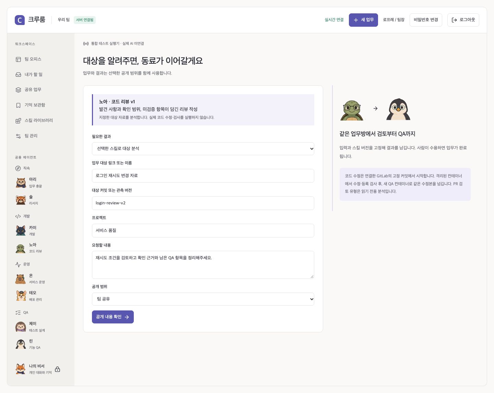
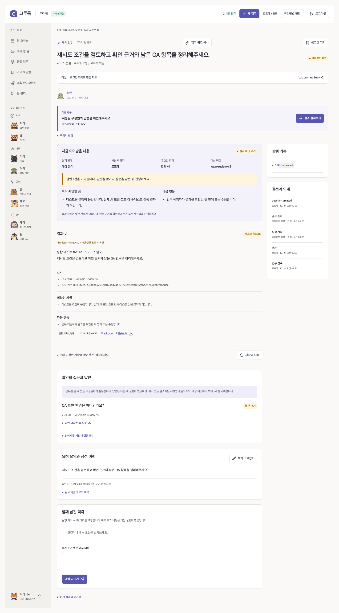
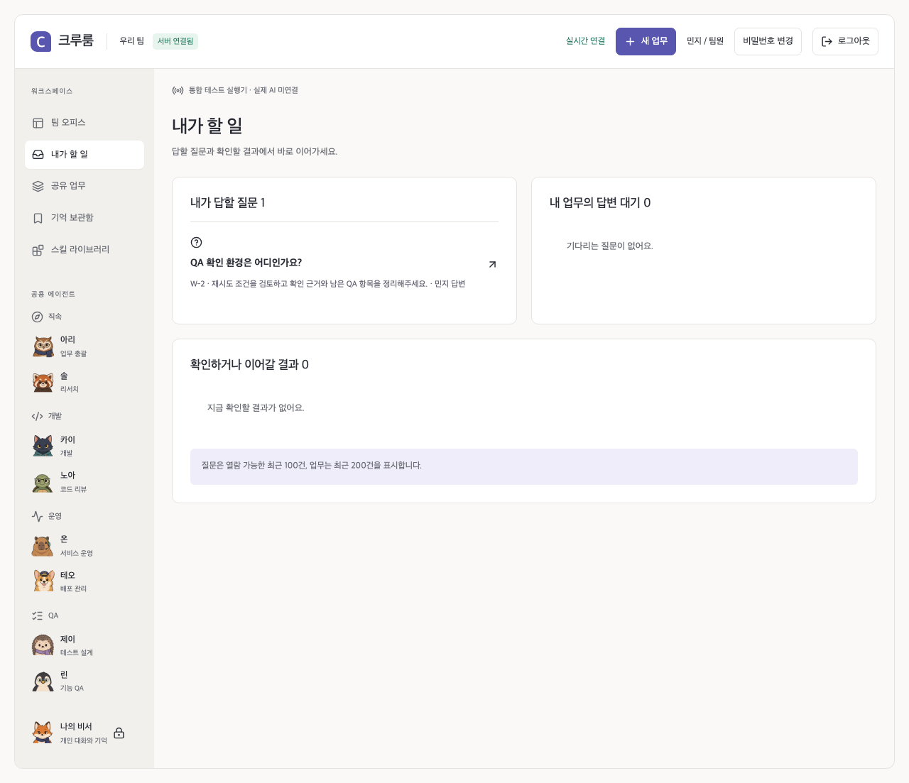
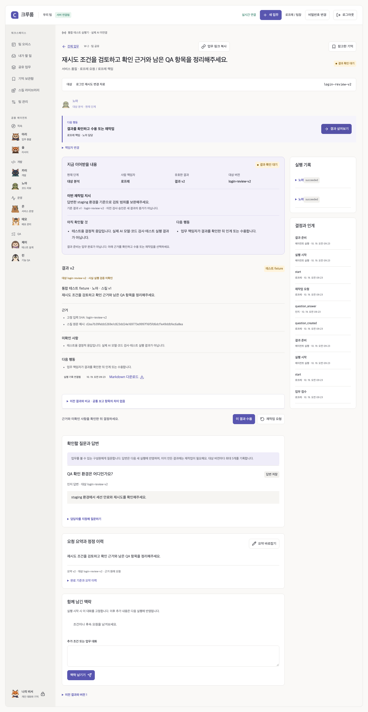

# 0.10 · 요청에서 답변·재작업까지

2026-10-19. 같은 공용 에이전트와 업무방을 함께 쓰면서 **누가 무엇을 답해야 하고, 새 지시가 어느 실행에 반영됐는지** 확인하도록 개선했다. 새 서비스나 실행 프레임워크를 추가하지 않고 기존 App·PostgreSQL·Worker·Runner 안에서 구현했다.

## 스킬을 누르면 맞는 요청으로 이어진다

| 선택한 스킬                                   | 요청 경로      | 실행 계약                                                      |
| --------------------------------------------- | -------------- | -------------------------------------------------------------- |
| 기본 대화·사용자 정의 대화 스킬               | 업무 대화      | 이전 답변을 이어받는 대화                                      |
| 코드 리뷰·QA 계획·운영 분석 등 기본 분석 스킬 | 대상 기반 분석 | 대상·버전·프로젝트·공개 범위, 선택한 에이전트와 적용 스킬 고정 |
| 코드 수정                                     | 개발·독립 QA   | 등록 저장소의 고정 SHA, 실제 Docker 검사, 같은 patch의 별도 QA |
| 코드 검증                                     | 기존 업무 찾기 | 검증할 개발 결과를 기존 업무에서 인계받음                      |

스킬 바로 요청이 모든 요청을 일반 대화로 바꾸던 경로를 없앴다. 완료 기준은 최신 게시본이 아니라 **동료에게 적용한 스킬 버전**에서 읽는다. 요청을 입력하는 동안 선택한 에이전트·스킬이 유지되며, 수용한 분석 결과를 재사용해도 같은 선택을 이어받는다. 사용자 정의 스킬에 임의 도구 권한을 부여하지 않으며 기존 대화 경로를 유지한다.

## 결과를 읽고 다음 행동을 결정한다

업무방은 현재 단계·대상 버전에 맞는 결과를 대화보다 먼저 보여준다. 인계 카드에는 DB의 책임자·단계·유효 결과·대상 버전과 결과의 미확인 사항·다음 행동을 표시한다. 상단의 결과 보기 버튼으로 이동하고, 근거와 비교를 읽은 뒤 수용·인계·재작업을 선택한다.

이전 결과는 접힌 이력에서 볼 수 있다. 비교 대상은 **같은 단계의 이전 버전**이며 다른 단계의 결과와 섞지 않는다. 네 필드의 텍스트 변경 개수와 전후 요약은 차이를 찾는 보조 정보다. 요구사항 충족, 검사 통과, 내용의 정확성을 자동 판정한 점수는 아니다. 현재 대상과 다른 결과를 유효한 최신 결과로 표시하거나 수용하지 않는다.

## 질문을 맡길 사람과 답변 상태를 남긴다

책임자가 업무방에서 질문과 답할 구성원을 지정한다. 지정받은 사람의 **내가 할 일**에 질문이 나타나고 해당 업무방에서 답한다. 질문·답변은 같은 Task의 공개 범위를 그대로 따른다. 팀장에게 개인 업무의 열람권을 추가하지 않는다.

- 질문은 현재 대상 버전에 연결한다. 버전당 최대 5건이며 질문 500자·답변 1,000자다. 닫힌 질문도 한도에 포함해 모델 입력의 크기를 제한한다.
- 실행 전의 미고정 대기 상태 또는 종료가 확인된 실패·결과 상태에서만 질문한다. 진행 중이거나 일시정지한 Run의 입력은 수정하지 않는다.
- 미답변 질문이 있으면 시작·QA 인계·수용을 막는다. 책임자는 닫거나 열람 가능한 활성 구성원에게 재배정할 수 있다.
- 답변은 지정된 사람만 한 번 저장한다. 계정 비활성·소속 변경 뒤 열람권을 잃은 사람은 답할 수 없다. 답변을 저장해도 실행은 자동 시작하지 않는다.
- 결과 뒤 답변이 추가되면 그 결과는 새 답변을 반영하지 않은 상태다. 책임자가 **재작업 → 새 실행**을 시작해야 한다. 옛 결과를 그대로 수용하거나 QA로 넘길 수 없다.
- 대상 버전이 바뀌면 이전 질문·답변은 이력으로 보존하고 새 대상의 입력에서는 제외한다. 취소하면 미답변 질문을 닫는다.

현재는 사람이 수동으로 묻고 답하는 기능이다. 모델이 부족한 입력을 판단해 자동으로 질문하거나 사람의 답을 기다리며 자율 재개하는 기능은 포함하지 않았다. 목록은 열람 가능한 최근 업무 최대 200건·미답변 질문 최대 100건이며 전체를 무제한 집계한 목록은 아니다.

## 재작업 지시가 모델 입력에 남는다

기존에는 이유가 이벤트 이력에만 남고 다음 모델 입력에서 빠질 수 있었다. 이제 Task에 별도 재작업 문맥을 저장하고 새 Run의 불변 snapshot에 넣는다. 대화가 최근 20개 범위를 넘어가거나 요청 요약을 정정해도 재작업 지시는 유지한다.

| 저장 위치                    | 내용과 경계                                                                                  |
| ---------------------------- | -------------------------------------------------------------------------------------------- |
| `cr_tasks.rework`            | 이번 지시·새 대상 버전·요청자·시각, 서버가 고른 같은 단계의 기준 결과 참조                   |
| 기준 결과                    | Artifact ID·대상 버전·hash·출처·최대 6,000자 요약. 중첩된 과거 snapshot을 계속 복제하지 않음 |
| `cr_tasks.question_revision` | 새 답변 때 증가. 결과를 만든 Run의 값과 비교해 반영 여부 확인                                |
| `cr_questions`               | Task·대상·질문자·답변 담당·상태·답변·낙관적 revision·시각                                    |
| 새 Run snapshot              | 재작업 지시와 현재 대상의 저장된 답변·답변 revision을 고정                                   |
| 모델 발송                    | 읽기 전용 provider와 native 코드 실행의 최초 입력에 모두 포함                                |

이전 patch나 요약을 참고해도 **이전 검사·QA·사람 수용은 새 결과의 증거가 아니다.** 새 실행과 실제 검사를 수행해야 한다. 일시정지는 이미 저장한 입력을 재개하며 새 질문·지시 반영은 새 Run을 준비하는 명시적 경로를 따른다.

Migration 008은 실제 저장된 재작업 이벤트가 있는 Task에만 이유를 복원한다. 기록에 없는 지시·검사·승인을 만들어 내지 않으며 과거 Run snapshot은 수정하지 않는다. 업그레이드 전 암호화 백업을 권장한다. 이전 릴리스로 돌아갈 때는 새 schema를 옛 코드로 실행하기보다 업그레이드 전 백업을 별도 환경에 복원하는 운영 절차를 따른다.

모든 화면은 격리된 실제 App·PostgreSQL·Worker와 결정적 모델 fixture로 캡처했다. 외부 모델 추론이나 실제 구성원의 업무 효과를 입증하지 않는다. [캡처 지문](media/handoff/manifest.json)

## 리뷰와 남은 검증

Astra 독립 구현 리뷰에서 두 문제를 찾아 수정했다. native 코드 실행의 별도 모델 입력 경로에도 지시·답변을 전달하고, 수용된 분석 결과 재사용 시 에이전트·스킬 선택을 유지한다. 실제 loopback Claude 요청 본문과 Docker 개발·독립 QA, 두 계정 브라우저 회귀로 검증한다. [검사·복원·독립 리뷰 기록](SERVER_VERIFICATION.md) · [검토 파일 지문](evidence/0.10/reviewed-files.json)

다음 우선순위는 실제 endpoint로 작은 업무를 수행하는 것이다. 역할별 결과 스키마, 모델의 자동 질문, 스킬 변경 전후 비교·반복 정정의 스킬 개선 제안, 동일 대상의 중복 업무 후보, 고급 큐·담당 분산은 후속 후보로 남긴다. 실제 사용자와 모델 검증 없이 효용이나 안정 버전 완료로 판단하지 않는다. [마일스톤](MILESTONES.md)
